# CmpLoadLayerVersion

- RVA: `0x007E6A74`–`0x007E6EBC` (길이 `1,096` bytes)
- VA: `0x00000001407E6A74`
- 실행 섹션: `PAGE`
- PDB 이름 있음: `예`; PDB Function 태그: `아니요`
- unwind 정보 RVA: `0x000C38F4`
- 디코드: `289`개 명령, `1,096/1,096` bytes 표시
- 미해석 바이트: `0` (있으면 어셈블리에 `.byte`로 보존)

> 이 문서는 커널 이미지의 기계어와 PDB 기호를 분석해 생성했습니다. 4번과 5번은 함수 원형과 자료형을 바이너리 사용 방식에서 추정한 C 해석이며 원본 소스 복구 결과는 아닙니다.

## 1. Dependencies

- 직접 호출 지점: **18**; 고유 호출 대상: **7**
- 직접 호출자로 확인된 함수: **1**
- RIP 상대 이미지 참조: **12**

### Outgoing calls
- `0x007E6AB5` → [memset](../../text/6C/memset_function_006C6C40.md) (function, `0x006C6C40`)
- `0x007E6AFA` → [ZwOpenKey](../../text/6A/ZwOpenKey_function_006AD310.md) (function, `0x006AD310`)
- `0x007E6B25` → [memset](../../text/6C/memset_function_006C6C40.md) (function, `0x006C6C40`)
- `0x007E6B36` → [memcpy](../../text/6C/memcpy_function_006C6840.md) (function, `0x006C6840`)
- `0x007E6B49` → [CmpQueryLayerVersionUlong](CmpQueryLayerVersionUlong_function_007E75B4.md) (function, `0x007E75B4`)
- `0x007E6B86` → [CmpQueryLayerVersionUlong](CmpQueryLayerVersionUlong_function_007E75B4.md) (function, `0x007E75B4`)
- `0x007E6BBE` → [CmpQueryLayerVersionUlong](CmpQueryLayerVersionUlong_function_007E75B4.md) (function, `0x007E75B4`)
- `0x007E6BFD` → [CmpQueryLayerVersionUlong](CmpQueryLayerVersionUlong_function_007E75B4.md) (function, `0x007E75B4`)
- `0x007E6C47` → [CmpQueryLayerVersionString](CmpQueryLayerVersionString_function_007E7480.md) (function, `0x007E7480`)
- `0x007E6C99` → [CmpQueryLayerVersionString](CmpQueryLayerVersionString_function_007E7480.md) (function, `0x007E7480`)
- `0x007E6CEB` → [CmpQueryLayerVersionString](CmpQueryLayerVersionString_function_007E7480.md) (function, `0x007E7480`)
- `0x007E6D3D` → [CmpQueryLayerVersionString](CmpQueryLayerVersionString_function_007E7480.md) (function, `0x007E7480`)
- `0x007E6D92` → [CmpQueryLayerVersionString](CmpQueryLayerVersionString_function_007E7480.md) (function, `0x007E7480`)
- `0x007E6DFE` → [RtlUnicodeStringToAnsiString](../90/RtlUnicodeStringToAnsiString_function_0090D1F0.md) (function, `0x0090D1F0`)
- `0x007E6E18` → [CmpQueryLayerVersionUlong](CmpQueryLayerVersionUlong_function_007E75B4.md) (function, `0x007E75B4`)
- `0x007E6E4A` → [CmpQueryLayerVersionUlong](CmpQueryLayerVersionUlong_function_007E75B4.md) (function, `0x007E75B4`)
- `0x007E6E7F` → [CmpQueryLayerVersionUlong](CmpQueryLayerVersionUlong_function_007E75B4.md) (function, `0x007E75B4`)
- `0x007E6E94` → [ZwClose](../../text/6A/ZwClose_function_006AD2B0.md) (function, `0x006AD2B0`)

### Direct callers
- [CmpLoadLayerVersions](CmpLoadLayerVersions_function_007E6EC4.md) at `0x007E7009`

### Static image references
- `0x007E6B3F` → RVA `0x00B09730` (` ?? ::NNGAKEGL::`string'`; read)
- `0x007E6B7F` → RVA `0x00B09750` (` ?? ::NNGAKEGL::`string'`; read)
- `0x007E6BB3` → RVA `0x00B096F0` (` ?? ::NNGAKEGL::`string'`; read)
- `0x007E6BF6` → RVA `0x00B09710` (` ?? ::NNGAKEGL::`string'`; read)
- `0x007E6C3C` → RVA `0x00B096B0` (` ?? ::NNGAKEGL::`string'`; read)
- `0x007E6C8E` → RVA `0x00B096D0` (` ?? ::NNGAKEGL::`string'`; read)
- `0x007E6CE0` → RVA `0x00B09670` (` ?? ::NNGAKEGL::`string'`; read)
- `0x007E6D32` → RVA `0x00B09690` (` ?? ::NNGAKEGL::`string'`; read)
- `0x007E6D8B` → RVA `0x00B09630` (` ?? ::NNGAKEGL::`string'`; read)
- `0x007E6E0D` → RVA `0x00B09650` (` ?? ::NNGAKEGL::`string'`; read)
- `0x007E6E2F` → RVA `0x00B095F0` (` ?? ::NNGAKEGL::`string'`; read)
- `0x007E6E65` → RVA `0x00B09610` (` ?? ::NNGAKEGL::`string'`; read)

## 2. Other-region calls and transfers

- 다른 실행 섹션으로 향하는 call: **5**
  - `0x007E6AB5` → [memset](../../text/6C/memset_function_006C6C40.md) (`PAGE` → `.text`)
  - `0x007E6AFA` → [ZwOpenKey](../../text/6A/ZwOpenKey_function_006AD310.md) (`PAGE` → `.text`)
  - `0x007E6B25` → [memset](../../text/6C/memset_function_006C6C40.md) (`PAGE` → `.text`)
  - `0x007E6B36` → [memcpy](../../text/6C/memcpy_function_006C6840.md) (`PAGE` → `.text`)
  - `0x007E6E94` → [ZwClose](../../text/6A/ZwClose_function_006AD2B0.md) (`PAGE` → `.text`)
- 별도 외부 분기/꼬리 이동을 확인하지 못했습니다.

## 3. Assembly (complete function range)

```asm
007E6A74  48 89 5C 24 08                  mov qword ptr [rsp + 8], rbx
007E6A79  48 89 74 24 10                  mov qword ptr [rsp + 0x10], rsi
007E6A7E  55                              push rbp
007E6A7F  57                              push rdi
007E6A80  41 54                           push r12
007E6A82  41 56                           push r14
007E6A84  41 57                           push r15
007E6A86  48 8B EC                        mov rbp, rsp
007E6A89  48 83 EC 70                     sub rsp, 0x70
007E6A8D  33 DB                           xor ebx, ebx
007E6A8F  41 8B F1                        mov esi, r9d
007E6A92  4D 8B F0                        mov r14, r8
007E6A95  89 5D D4                        mov dword ptr [rbp - 0x2c], ebx
007E6A98  4C 8B FA                        mov r15, rdx
007E6A9B  89 5D EC                        mov dword ptr [rbp - 0x14], ebx
007E6A9E  33 D2                           xor edx, edx
007E6AA0  48 89 5D 40                     mov qword ptr [rbp + 0x40], rbx
007E6AA4  41 B8 28 03 00 00               mov r8d, 0x328
007E6AAA  89 5D C4                        mov dword ptr [rbp - 0x3c], ebx
007E6AAD  F7 D6                           not esi
007E6AAF  89 5D 48                        mov dword ptr [rbp + 0x48], ebx
007E6AB2  48 8B F9                        mov rdi, rcx
007E6AB5  E8 86 01 EE FF                  call 0x1406c6c40
007E6ABA  66 41 83 3E 7E                  cmp word ptr [r14], 0x7e
007E6ABF  76 0A                           jbe 0x1407e6acb
007E6AC1  B8 06 01 00 C0                  mov eax, 0xc0000106
007E6AC6  E9 D7 03 00 00                  jmp 0x1407e6ea2
007E6ACB  4C 89 7D D8                     mov qword ptr [rbp - 0x28], r15
007E6ACF  4C 8D 45 D0                     lea r8, [rbp - 0x30]
007E6AD3  0F 57 C0                        xorps xmm0, xmm0
007E6AD6  C7 45 D0 30 00 00 00            mov dword ptr [rbp - 0x30], 0x30
007E6ADD  41 BF 01 00 00 00               mov r15d, 1
007E6AE3  C7 45 E8 40 02 00 00            mov dword ptr [rbp - 0x18], 0x240
007E6AEA  41 8B D7                        mov edx, r15d
007E6AED  4C 89 75 E0                     mov qword ptr [rbp - 0x20], r14
007E6AF1  48 8D 4D 40                     lea rcx, [rbp + 0x40]
007E6AF5  F3 0F 7F 45 F0                  movdqu xmmword ptr [rbp - 0x10], xmm0
007E6AFA  E8 11 68 EC FF                  call 0x1406ad310
007E6AFF  85 C0                           test eax, eax
007E6B01  0F 88 9B 03 00 00               js 0x1407e6ea2
007E6B07  41 0F B7 06                     movzx eax, word ptr [r14]
007E6B0B  45 8D 67 7F                     lea r12d, [r15 + 0x7f]
007E6B0F  48 8D 4F 70                     lea rcx, [rdi + 0x70]
007E6B13  66 89 47 10                     mov word ptr [rdi + 0x10], ax
007E6B17  45 8B C4                        mov r8d, r12d
007E6B1A  66 44 89 67 12                  mov word ptr [rdi + 0x12], r12w
007E6B1F  33 D2                           xor edx, edx
007E6B21  48 89 4F 18                     mov qword ptr [rdi + 0x18], rcx
007E6B25  E8 16 01 EE FF                  call 0x1406c6c40
007E6B2A  45 0F B7 06                     movzx r8d, word ptr [r14]
007E6B2E  49 8B 56 08                     mov rdx, qword ptr [r14 + 8]
007E6B32  48 8B 4F 18                     mov rcx, qword ptr [rdi + 0x18]
007E6B36  E8 05 FD ED FF                  call 0x1406c6840
007E6B3B  4C 8B 45 40                     mov r8, qword ptr [rbp + 0x40]
007E6B3F  48 8D 15 EA 2B 32 00            lea rdx, [rip + 0x322bea]
007E6B46  48 8B CF                        mov rcx, rdi
007E6B49  E8 66 0A 00 00                  call 0x1407e75b4
007E6B4E  85 C0                           test eax, eax
007E6B50  78 08                           js 0x1407e6b5a
007E6B52  41 8D 4F 07                     lea ecx, [r15 + 7]
007E6B56  39 1F                           cmp dword ptr [rdi], ebx
007E6B58  75 02                           jne 0x1407e6b5c
007E6B5A  8B CB                           mov ecx, ebx
007E6B5C  8B 87 20 03 00 00               mov eax, dword ptr [rdi + 0x320]
007E6B62  83 E0 F7                        and eax, 0xfffffff7
007E6B65  0B C1                           or eax, ecx
007E6B67  89 87 20 03 00 00               mov dword ptr [rdi + 0x320], eax
007E6B6D  0B C6                           or eax, esi
007E6B6F  A8 08                           test al, 8
007E6B71  0F 84 26 03 00 00               je 0x1407e6e9d
007E6B77  4C 8B 45 40                     mov r8, qword ptr [rbp + 0x40]
007E6B7B  48 8D 4F 04                     lea rcx, [rdi + 4]
007E6B7F  48 8D 15 CA 2B 32 00            lea rdx, [rip + 0x322bca]
007E6B86  E8 29 0A 00 00                  call 0x1407e75b4
007E6B8B  8B 8F 20 03 00 00               mov ecx, dword ptr [rdi + 0x320]
007E6B91  F7 D0                           not eax
007E6B93  83 E1 EF                        and ecx, 0xffffffef
007E6B96  C1 E8 1B                        shr eax, 0x1b
007E6B99  83 E0 10                        and eax, 0x10
007E6B9C  0B C8                           or ecx, eax
007E6B9E  89 8F 20 03 00 00               mov dword ptr [rdi + 0x320], ecx
007E6BA4  0B CE                           or ecx, esi
007E6BA6  F6 C1 10                        test cl, 0x10
007E6BA9  0F 84 EE 02 00 00               je 0x1407e6e9d
007E6BAF  4C 8B 45 40                     mov r8, qword ptr [rbp + 0x40]
007E6BB3  48 8D 15 36 2B 32 00            lea rdx, [rip + 0x322b36]
007E6BBA  48 8D 4F 08                     lea rcx, [rdi + 8]
007E6BBE  E8 F1 09 00 00                  call 0x1407e75b4
007E6BC3  85 C0                           test eax, eax
007E6BC5  78 0A                           js 0x1407e6bd1
007E6BC7  B9 20 00 00 00                  mov ecx, 0x20
007E6BCC  39 5F 08                        cmp dword ptr [rdi + 8], ebx
007E6BCF  75 02                           jne 0x1407e6bd3
007E6BD1  8B CB                           mov ecx, ebx
007E6BD3  8B 87 20 03 00 00               mov eax, dword ptr [rdi + 0x320]
007E6BD9  83 E0 DF                        and eax, 0xffffffdf
007E6BDC  0B C1                           or eax, ecx
007E6BDE  89 87 20 03 00 00               mov dword ptr [rdi + 0x320], eax
007E6BE4  0B C6                           or eax, esi
007E6BE6  A8 20                           test al, 0x20
007E6BE8  0F 84 AF 02 00 00               je 0x1407e6e9d
007E6BEE  4C 8B 45 40                     mov r8, qword ptr [rbp + 0x40]
007E6BF2  48 8D 4F 0C                     lea rcx, [rdi + 0xc]
007E6BF6  48 8D 15 13 2B 32 00            lea rdx, [rip + 0x322b13]
007E6BFD  E8 B2 09 00 00                  call 0x1407e75b4
007E6C02  8B 8F 20 03 00 00               mov ecx, dword ptr [rdi + 0x320]
007E6C08  F7 D0                           not eax
007E6C0A  83 E1 BF                        and ecx, 0xffffffbf
007E6C0D  C1 E8 19                        shr eax, 0x19
007E6C10  83 E0 40                        and eax, 0x40
007E6C13  0B C8                           or ecx, eax
007E6C15  89 8F 20 03 00 00               mov dword ptr [rdi + 0x320], ecx
007E6C1B  0B CE                           or ecx, esi
007E6C1D  F6 C1 40                        test cl, 0x40
007E6C20  0F 84 77 02 00 00               je 0x1407e6e9d
007E6C26  48 8B 45 40                     mov rax, qword ptr [rbp + 0x40]
007E6C2A  48 8D 97 F0 00 00 00            lea rdx, [rdi + 0xf0]
007E6C31  41 B8 1A 00 00 00               mov r8d, 0x1a
007E6C37  48 89 44 24 20                  mov qword ptr [rsp + 0x20], rax
007E6C3C  4C 8D 0D 6D 2A 32 00            lea r9, [rip + 0x322a6d]
007E6C43  48 8D 4F 20                     lea rcx, [rdi + 0x20]
007E6C47  E8 34 08 00 00                  call 0x1407e7480
007E6C4C  85 C0                           test eax, eax
007E6C4E  78 09                           js 0x1407e6c59
007E6C50  41 8B CC                        mov ecx, r12d
007E6C53  66 39 5F 20                     cmp word ptr [rdi + 0x20], bx
007E6C57  77 02                           ja 0x1407e6c5b
007E6C59  8B CB                           mov ecx, ebx
007E6C5B  8B 87 20 03 00 00               mov eax, dword ptr [rdi + 0x320]
007E6C61  0F BA F0 07                     btr eax, 7
007E6C65  0B C1                           or eax, ecx
007E6C67  89 87 20 03 00 00               mov dword ptr [rdi + 0x320], eax
007E6C6D  0B C6                           or eax, esi
007E6C6F  41 84 C4                        test r12b, al
007E6C72  0F 84 25 02 00 00               je 0x1407e6e9d
007E6C78  48 8B 45 40                     mov rax, qword ptr [rbp + 0x40]
007E6C7C  48 8D 97 0A 01 00 00            lea rdx, [rdi + 0x10a]
007E6C83  41 B8 10 00 00 00               mov r8d, 0x10
007E6C89  48 89 44 24 20                  mov qword ptr [rsp + 0x20], rax
007E6C8E  4C 8D 0D 3B 2A 32 00            lea r9, [rip + 0x322a3b]
007E6C95  48 8D 4F 30                     lea rcx, [rdi + 0x30]
007E6C99  E8 E2 07 00 00                  call 0x1407e7480
007E6C9E  BA 00 01 00 00                  mov edx, 0x100
007E6CA3  85 C0                           test eax, eax
007E6CA5  78 08                           js 0x1407e6caf
007E6CA7  8B CA                           mov ecx, edx
007E6CA9  66 39 5F 30                     cmp word ptr [rdi + 0x30], bx
007E6CAD  77 02                           ja 0x1407e6cb1
007E6CAF  8B CB                           mov ecx, ebx
007E6CB1  8B 87 20 03 00 00               mov eax, dword ptr [rdi + 0x320]
007E6CB7  0F BA F0 08                     btr eax, 8
007E6CBB  0B C1                           or eax, ecx
007E6CBD  89 87 20 03 00 00               mov dword ptr [rdi + 0x320], eax
007E6CC3  0B C6                           or eax, esi
007E6CC5  85 C2                           test edx, eax
007E6CC7  0F 84 D0 01 00 00               je 0x1407e6e9d
007E6CCD  48 8B 45 40                     mov rax, qword ptr [rbp + 0x40]
007E6CD1  48 8D 97 1A 01 00 00            lea rdx, [rdi + 0x11a]
007E6CD8  45 8B C4                        mov r8d, r12d
007E6CDB  48 89 44 24 20                  mov qword ptr [rsp + 0x20], rax
007E6CE0  4C 8D 0D 89 29 32 00            lea r9, [rip + 0x322989]
007E6CE7  48 8D 4F 40                     lea rcx, [rdi + 0x40]
007E6CEB  E8 90 07 00 00                  call 0x1407e7480
007E6CF0  BA 00 02 00 00                  mov edx, 0x200
007E6CF5  85 C0                           test eax, eax
007E6CF7  78 08                           js 0x1407e6d01
007E6CF9  8B CA                           mov ecx, edx
007E6CFB  66 39 5F 40                     cmp word ptr [rdi + 0x40], bx
007E6CFF  77 02                           ja 0x1407e6d03
007E6D01  8B CB                           mov ecx, ebx
007E6D03  8B 87 20 03 00 00               mov eax, dword ptr [rdi + 0x320]
007E6D09  0F BA F0 09                     btr eax, 9
007E6D0D  0B C1                           or eax, ecx
007E6D0F  89 87 20 03 00 00               mov dword ptr [rdi + 0x320], eax
007E6D15  0B C6                           or eax, esi
007E6D17  85 C2                           test edx, eax
007E6D19  0F 84 7E 01 00 00               je 0x1407e6e9d
007E6D1F  48 8B 45 40                     mov rax, qword ptr [rbp + 0x40]
007E6D23  48 8D 97 9A 01 00 00            lea rdx, [rdi + 0x19a]
007E6D2A  45 8B C4                        mov r8d, r12d
007E6D2D  48 89 44 24 20                  mov qword ptr [rsp + 0x20], rax
007E6D32  4C 8D 0D 57 29 32 00            lea r9, [rip + 0x322957]
007E6D39  48 8D 4F 50                     lea rcx, [rdi + 0x50]
007E6D3D  E8 3E 07 00 00                  call 0x1407e7480
007E6D42  BA 00 04 00 00                  mov edx, 0x400
007E6D47  85 C0                           test eax, eax
007E6D49  78 08                           js 0x1407e6d53
007E6D4B  8B CA                           mov ecx, edx
007E6D4D  66 39 5F 50                     cmp word ptr [rdi + 0x50], bx
007E6D51  77 02                           ja 0x1407e6d55
007E6D53  8B CB                           mov ecx, ebx
007E6D55  8B 87 20 03 00 00               mov eax, dword ptr [rdi + 0x320]
007E6D5B  0F BA F0 0A                     btr eax, 0xa
007E6D5F  0B C1                           or eax, ecx
007E6D61  89 87 20 03 00 00               mov dword ptr [rdi + 0x320], eax
007E6D67  0B C6                           or eax, esi
007E6D69  85 C2                           test edx, eax
007E6D6B  0F 84 2C 01 00 00               je 0x1407e6e9d
007E6D71  48 8B 45 40                     mov rax, qword ptr [rbp + 0x40]
007E6D75  4C 8D 77 60                     lea r14, [rdi + 0x60]
007E6D79  49 8B CE                        mov rcx, r14
007E6D7C  48 89 44 24 20                  mov qword ptr [rsp + 0x20], rax
007E6D81  45 8B C4                        mov r8d, r12d
007E6D84  48 8D 97 1A 02 00 00            lea rdx, [rdi + 0x21a]
007E6D8B  4C 8D 0D 9E 28 32 00            lea r9, [rip + 0x32289e]
007E6D92  E8 E9 06 00 00                  call 0x1407e7480
007E6D97  BA 00 08 00 00                  mov edx, 0x800
007E6D9C  85 C0                           test eax, eax
007E6D9E  78 08                           js 0x1407e6da8
007E6DA0  8B CA                           mov ecx, edx
007E6DA2  66 41 39 1E                     cmp word ptr [r14], bx
007E6DA6  77 02                           ja 0x1407e6daa
007E6DA8  8B CB                           mov ecx, ebx
007E6DAA  8B 87 20 03 00 00               mov eax, dword ptr [rdi + 0x320]
007E6DB0  0F BA F0 0B                     btr eax, 0xb
007E6DB4  0B C1                           or eax, ecx
007E6DB6  89 87 20 03 00 00               mov dword ptr [rdi + 0x320], eax
007E6DBC  0B C6                           or eax, esi
007E6DBE  85 C2                           test edx, eax
007E6DC0  0F 84 D7 00 00 00               je 0x1407e6e9d
007E6DC6  48 8D B7 9A 02 00 00            lea rsi, [rdi + 0x29a]
007E6DCD  C7 45 C0 00 00 80 00            mov dword ptr [rbp - 0x40], 0x800000
007E6DD4  48 89 75 C8                     mov qword ptr [rbp - 0x38], rsi
007E6DD8  48 39 5F 68                     cmp qword ptr [rdi + 0x68], rbx
007E6DDC  74 06                           je 0x1407e6de4
007E6DDE  66 41 39 1E                     cmp word ptr [r14], bx
007E6DE2  75 10                           jne 0x1407e6df4
007E6DE4  48 39 5F 58                     cmp qword ptr [rdi + 0x58], rbx
007E6DE8  74 1D                           je 0x1407e6e07
007E6DEA  66 39 5F 50                     cmp word ptr [rdi + 0x50], bx
007E6DEE  74 17                           je 0x1407e6e07
007E6DF0  4C 8D 77 50                     lea r14, [rdi + 0x50]
007E6DF4  44 8A C3                        mov r8b, bl
007E6DF7  48 8D 4D C0                     lea rcx, [rbp - 0x40]
007E6DFB  49 8B D6                        mov rdx, r14
007E6DFE  E8 ED 63 12 00                  call 0x14090d1f0
007E6E03  85 C0                           test eax, eax
007E6E05  79 02                           jns 0x1407e6e09
007E6E07  88 1E                           mov byte ptr [rsi], bl
007E6E09  4C 8B 45 40                     mov r8, qword ptr [rbp + 0x40]
007E6E0D  48 8D 15 3C 28 32 00            lea rdx, [rip + 0x32283c]
007E6E14  48 8D 4D 48                     lea rcx, [rbp + 0x48]
007E6E18  E8 97 07 00 00                  call 0x1407e75b4
007E6E1D  85 C0                           test eax, eax
007E6E1F  78 05                           js 0x1407e6e26
007E6E21  39 5D 48                        cmp dword ptr [rbp + 0x48], ebx
007E6E24  75 03                           jne 0x1407e6e29
007E6E26  44 8B FB                        mov r15d, ebx
007E6E29  8B 87 20 03 00 00               mov eax, dword ptr [rdi + 0x320]
007E6E2F  48 8D 15 BA 27 32 00            lea rdx, [rip + 0x3227ba]
007E6E36  4C 8B 45 40                     mov r8, qword ptr [rbp + 0x40]
007E6E3A  48 8D 4D 48                     lea rcx, [rbp + 0x48]
007E6E3E  83 E0 FE                        and eax, 0xfffffffe
007E6E41  41 0B C7                        or eax, r15d
007E6E44  89 87 20 03 00 00               mov dword ptr [rdi + 0x320], eax
007E6E4A  E8 65 07 00 00                  call 0x1407e75b4
007E6E4F  85 C0                           test eax, eax
007E6E51  78 0A                           js 0x1407e6e5d
007E6E53  B9 02 00 00 00                  mov ecx, 2
007E6E58  39 5D 48                        cmp dword ptr [rbp + 0x48], ebx
007E6E5B  75 02                           jne 0x1407e6e5f
007E6E5D  8B CB                           mov ecx, ebx
007E6E5F  8B 87 20 03 00 00               mov eax, dword ptr [rdi + 0x320]
007E6E65  48 8D 15 A4 27 32 00            lea rdx, [rip + 0x3227a4]
007E6E6C  4C 8B 45 40                     mov r8, qword ptr [rbp + 0x40]
007E6E70  83 E0 FD                        and eax, 0xfffffffd
007E6E73  0B C1                           or eax, ecx
007E6E75  48 8D 4D 48                     lea rcx, [rbp + 0x48]
007E6E79  89 87 20 03 00 00               mov dword ptr [rdi + 0x320], eax
007E6E7F  E8 30 07 00 00                  call 0x1407e75b4
007E6E84  48 8B 4D 40                     mov rcx, qword ptr [rbp + 0x40]
007E6E88  85 C0                           test eax, eax
007E6E8A  0F 49 5D 48                     cmovns ebx, dword ptr [rbp + 0x48]
007E6E8E  89 9F 1C 03 00 00               mov dword ptr [rdi + 0x31c], ebx
007E6E94  E8 17 64 EC FF                  call 0x1406ad2b0
007E6E99  33 C0                           xor eax, eax
007E6E9B  EB 05                           jmp 0x1407e6ea2
007E6E9D  B8 22 00 00 80                  mov eax, 0x80000022
007E6EA2  4C 8D 5C 24 70                  lea r11, [rsp + 0x70]
007E6EA7  49 8B 5B 30                     mov rbx, qword ptr [r11 + 0x30]
007E6EAB  49 8B 73 38                     mov rsi, qword ptr [r11 + 0x38]
007E6EAF  49 8B E3                        mov rsp, r11
007E6EB2  41 5F                           pop r15
007E6EB4  41 5E                           pop r14
007E6EB6  41 5C                           pop r12
007E6EB8  5F                              pop rdi
007E6EB9  5D                              pop rbp
007E6EBA  C3                              ret
007E6EBB  CC                              int3
```

## 4. C-style interpretation (structured pseudocode)

```c
__int64 __fastcall CmpLoadLayerVersion(__int64 a1, __int64 a2, __int64 a3, int a4)
{
    __int64 result;
    __int64 v_r15;
    __int64 v_rbx;
    __int64 v_rsi;
    __int64 v_rsp;
    unsigned __int64 v_stack_m28;
    unsigned __int64 v_stack_m38;
    unsigned int v_stack_m3C;
    unsigned int v_stack_m40;
    unsigned __int64 v_stack_m48;
    unsigned __int64 v_stack_m50;
    unsigned int v_stack_m54;
    unsigned __int64 v_stack_m58;
    unsigned __int64 v_stack_m60;
    unsigned int v_stack_m64;
    unsigned int v_stack_m68;
    unsigned __int64 v_stack_m78;
    unsigned __int64 v_stack_p10;
    unsigned __int64 v_stack_p18;
    unsigned int v_stack_p20;
    unsigned __int64 v_stack_p8;

    v_stack_p8 = v_rbx;
    v_stack_p10 = v_rsi;
    v_rsp = (v_rsp) - (112);
    v_rbx = 0;
    v_stack_m54 = 0;
    v_stack_m3C = 0;
    a2 = 0;
    v_stack_p18 = 0;
    v_stack_m64 = 0;
    v_rsi = (unsigned int)(~((unsigned int)(a4)));
    v_stack_p20 = 0;
    result = memset(a1, a2, 808, a4);
    if ((*(unsigned __int16 *)(a3)) <= 126) goto loc_007E6ACB;
    goto loc_007E6EA2;
loc_007E6ACB:
    v_stack_m50 = 0;
    v_stack_m58 = 48;
    v_stack_m40 = 576;
    v_stack_m48 = a3;
    v_stack_m38 = v_xmm0;
    result = ZwOpenKey(v_stack_p18, 1, v_stack_m58, a4);
    if (sign_flag) goto loc_007E6EA2;
    *(unsigned __int16 *)(a1 + 16) = (unsigned __int16)(*(unsigned __int16 *)(a3));
    *(unsigned __int16 *)(a1 + 18) = (unsigned __int16)(1 + 127);
    a2 = 0;
    *(unsigned __int64 *)(a1 + 24) = a1 + 112;
    result = memset(a1 + 112, a2, (unsigned int)((unsigned int)(1 + 127)), a4);
    result = memcpy(*(unsigned __int64 *)(a1 + 24), *(unsigned __int64 *)(a3 + 8), *(unsigned __int16 *)(a3), a4);
    result = CmpQueryLayerVersionUlong(a1, v_rip + 3288042, v_stack_p18, a4);
    if (sign_flag) goto loc_007E6B5A;
    if ((*(unsigned int *)(a1)) == 0) {
        a1 = 0;
    }
    result = (unsigned int)(((unsigned int)(*(unsigned int *)(a1 + 800))) & (0xFFFFFFF7ULL));
    result = (unsigned int)((result) | ((unsigned int)(a1)));
    *(unsigned int *)(a1 + 800) = (unsigned int)(result);
    result = (unsigned int)((result) | ((unsigned int)(v_rsi)));
    if ((((unsigned __int8)(result)) & (8)) == 0) goto loc_007E6E9D;
    result = CmpQueryLayerVersionUlong(a1 + 4, v_rip + 3288010, v_stack_p18, a4);
    result = (unsigned int)(~(result));
    a1 = (unsigned int)(((unsigned int)(*(unsigned int *)(a1 + 800))) & (0xFFFFFFEFULL));
    result = (unsigned int)((result) >> (27));
    result = (unsigned int)((result) & (16));
    a1 = (unsigned int)((a1) | ((unsigned int)(result)));
    *(unsigned int *)(a1 + 800) = (unsigned int)(a1);
    a1 = (unsigned int)((a1) | ((unsigned int)(v_rsi)));
    if ((((unsigned __int8)(a1)) & (16)) == 0) goto loc_007E6E9D;
    result = CmpQueryLayerVersionUlong(a1 + 8, v_rip + 3287862, v_stack_p18, a4);
    if (sign_flag) goto loc_007E6BD1;
    if ((*(unsigned int *)(a1 + 8)) == 0) {
        a1 = 0;
    }
    result = (unsigned int)(((unsigned int)(*(unsigned int *)(a1 + 800))) & (0xFFFFFFDFULL));
    result = (unsigned int)((result) | ((unsigned int)(a1)));
    *(unsigned int *)(a1 + 800) = (unsigned int)(result);
    result = (unsigned int)((result) | ((unsigned int)(v_rsi)));
    if ((((unsigned __int8)(result)) & (32)) == 0) goto loc_007E6E9D;
    result = CmpQueryLayerVersionUlong(a1 + 12, v_rip + 3287827, v_stack_p18, a4);
    result = (unsigned int)(~(result));
    a1 = (unsigned int)(((unsigned int)(*(unsigned int *)(a1 + 800))) & (0xFFFFFFBFULL));
    result = (unsigned int)((result) >> (25));
    result = (unsigned int)((result) & (64));
    a1 = (unsigned int)((a1) | ((unsigned int)(result)));
    *(unsigned int *)(a1 + 800) = (unsigned int)(a1);
    a1 = (unsigned int)((a1) | ((unsigned int)(v_rsi)));
    if ((((unsigned __int8)(a1)) & (64)) == 0) goto loc_007E6E9D;
    v_stack_m78 = v_stack_p18;
    result = CmpQueryLayerVersionString(a1 + 32, a1 + 240, 26, v_rip + 3287661);
    if (sign_flag) goto loc_007E6C59;
    if ((*(unsigned __int16 *)(a1 + 32)) <= 0) {
        a1 = 0;
    }
    result = (unsigned int)(((unsigned int)(*(unsigned int *)(a1 + 800))) | ((unsigned int)(a1)));
    *(unsigned int *)(a1 + 800) = (unsigned int)(result);
    result = (unsigned int)((result) | ((unsigned int)(v_rsi)));
    if ((((unsigned __int8)(1 + 127)) & ((unsigned __int8)(result))) == 0) goto loc_007E6E9D;
    v_stack_m78 = v_stack_p18;
    result = CmpQueryLayerVersionString(a1 + 48, a1 + 266, 16, v_rip + 3287611);
    if (sign_flag) goto loc_007E6CAF;
    if ((*(unsigned __int16 *)(a1 + 48)) <= 0) {
        a1 = 0;
    }
    result = (unsigned int)(((unsigned int)(*(unsigned int *)(a1 + 800))) | ((unsigned int)(a1)));
    *(unsigned int *)(a1 + 800) = (unsigned int)(result);
    result = (unsigned int)((result) | ((unsigned int)(v_rsi)));
    if (((256) & ((unsigned int)(result))) == 0) goto loc_007E6E9D;
    v_stack_m78 = v_stack_p18;
    result = CmpQueryLayerVersionString(a1 + 64, a1 + 282, (unsigned int)((unsigned int)(1 + 127)), v_rip + 3287433);
    if (sign_flag) goto loc_007E6D01;
    if ((*(unsigned __int16 *)(a1 + 64)) <= 0) {
        a1 = 0;
    }
    result = (unsigned int)(((unsigned int)(*(unsigned int *)(a1 + 800))) | ((unsigned int)(a1)));
    *(unsigned int *)(a1 + 800) = (unsigned int)(result);
    result = (unsigned int)((result) | ((unsigned int)(v_rsi)));
    if (((512) & ((unsigned int)(result))) == 0) goto loc_007E6E9D;
    v_stack_m78 = v_stack_p18;
    result = CmpQueryLayerVersionString(a1 + 80, a1 + 410, (unsigned int)((unsigned int)(1 + 127)), v_rip + 3287383);
    if (sign_flag) goto loc_007E6D53;
    if ((*(unsigned __int16 *)(a1 + 80)) <= 0) {
        a1 = 0;
    }
    result = (unsigned int)(((unsigned int)(*(unsigned int *)(a1 + 800))) | ((unsigned int)(a1)));
    *(unsigned int *)(a1 + 800) = (unsigned int)(result);
    result = (unsigned int)((result) | ((unsigned int)(v_rsi)));
    if ((((unsigned int)((unsigned int)(0x400ULL))) & ((unsigned int)(result))) == 0) goto loc_007E6E9D;
    v_stack_m78 = v_stack_p18;
    result = CmpQueryLayerVersionString(a1 + 96, a1 + 538, (unsigned int)((unsigned int)(1 + 127)), v_rip + 3287198);
    if (sign_flag) goto loc_007E6DA8;
    if ((*(unsigned __int16 *)(a1 + 96)) <= 0) {
        a1 = 0;
    }
    result = (unsigned int)(((unsigned int)(*(unsigned int *)(a1 + 800))) | ((unsigned int)(a1)));
    *(unsigned int *)(a1 + 800) = (unsigned int)(result);
    result = (unsigned int)((result) | ((unsigned int)(v_rsi)));
    if ((((unsigned int)((unsigned int)(0x800ULL))) & ((unsigned int)(result))) == 0) goto loc_007E6E9D;
    v_stack_m68 = 0x800000ULL;
    v_stack_m60 = a1 + 666;
    if ((*(unsigned __int64 *)(a1 + 104)) == 0) goto loc_007E6DE4;
    if ((*(unsigned __int16 *)(a1 + 96)) != 0) goto loc_007E6DF4;
loc_007E6DE4:
    if ((*(unsigned __int64 *)(a1 + 88)) == 0) goto loc_007E6E07;
    if ((*(unsigned __int16 *)(a1 + 80)) == 0) goto loc_007E6E07;
loc_007E6DF4:
    result = RtlUnicodeStringToAnsiString(v_stack_m68, a1 + 80, 0, v_rip + 3287198);
    if (sign_flag) {
        *(unsigned __int8 *)(a1 + 666) = 0;
    }
    result = CmpQueryLayerVersionUlong(v_stack_p20, v_rip + 3287100, v_stack_p18, v_rip + 3287198);
    if (sign_flag) goto loc_007E6E26;
    v_r15 = 1;
    if (v_stack_p20 == 0) {
        v_r15 = 0;
    }
    result = (unsigned int)(((unsigned int)(*(unsigned int *)(a1 + 800))) & (0xFFFFFFFEULL));
    result = (unsigned int)((result) | ((unsigned int)(v_r15)));
    *(unsigned int *)(a1 + 800) = (unsigned int)(result);
    result = CmpQueryLayerVersionUlong(v_stack_p20, v_rip + 3286970, v_stack_p18, v_rip + 3287198);
    if (sign_flag) goto loc_007E6E5D;
    if (v_stack_p20 == 0) {
        a1 = 0;
    }
    result = (unsigned int)(((unsigned int)(*(unsigned int *)(a1 + 800))) & (0xFFFFFFFDULL));
    result = (unsigned int)((result) | ((unsigned int)(a1)));
    *(unsigned int *)(a1 + 800) = (unsigned int)(result);
    result = CmpQueryLayerVersionUlong(v_stack_p20, v_rip + 3286948, v_stack_p18, v_rip + 3287198);
    if (!sign_flag) { v_rbx = v_stack_p20; }
    *(unsigned int *)(a1 + 796) = (unsigned int)(v_rbx);
    result = ZwClose(v_stack_p18, v_rip + 3286948, v_stack_p18, v_rip + 3287198);
    result = 0;
    goto loc_007E6EA2;
loc_007E6E9D:
loc_007E6EA2:
    return (unsigned int)(0x80000022ULL);
}
```

## 5. (Beta) C Style

```c
int64_t CmpLoadLayerVersion(void *Arg1, int64_t Arg2, void *Arg3, int32_t Arg4)
{
    uint8_t *arg1 = (uint8_t *)Arg1;
    uint8_t *arg3 = (uint8_t *)Arg3;

    int64_t result;
    int64_t local_r15;
    int64_t local_rbx;
    int64_t local_rsi;
    int64_t local_rsp;
    uint64_t v_stack_m28;
    uint64_t v_stack_m38;
    uint32_t v_stack_m3C;
    uint32_t v_stack_m40;
    uint64_t v_stack_m48;
    uint64_t v_stack_m50;
    uint32_t v_stack_m54;
    uint64_t v_stack_m58;
    uint64_t v_stack_m60;
    uint32_t v_stack_m64;
    uint32_t v_stack_m68;
    uint64_t v_stack_m78;
    uint64_t v_stack_p10;
    uint64_t v_stack_p18;
    uint32_t v_stack_p20;
    uint64_t v_stack_p8;

    v_stack_p8 = local_rbx;
    v_stack_p10 = local_rsi;
    local_rsp = (local_rsp) - (112);
    local_rbx = 0;
    v_stack_m54 = 0;
    v_stack_m3C = 0;
    Arg2 = 0;
    v_stack_p18 = 0;
    v_stack_m64 = 0;
    local_rsi = (uint32_t)(~((uint32_t)(Arg4)));
    v_stack_p20 = 0;
    result = memset(Arg1, Arg2, 808, Arg4);
    if ((*(uint16_t *)(arg3)) <= 126) goto loc_007E6ACB;
    goto loc_007E6EA2;
loc_007E6ACB:
    v_stack_m50 = 0;
    v_stack_m58 = 48;
    v_stack_m40 = 576;
    v_stack_m48 = Arg3;
    v_stack_m38 = v_xmm0;
    result = ZwOpenKey(v_stack_p18, 1, v_stack_m58, Arg4);
    if (sign_flag) goto loc_007E6EA2;
    *(uint16_t *)(arg1 + 0x10) = (uint16_t)(*(uint16_t *)(arg3));
    *(uint16_t *)(arg1 + 0x12) = (uint16_t)(1 + 127);
    Arg2 = 0;
    *(void **)(arg1 + 0x18) = Arg1 + 112;
    result = memset(Arg1 + 112, Arg2, (uint32_t)((uint32_t)(1 + 127)), Arg4);
    result = memcpy(*(uint64_t *)(arg1 + 0x18), *(uint64_t *)(arg3 + 0x8), *(uint16_t *)(arg3), Arg4);
    result = CmpQueryLayerVersionUlong(Arg1, v_rip + 3288042, v_stack_p18, Arg4);
    if (sign_flag) goto loc_007E6B5A;
    if ((*(uint32_t *)(arg1)) == 0) {
        Arg1 = 0;
    }
    result = (uint32_t)(((uint32_t)(*(uint32_t *)(arg1 + 0x320))) & (0xFFFFFFF7ULL));
    result = (uint32_t)((result) | ((uint32_t)(Arg1)));
    *(uint32_t *)(arg1 + 0x320) = (uint32_t)(result);
    result = (uint32_t)((result) | ((uint32_t)(local_rsi)));
    if ((((uint8_t)(result)) & (8)) == 0) goto loc_007E6E9D;
    result = CmpQueryLayerVersionUlong(Arg1 + 4, v_rip + 3288010, v_stack_p18, Arg4);
    result = (uint32_t)(~(result));
    Arg1 = (uint32_t)(((uint32_t)(*(uint32_t *)(arg1 + 0x320))) & (0xFFFFFFEFULL));
    result = (uint32_t)((result) >> (27));
    result = (uint32_t)((result) & (16));
    Arg1 = (uint32_t)((Arg1) | ((uint32_t)(result)));
    *(uint32_t *)(arg1 + 0x320) = (uint32_t)(Arg1);
    Arg1 = (uint32_t)((Arg1) | ((uint32_t)(local_rsi)));
    if ((((uint8_t)(Arg1)) & (16)) == 0) goto loc_007E6E9D;
    result = CmpQueryLayerVersionUlong(Arg1 + 8, v_rip + 3287862, v_stack_p18, Arg4);
    if (sign_flag) goto loc_007E6BD1;
    if ((*(uint32_t *)(arg1 + 0x8)) == 0) {
        Arg1 = 0;
    }
    result = (uint32_t)(((uint32_t)(*(uint32_t *)(arg1 + 0x320))) & (0xFFFFFFDFULL));
    result = (uint32_t)((result) | ((uint32_t)(Arg1)));
    *(uint32_t *)(arg1 + 0x320) = (uint32_t)(result);
    result = (uint32_t)((result) | ((uint32_t)(local_rsi)));
    if ((((uint8_t)(result)) & (32)) == 0) goto loc_007E6E9D;
    result = CmpQueryLayerVersionUlong(Arg1 + 12, v_rip + 3287827, v_stack_p18, Arg4);
    result = (uint32_t)(~(result));
    Arg1 = (uint32_t)(((uint32_t)(*(uint32_t *)(arg1 + 0x320))) & (0xFFFFFFBFULL));
    result = (uint32_t)((result) >> (25));
    result = (uint32_t)((result) & (64));
    Arg1 = (uint32_t)((Arg1) | ((uint32_t)(result)));
    *(uint32_t *)(arg1 + 0x320) = (uint32_t)(Arg1);
    Arg1 = (uint32_t)((Arg1) | ((uint32_t)(local_rsi)));
    if ((((uint8_t)(Arg1)) & (64)) == 0) goto loc_007E6E9D;
    v_stack_m78 = v_stack_p18;
    result = CmpQueryLayerVersionString(Arg1 + 32, Arg1 + 240, 26, v_rip + 3287661);
    if (sign_flag) goto loc_007E6C59;
    if ((*(uint16_t *)(arg1 + 0x20)) <= 0) {
        Arg1 = 0;
    }
    result = (uint32_t)(((uint32_t)(*(uint32_t *)(arg1 + 0x320))) | ((uint32_t)(Arg1)));
    *(uint32_t *)(arg1 + 0x320) = (uint32_t)(result);
    result = (uint32_t)((result) | ((uint32_t)(local_rsi)));
    if ((((uint8_t)(1 + 127)) & ((uint8_t)(result))) == 0) goto loc_007E6E9D;
    v_stack_m78 = v_stack_p18;
    result = CmpQueryLayerVersionString(Arg1 + 48, Arg1 + 266, 16, v_rip + 3287611);
    if (sign_flag) goto loc_007E6CAF;
    if ((*(uint16_t *)(arg1 + 0x30)) <= 0) {
        Arg1 = 0;
    }
    result = (uint32_t)(((uint32_t)(*(uint32_t *)(arg1 + 0x320))) | ((uint32_t)(Arg1)));
    *(uint32_t *)(arg1 + 0x320) = (uint32_t)(result);
    result = (uint32_t)((result) | ((uint32_t)(local_rsi)));
    if (((256) & ((uint32_t)(result))) == 0) goto loc_007E6E9D;
    v_stack_m78 = v_stack_p18;
    result = CmpQueryLayerVersionString(Arg1 + 64, Arg1 + 282, (uint32_t)((uint32_t)(1 + 127)), v_rip + 3287433);
    if (sign_flag) goto loc_007E6D01;
    if ((*(uint16_t *)(arg1 + 0x40)) <= 0) {
        Arg1 = 0;
    }
    result = (uint32_t)(((uint32_t)(*(uint32_t *)(arg1 + 0x320))) | ((uint32_t)(Arg1)));
    *(uint32_t *)(arg1 + 0x320) = (uint32_t)(result);
    result = (uint32_t)((result) | ((uint32_t)(local_rsi)));
    if (((512) & ((uint32_t)(result))) == 0) goto loc_007E6E9D;
    v_stack_m78 = v_stack_p18;
    result = CmpQueryLayerVersionString(Arg1 + 80, Arg1 + 410, (uint32_t)((uint32_t)(1 + 127)), v_rip + 3287383);
    if (sign_flag) goto loc_007E6D53;
    if ((*(uint16_t *)(arg1 + 0x50)) <= 0) {
        Arg1 = 0;
    }
    result = (uint32_t)(((uint32_t)(*(uint32_t *)(arg1 + 0x320))) | ((uint32_t)(Arg1)));
    *(uint32_t *)(arg1 + 0x320) = (uint32_t)(result);
    result = (uint32_t)((result) | ((uint32_t)(local_rsi)));
    if ((((uint32_t)((uint32_t)(0x400ULL))) & ((uint32_t)(result))) == 0) goto loc_007E6E9D;
    v_stack_m78 = v_stack_p18;
    result = CmpQueryLayerVersionString(Arg1 + 96, Arg1 + 538, (uint32_t)((uint32_t)(1 + 127)), v_rip + 3287198);
    if (sign_flag) goto loc_007E6DA8;
    if ((*(uint16_t *)(arg1 + 0x60)) <= 0) {
        Arg1 = 0;
    }
    result = (uint32_t)(((uint32_t)(*(uint32_t *)(arg1 + 0x320))) | ((uint32_t)(Arg1)));
    *(uint32_t *)(arg1 + 0x320) = (uint32_t)(result);
    result = (uint32_t)((result) | ((uint32_t)(local_rsi)));
    if ((((uint32_t)((uint32_t)(0x800ULL))) & ((uint32_t)(result))) == 0) goto loc_007E6E9D;
    v_stack_m68 = 0x800000ULL;
    v_stack_m60 = Arg1 + 666;
    if ((*(uint64_t *)(arg1 + 0x68)) == 0) goto loc_007E6DE4;
    if ((*(uint16_t *)(arg1 + 0x60)) != 0) goto loc_007E6DF4;
loc_007E6DE4:
    if ((*(uint64_t *)(arg1 + 0x58)) == 0) goto loc_007E6E07;
    if ((*(uint16_t *)(arg1 + 0x50)) == 0) goto loc_007E6E07;
loc_007E6DF4:
    result = RtlUnicodeStringToAnsiString(v_stack_m68, Arg1 + 80, 0, v_rip + 3287198);
    if (sign_flag) {
        *(uint8_t *)(arg1 + 0x29A) = 0;
    }
    result = CmpQueryLayerVersionUlong(v_stack_p20, v_rip + 3287100, v_stack_p18, v_rip + 3287198);
    if (sign_flag) goto loc_007E6E26;
    local_r15 = 1;
    if (v_stack_p20 == 0) {
        local_r15 = 0;
    }
    result = (uint32_t)(((uint32_t)(*(uint32_t *)(arg1 + 0x320))) & (0xFFFFFFFEULL));
    result = (uint32_t)((result) | ((uint32_t)(local_r15)));
    *(uint32_t *)(arg1 + 0x320) = (uint32_t)(result);
    result = CmpQueryLayerVersionUlong(v_stack_p20, v_rip + 3286970, v_stack_p18, v_rip + 3287198);
    if (sign_flag) goto loc_007E6E5D;
    if (v_stack_p20 == 0) {
        Arg1 = 0;
    }
    result = (uint32_t)(((uint32_t)(*(uint32_t *)(arg1 + 0x320))) & (0xFFFFFFFDULL));
    result = (uint32_t)((result) | ((uint32_t)(Arg1)));
    *(uint32_t *)(arg1 + 0x320) = (uint32_t)(result);
    result = CmpQueryLayerVersionUlong(v_stack_p20, v_rip + 3286948, v_stack_p18, v_rip + 3287198);
    if (!sign_flag) { local_rbx = v_stack_p20; }
    *(uint32_t *)(arg1 + 0x31C) = (uint32_t)(local_rbx);
    result = ZwClose(v_stack_p18, v_rip + 3286948, v_stack_p18, v_rip + 3287198);
    result = 0;
    goto loc_007E6EA2;
loc_007E6E9D:
loc_007E6EA2:
    return (uint32_t)(0x80000022ULL);
}
```

### 관측된 메모리 오프셋

구조체 형식이 확인되지 않은 접근은 인자 기준의 오프셋으로만 기록했습니다.

| 기준 인자 | 오프셋 표현 | 폭 (bit) | 접근 |
|---|---:|---:|---|
| `Arg1` | `+ 0x0` | `8` | `W` |
| `Arg1` | `+ 0x0` | `16` | `R` |
| `Arg1` | `+ 0x0` | `32` | `R` |
| `Arg1` | `+ 0x4` | `64` | `R` |
| `Arg1` | `+ 0x8` | `32` | `R` |
| `Arg1` | `+ 0x8` | `64` | `R` |
| `Arg1` | `+ 0xC` | `64` | `R` |
| `Arg1` | `+ 0x10` | `16` | `W` |
| `Arg1` | `+ 0x12` | `16` | `W` |
| `Arg1` | `+ 0x18` | `64` | `R` |
| `Arg1` | `+ 0x18` | `64` | `W` |
| `Arg1` | `+ 0x20` | `16` | `R` |
| `Arg1` | `+ 0x20` | `64` | `R` |
| `Arg1` | `+ 0x30` | `16` | `R` |
| `Arg1` | `+ 0x30` | `64` | `R` |
| `Arg1` | `+ 0x40` | `16` | `R` |
| `Arg1` | `+ 0x40` | `64` | `R` |
| `Arg1` | `+ 0x50` | `16` | `R` |
| `Arg1` | `+ 0x50` | `64` | `R` |
| `Arg1` | `+ 0x58` | `64` | `R` |
| `Arg1` | `+ 0x60` | `64` | `R` |
| `Arg1` | `+ 0x68` | `64` | `R` |
| `Arg1` | `+ 0x70` | `64` | `R` |
| `Arg1` | `+ 0xF0` | `64` | `R` |
| `Arg1` | `+ 0x10A` | `64` | `R` |
| `Arg1` | `+ 0x11A` | `64` | `R` |
| `Arg1` | `+ 0x19A` | `64` | `R` |
| `Arg1` | `+ 0x21A` | `64` | `R` |
| `Arg1` | `+ 0x29A` | `64` | `R` |
| `Arg1` | `+ 0x31C` | `32` | `W` |
| `Arg1` | `+ 0x320` | `32` | `R` |
| `Arg1` | `+ 0x320` | `32` | `W` |

추가 오프셋 2개는 표에서 생략했습니다.

## 6. Execution-region graph

[열기: 2D/3D 그래프와 함수 탐색 컨트롤 패널](../../../control-panel.html?section=page&rva=0x007E6A74&view=graph)

- 2D 그래프는 위에서 아래로 흐르고, 3D 그래프는 빈 공간을 드래그해 회전합니다. Shift+드래그는 이동, 휠은 확대·축소, 함수 노드 선택은 대상 보고서 이동입니다.

### Static fallback

```mermaid
flowchart TD
  bb_007E6A74[BB_007E6A74]
  bb_007E6AC1[BB_007E6AC1]
  bb_007E6ACB[BB_007E6ACB]
  bb_007E6B07[BB_007E6B07]
  bb_007E6B52[BB_007E6B52]
  bb_007E6B5A[BB_007E6B5A]
  bb_007E6B5C[BB_007E6B5C]
  bb_007E6B77[BB_007E6B77]
  bb_007E6BAF[BB_007E6BAF]
  bb_007E6BC7[BB_007E6BC7]
  bb_007E6BD1[BB_007E6BD1]
  bb_007E6BD3[BB_007E6BD3]
  bb_007E6BEE[BB_007E6BEE]
  bb_007E6C26[BB_007E6C26]
  bb_007E6C50[BB_007E6C50]
  bb_007E6C59[BB_007E6C59]
  bb_007E6C5B[BB_007E6C5B]
  bb_007E6C78[BB_007E6C78]
  bb_007E6CA7[BB_007E6CA7]
  bb_007E6CAF[BB_007E6CAF]
  bb_007E6CB1[BB_007E6CB1]
  bb_007E6CCD[BB_007E6CCD]
  bb_007E6CF9[BB_007E6CF9]
  bb_007E6D01[BB_007E6D01]
  bb_007E6D03[BB_007E6D03]
  bb_007E6D1F[BB_007E6D1F]
  bb_007E6D4B[BB_007E6D4B]
  bb_007E6D53[BB_007E6D53]
  bb_007E6D55[BB_007E6D55]
  bb_007E6D71[BB_007E6D71]
  bb_007E6DA0[BB_007E6DA0]
  bb_007E6DA8[BB_007E6DA8]
  bb_007E6DAA[BB_007E6DAA]
  bb_007E6DC6[BB_007E6DC6]
  bb_007E6DDE[BB_007E6DDE]
  bb_007E6DE4[BB_007E6DE4]
  bb_007E6DEA[BB_007E6DEA]
  bb_007E6DF0[BB_007E6DF0]
  bb_007E6DF4[BB_007E6DF4]
  bb_007E6E07[BB_007E6E07]
  bb_007E6E09[BB_007E6E09]
  bb_007E6E21[BB_007E6E21]
  bb_007E6E26[BB_007E6E26]
  bb_007E6E29[BB_007E6E29]
  bb_007E6E53[BB_007E6E53]
  bb_007E6E5D[BB_007E6E5D]
  bb_007E6E5F[BB_007E6E5F]
  bb_007E6E9D[BB_007E6E9D]
  bb_007E6EA2[BB_007E6EA2]
  bb_007E6EBB[BB_007E6EBB]
  bb_007E6A74 -->|branch| bb_007E6ACB
  bb_007E6A74 -->|fallthrough| bb_007E6AC1
  bb_007E6AC1 -->|branch| bb_007E6EA2
  bb_007E6ACB -->|branch| bb_007E6EA2
  bb_007E6ACB -->|fallthrough| bb_007E6B07
  bb_007E6B07 -->|branch| bb_007E6B5A
  bb_007E6B07 -->|fallthrough| bb_007E6B52
  bb_007E6B52 -->|branch| bb_007E6B5C
  bb_007E6B52 -->|fallthrough| bb_007E6B5A
  bb_007E6B5A -->|flow| bb_007E6B5C
  bb_007E6B5C -->|branch| bb_007E6E9D
  bb_007E6B5C -->|fallthrough| bb_007E6B77
  bb_007E6B77 -->|branch| bb_007E6E9D
  bb_007E6B77 -->|fallthrough| bb_007E6BAF
  bb_007E6BAF -->|branch| bb_007E6BD1
  bb_007E6BAF -->|fallthrough| bb_007E6BC7
  bb_007E6BC7 -->|branch| bb_007E6BD3
  bb_007E6BC7 -->|fallthrough| bb_007E6BD1
  bb_007E6BD1 -->|flow| bb_007E6BD3
  bb_007E6BD3 -->|branch| bb_007E6E9D
  bb_007E6BD3 -->|fallthrough| bb_007E6BEE
  bb_007E6BEE -->|branch| bb_007E6E9D
  bb_007E6BEE -->|fallthrough| bb_007E6C26
  bb_007E6C26 -->|branch| bb_007E6C59
  bb_007E6C26 -->|fallthrough| bb_007E6C50
  bb_007E6C50 -->|branch| bb_007E6C5B
  bb_007E6C50 -->|fallthrough| bb_007E6C59
  bb_007E6C59 -->|flow| bb_007E6C5B
  bb_007E6C5B -->|branch| bb_007E6E9D
  bb_007E6C5B -->|fallthrough| bb_007E6C78
  bb_007E6C78 -->|branch| bb_007E6CAF
  bb_007E6C78 -->|fallthrough| bb_007E6CA7
  bb_007E6CA7 -->|branch| bb_007E6CB1
  bb_007E6CA7 -->|fallthrough| bb_007E6CAF
  bb_007E6CAF -->|flow| bb_007E6CB1
  bb_007E6CB1 -->|branch| bb_007E6E9D
  bb_007E6CB1 -->|fallthrough| bb_007E6CCD
  bb_007E6CCD -->|branch| bb_007E6D01
  bb_007E6CCD -->|fallthrough| bb_007E6CF9
  bb_007E6CF9 -->|branch| bb_007E6D03
  bb_007E6CF9 -->|fallthrough| bb_007E6D01
  bb_007E6D01 -->|flow| bb_007E6D03
  bb_007E6D03 -->|branch| bb_007E6E9D
  bb_007E6D03 -->|fallthrough| bb_007E6D1F
  bb_007E6D1F -->|branch| bb_007E6D53
  bb_007E6D1F -->|fallthrough| bb_007E6D4B
  bb_007E6D4B -->|branch| bb_007E6D55
  bb_007E6D4B -->|fallthrough| bb_007E6D53
  bb_007E6D53 -->|flow| bb_007E6D55
  bb_007E6D55 -->|branch| bb_007E6E9D
  bb_007E6D55 -->|fallthrough| bb_007E6D71
  bb_007E6D71 -->|branch| bb_007E6DA8
  bb_007E6D71 -->|fallthrough| bb_007E6DA0
  bb_007E6DA0 -->|branch| bb_007E6DAA
  bb_007E6DA0 -->|fallthrough| bb_007E6DA8
  bb_007E6DA8 -->|flow| bb_007E6DAA
  bb_007E6DAA -->|branch| bb_007E6E9D
  bb_007E6DAA -->|fallthrough| bb_007E6DC6
  bb_007E6DC6 -->|branch| bb_007E6DE4
  bb_007E6DC6 -->|fallthrough| bb_007E6DDE
  bb_007E6DDE -->|branch| bb_007E6DF4
  bb_007E6DDE -->|fallthrough| bb_007E6DE4
  bb_007E6DE4 -->|branch| bb_007E6E07
  bb_007E6DE4 -->|fallthrough| bb_007E6DEA
  bb_007E6DEA -->|branch| bb_007E6E07
  bb_007E6DEA -->|fallthrough| bb_007E6DF0
  bb_007E6DF0 -->|flow| bb_007E6DF4
  bb_007E6DF4 -->|branch| bb_007E6E09
  bb_007E6DF4 -->|fallthrough| bb_007E6E07
  bb_007E6E07 -->|flow| bb_007E6E09
  bb_007E6E09 -->|branch| bb_007E6E26
  bb_007E6E09 -->|fallthrough| bb_007E6E21
  bb_007E6E21 -->|branch| bb_007E6E29
  bb_007E6E21 -->|fallthrough| bb_007E6E26
  bb_007E6E26 -->|flow| bb_007E6E29
  bb_007E6E29 -->|branch| bb_007E6E5D
  bb_007E6E29 -->|fallthrough| bb_007E6E53
  bb_007E6E53 -->|branch| bb_007E6E5F
  bb_007E6E53 -->|fallthrough| bb_007E6E5D
  bb_007E6E5D -->|flow| bb_007E6E5F
  bb_007E6E5F -->|branch| bb_007E6EA2
  bb_007E6E9D -->|flow| bb_007E6EA2
```


