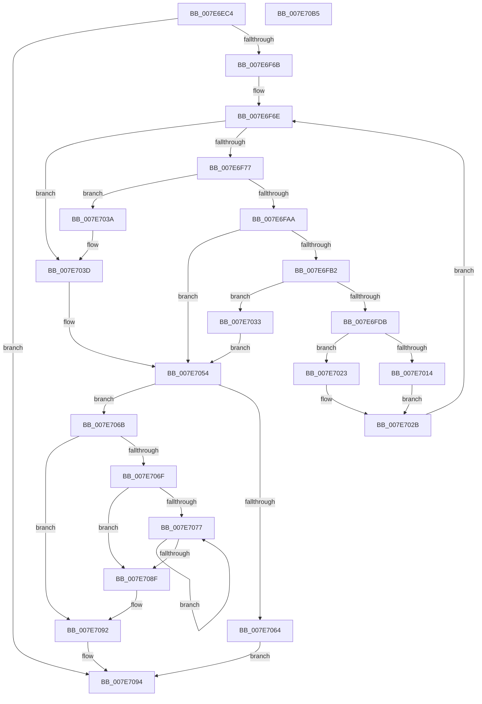

# CmpLoadLayerVersions

- RVA: `0x007E6EC4`–`0x007E70B6` (길이 `498` bytes)
- VA: `0x00000001407E6EC4`
- 실행 섹션: `PAGE`
- PDB 이름 있음: `예`; PDB Function 태그: `아니요`
- unwind 정보 RVA: `0x000D6CD0`
- 디코드: `129`개 명령, `498/498` bytes 표시
- 미해석 바이트: `0` (있으면 어셈블리에 `.byte`로 보존)

> 이 문서는 커널 이미지의 기계어와 PDB 기호를 분석해 생성했습니다. 4번과 5번은 함수 원형과 자료형을 바이너리 사용 방식에서 추정한 C 해석이며 원본 소스 복구 결과는 아닙니다.

## 1. Dependencies

- 직접 호출 지점: **10**; 고유 호출 대상: **9**
- 직접 호출자로 확인된 함수: **1**
- RIP 상대 이미지 참조: **2**

### Outgoing calls
- `0x007E6F32` → [memset](../../text/6C/memset_function_006C6C40.md) (function, `0x006C6C40`)
- `0x007E6F5C` → [ZwOpenKey](../../text/6A/ZwOpenKey_function_006AD310.md) (function, `0x006AD310`)
- `0x007E6F98` → [ZwEnumerateKey](../../text/6A/ZwEnumerateKey_function_006AD710.md) (function, `0x006AD710`)
- `0x007E6FCE` → [ExAllocatePool2](../../poolcode/B8/ExAllocatePool2_function_00B820F0.md) (function, `0x00B820F0`)
- `0x007E7009` → [CmpLoadLayerVersion](CmpLoadLayerVersion_function_007E6A74.md) (function, `0x007E6A74`)
- `0x007E701C` → [ExFreePoolWithTag](../../poolcode/B8/ExFreePoolWithTag_function_00B82870.md) (function, `0x00B82870`)
- `0x007E704F` → [qsort](../../text/50/qsort_function_005009F0.md) (function, `0x005009F0`)
- `0x007E7059` → [ZwClose](../../text/6A/ZwClose_function_006AD2B0.md) (function, `0x006AD2B0`)
- `0x007E7080` → [ExFreePoolWithTag](../../poolcode/B8/ExFreePoolWithTag_function_00B82870.md) (function, `0x00B82870`)
- `0x007E709E` → [_security_check_cookie](../../text/6A/_security_check_cookie_function_006AC640.md) (function, `0x006AC640`)

### Direct callers
- [CmpLoadSystemVersionData](CmpLoadSystemVersionData_function_007E70BC.md) at `0x007E7168`
- [CmpLoadSystemVersionData](CmpLoadSystemVersionData_function_007E70BC.md) at `0x007E7197`

### Static image references
- `0x007E6EDE` → RVA `0x00E0A740` (`.data`; read)
- `0x007E703F` → RVA `0x00ABFDD0` (`CmpCompareLayerDescriptors`; read)

## 2. Other-region calls and transfers

- 다른 실행 섹션으로 향하는 call: **9**
  - `0x007E6F32` → [memset](../../text/6C/memset_function_006C6C40.md) (`PAGE` → `.text`)
  - `0x007E6F5C` → [ZwOpenKey](../../text/6A/ZwOpenKey_function_006AD310.md) (`PAGE` → `.text`)
  - `0x007E6F98` → [ZwEnumerateKey](../../text/6A/ZwEnumerateKey_function_006AD710.md) (`PAGE` → `.text`)
  - `0x007E6FCE` → [ExAllocatePool2](../../poolcode/B8/ExAllocatePool2_function_00B820F0.md) (`PAGE` → `POOLCODE`)
  - `0x007E701C` → [ExFreePoolWithTag](../../poolcode/B8/ExFreePoolWithTag_function_00B82870.md) (`PAGE` → `POOLCODE`)
  - `0x007E704F` → [qsort](../../text/50/qsort_function_005009F0.md) (`PAGE` → `.text`)
  - `0x007E7059` → [ZwClose](../../text/6A/ZwClose_function_006AD2B0.md) (`PAGE` → `.text`)
  - `0x007E7080` → [ExFreePoolWithTag](../../poolcode/B8/ExFreePoolWithTag_function_00B82870.md) (`PAGE` → `POOLCODE`)
  - `0x007E709E` → [_security_check_cookie](../../text/6A/_security_check_cookie_function_006AC640.md) (`PAGE` → `.text`)
- 별도 외부 분기/꼬리 이동을 확인하지 못했습니다.

## 3. Assembly (complete function range)

```asm
007E6EC4  40 55                           push rbp
007E6EC6  53                              push rbx
007E6EC7  56                              push rsi
007E6EC8  57                              push rdi
007E6EC9  41 54                           push r12
007E6ECB  41 56                           push r14
007E6ECD  41 57                           push r15
007E6ECF  48 8D AC 24 70 FF FF FF         lea rbp, [rsp - 0x90]
007E6ED7  48 81 EC 90 01 00 00            sub rsp, 0x190
007E6EDE  48 8B 05 5B 38 62 00            mov rax, qword ptr [rip + 0x62385b]
007E6EE5  48 33 C4                        xor rax, rsp
007E6EE8  48 89 85 80 00 00 00            mov qword ptr [rbp + 0x80], rax
007E6EEF  48 8B 9D F0 00 00 00            mov rbx, qword ptr [rbp + 0xf0]
007E6EF6  48 8B F2                        mov rsi, rdx
007E6EF9  4C 8B F9                        mov r15, rcx
007E6EFC  48 C7 44 24 50 30 00 00 00      mov qword ptr [rsp + 0x50], 0x30
007E6F05  45 33 E4                        xor r12d, r12d
007E6F08  48 C7 44 24 68 40 02 00 00      mov qword ptr [rsp + 0x68], 0x240
007E6F11  0F 57 C0                        xorps xmm0, xmm0
007E6F14  4C 89 64 24 30                  mov qword ptr [rsp + 0x30], r12
007E6F19  33 D2                           xor edx, edx
007E6F1B  44 89 64 24 38                  mov dword ptr [rsp + 0x38], r12d
007E6F20  48 8D 4D 80                     lea rcx, [rbp - 0x80]
007E6F24  41 B8 00 01 00 00               mov r8d, 0x100
007E6F2A  0F 11 44 24 40                  movups xmmword ptr [rsp + 0x40], xmm0
007E6F2F  49 8B F9                        mov rdi, r9
007E6F32  E8 09 FD ED FF                  call 0x1406c6c40
007E6F37  0F 57 C0                        xorps xmm0, xmm0
007E6F3A  44 89 26                        mov dword ptr [rsi], r12d
007E6F3D  4C 8D 44 24 50                  lea r8, [rsp + 0x50]
007E6F42  48 89 7C 24 58                  mov qword ptr [rsp + 0x58], rdi
007E6F47  41 8D 54 24 09                  lea edx, [r12 + 9]
007E6F4C  48 89 5C 24 60                  mov qword ptr [rsp + 0x60], rbx
007E6F51  48 8D 4C 24 30                  lea rcx, [rsp + 0x30]
007E6F56  F3 0F 7F 44 24 70               movdqu xmmword ptr [rsp + 0x70], xmm0
007E6F5C  E8 AF 63 EC FF                  call 0x1406ad310
007E6F61  8B D8                           mov ebx, eax
007E6F63  85 C0                           test eax, eax
007E6F65  0F 88 29 01 00 00               js 0x1407e7094
007E6F6B  45 8B F4                        mov r14d, r12d
007E6F6E  83 3E 10                        cmp dword ptr [rsi], 0x10
007E6F71  0F 83 C6 00 00 00               jae 0x1407e703d
007E6F77  48 8B 4C 24 30                  mov rcx, qword ptr [rsp + 0x30]
007E6F7C  48 8D 44 24 38                  lea rax, [rsp + 0x38]
007E6F81  48 89 44 24 28                  mov qword ptr [rsp + 0x28], rax
007E6F86  4C 8D 4D 80                     lea r9, [rbp - 0x80]
007E6F8A  45 33 C0                        xor r8d, r8d
007E6F8D  C7 44 24 20 FE 00 00 00         mov dword ptr [rsp + 0x20], 0xfe
007E6F95  41 8B D6                        mov edx, r14d
007E6F98  E8 73 67 EC FF                  call 0x1406ad710
007E6F9D  8B D8                           mov ebx, eax
007E6F9F  3D 1A 00 00 80                  cmp eax, 0x8000001a
007E6FA4  0F 84 90 00 00 00               je 0x1407e703a
007E6FAA  85 C0                           test eax, eax
007E6FAC  0F 88 A2 00 00 00               js 0x1407e7054
007E6FB2  8B 45 8C                        mov eax, dword ptr [rbp - 0x74]
007E6FB5  BA 28 03 00 00                  mov edx, 0x328
007E6FBA  48 D1 E8                        shr rax, 1
007E6FBD  B9 00 01 00 00                  mov ecx, 0x100
007E6FC2  41 B8 43 4D 76 64               mov r8d, 0x64764d43
007E6FC8  66 44 89 64 45 90               mov word ptr [rbp + rax*2 - 0x70], r12w
007E6FCE  E8 1D B1 39 00                  call 0x140b820f0
007E6FD3  48 8B F8                        mov rdi, rax
007E6FD6  48 85 C0                        test rax, rax
007E6FD9  74 58                           je 0x1407e7033
007E6FDB  8B 4D 8C                        mov ecx, dword ptr [rbp - 0x74]
007E6FDE  48 8D 45 90                     lea rax, [rbp - 0x70]
007E6FE2  44 8B 8D F8 00 00 00            mov r9d, dword ptr [rbp + 0xf8]
007E6FE9  4C 8D 44 24 40                  lea r8, [rsp + 0x40]
007E6FEE  48 8B 54 24 30                  mov rdx, qword ptr [rsp + 0x30]
007E6FF3  66 89 4C 24 40                  mov word ptr [rsp + 0x40], cx
007E6FF8  66 83 C1 02                     add cx, 2
007E6FFC  66 89 4C 24 42                  mov word ptr [rsp + 0x42], cx
007E7001  48 8B CF                        mov rcx, rdi
007E7004  48 89 44 24 48                  mov qword ptr [rsp + 0x48], rax
007E7009  E8 66 FA FF FF                  call 0x1407e6a74
007E700E  8B D8                           mov ebx, eax
007E7010  85 C0                           test eax, eax
007E7012  79 0F                           jns 0x1407e7023
007E7014  BA 43 4D 76 64                  mov edx, 0x64764d43
007E7019  48 8B CF                        mov rcx, rdi
007E701C  E8 4F B8 39 00                  call 0x140b82870
007E7021  EB 08                           jmp 0x1407e702b
007E7023  8B 06                           mov eax, dword ptr [rsi]
007E7025  49 89 3C C7                     mov qword ptr [r15 + rax*8], rdi
007E7029  FF 06                           inc dword ptr [rsi]
007E702B  41 FF C6                        inc r14d
007E702E  E9 3B FF FF FF                  jmp 0x1407e6f6e
007E7033  BB 9A 00 00 C0                  mov ebx, 0xc000009a
007E7038  EB 1A                           jmp 0x1407e7054
007E703A  41 8B DC                        mov ebx, r12d
007E703D  8B 16                           mov edx, dword ptr [rsi]
007E703F  4C 8D 0D 8A 8D 2D 00            lea r9, [rip + 0x2d8d8a]
007E7046  41 B8 08 00 00 00               mov r8d, 8
007E704C  49 8B CF                        mov rcx, r15
007E704F  E8 9C 99 D1 FF                  call 0x1405009f0
007E7054  48 8B 4C 24 30                  mov rcx, qword ptr [rsp + 0x30]
007E7059  E8 52 62 EC FF                  call 0x1406ad2b0
007E705E  8B 06                           mov eax, dword ptr [rsi]
007E7060  85 C0                           test eax, eax
007E7062  75 07                           jne 0x1407e706b
007E7064  B8 22 00 00 80                  mov eax, 0x80000022
007E7069  EB 29                           jmp 0x1407e7094
007E706B  85 DB                           test ebx, ebx
007E706D  79 23                           jns 0x1407e7092
007E706F  83 E8 01                        sub eax, 1
007E7072  48 63 F8                        movsxd rdi, eax
007E7075  78 18                           js 0x1407e708f
007E7077  49 8B 0C FF                     mov rcx, qword ptr [r15 + rdi*8]
007E707B  BA 43 4D 76 64                  mov edx, 0x64764d43
007E7080  E8 EB B7 39 00                  call 0x140b82870
007E7085  4D 89 24 FF                     mov qword ptr [r15 + rdi*8], r12
007E7089  48 83 EF 01                     sub rdi, 1
007E708D  79 E8                           jns 0x1407e7077
007E708F  44 89 26                        mov dword ptr [rsi], r12d
007E7092  8B C3                           mov eax, ebx
007E7094  48 8B 8D 80 00 00 00            mov rcx, qword ptr [rbp + 0x80]
007E709B  48 33 CC                        xor rcx, rsp
007E709E  E8 9D 55 EC FF                  call 0x1406ac640
007E70A3  48 81 C4 90 01 00 00            add rsp, 0x190
007E70AA  41 5F                           pop r15
007E70AC  41 5E                           pop r14
007E70AE  41 5C                           pop r12
007E70B0  5F                              pop rdi
007E70B1  5E                              pop rsi
007E70B2  5B                              pop rbx
007E70B3  5D                              pop rbp
007E70B4  C3                              ret
007E70B5  CC                              int3
```

## 4. C-style interpretation (structured pseudocode)

```c
__int64 __fastcall CmpLoadLayerVersions(__int64 a1, __int64 a2, __int64 a3, __int64 a4, __int64 a5, unsigned int a6)
{
    __int64 result;
    __int64 v_r12;
    __int64 v_r14;
    __int64 v_rdi;
    __int64 v_rsp;
    unsigned __int64 v_stack_m138;
    unsigned int v_stack_m13C;
    unsigned __int64 v_stack_m148;
    unsigned __int64 v_stack_m158;
    unsigned __int64 v_stack_m160;
    unsigned __int64 v_stack_m168;
    unsigned __int64 v_stack_m170;
    unsigned __int64 v_stack_m178;
    unsigned __int64 v_stack_m180;
    unsigned __int16 v_stack_m186;
    unsigned __int64 v_stack_m188;
    unsigned int v_stack_m190;
    unsigned __int64 v_stack_m198;
    unsigned __int64 v_stack_m1A0;
    unsigned int v_stack_m1A8;
    unsigned __int64 v_stack_m48;
    unsigned __int64 v_stack_mC8;

    v_rsp = (v_rsp) - (400);
    result = (*(unsigned __int64 *)(v_rip + 6436955)) ^ (v_rsp);
    v_stack_m48 = result;
    v_stack_m178 = 48;
    v_r12 = 0;
    v_stack_m160 = 576;
    v_stack_m198 = 0;
    a2 = 0;
    v_stack_m190 = 0;
    v_stack_m188 = v_xmm0;
    result = memset(v_stack_m148, a2, 256, a4);
    *(unsigned int *)(a2) = 0;
    v_stack_m170 = a4;
    v_stack_m168 = a5;
    v_stack_m158 = v_xmm0;
    result = ZwOpenKey(v_stack_m198, v_r12 + 9, v_stack_m178, a4);
    if (sign_flag) goto loc_007E7094;
loc_007E6F6E:
    if ((*(unsigned int *)(a2)) >= 16) goto loc_007E703D;
    v_stack_m1A0 = v_stack_m190;
    a3 = 0;
    v_stack_m1A8 = 254;
    result = ZwEnumerateKey(v_stack_m198, 0, a3, v_stack_m148);
    if (((unsigned int)(result)) == 0x8000001AULL) goto loc_007E703A;
    if (sign_flag) goto loc_007E7054;
    result = ((unsigned int)(v_stack_m13C)) >> (1);
    *(unsigned __int16 *)(v_stack_mC8 + result * 2 - 112) = 0;
    result = ExAllocatePool2(256, 808, (unsigned int)(0x64764D43ULL), v_stack_m148);
    if (result == 0) goto loc_007E7033;
    v_stack_m188 = (unsigned __int16)((unsigned int)(v_stack_m13C));
    a1 = (unsigned __int16)(((unsigned int)(v_stack_m13C)) + (2));
    v_stack_m186 = (unsigned __int16)(a1);
    v_stack_m180 = v_stack_m138;
    result = CmpLoadLayerVersion(result, v_stack_m198, v_stack_m188, (unsigned int)(a6));
    if (!sign_flag) goto loc_007E7023;
    result = ExFreePoolWithTag(result, (unsigned int)(0x64764D43ULL), v_stack_m188, (unsigned int)(a6));
    goto loc_007E702B;
loc_007E7023:
    *(unsigned __int64 *)(a1 + (unsigned int)(*(unsigned int *)(a2)) * 8) = result;
loc_007E702B:
    v_r14 = (unsigned int)((0) + 1);
    goto loc_007E6F6E;
loc_007E7033:
    goto loc_007E7054;
loc_007E703A:
loc_007E703D:
    result = qsort(a1, (unsigned int)(*(unsigned int *)(a2)), 8, v_rip + 2985354);
loc_007E7054:
    result = ZwClose(v_stack_m198, (unsigned int)(*(unsigned int *)(a2)), 8, v_rip + 2985354);
    if ((unsigned int)((unsigned int)(*(unsigned int *)(a2))) != 0) goto loc_007E706B;
    goto loc_007E7094;
loc_007E706B:
    if (!sign_flag) goto loc_007E7092;
    result = (unsigned int)(((unsigned int)(0x80000022ULL)) - (1));
    if (sign_flag) goto loc_007E708F;
loc_007E7077:
    result = ExFreePoolWithTag(*(unsigned __int64 *)(a1 + (int)((unsigned int)(result)) * 8), (unsigned int)(0x64764D43ULL), 8, v_rip + 2985354);
    *(unsigned __int64 *)(a1 + (int)((unsigned int)(result)) * 8) = 0;
    v_rdi = ((int)((unsigned int)(result))) - (1);
    if (!sign_flag) goto loc_007E7077;
loc_007E708F:
    *(unsigned int *)(a2) = 0;
loc_007E7092:
loc_007E7094:
    a1 = (v_stack_m48) ^ (v_rsp);
    result = _security_check_cookie(a1, (unsigned int)(0x64764D43ULL), 8, v_rip + 2985354);
    v_rsp = (v_rsp) + (400);
    return result;
}
```

## 5. (Beta) C Style

```c
int64_t CmpLoadLayerVersions(void *Arg1, void *Arg2, int64_t Arg3, int64_t Arg4, int64_t Arg5, uint32_t Arg6)
{
    uint8_t *arg1 = (uint8_t *)Arg1;
    uint8_t *arg2 = (uint8_t *)Arg2;

    int64_t result;
    int64_t local_r12;
    int64_t local_r14;
    int64_t local_rdi;
    int64_t local_rsp;
    uint64_t v_stack_m138;
    uint32_t v_stack_m13C;
    uint64_t v_stack_m148;
    uint64_t v_stack_m158;
    uint64_t v_stack_m160;
    uint64_t v_stack_m168;
    uint64_t v_stack_m170;
    uint64_t v_stack_m178;
    uint64_t v_stack_m180;
    uint16_t v_stack_m186;
    uint64_t v_stack_m188;
    uint32_t v_stack_m190;
    uint64_t v_stack_m198;
    uint64_t v_stack_m1A0;
    uint32_t v_stack_m1A8;
    uint64_t v_stack_m48;
    uint64_t v_stack_mC8;

    local_rsp = (local_rsp) - (400);
    result = (*(uint64_t *)(v_rip + 0x62385B)) ^ (local_rsp);
    v_stack_m48 = result;
    v_stack_m178 = 48;
    local_r12 = 0;
    v_stack_m160 = 576;
    v_stack_m198 = 0;
    Arg2 = 0;
    v_stack_m190 = 0;
    v_stack_m188 = v_xmm0;
    result = memset(v_stack_m148, Arg2, 256, Arg4);
    *(uint32_t *)(arg2) = 0;
    v_stack_m170 = Arg4;
    v_stack_m168 = Arg5;
    v_stack_m158 = v_xmm0;
    result = ZwOpenKey(v_stack_m198, local_r12 + 9, v_stack_m178, Arg4);
    if (sign_flag) goto loc_007E7094;
loc_007E6F6E:
    if ((*(uint32_t *)(arg2)) >= 16) goto loc_007E703D;
    v_stack_m1A0 = v_stack_m190;
    Arg3 = 0;
    v_stack_m1A8 = 254;
    result = ZwEnumerateKey(v_stack_m198, 0, Arg3, v_stack_m148);
    if (((uint32_t)(result)) == 0x8000001AULL) goto loc_007E703A;
    if (sign_flag) goto loc_007E7054;
    result = ((uint32_t)(v_stack_m13C)) >> (1);
    *(uint16_t *)(v_stack_mC8 + result * 2 - 0x70) = 0;
    result = ExAllocatePool2(256, 808, (uint32_t)(0x64764D43ULL), v_stack_m148);
    if (result == 0) goto loc_007E7033;
    v_stack_m188 = (uint16_t)((uint32_t)(v_stack_m13C));
    Arg1 = (uint16_t)(((uint32_t)(v_stack_m13C)) + (2));
    v_stack_m186 = (uint16_t)(Arg1);
    v_stack_m180 = v_stack_m138;
    result = CmpLoadLayerVersion(result, v_stack_m198, v_stack_m188, (uint32_t)(Arg6));
    if (!sign_flag) goto loc_007E7023;
    result = ExFreePoolWithTag(result, (uint32_t)(0x64764D43ULL), v_stack_m188, (uint32_t)(Arg6));
    goto loc_007E702B;
loc_007E7023:
    *(uint64_t *)(arg1 + (uint32_t)(*(uint32_t *)(arg2)) * 8) = result;
loc_007E702B:
    local_r14 = (uint32_t)((0) + 1);
    goto loc_007E6F6E;
loc_007E7033:
    goto loc_007E7054;
loc_007E703A:
loc_007E703D:
    result = qsort(Arg1, (uint32_t)(*(uint32_t *)(arg2)), 8, v_rip + 2985354);
loc_007E7054:
    result = ZwClose(v_stack_m198, (uint32_t)(*(uint32_t *)(arg2)), 8, v_rip + 2985354);
    if ((uint32_t)((uint32_t)(*(uint32_t *)(arg2))) != 0) goto loc_007E706B;
    goto loc_007E7094;
loc_007E706B:
    if (!sign_flag) goto loc_007E7092;
    result = (uint32_t)(((uint32_t)(0x80000022ULL)) - (1));
    if (sign_flag) goto loc_007E708F;
loc_007E7077:
    result = ExFreePoolWithTag(*(uint64_t *)(arg1 + (int32_t)((uint32_t)(result)) * 8), (uint32_t)(0x64764D43ULL), 8, v_rip + 2985354);
    *(uint64_t *)(arg1 + (int32_t)((uint32_t)(result)) * 8) = 0;
    local_rdi = ((int32_t)((uint32_t)(result))) - (1);
    if (!sign_flag) goto loc_007E7077;
loc_007E708F:
    *(uint32_t *)(arg2) = 0;
loc_007E7092:
loc_007E7094:
    Arg1 = (v_stack_m48) ^ (local_rsp);
    result = _security_check_cookie(Arg1, (uint32_t)(0x64764D43ULL), 8, v_rip + 2985354);
    local_rsp = (local_rsp) + (400);
    return result;
}
```

### 관측된 메모리 오프셋

구조체 형식이 확인되지 않은 접근은 인자 기준의 오프셋으로만 기록했습니다.

| 기준 인자 | 오프셋 표현 | 폭 (bit) | 접근 |
|---|---:|---:|---|
| `Arg1` | `+ 0x0 + rax*8` | `64` | `W` |
| `Arg1` | `+ 0x0 + rdi*8` | `64` | `R` |
| `Arg1` | `+ 0x0 + rdi*8` | `64` | `W` |
| `Arg2` | `+ 0x0` | `32` | `R` |
| `Arg2` | `+ 0x0` | `32` | `R/W` |
| `Arg2` | `+ 0x0` | `32` | `W` |

## 6. Execution-region graph

[열기: 2D/3D 그래프와 함수 탐색 컨트롤 패널](../../../control-panel.html?section=page&rva=0x007E6EC4&view=graph)

- 2D 그래프는 위에서 아래로 흐르고, 3D 그래프는 빈 공간을 드래그해 회전합니다. Shift+드래그는 이동, 휠은 확대·축소, 함수 노드 선택은 대상 보고서 이동입니다.

### Static fallback


