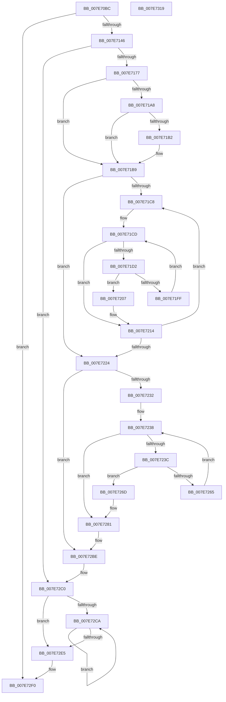

# CmpLoadSystemVersionData

- RVA: `0x007E70BC`–`0x007E731A` (길이 `606` bytes)
- VA: `0x00000001407E70BC`
- 실행 섹션: `PAGE`
- PDB 이름 있음: `예`; PDB Function 태그: `아니요`
- unwind 정보 RVA: `0x000D6D14`
- 디코드: `149`개 명령, `606/606` bytes 표시
- 미해석 바이트: `0` (있으면 어셈블리에 `.byte`로 보존)

> 이 문서는 커널 이미지의 기계어와 PDB 기호를 분석해 생성했습니다. 4번과 5번은 함수 원형과 자료형을 바이너리 사용 방식에서 추정한 C 해석이며 원본 소스 복구 결과는 아닙니다.

## 1. Dependencies

- 직접 호출 지점: **12**; 고유 호출 대상: **8**
- 직접 호출자로 확인된 함수: **1**
- RIP 상대 이미지 참조: **16**

### Outgoing calls
- `0x007E710A` → [memset](../../text/6C/memset_function_006C6C40.md) (function, `0x006C6C40`)
- `0x007E711F` → [memset](../../text/6C/memset_function_006C6C40.md) (function, `0x006C6C40`)
- `0x007E7139` → [ZwOpenKey](../../text/6A/ZwOpenKey_function_006AD310.md) (function, `0x006AD310`)
- `0x007E7168` → [CmpLoadLayerVersions](CmpLoadLayerVersions_function_007E6EC4.md) (function, `0x007E6EC4`)
- `0x007E7197` → [CmpLoadLayerVersions](CmpLoadLayerVersions_function_007E6EC4.md) (function, `0x007E6EC4`)
- `0x007E71F6` → [RtlCompareUnicodeStrings](../97/RtlCompareUnicodeStrings_function_009727E0.md) (function, `0x009727E0`)
- `0x007E720F` → [CmpMergeVersionDescriptors](CmpMergeVersionDescriptors_function_007E7320.md) (function, `0x007E7320`)
- `0x007E725C` → [RtlCompareUnicodeStrings](../97/RtlCompareUnicodeStrings_function_009727E0.md) (function, `0x009727E0`)
- `0x007E727C` → [CmpMergeVersionDescriptors](CmpMergeVersionDescriptors_function_007E7320.md) (function, `0x007E7320`)
- `0x007E72D4` → [ExFreePoolWithTag](../../poolcode/B8/ExFreePoolWithTag_function_00B82870.md) (function, `0x00B82870`)
- `0x007E72E9` → [ZwClose](../../text/6A/ZwClose_function_006AD2B0.md) (function, `0x006AD2B0`)
- `0x007E72F7` → [_security_check_cookie](../../text/6A/_security_check_cookie_function_006AC640.md) (function, `0x006AC640`)

### Direct callers
- [CmpFinishSystemHivesLoad](../7D/CmpFinishSystemHivesLoad_function_007DA210.md) at `0x007DA708`
- [CmpFinishSystemHivesLoad](../7D/CmpFinishSystemHivesLoad_function_007DA210.md) at `0x007DA71F`
- [CmpFinishSystemHivesLoad](../7D/CmpFinishSystemHivesLoad_function_007DA210.md) at `0x007DA806`
- [CmpFinishSystemHivesLoad](../7D/CmpFinishSystemHivesLoad_function_007DA210.md) at `0x007DAB8F`

### Static image references
- `0x007E70DB` → RVA `0x00E0A740` (`.data`; read)
- `0x007E70EE` → RVA `0x00EF7260` (`.data`; read)
- `0x007E70F5` → RVA `0x00EF7238` (`.data`; read/write)
- `0x007E710F` → RVA `0x00EF7240` (`.data`; read/write)
- `0x007E7126` → RVA `0x0000BE40` (`.rdata`; read)
- `0x007E714A` → RVA `0x00B4BD28` (`CmpBuildLayersString`; read)
- `0x007E7159` → RVA `0x00EF7240` (`.data`; read)
- `0x007E717B` → RVA `0x00B4BD18` (`CmpServicingLayersString`; read)
- `0x007E71B2` → RVA `0x00EF7238` (`.data`; write)
- `0x007E7224` → RVA `0x00EF7238` (`.data`; read)
- `0x007E7245` → RVA `0x00B4BD40` (`PAGE`; read)
- `0x007E7290` → RVA `0x00E0A74C` (`.data`; write)
- `0x007E7299` → RVA `0x00FC5008` (`ALMOSTRO`; read)
- `0x007E72A6` → RVA `0x00E0A74C` (`.data`; read)
- `0x007E72AF` → RVA `0x00FCFE78` (`CACHEALI`; write)
- `0x007E72B8` → RVA `0x00E0A748` (`.data`; write)

## 2. Other-region calls and transfers

- 다른 실행 섹션으로 향하는 call: **6**
  - `0x007E710A` → [memset](../../text/6C/memset_function_006C6C40.md) (`PAGE` → `.text`)
  - `0x007E711F` → [memset](../../text/6C/memset_function_006C6C40.md) (`PAGE` → `.text`)
  - `0x007E7139` → [ZwOpenKey](../../text/6A/ZwOpenKey_function_006AD310.md) (`PAGE` → `.text`)
  - `0x007E72D4` → [ExFreePoolWithTag](../../poolcode/B8/ExFreePoolWithTag_function_00B82870.md) (`PAGE` → `POOLCODE`)
  - `0x007E72E9` → [ZwClose](../../text/6A/ZwClose_function_006AD2B0.md) (`PAGE` → `.text`)
  - `0x007E72F7` → [_security_check_cookie](../../text/6A/_security_check_cookie_function_006AC640.md) (`PAGE` → `.text`)
- 별도 외부 분기/꼬리 이동을 확인하지 못했습니다.

## 3. Assembly (complete function range)

```asm
007E70BC  48 8B C4                        mov rax, rsp
007E70BF  48 89 58 08                     mov qword ptr [rax + 8], rbx
007E70C3  48 89 70 10                     mov qword ptr [rax + 0x10], rsi
007E70C7  48 89 78 18                     mov qword ptr [rax + 0x18], rdi
007E70CB  55                              push rbp
007E70CC  41 56                           push r14
007E70CE  41 57                           push r15
007E70D0  48 8D 68 A1                     lea rbp, [rax - 0x5f]
007E70D4  48 81 EC D0 00 00 00            sub rsp, 0xd0
007E70DB  48 8B 05 5E 36 62 00            mov rax, qword ptr [rip + 0x62365e]
007E70E2  48 33 C4                        xor rax, rsp
007E70E5  48 89 45 37                     mov qword ptr [rbp + 0x37], rax
007E70E9  48 83 65 AF 00                  and qword ptr [rbp - 0x51], 0
007E70EE  48 8D 1D 6B 01 71 00            lea rbx, [rip + 0x71016b]
007E70F5  48 83 25 3B 01 71 00 00         and qword ptr [rip + 0x71013b], 0
007E70FD  BF 80 00 00 00                  mov edi, 0x80
007E7102  44 8B C7                        mov r8d, edi
007E7105  48 8B CB                        mov rcx, rbx
007E7108  33 D2                           xor edx, edx
007E710A  E8 31 FB ED FF                  call 0x1406c6c40
007E710F  83 25 2A 01 71 00 00            and dword ptr [rip + 0x71012a], 0
007E7116  48 8D 4D B7                     lea rcx, [rbp - 0x49]
007E711A  44 8B C7                        mov r8d, edi
007E711D  33 D2                           xor edx, edx
007E711F  E8 1C FB ED FF                  call 0x1406c6c40
007E7124  33 FF                           xor edi, edi
007E7126  4C 8D 05 13 4D 82 FF            lea r8, [rip - 0x7db2ed]
007E712D  BA 19 00 02 00                  mov edx, 0x20019
007E7132  89 7D A7                        mov dword ptr [rbp - 0x59], edi
007E7135  48 8D 4D AF                     lea rcx, [rbp - 0x51]
007E7139  E8 D2 61 EC FF                  call 0x1406ad310
007E713E  85 C0                           test eax, eax
007E7140  0F 88 AA 01 00 00               js 0x1407e72f0
007E7146  4C 8B 4D AF                     mov r9, qword ptr [rbp - 0x51]
007E714A  48 8D 05 D7 4B 36 00            lea rax, [rip + 0x364bd7]
007E7151  C7 44 24 28 F8 0F 00 00         mov dword ptr [rsp + 0x28], 0xff8
007E7159  48 8D 15 E0 00 71 00            lea rdx, [rip + 0x7100e0]
007E7160  48 8B CB                        mov rcx, rbx
007E7163  48 89 44 24 20                  mov qword ptr [rsp + 0x20], rax
007E7168  E8 57 FD FF FF                  call 0x1407e6ec4
007E716D  8B F0                           mov esi, eax
007E716F  85 C0                           test eax, eax
007E7171  0F 88 49 01 00 00               js 0x1407e72c0
007E7177  4C 8B 4D AF                     mov r9, qword ptr [rbp - 0x51]
007E717B  48 8D 05 96 4B 36 00            lea rax, [rip + 0x364b96]
007E7182  C7 44 24 28 40 00 00 00         mov dword ptr [rsp + 0x28], 0x40
007E718A  48 8D 55 A7                     lea rdx, [rbp - 0x59]
007E718E  48 8D 4D B7                     lea rcx, [rbp - 0x49]
007E7192  48 89 44 24 20                  mov qword ptr [rsp + 0x20], rax
007E7197  E8 28 FD FF FF                  call 0x1407e6ec4
007E719C  48 8B 0D BD 00 71 00            mov rcx, qword ptr [rip + 0x7100bd]
007E71A3  48 85 C9                        test rcx, rcx
007E71A6  74 11                           je 0x1407e71b9
007E71A8  8B 81 20 03 00 00               mov eax, dword ptr [rcx + 0x320]
007E71AE  A8 01                           test al, 1
007E71B0  74 07                           je 0x1407e71b9
007E71B2  48 89 0D 7F 00 71 00            mov qword ptr [rip + 0x71007f], rcx
007E71B9  8B 7D A7                        mov edi, dword ptr [rbp - 0x59]
007E71BC  45 33 F6                        xor r14d, r14d
007E71BF  44 39 35 7A 00 71 00            cmp dword ptr [rip + 0x71007a], r14d
007E71C6  7E 5C                           jle 0x1407e7224
007E71C8  45 33 FF                        xor r15d, r15d
007E71CB  33 F6                           xor esi, esi
007E71CD  44 3B FF                        cmp r15d, edi
007E71D0  7D 42                           jge 0x1407e7214
007E71D2  4C 8B 44 F5 B7                  mov r8, qword ptr [rbp + rsi*8 - 0x49]
007E71D7  48 8B 0B                        mov rcx, qword ptr [rbx]
007E71DA  C6 44 24 20 01                  mov byte ptr [rsp + 0x20], 1
007E71DF  45 0F B7 48 10                  movzx r9d, word ptr [r8 + 0x10]
007E71E4  0F B7 51 10                     movzx edx, word ptr [rcx + 0x10]
007E71E8  4D 8B 40 18                     mov r8, qword ptr [r8 + 0x18]
007E71EC  48 8B 49 18                     mov rcx, qword ptr [rcx + 0x18]
007E71F0  49 D1 E9                        shr r9, 1
007E71F3  48 D1 EA                        shr rdx, 1
007E71F6  E8 E5 B5 18 00                  call 0x1409727e0
007E71FB  85 C0                           test eax, eax
007E71FD  74 08                           je 0x1407e7207
007E71FF  41 FF C7                        inc r15d
007E7202  48 FF C6                        inc rsi
007E7205  EB C6                           jmp 0x1407e71cd
007E7207  48 8B 54 F5 B7                  mov rdx, qword ptr [rbp + rsi*8 - 0x49]
007E720C  48 8B 0B                        mov rcx, qword ptr [rbx]
007E720F  E8 0C 01 00 00                  call 0x1407e7320
007E7214  41 FF C6                        inc r14d
007E7217  48 83 C3 08                     add rbx, 8
007E721B  44 3B 35 1E 00 71 00            cmp r14d, dword ptr [rip + 0x71001e]
007E7222  7C A4                           jl 0x1407e71c8
007E7224  48 83 3D 0C 00 71 00 00         cmp qword ptr [rip + 0x71000c], 0
007E722C  0F 84 8C 00 00 00               je 0x1407e72be
007E7232  33 DB                           xor ebx, ebx
007E7234  48 8D 75 B7                     lea rsi, [rbp - 0x49]
007E7238  3B DF                           cmp ebx, edi
007E723A  7D 45                           jge 0x1407e7281
007E723C  48 8B 0E                        mov rcx, qword ptr [rsi]
007E723F  41 B9 09 00 00 00               mov r9d, 9
007E7245  4C 8B 05 F4 4A 36 00            mov r8, qword ptr [rip + 0x364af4]
007E724C  C6 44 24 20 01                  mov byte ptr [rsp + 0x20], 1
007E7251  0F B7 51 10                     movzx edx, word ptr [rcx + 0x10]
007E7255  48 8B 49 18                     mov rcx, qword ptr [rcx + 0x18]
007E7259  48 D1 EA                        shr rdx, 1
007E725C  E8 7F B5 18 00                  call 0x1409727e0
007E7261  85 C0                           test eax, eax
007E7263  74 08                           je 0x1407e726d
007E7265  FF C3                           inc ebx
007E7267  48 83 C6 08                     add rsi, 8
007E726B  EB CB                           jmp 0x1407e7238
007E726D  48 8B 0D C4 FF 70 00            mov rcx, qword ptr [rip + 0x70ffc4]
007E7274  48 63 D3                        movsxd rdx, ebx
007E7277  48 8B 54 D5 B7                  mov rdx, qword ptr [rbp + rdx*8 - 0x49]
007E727C  E8 9F 00 00 00                  call 0x1407e7320
007E7281  48 8B 15 B0 FF 70 00            mov rdx, qword ptr [rip + 0x70ffb0]
007E7288  8B 42 08                        mov eax, dword ptr [rdx + 8]
007E728B  0D 00 00 00 F0                  or eax, 0xf0000000
007E7290  89 05 B6 34 62 00               mov dword ptr [rip + 0x6234b6], eax
007E7296  8B 4A 08                        mov ecx, dword ptr [rdx + 8]
007E7299  48 8B 05 68 DD 7D 00            mov rax, qword ptr [rip + 0x7ddd68]
007E72A0  89 88 60 02 00 00               mov dword ptr [rax + 0x260], ecx
007E72A6  8B 05 A0 34 62 00               mov eax, dword ptr [rip + 0x6234a0]
007E72AC  0F B7 C8                        movzx ecx, ax
007E72AF  89 0D C3 8B 7E 00               mov dword ptr [rip + 0x7e8bc3], ecx
007E72B5  8B 42 0C                        mov eax, dword ptr [rdx + 0xc]
007E72B8  89 05 8A 34 62 00               mov dword ptr [rip + 0x62348a], eax
007E72BE  33 F6                           xor esi, esi
007E72C0  8D 47 FF                        lea eax, [rdi - 1]
007E72C3  48 63 D8                        movsxd rbx, eax
007E72C6  85 C0                           test eax, eax
007E72C8  78 1B                           js 0x1407e72e5
007E72CA  48 8B 4C DD B7                  mov rcx, qword ptr [rbp + rbx*8 - 0x49]
007E72CF  BA 43 4D 76 64                  mov edx, 0x64764d43
007E72D4  E8 97 B5 39 00                  call 0x140b82870
007E72D9  48 83 64 DD B7 00               and qword ptr [rbp + rbx*8 - 0x49], 0
007E72DF  48 83 EB 01                     sub rbx, 1
007E72E3  79 E5                           jns 0x1407e72ca
007E72E5  48 8B 4D AF                     mov rcx, qword ptr [rbp - 0x51]
007E72E9  E8 C2 5F EC FF                  call 0x1406ad2b0
007E72EE  8B C6                           mov eax, esi
007E72F0  48 8B 4D 37                     mov rcx, qword ptr [rbp + 0x37]
007E72F4  48 33 CC                        xor rcx, rsp
007E72F7  E8 44 53 EC FF                  call 0x1406ac640
007E72FC  4C 8D 9C 24 D0 00 00 00         lea r11, [rsp + 0xd0]
007E7304  49 8B 5B 20                     mov rbx, qword ptr [r11 + 0x20]
007E7308  49 8B 73 28                     mov rsi, qword ptr [r11 + 0x28]
007E730C  49 8B 7B 30                     mov rdi, qword ptr [r11 + 0x30]
007E7310  49 8B E3                        mov rsp, r11
007E7313  41 5F                           pop r15
007E7315  41 5E                           pop r14
007E7317  5D                              pop rbp
007E7318  C3                              ret
007E7319  CC                              int3
```

## 4. C-style interpretation (structured pseudocode)

```c
__int64 __fastcall CmpLoadSystemVersionData(__int64 a1, int a2)
{
    __int64 result;
    __int64 v_r14;
    __int64 v_r15;
    __int64 v_rbx;
    __int64 v_rdi;
    __int64 v_rsi;
    __int64 v_rsp;
    unsigned __int64 v_stack_m18;
    unsigned int v_stack_mC0;
    unsigned __int64 v_stack_mC8;

    *(unsigned __int64 *)(v_rsp + 8) = v_rbx;
    *(unsigned __int64 *)(v_rsp + 16) = v_rsi;
    *(unsigned __int64 *)(v_rsp + 24) = v_rdi;
    v_rsp = (v_rsp) - (208);
    result = (*(unsigned __int64 *)(v_rip + 6436446)) ^ (v_rsp);
    *(unsigned __int64 *)(v_rsp - 95 + 55) = result;
    a2 = 0;
    result = memset(v_rip + 7405931, a2, 128, a4);
    a2 = 0;
    result = memset(v_rsp - 95 - 73, a2, 128, a4);
    v_rdi = 0;
    *(unsigned int *)(v_rsp - 95 - 89) = 0;
    result = ZwOpenKey(v_rsp - 95 - 81, (unsigned int)(0x20019ULL), v_rip - 8237805, a4);
    if (sign_flag) goto loc_007E72F0;
    v_stack_mC0 = 0xFF8ULL;
    v_stack_mC8 = v_rip + 3558359;
    result = CmpLoadLayerVersions(v_rip + 7405931, v_rip + 7405792, v_rip - 8237805, *(unsigned __int64 *)(v_rsp - 95 - 81));
    if (sign_flag) goto loc_007E72C0;
    v_stack_mC0 = 64;
    v_stack_mC8 = v_rip + 3558294;
    result = CmpLoadLayerVersions(v_rsp - 95 - 73, v_rsp - 95 - 89, v_rip - 8237805, *(unsigned __int64 *)(v_rsp - 95 - 81));
    if (*(unsigned __int64 *)(v_rip + 7405757) == 0) goto loc_007E71B9;
    if ((((unsigned __int8)((unsigned int)(*(unsigned int *)(*(unsigned __int64 *)(v_rip + 7405757) + 800)))) & (1)) != 0) {
        *(unsigned __int64 *)(v_rip + 7405695) = *(unsigned __int64 *)(v_rip + 7405757);
    }
    v_r14 = 0;
    if ((*(unsigned int *)(v_rip + 7405690)) <= 0) goto loc_007E7224;
loc_007E71C8:
    v_r15 = 0;
    v_rsi = 0;
loc_007E71CD:
    if (0 >= ((unsigned int)((unsigned int)(*(unsigned int *)(v_rsp - 95 - 89))))) goto loc_007E7214;
    v_stack_mC8 = 1;
    a4 = (*(unsigned __int16 *)(*(unsigned __int64 *)(v_rsp - 95 + v_rsi * 8 - 73) + 16)) >> (1);
    a2 = (*(unsigned __int16 *)(*(unsigned __int64 *)(v_rip + 7405931) + 16)) >> (1);
    result = RtlCompareUnicodeStrings(*(unsigned __int64 *)(*(unsigned __int64 *)(v_rip + 7405931) + 24), a2, *(unsigned __int64 *)(*(unsigned __int64 *)(v_rsp - 95 + v_rsi * 8 - 73) + 24), a4);
    if ((unsigned int)(result) == 0) goto loc_007E7207;
    v_r15 = (unsigned int)((v_r15) + 1);
    v_rsi = (v_rsi) + 1;
    goto loc_007E71CD;
loc_007E7207:
    result = CmpMergeVersionDescriptors(*(unsigned __int64 *)(v_rip + 7405931), *(unsigned __int64 *)(v_rsp - 95 + v_rsi * 8 - 73), *(unsigned __int64 *)(*(unsigned __int64 *)(v_rsp - 95 + v_rsi * 8 - 73) + 24), a4);
loc_007E7214:
    v_r14 = (unsigned int)((v_r14) + 1);
    v_rbx = (v_rip + 7405931) + (8);
    if (((unsigned int)(v_r14)) < (*(unsigned int *)(v_rip + 7405598))) goto loc_007E71C8;
loc_007E7224:
    if ((*(unsigned __int64 *)(v_rip + 7405580)) == 0) goto loc_007E72BE;
    v_rbx = 0;
loc_007E7238:
    if (0 >= ((unsigned int)((unsigned int)(*(unsigned int *)(v_rsp - 95 - 89))))) goto loc_007E7281;
    v_stack_mC8 = 1;
    a2 = (*(unsigned __int16 *)(*(unsigned __int64 *)(v_rsp - 95 - 73) + 16)) >> (1);
    result = RtlCompareUnicodeStrings(*(unsigned __int64 *)(*(unsigned __int64 *)(v_rsp - 95 - 73) + 24), a2, *(unsigned __int64 *)(v_rip + 3558132), 9);
    if ((unsigned int)(result) == 0) goto loc_007E726D;
    v_rbx = (unsigned int)((v_rbx) + 1);
    v_rsi = (v_rsp - 95 - 73) + (8);
    goto loc_007E7238;
loc_007E726D:
    result = CmpMergeVersionDescriptors(*(unsigned __int64 *)(v_rip + 7405508), *(unsigned __int64 *)(v_rsp - 95 + (int)((unsigned int)(v_rbx)) * 8 - 73), *(unsigned __int64 *)(v_rip + 3558132), 9);
loc_007E7281:
    result = (unsigned int)(((unsigned int)(*(unsigned int *)(*(unsigned __int64 *)(v_rip + 7405488) + 8))) | (0xF0000000ULL));
    *(unsigned int *)(v_rip + 6436022) = (unsigned int)(result);
    *(unsigned int *)(*(unsigned __int64 *)(v_rip + 8248680) + 608) = (unsigned int)((unsigned int)(*(unsigned int *)(*(unsigned __int64 *)(v_rip + 7405488) + 8)));
    *(unsigned int *)(v_rip + 8293315) = (unsigned int)((unsigned __int16)((unsigned int)(*(unsigned int *)(v_rip + 6436000))));
    *(unsigned int *)(v_rip + 6435978) = (unsigned int)((unsigned int)(*(unsigned int *)(*(unsigned __int64 *)(v_rip + 7405488) + 12)));
loc_007E72BE:
    v_rsi = 0;
loc_007E72C0:
    if (sign_flag) goto loc_007E72E5;
loc_007E72CA:
    result = ExFreePoolWithTag(*(unsigned __int64 *)(v_rsp - 95 + (int)((unsigned int)((unsigned int)(*(unsigned int *)(v_rsp - 95 - 89)) - 1)) * 8 - 73), (unsigned int)(0x64764D43ULL), *(unsigned __int64 *)(v_rip + 3558132), 9);
    v_rbx = ((int)((unsigned int)((unsigned int)(*(unsigned int *)(v_rsp - 95 - 89)) - 1))) - (1);
    if (!sign_flag) goto loc_007E72CA;
loc_007E72E5:
    result = ZwClose(*(unsigned __int64 *)(v_rsp - 95 - 81), (unsigned int)(0x64764D43ULL), *(unsigned __int64 *)(v_rip + 3558132), 9);
loc_007E72F0:
    a1 = (*(unsigned __int64 *)(v_rsp - 95 + 55)) ^ (v_rsp);
    result = _security_check_cookie(a1, (unsigned int)(0x64764D43ULL), *(unsigned __int64 *)(v_rip + 3558132), 9);
    return result;
}
```

## 5. (Beta) C Style

```c
int64_t CmpLoadSystemVersionData(int64_t Arg1, int32_t Arg2)
{
    int64_t result;
    int64_t local_r14;
    int64_t local_r15;
    int64_t local_rbx;
    int64_t local_rdi;
    int64_t local_rsi;
    int64_t local_rsp;
    uint64_t v_stack_m18;
    uint32_t v_stack_mC0;
    uint64_t v_stack_mC8;

    *(uint64_t *)(local_rsp + 0x8) = local_rbx;
    *(uint64_t *)(local_rsp + 0x10) = local_rsi;
    *(uint64_t *)(local_rsp + 0x18) = local_rdi;
    local_rsp = (local_rsp) - (208);
    result = (*(uint64_t *)(v_rip + 0x62365E)) ^ (local_rsp);
    *(uint64_t *)(local_rsp - 0x5F + 0x37) = result;
    Arg2 = 0;
    result = memset(v_rip + 7405931, Arg2, 128, a4);
    Arg2 = 0;
    result = memset(local_rsp - 95 - 73, Arg2, 128, a4);
    local_rdi = 0;
    *(uint32_t *)(local_rsp - 0x5F - 0x59) = 0;
    result = ZwOpenKey(local_rsp - 95 - 81, (uint32_t)(0x20019ULL), v_rip - 8237805, a4);
    if (sign_flag) goto loc_007E72F0;
    v_stack_mC0 = 0xFF8ULL;
    v_stack_mC8 = v_rip + 3558359;
    result = CmpLoadLayerVersions(v_rip + 7405931, v_rip + 7405792, v_rip - 8237805, *(uint64_t *)(local_rsp - 0x5F - 0x51));
    if (sign_flag) goto loc_007E72C0;
    v_stack_mC0 = 64;
    v_stack_mC8 = v_rip + 3558294;
    result = CmpLoadLayerVersions(local_rsp - 95 - 73, local_rsp - 95 - 89, v_rip - 8237805, *(uint64_t *)(local_rsp - 0x5F - 0x51));
    if (*(uint64_t *)(v_rip + 0x7100BD) == 0) goto loc_007E71B9;
    if ((((uint8_t)((uint32_t)(*(uint32_t *)(*(uint64_t *)(v_rip + 0x7100BD) + 0x320)))) & (1)) != 0) {
        *(uint64_t *)(v_rip + 0x71007F) = *(uint64_t *)(v_rip + 0x7100BD);
    }
    local_r14 = 0;
    if ((*(uint32_t *)(v_rip + 0x71007A)) <= 0) goto loc_007E7224;
loc_007E71C8:
    local_r15 = 0;
    local_rsi = 0;
loc_007E71CD:
    if (0 >= ((uint32_t)((uint32_t)(*(uint32_t *)(local_rsp - 0x5F - 0x59))))) goto loc_007E7214;
    v_stack_mC8 = 1;
    a4 = (*(uint16_t *)(*(uint64_t *)(local_rsp - 0x5F + local_rsi * 8 - 0x49) + 0x10)) >> (1);
    Arg2 = (*(uint16_t *)(*(uint64_t *)(v_rip + 0x71016B) + 0x10)) >> (1);
    result = RtlCompareUnicodeStrings(*(uint64_t *)(*(uint64_t *)(v_rip + 0x71016B) + 0x18), Arg2, *(uint64_t *)(*(uint64_t *)(local_rsp - 0x5F + local_rsi * 8 - 0x49) + 0x18), a4);
    if ((uint32_t)(result) == 0) goto loc_007E7207;
    local_r15 = (uint32_t)((local_r15) + 1);
    local_rsi = (local_rsi) + 1;
    goto loc_007E71CD;
loc_007E7207:
    result = CmpMergeVersionDescriptors(*(uint64_t *)(v_rip + 0x71016B), *(uint64_t *)(local_rsp - 0x5F + local_rsi * 8 - 0x49), *(uint64_t *)(*(uint64_t *)(local_rsp - 0x5F + local_rsi * 8 - 0x49) + 0x18), a4);
loc_007E7214:
    local_r14 = (uint32_t)((local_r14) + 1);
    local_rbx = (v_rip + 7405931) + (8);
    if (((uint32_t)(local_r14)) < (*(uint32_t *)(v_rip + 0x71001E))) goto loc_007E71C8;
loc_007E7224:
    if ((*(uint64_t *)(v_rip + 0x71000C)) == 0) goto loc_007E72BE;
    local_rbx = 0;
loc_007E7238:
    if (0 >= ((uint32_t)((uint32_t)(*(uint32_t *)(local_rsp - 0x5F - 0x59))))) goto loc_007E7281;
    v_stack_mC8 = 1;
    Arg2 = (*(uint16_t *)(*(uint64_t *)(local_rsp - 0x5F - 0x49) + 0x10)) >> (1);
    result = RtlCompareUnicodeStrings(*(uint64_t *)(*(uint64_t *)(local_rsp - 0x5F - 0x49) + 0x18), Arg2, *(uint64_t *)(v_rip + 0x364AF4), 9);
    if ((uint32_t)(result) == 0) goto loc_007E726D;
    local_rbx = (uint32_t)((local_rbx) + 1);
    local_rsi = (local_rsp - 95 - 73) + (8);
    goto loc_007E7238;
loc_007E726D:
    result = CmpMergeVersionDescriptors(*(uint64_t *)(v_rip + 0x70FFC4), *(uint64_t *)(local_rsp - 0x5F + (int32_t)((uint32_t)(local_rbx)) * 8 - 0x49), *(uint64_t *)(v_rip + 0x364AF4), 9);
loc_007E7281:
    result = (uint32_t)(((uint32_t)(*(uint32_t *)(*(uint64_t *)(v_rip + 0x70FFB0) + 0x8))) | (0xF0000000ULL));
    *(uint32_t *)(v_rip + 0x6234B6) = (uint32_t)(result);
    *(uint32_t *)(*(uint64_t *)(v_rip + 0x7DDD68) + 0x260) = (uint32_t)((uint32_t)(*(uint32_t *)(*(uint64_t *)(v_rip + 0x70FFB0) + 0x8)));
    *(uint32_t *)(v_rip + 0x7E8BC3) = (uint32_t)((uint16_t)((uint32_t)(*(uint32_t *)(v_rip + 0x6234A0))));
    *(uint32_t *)(v_rip + 0x62348A) = (uint32_t)((uint32_t)(*(uint32_t *)(*(uint64_t *)(v_rip + 0x70FFB0) + 0xC)));
loc_007E72BE:
    local_rsi = 0;
loc_007E72C0:
    if (sign_flag) goto loc_007E72E5;
loc_007E72CA:
    result = ExFreePoolWithTag(*(uint64_t *)(local_rsp - 0x5F + (int32_t)((uint32_t)((uint32_t)(*(uint32_t *)(local_rsp - 0x5F - 0x59)) - 0x1)) * 8 - 0x49), (uint32_t)(0x64764D43ULL), *(uint64_t *)(v_rip + 0x364AF4), 9);
    local_rbx = ((int32_t)((uint32_t)((uint32_t)(*(uint32_t *)(local_rsp - 0x5F - 0x59)) - 1))) - (1);
    if (!sign_flag) goto loc_007E72CA;
loc_007E72E5:
    result = ZwClose(*(uint64_t *)(local_rsp - 0x5F - 0x51), (uint32_t)(0x64764D43ULL), *(uint64_t *)(v_rip + 0x364AF4), 9);
loc_007E72F0:
    Arg1 = (*(uint64_t *)(local_rsp - 0x5F + 0x37)) ^ (local_rsp);
    result = _security_check_cookie(Arg1, (uint32_t)(0x64764D43ULL), *(uint64_t *)(v_rip + 0x364AF4), 9);
    return result;
}
```

## 6. Execution-region graph

[열기: 2D/3D 그래프와 함수 탐색 컨트롤 패널](../../../control-panel.html?section=page&rva=0x007E70BC&view=graph)

- 2D 그래프는 위에서 아래로 흐르고, 3D 그래프는 빈 공간을 드래그해 회전합니다. Shift+드래그는 이동, 휠은 확대·축소, 함수 노드 선택은 대상 보고서 이동입니다.

### Static fallback


