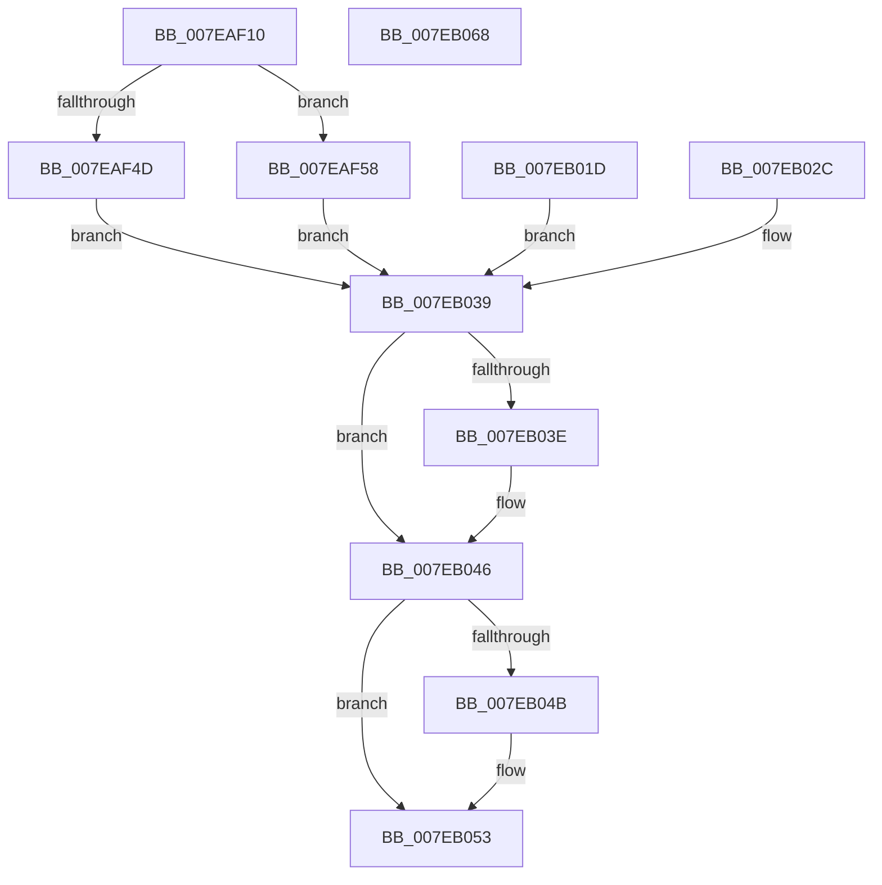

# CmpLockKeyBodyIntoMemory

- RVA: `0x007EAF10`–`0x007EB069` (길이 `345` bytes)
- VA: `0x00000001407EAF10`
- 실행 섹션: `PAGE`
- PDB 이름 있음: `예`; PDB Function 태그: `아니요`
- unwind 정보 RVA: `0x000D6DEC`
- 디코드: `98`개 명령, `345/345` bytes 표시
- 미해석 바이트: `0` (있으면 어셈블리에 `.byte`로 보존)

> 이 문서는 커널 이미지의 기계어와 PDB 기호를 분석해 생성했습니다. 4번과 5번은 함수 원형과 자료형을 바이너리 사용 방식에서 추정한 C 해석이며 원본 소스 복구 결과는 아닙니다.

## 1. Dependencies

- 직접 호출 지점: **5**; 고유 호출 대상: **4**
- 직접 호출자로 확인된 함수: **1**
- RIP 상대 이미지 참조: **0**

### Outgoing calls
- `0x007EAF3B` → [CmpAllocatePool](../../text/3C/CmpAllocatePool_function_003CD504.md) (function, `0x003CD504`)
- `0x007EAFAA` → [MmProbeAndLockPages](../../text/23/MmProbeAndLockPages_function_0023B990.md) (function, `0x0023B990`)
- `0x007EB002` → [MmProbeAndLockPages](../../text/23/MmProbeAndLockPages_function_0023B990.md) (function, `0x0023B990`)
- `0x007EB041` → [MmUnlockPages](../../text/29/MmUnlockPages_function_0029EEE0.md) (function, `0x0029EEE0`)
- `0x007EB04E` → [CmSiFreeMemory](../../text/47/CmSiFreeMemory_function_00475D80.md) (function, `0x00475D80`)

### Direct callers
- [CmOpenKeyForBugCheckRecovery](../7D/CmOpenKeyForBugCheckRecovery_function_007DF3C0.md) at `0x007DF4E4`

### Static image references
- 디코드된 RIP-relative 메모리 참조가 없습니다.

## 2. Other-region calls and transfers

- 다른 실행 섹션으로 향하는 call: **5**
  - `0x007EAF3B` → [CmpAllocatePool](../../text/3C/CmpAllocatePool_function_003CD504.md) (`PAGE` → `.text`)
  - `0x007EAFAA` → [MmProbeAndLockPages](../../text/23/MmProbeAndLockPages_function_0023B990.md) (`PAGE` → `.text`)
  - `0x007EB002` → [MmProbeAndLockPages](../../text/23/MmProbeAndLockPages_function_0023B990.md) (`PAGE` → `.text`)
  - `0x007EB041` → [MmUnlockPages](../../text/29/MmUnlockPages_function_0029EEE0.md) (`PAGE` → `.text`)
  - `0x007EB04E` → [CmSiFreeMemory](../../text/47/CmSiFreeMemory_function_00475D80.md) (`PAGE` → `.text`)
- 별도 외부 분기/꼬리 이동을 확인하지 못했습니다.

## 3. Assembly (complete function range)

```asm
007EAF10  48 89 5C 24 18                  mov qword ptr [rsp + 0x18], rbx
007EAF15  56                              push rsi
007EAF16  57                              push rdi
007EAF17  41 55                           push r13
007EAF19  41 56                           push r14
007EAF1B  41 57                           push r15
007EAF1D  48 83 EC 20                     sub rsp, 0x20
007EAF21  4C 8B F1                        mov r14, rcx
007EAF24  4C 8B 79 08                     mov r15, qword ptr [rcx + 8]
007EAF28  33 FF                           xor edi, edi
007EAF2A  40 8A F7                        mov sil, dil
007EAF2D  BA 80 00 00 00                  mov edx, 0x80
007EAF32  8D 4F 40                        lea ecx, [rdi + 0x40]
007EAF35  41 B8 43 4D 39 34               mov r8d, 0x34394d43
007EAF3B  E8 C4 25 BE FF                  call 0x1403cd504
007EAF40  48 8B D8                        mov rbx, rax
007EAF43  48 89 44 24 58                  mov qword ptr [rsp + 0x58], rax
007EAF48  48 85 C0                        test rax, rax
007EAF4B  75 0B                           jne 0x1407eaf58
007EAF4D  41 BE 9A 00 00 C0               mov r14d, 0xc000009a
007EAF53  E9 E1 00 00 00                  jmp 0x1407eb039
007EAF58  48 89 38                        mov qword ptr [rax], rdi
007EAF5B  41 0F B7 C6                     movzx eax, r14w
007EAF5F  41 BD FF 0F 00 00               mov r13d, 0xfff
007EAF65  66 41 23 C5                     and ax, r13w
007EAF69  41 8D 4D 70                     lea ecx, [r13 + 0x70]
007EAF6D  66 03 C1                        add ax, cx
007EAF70  66 C1 E8 0C                     shr ax, 0xc
007EAF74  66 83 C0 06                     add ax, 6
007EAF78  66 C1 E0 03                     shl ax, 3
007EAF7C  66 89 43 08                     mov word ptr [rbx + 8], ax
007EAF80  66 89 7B 0A                     mov word ptr [rbx + 0xa], di
007EAF84  49 8B C6                        mov rax, r14
007EAF87  48 25 00 F0 FF FF               and rax, 0xfffffffffffff000
007EAF8D  48 89 43 20                     mov qword ptr [rbx + 0x20], rax
007EAF91  41 8B C6                        mov eax, r14d
007EAF94  41 23 C5                        and eax, r13d
007EAF97  89 43 2C                        mov dword ptr [rbx + 0x2c], eax
007EAF9A  C7 43 28 70 00 00 00            mov dword ptr [rbx + 0x28], 0x70
007EAFA1  33 D2                           xor edx, edx
007EAFA3  44 8D 42 02                     lea r8d, [rdx + 2]
007EAFA7  48 8B CB                        mov rcx, rbx
007EAFAA  E8 E1 09 A5 FF                  call 0x14023b990
007EAFAF  90                              nop
007EAFB0  C6 44 24 50 01                  mov byte ptr [rsp + 0x50], 1
007EAFB5  48 89 7B 40                     mov qword ptr [rbx + 0x40], rdi
007EAFB9  41 0F B7 C7                     movzx eax, r15w
007EAFBD  66 41 23 C5                     and ax, r13w
007EAFC1  B9 37 11 00 00                  mov ecx, 0x1137
007EAFC6  66 03 C1                        add ax, cx
007EAFC9  66 C1 E8 0C                     shr ax, 0xc
007EAFCD  66 83 C0 06                     add ax, 6
007EAFD1  66 C1 E0 03                     shl ax, 3
007EAFD5  66 89 43 48                     mov word ptr [rbx + 0x48], ax
007EAFD9  66 89 7B 4A                     mov word ptr [rbx + 0x4a], di
007EAFDD  49 8B C7                        mov rax, r15
007EAFE0  48 25 00 F0 FF FF               and rax, 0xfffffffffffff000
007EAFE6  48 89 43 60                     mov qword ptr [rbx + 0x60], rax
007EAFEA  45 23 FD                        and r15d, r13d
007EAFED  44 89 7B 6C                     mov dword ptr [rbx + 0x6c], r15d
007EAFF1  C7 43 68 38 01 00 00            mov dword ptr [rbx + 0x68], 0x138
007EAFF8  33 D2                           xor edx, edx
007EAFFA  44 8D 42 02                     lea r8d, [rdx + 2]
007EAFFE  48 8D 4B 40                     lea rcx, [rbx + 0x40]
007EB002  E8 89 09 A5 FF                  call 0x14023b990
007EB007  90                              nop
007EB008  49 89 5E 68                     mov qword ptr [r14 + 0x68], rbx
007EB00C  40 8A F7                        mov sil, dil
007EB00F  48 8B DF                        mov rbx, rdi
007EB012  66 41 83 4E 30 20               or word ptr [r14 + 0x30], 0x20
007EB018  44 8B F7                        mov r14d, edi
007EB01B  EB 1C                           jmp 0x1407eb039
007EB01D  44 8B F0                        mov r14d, eax
007EB020  48 8B 5C 24 58                  mov rbx, qword ptr [rsp + 0x58]
007EB025  40 8A 74 24 50                  mov sil, byte ptr [rsp + 0x50]
007EB02A  EB 0D                           jmp 0x1407eb039
007EB02C  44 8B F0                        mov r14d, eax
007EB02F  33 FF                           xor edi, edi
007EB031  48 8B 5C 24 58                  mov rbx, qword ptr [rsp + 0x58]
007EB036  40 8A F7                        mov sil, dil
007EB039  40 84 F6                        test sil, sil
007EB03C  74 08                           je 0x1407eb046
007EB03E  48 8B CB                        mov rcx, rbx
007EB041  E8 9A 3E AB FF                  call 0x14029eee0
007EB046  48 85 DB                        test rbx, rbx
007EB049  74 08                           je 0x1407eb053
007EB04B  48 8B CB                        mov rcx, rbx
007EB04E  E8 2D AD C8 FF                  call 0x140475d80
007EB053  41 8B C6                        mov eax, r14d
007EB056  48 8B 5C 24 60                  mov rbx, qword ptr [rsp + 0x60]
007EB05B  48 83 C4 20                     add rsp, 0x20
007EB05F  41 5F                           pop r15
007EB061  41 5E                           pop r14
007EB063  41 5D                           pop r13
007EB065  5F                              pop rdi
007EB066  5E                              pop rsi
007EB067  C3                              ret
007EB068  CC                              int3
```

## 4. C-style interpretation (structured pseudocode)

```c
__int64 __fastcall CmpLockKeyBodyIntoMemory(__int64 a1)
{
    __int64 result;
    __int64 v_r15;
    __int64 v_rdi;
    __int64 v_rsp;
    unsigned __int64 v_stack_p10;
    unsigned __int64 v_stack_p18;
    unsigned __int8 v_stack_p8;

    v_stack_p18 = v_rbx;
    v_rsp = (v_rsp) - (32);
    v_rdi = 0;
    result = CmpAllocatePool(v_rdi + 64, 128, (unsigned int)(0x34394D43ULL), a4);
    v_stack_p10 = result;
    if (result != 0) goto loc_007EAF58;
    goto loc_007EB039;
loc_007EAF58:
    *(unsigned __int64 *)(result) = 0;
    result = (unsigned __int16)(((unsigned __int16)((unsigned int)(0xC000009AULL))) & ((unsigned __int16)((unsigned int)(0xFFFULL))));
    result = (unsigned __int16)((result) + ((unsigned __int16)((unsigned int)(0xFFFULL) + 112)));
    result = (unsigned __int16)((result) >> (12));
    result = (unsigned __int16)((result) + (6));
    result = (unsigned __int16)((result) << (3));
    *(unsigned __int16 *)(result + 8) = (unsigned __int16)(result);
    *(unsigned __int16 *)(result + 10) = 0;
    result = ((unsigned int)(0xC000009AULL)) & (0xFFFFFFFFFFFFF000ULL);
    *(unsigned __int64 *)(result + 32) = result;
    result = (unsigned int)(((unsigned int)((unsigned int)((unsigned int)(0xC000009AULL)))) & ((unsigned int)((unsigned int)(0xFFFULL))));
    *(unsigned int *)(result + 44) = (unsigned int)(result);
    *(unsigned int *)(result + 40) = 112;
    a2 = 0;
    result = MmProbeAndLockPages(result, a2, a2 + 2, a4);
    v_stack_p8 = 1;
    *(unsigned __int64 *)(result + 64) = 0;
    result = (unsigned __int16)(((unsigned __int16)(*(unsigned __int64 *)(a1 + 8))) & ((unsigned __int16)((unsigned int)(0xFFFULL))));
    result = (unsigned __int16)((result) + ((unsigned __int16)((unsigned int)(0x1137ULL))));
    result = (unsigned __int16)((result) >> (12));
    result = (unsigned __int16)((result) + (6));
    result = (unsigned __int16)((result) << (3));
    *(unsigned __int16 *)(result + 72) = (unsigned __int16)(result);
    *(unsigned __int16 *)(result + 74) = 0;
    result = (*(unsigned __int64 *)(a1 + 8)) & (0xFFFFFFFFFFFFF000ULL);
    *(unsigned __int64 *)(result + 96) = result;
    v_r15 = (unsigned int)((*(unsigned __int64 *)(a1 + 8)) & ((unsigned int)((unsigned int)(0xFFFULL))));
    *(unsigned int *)(result + 108) = (unsigned int)(v_r15);
    *(unsigned int *)(result + 104) = 312;
    a2 = 0;
    result = MmProbeAndLockPages(result + 64, a2, a2 + 2, a4);
    *(unsigned __int64 *)((unsigned int)(0xC000009AULL) + 104) = result;
    goto loc_007EB039;
loc_007EB039:
    if (0 != 0) {
        a1 = 0;
        result = MmUnlockPages(a1, a2, a2 + 2, a4);
    }
    if (0 != 0) {
        a1 = 0;
        result = CmSiFreeMemory(a1, a2, a2 + 2, a4);
    }
    v_rsp = (v_rsp) + (32);
    return 0;
}
```

## 5. (Beta) C Style

```c
int64_t CmpLockKeyBodyIntoMemory(void *Arg1)
{
    uint8_t *arg1 = (uint8_t *)Arg1;

    int64_t result;
    int64_t local_r15;
    int64_t local_rdi;
    int64_t local_rsp;
    uint64_t v_stack_p10;
    uint64_t v_stack_p18;
    uint8_t v_stack_p8;

    v_stack_p18 = local_rbx;
    local_rsp = (local_rsp) - (32);
    local_rdi = 0;
    result = CmpAllocatePool(local_rdi + 64, 128, (uint32_t)(0x34394D43ULL), a4);
    v_stack_p10 = result;
    if (result != 0) goto loc_007EAF58;
    goto loc_007EB039;
loc_007EAF58:
    *(uint64_t *)(result) = 0;
    result = (uint16_t)(((uint16_t)((uint32_t)(0xC000009AULL))) & ((uint16_t)((uint32_t)(0xFFFULL))));
    result = (uint16_t)((result) + ((uint16_t)((uint32_t)(0xFFFULL) + 112)));
    result = (uint16_t)((result) >> (12));
    result = (uint16_t)((result) + (6));
    result = (uint16_t)((result) << (3));
    *(uint16_t *)(result + 0x8) = (uint16_t)(result);
    *(uint16_t *)(result + 0xA) = 0;
    result = ((uint32_t)(0xC000009AULL)) & (0xFFFFFFFFFFFFF000ULL);
    *(uint64_t *)(result + 0x20) = result;
    result = (uint32_t)(((uint32_t)((uint32_t)((uint32_t)(0xC000009AULL)))) & ((uint32_t)((uint32_t)(0xFFFULL))));
    *(uint32_t *)(result + 0x2C) = (uint32_t)(result);
    *(uint32_t *)(result + 0x28) = 112;
    a2 = 0;
    result = MmProbeAndLockPages(result, a2, a2 + 2, a4);
    v_stack_p8 = 1;
    *(uint64_t *)(result + 0x40) = 0;
    result = (uint16_t)(((uint16_t)(*(uint64_t *)(arg1 + 0x8))) & ((uint16_t)((uint32_t)(0xFFFULL))));
    result = (uint16_t)((result) + ((uint16_t)((uint32_t)(0x1137ULL))));
    result = (uint16_t)((result) >> (12));
    result = (uint16_t)((result) + (6));
    result = (uint16_t)((result) << (3));
    *(uint16_t *)(result + 0x48) = (uint16_t)(result);
    *(uint16_t *)(result + 0x4A) = 0;
    result = (*(uint64_t *)(arg1 + 0x8)) & (0xFFFFFFFFFFFFF000ULL);
    *(uint64_t *)(result + 0x60) = result;
    local_r15 = (uint32_t)((*(uint64_t *)(arg1 + 0x8)) & ((uint32_t)((uint32_t)(0xFFFULL))));
    *(uint32_t *)(result + 0x6C) = (uint32_t)(local_r15);
    *(uint32_t *)(result + 0x68) = 312;
    a2 = 0;
    result = MmProbeAndLockPages(result + 64, a2, a2 + 2, a4);
    *(uint64_t *)((uint32_t)(0xC000009AULL) + 0x68) = result;
    goto loc_007EB039;
loc_007EB039:
    if (0 != 0) {
        Arg1 = 0;
        result = MmUnlockPages(Arg1, a2, a2 + 2, a4);
    }
    if (0 != 0) {
        Arg1 = 0;
        result = CmSiFreeMemory(Arg1, a2, a2 + 2, a4);
    }
    local_rsp = (local_rsp) + (32);
    return 0;
}
```

### 관측된 메모리 오프셋

구조체 형식이 확인되지 않은 접근은 인자 기준의 오프셋으로만 기록했습니다.

| 기준 인자 | 오프셋 표현 | 폭 (bit) | 접근 |
|---|---:|---:|---|
| `Arg1` | `+ 0x8` | `64` | `R` |
| `Arg1` | `+ 0x30` | `16` | `R/W` |
| `Arg1` | `+ 0x68` | `64` | `W` |

## 6. Execution-region graph

[열기: 2D/3D 그래프와 함수 탐색 컨트롤 패널](../../../control-panel.html?section=page&rva=0x007EAF10&view=graph)

- 2D 그래프는 위에서 아래로 흐르고, 3D 그래프는 빈 공간을 드래그해 회전합니다. Shift+드래그는 이동, 휠은 확대·축소, 함수 노드 선택은 대상 보고서 이동입니다.

### Static fallback


