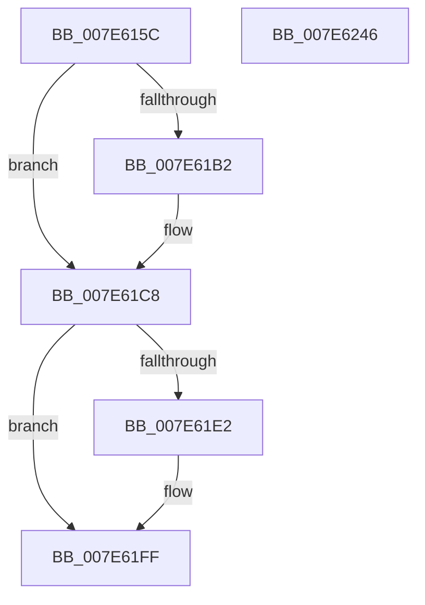

# CmpLogHiveDestroyEvent

- RVA: `0x007E615C`–`0x007E6247` (길이 `235` bytes)
- VA: `0x00000001407E615C`
- 실행 섹션: `PAGE`
- PDB 이름 있음: `예`; PDB Function 태그: `아니요`
- unwind 정보 RVA: `0x000C6160`
- 디코드: `57`개 명령, `235/235` bytes 표시
- 미해석 바이트: `0` (있으면 어셈블리에 `.byte`로 보존)

> 이 문서는 커널 이미지의 기계어와 PDB 기호를 분석해 생성했습니다. 4번과 5번은 함수 원형과 자료형을 바이너리 사용 방식에서 추정한 C 해석이며 원본 소스 복구 결과는 아닙니다.

## 1. Dependencies

- 직접 호출 지점: **2**; 고유 호출 대상: **2**
- 직접 호출자로 확인된 함수: **1**
- RIP 상대 이미지 참조: **1**

### Outgoing calls
- `0x007E622C` → [EtwTraceKernelEvent](../../text/23/EtwTraceKernelEvent_function_00235350.md) (function, `0x00235350`)
- `0x007E6238` → [_security_check_cookie](../../text/6A/_security_check_cookie_function_006AC640.md) (function, `0x006AC640`)

### Direct callers
- [CmpRemoveHiveFromNamespace](../../text/49/CmpRemoveHiveFromNamespace_function_0049C4CC.md) at `0x0049C594`

### Static image references
- `0x007E616E` → RVA `0x00E0A740` (`.data`; read)

## 2. Other-region calls and transfers

- 다른 실행 섹션으로 향하는 call: **2**
  - `0x007E622C` → [EtwTraceKernelEvent](../../text/23/EtwTraceKernelEvent_function_00235350.md) (`PAGE` → `.text`)
  - `0x007E6238` → [_security_check_cookie](../../text/6A/_security_check_cookie_function_006AC640.md) (`PAGE` → `.text`)
- 별도 외부 분기/꼬리 이동을 확인하지 못했습니다.

## 3. Assembly (complete function range)

```asm
007E615C  48 89 4C 24 08                  mov qword ptr [rsp + 8], rcx
007E6161  55                              push rbp
007E6162  48 8D 6C 24 A9                  lea rbp, [rsp - 0x57]
007E6167  48 81 EC A0 00 00 00            sub rsp, 0xa0
007E616E  48 8B 05 CB 45 62 00            mov rax, qword ptr [rip + 0x6245cb]
007E6175  48 33 C4                        xor rax, rsp
007E6178  48 89 45 47                     mov qword ptr [rbp + 0x47], rax
007E617C  45 33 D2                        xor r10d, r10d
007E617F  48 C7 45 FF 08 00 00 00         mov qword ptr [rbp - 1], 8
007E6187  66 44 89 55 E7                  mov word ptr [rbp - 0x19], r10w
007E618C  4C 8B C1                        mov r8, rcx
007E618F  48 8B 81 38 07 00 00            mov rax, qword ptr [rcx + 0x738]
007E6196  4C 8B 89 48 07 00 00            mov r9, qword ptr [rcx + 0x748]
007E619D  48 8D 4D 67                     lea rcx, [rbp + 0x67]
007E61A1  48 89 4D F7                     mov qword ptr [rbp - 9], rcx
007E61A5  41 8D 52 01                     lea edx, [r10 + 1]
007E61A9  45 8D 5A 02                     lea r11d, [r10 + 2]
007E61AD  48 85 C0                        test rax, rax
007E61B0  74 16                           je 0x1407e61c8
007E61B2  48 89 45 07                     mov qword ptr [rbp + 7], rax
007E61B6  41 8B D3                        mov edx, r11d
007E61B9  41 0F B7 80 30 07 00 00         movzx eax, word ptr [r8 + 0x730]
007E61C1  89 45 0F                        mov dword ptr [rbp + 0xf], eax
007E61C4  44 89 55 13                     mov dword ptr [rbp + 0x13], r10d
007E61C8  8B C2                           mov eax, edx
007E61CA  48 8D 4D E7                     lea rcx, [rbp - 0x19]
007E61CE  48 03 C0                        add rax, rax
007E61D1  FF C2                           inc edx
007E61D3  48 89 4C C5 F7                  mov qword ptr [rbp + rax*8 - 9], rcx
007E61D8  4C 89 5C C5 FF                  mov qword ptr [rbp + rax*8 - 1], r11
007E61DD  4D 85 C9                        test r9, r9
007E61E0  74 1D                           je 0x1407e61ff
007E61E2  41 0F B7 80 40 07 00 00         movzx eax, word ptr [r8 + 0x740]
007E61EA  8B CA                           mov ecx, edx
007E61EC  48 03 C9                        add rcx, rcx
007E61EF  FF C2                           inc edx
007E61F1  4C 89 4C CD F7                  mov qword ptr [rbp + rcx*8 - 9], r9
007E61F6  89 44 CD FF                     mov dword ptr [rbp + rcx*8 - 1], eax
007E61FA  44 89 54 CD 03                  mov dword ptr [rbp + rcx*8 + 3], r10d
007E61FF  8B C2                           mov eax, edx
007E6201  48 8D 4D E7                     lea rcx, [rbp - 0x19]
007E6205  48 03 C0                        add rax, rax
007E6208  C7 44 24 20 02 19 60 00         mov dword ptr [rsp + 0x20], 0x601902
007E6210  41 B9 25 09 00 00               mov r9d, 0x925
007E6216  FF C2                           inc edx
007E6218  41 B8 00 00 00 41               mov r8d, 0x41000000
007E621E  48 89 4C C5 F7                  mov qword ptr [rbp + rax*8 - 9], rcx
007E6223  48 8D 4D F7                     lea rcx, [rbp - 9]
007E6227  4C 89 5C C5 FF                  mov qword ptr [rbp + rax*8 - 1], r11
007E622C  E8 1F F1 A4 FF                  call 0x140235350
007E6231  48 8B 4D 47                     mov rcx, qword ptr [rbp + 0x47]
007E6235  48 33 CC                        xor rcx, rsp
007E6238  E8 03 64 EC FF                  call 0x1406ac640
007E623D  48 81 C4 A0 00 00 00            add rsp, 0xa0
007E6244  5D                              pop rbp
007E6245  C3                              ret
007E6246  CC                              int3
```

## 4. C-style interpretation (structured pseudocode)

```c
__int64 __fastcall CmpLogHiveDestroyEvent(__int64 a1)
{
    __int64 result;
    __int64 v_r10;
    __int64 v_rsp;
    unsigned __int64 v_stack_m18;
    unsigned int v_stack_m4C;
    unsigned int v_stack_m50;
    unsigned __int64 v_stack_m58;
    unsigned __int64 v_stack_m5F;
    unsigned __int64 v_stack_m60;
    unsigned __int64 v_stack_m68;
    unsigned __int16 v_stack_m78;
    unsigned int v_stack_m88;
    unsigned __int64 v_stack_p8;

    v_stack_p8 = a1;
    v_rsp = (v_rsp) - (160);
    result = (*(unsigned __int64 *)(v_rip + 6440395)) ^ (v_rsp);
    v_stack_m18 = result;
    v_r10 = 0;
    v_stack_m60 = 8;
    v_stack_m78 = 0;
    v_stack_m68 = v_stack_p8;
    result = *(unsigned __int64 *)(a1 + 1848);
    if (*(unsigned __int64 *)(a1 + 1848) != 0) {
        v_stack_m58 = *(unsigned __int64 *)(a1 + 1848);
        a2 = (unsigned int)(v_r10 + 2);
        result = *(unsigned __int16 *)(a1 + 1840);
        v_stack_m50 = (unsigned int)(result);
        v_stack_m4C = 0;
    }
    result = ((unsigned int)((unsigned int)(a2))) + ((unsigned int)((unsigned int)(a2)));
    a2 = (unsigned int)((a2) + 1);
    *(unsigned __int64 *)(v_stack_m5F + result * 8 - 9) = v_stack_m78;
    *(unsigned __int64 *)(v_stack_m5F + result * 8 - 1) = v_r10 + 2;
    if (*(unsigned __int64 *)(a1 + 1864) != 0) {
        result = *(unsigned __int16 *)(a1 + 1856);
        a1 = (unsigned int)(a2);
        a1 = (a1) + (a1);
        a2 = (unsigned int)((a2) + 1);
        *(unsigned __int64 *)(v_stack_m5F + a1 * 8 - 9) = *(unsigned __int64 *)(a1 + 1864);
        *(unsigned int *)(v_stack_m5F + a1 * 8 - 1) = (unsigned int)(result);
        *(unsigned int *)(v_stack_m5F + a1 * 8 + 3) = 0;
    }
    result = ((unsigned int)((unsigned int)(a2))) + ((unsigned int)((unsigned int)(a2)));
    v_stack_m88 = 0x601902ULL;
    a2 = (unsigned int)((a2) + 1);
    *(unsigned __int64 *)(v_stack_m5F + result * 8 - 9) = v_stack_m78;
    *(unsigned __int64 *)(v_stack_m5F + result * 8 - 1) = v_r10 + 2;
    result = EtwTraceKernelEvent(v_stack_m68, a2, (unsigned int)(0x41000000ULL), (unsigned int)(0x925ULL));
    a1 = (v_stack_m18) ^ (v_rsp);
    result = _security_check_cookie(a1, a2, (unsigned int)(0x41000000ULL), (unsigned int)(0x925ULL));
    v_rsp = (v_rsp) + (160);
    return result;
}
```

## 5. (Beta) C Style

```c
int64_t CmpLogHiveDestroyEvent(void *Arg1)
{
    uint8_t *arg1 = (uint8_t *)Arg1;

    int64_t result;
    int64_t local_r10;
    int64_t local_rsp;
    uint64_t v_stack_m18;
    uint32_t v_stack_m4C;
    uint32_t v_stack_m50;
    uint64_t v_stack_m58;
    uint64_t v_stack_m5F;
    uint64_t v_stack_m60;
    uint64_t v_stack_m68;
    uint16_t v_stack_m78;
    uint32_t v_stack_m88;
    uint64_t v_stack_p8;

    v_stack_p8 = Arg1;
    local_rsp = (local_rsp) - (160);
    result = (*(uint64_t *)(v_rip + 0x6245CB)) ^ (local_rsp);
    v_stack_m18 = result;
    local_r10 = 0;
    v_stack_m60 = 8;
    v_stack_m78 = 0;
    v_stack_m68 = v_stack_p8;
    result = *(uint64_t *)(arg1 + 0x738);
    if (*(uint64_t *)(arg1 + 0x738) != 0) {
        v_stack_m58 = *(uint64_t *)(arg1 + 0x738);
        a2 = (uint32_t)(local_r10 + 2);
        result = *(uint16_t *)(arg1 + 0x730);
        v_stack_m50 = (uint32_t)(result);
        v_stack_m4C = 0;
    }
    result = ((uint32_t)((uint32_t)(a2))) + ((uint32_t)((uint32_t)(a2)));
    a2 = (uint32_t)((a2) + 1);
    *(uint64_t *)(v_stack_m5F + result * 8 - 0x9) = v_stack_m78;
    *(uint64_t *)(v_stack_m5F + result * 8 - 0x1) = local_r10 + 2;
    if (*(uint64_t *)(arg1 + 0x748) != 0) {
        result = *(uint16_t *)(arg1 + 0x740);
        Arg1 = (uint32_t)(a2);
        Arg1 = (Arg1) + (Arg1);
        a2 = (uint32_t)((a2) + 1);
        *(uint64_t *)(v_stack_m5F + arg1 * 8 - 0x9) = *(uint64_t *)(arg1 + 0x748);
        *(uint32_t *)(v_stack_m5F + arg1 * 8 - 0x1) = (uint32_t)(result);
        *(uint32_t *)(v_stack_m5F + arg1 * 8 + 0x3) = 0;
    }
    result = ((uint32_t)((uint32_t)(a2))) + ((uint32_t)((uint32_t)(a2)));
    v_stack_m88 = 0x601902ULL;
    a2 = (uint32_t)((a2) + 1);
    *(uint64_t *)(v_stack_m5F + result * 8 - 0x9) = v_stack_m78;
    *(uint64_t *)(v_stack_m5F + result * 8 - 0x1) = local_r10 + 2;
    result = EtwTraceKernelEvent(v_stack_m68, a2, (uint32_t)(0x41000000ULL), (uint32_t)(0x925ULL));
    Arg1 = (v_stack_m18) ^ (local_rsp);
    result = _security_check_cookie(Arg1, a2, (uint32_t)(0x41000000ULL), (uint32_t)(0x925ULL));
    local_rsp = (local_rsp) + (160);
    return result;
}
```

### 관측된 메모리 오프셋

구조체 형식이 확인되지 않은 접근은 인자 기준의 오프셋으로만 기록했습니다.

| 기준 인자 | 오프셋 표현 | 폭 (bit) | 접근 |
|---|---:|---:|---|
| `Arg1` | `+ 0x730` | `16` | `R` |
| `Arg1` | `+ 0x738` | `64` | `R` |
| `Arg1` | `+ 0x740` | `16` | `R` |
| `Arg1` | `+ 0x748` | `64` | `R` |

## 6. Execution-region graph

[열기: 2D/3D 그래프와 함수 탐색 컨트롤 패널](../../../control-panel.html?section=page&rva=0x007E615C&view=graph)

- 2D 그래프는 위에서 아래로 흐르고, 3D 그래프는 빈 공간을 드래그해 회전합니다. Shift+드래그는 이동, 휠은 확대·축소, 함수 노드 선택은 대상 보고서 이동입니다.

### Static fallback


