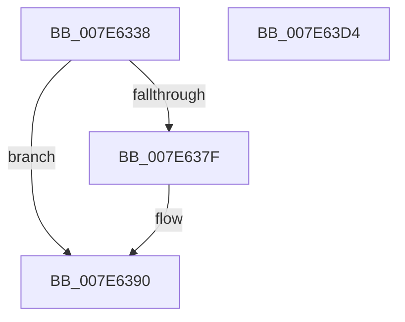

# CmpLogHiveLinkEvent

- RVA: `0x007E6338`–`0x007E63D5` (길이 `157` bytes)
- VA: `0x00000001407E6338`
- 실행 섹션: `PAGE`
- PDB 이름 있음: `예`; PDB Function 태그: `아니요`
- unwind 정보 RVA: `0x000B540C`
- 디코드: `41`개 명령, `157/157` bytes 표시
- 미해석 바이트: `0` (있으면 어셈블리에 `.byte`로 보존)

> 이 문서는 커널 이미지의 기계어와 PDB 기호를 분석해 생성했습니다. 4번과 5번은 함수 원형과 자료형을 바이너리 사용 방식에서 추정한 C 해석이며 원본 소스 복구 결과는 아닙니다.

## 1. Dependencies

- 직접 호출 지점: **2**; 고유 호출 대상: **2**
- 직접 호출자로 확인된 함수: **1**
- RIP 상대 이미지 참조: **1**

### Outgoing calls
- `0x007E63BD` → [EtwTraceKernelEvent](../../text/23/EtwTraceKernelEvent_function_00235350.md) (function, `0x00235350`)
- `0x007E63C9` → [_security_check_cookie](../../text/6A/_security_check_cookie_function_006AC640.md) (function, `0x006AC640`)

### Direct callers
- [CmpLinkHiveToMaster](../87/CmpLinkHiveToMaster_function_00877D6C.md) at `0x0087815C`

### Static image references
- `0x007E6345` → RVA `0x00E0A740` (`.data`; read)

## 2. Other-region calls and transfers

- 다른 실행 섹션으로 향하는 call: **2**
  - `0x007E63BD` → [EtwTraceKernelEvent](../../text/23/EtwTraceKernelEvent_function_00235350.md) (`PAGE` → `.text`)
  - `0x007E63C9` → [_security_check_cookie](../../text/6A/_security_check_cookie_function_006AC640.md) (`PAGE` → `.text`)
- 별도 외부 분기/꼬리 이동을 확인하지 못했습니다.

## 3. Assembly (complete function range)

```asm
007E6338  48 89 4C 24 08                  mov qword ptr [rsp + 8], rcx
007E633D  55                              push rbp
007E633E  48 8B EC                        mov rbp, rsp
007E6341  48 83 EC 70                     sub rsp, 0x70
007E6345  48 8B 05 F4 43 62 00            mov rax, qword ptr [rip + 0x6243f4]
007E634C  48 33 C4                        xor rax, rsp
007E634F  48 89 45 F8                     mov qword ptr [rbp - 8], rax
007E6353  45 33 C0                        xor r8d, r8d
007E6356  48 C7 45 D0 08 00 00 00         mov qword ptr [rbp - 0x30], 8
007E635E  48 8B C2                        mov rax, rdx
007E6361  66 44 89 45 C0                  mov word ptr [rbp - 0x40], r8w
007E6366  48 8D 4D 10                     lea rcx, [rbp + 0x10]
007E636A  48 89 4D C8                     mov qword ptr [rbp - 0x38], rcx
007E636E  41 8D 50 01                     lea edx, [r8 + 1]
007E6372  48 8B 48 08                     mov rcx, qword ptr [rax + 8]
007E6376  45 8D 48 02                     lea r9d, [r8 + 2]
007E637A  48 85 C9                        test rcx, rcx
007E637D  74 11                           je 0x1407e6390
007E637F  0F B7 00                        movzx eax, word ptr [rax]
007E6382  41 8B D1                        mov edx, r9d
007E6385  89 45 E0                        mov dword ptr [rbp - 0x20], eax
007E6388  48 89 4D D8                     mov qword ptr [rbp - 0x28], rcx
007E638C  44 89 45 E4                     mov dword ptr [rbp - 0x1c], r8d
007E6390  8B C2                           mov eax, edx
007E6392  48 8D 4D C0                     lea rcx, [rbp - 0x40]
007E6396  48 03 C0                        add rax, rax
007E6399  C7 44 24 20 02 19 60 00         mov dword ptr [rsp + 0x20], 0x601902
007E63A1  FF C2                           inc edx
007E63A3  41 B8 00 00 00 41               mov r8d, 0x41000000
007E63A9  48 89 4C C5 C8                  mov qword ptr [rbp + rax*8 - 0x38], rcx
007E63AE  48 8D 4D C8                     lea rcx, [rbp - 0x38]
007E63B2  4C 89 4C C5 D0                  mov qword ptr [rbp + rax*8 - 0x30], r9
007E63B7  41 B9 26 09 00 00               mov r9d, 0x926
007E63BD  E8 8E EF A4 FF                  call 0x140235350
007E63C2  48 8B 4D F8                     mov rcx, qword ptr [rbp - 8]
007E63C6  48 33 CC                        xor rcx, rsp
007E63C9  E8 72 62 EC FF                  call 0x1406ac640
007E63CE  48 83 C4 70                     add rsp, 0x70
007E63D2  5D                              pop rbp
007E63D3  C3                              ret
007E63D4  CC                              int3
```

## 4. C-style interpretation (structured pseudocode)

```c
__int64 __fastcall CmpLogHiveLinkEvent(__int64 a1, __int64 a2, int a3)
{
    __int64 result;
    __int64 v_rsp;
    unsigned __int64 v_stack_m10;
    unsigned int v_stack_m24;
    unsigned int v_stack_m28;
    unsigned __int64 v_stack_m30;
    unsigned __int64 v_stack_m38;
    unsigned __int64 v_stack_m40;
    unsigned __int16 v_stack_m48;
    unsigned int v_stack_m58;
    unsigned __int64 v_stack_p8;

    v_stack_p8 = a1;
    v_rsp = (v_rsp) - (112);
    result = (*(unsigned __int64 *)(v_rip + 6439924)) ^ (v_rsp);
    v_stack_m10 = result;
    a3 = 0;
    v_stack_m38 = 8;
    v_stack_m48 = 0;
    v_stack_m40 = v_stack_p8;
    result = a2;
    if (*(unsigned __int64 *)(a2 + 8) != 0) {
        result = *(unsigned __int16 *)(a2);
        a2 = (unsigned int)(a3 + 2);
        v_stack_m28 = (unsigned int)(result);
        v_stack_m30 = *(unsigned __int64 *)(a2 + 8);
        v_stack_m24 = 0;
    }
    result = ((unsigned int)((unsigned int)(a2))) + ((unsigned int)((unsigned int)(a2)));
    v_stack_m58 = 0x601902ULL;
    a2 = (unsigned int)((a2) + 1);
    *(unsigned __int64 *)(v_rsp + result * 8 - 56) = v_stack_m48;
    *(unsigned __int64 *)(v_rsp + result * 8 - 48) = a3 + 2;
    result = EtwTraceKernelEvent(v_stack_m40, a2, (unsigned int)(0x41000000ULL), (unsigned int)(0x926ULL));
    a1 = (v_stack_m10) ^ (v_rsp);
    result = _security_check_cookie(a1, a2, (unsigned int)(0x41000000ULL), (unsigned int)(0x926ULL));
    v_rsp = (v_rsp) + (112);
    return result;
}
```

## 5. (Beta) C Style

```c
int64_t CmpLogHiveLinkEvent(int64_t Arg1, void *Arg2, int32_t Arg3)
{
    uint8_t *arg2 = (uint8_t *)Arg2;

    int64_t result;
    int64_t local_rsp;
    uint64_t v_stack_m10;
    uint32_t v_stack_m24;
    uint32_t v_stack_m28;
    uint64_t v_stack_m30;
    uint64_t v_stack_m38;
    uint64_t v_stack_m40;
    uint16_t v_stack_m48;
    uint32_t v_stack_m58;
    uint64_t v_stack_p8;

    v_stack_p8 = Arg1;
    local_rsp = (local_rsp) - (112);
    result = (*(uint64_t *)(v_rip + 0x6243F4)) ^ (local_rsp);
    v_stack_m10 = result;
    Arg3 = 0;
    v_stack_m38 = 8;
    v_stack_m48 = 0;
    v_stack_m40 = v_stack_p8;
    result = Arg2;
    if (*(uint64_t *)(arg2 + 0x8) != 0) {
        result = *(uint16_t *)(arg2);
        Arg2 = (uint32_t)(Arg3 + 2);
        v_stack_m28 = (uint32_t)(result);
        v_stack_m30 = *(uint64_t *)(arg2 + 0x8);
        v_stack_m24 = 0;
    }
    result = ((uint32_t)((uint32_t)(Arg2))) + ((uint32_t)((uint32_t)(Arg2)));
    v_stack_m58 = 0x601902ULL;
    Arg2 = (uint32_t)((Arg2) + 1);
    *(uint64_t *)(local_rsp + result * 8 - 0x38) = v_stack_m48;
    *(uint64_t *)(local_rsp + result * 8 - 0x30) = Arg3 + 2;
    result = EtwTraceKernelEvent(v_stack_m40, Arg2, (uint32_t)(0x41000000ULL), (uint32_t)(0x926ULL));
    Arg1 = (v_stack_m10) ^ (local_rsp);
    result = _security_check_cookie(Arg1, Arg2, (uint32_t)(0x41000000ULL), (uint32_t)(0x926ULL));
    local_rsp = (local_rsp) + (112);
    return result;
}
```

### 관측된 메모리 오프셋

구조체 형식이 확인되지 않은 접근은 인자 기준의 오프셋으로만 기록했습니다.

| 기준 인자 | 오프셋 표현 | 폭 (bit) | 접근 |
|---|---:|---:|---|
| `Arg2` | `+ 0x0` | `16` | `R` |
| `Arg2` | `+ 0x8` | `64` | `R` |

## 6. Execution-region graph

[열기: 2D/3D 그래프와 함수 탐색 컨트롤 패널](../../../control-panel.html?section=page&rva=0x007E6338&view=graph)

- 2D 그래프는 위에서 아래로 흐르고, 3D 그래프는 빈 공간을 드래그해 회전합니다. Shift+드래그는 이동, 휠은 확대·축소, 함수 노드 선택은 대상 보고서 이동입니다.

### Static fallback


