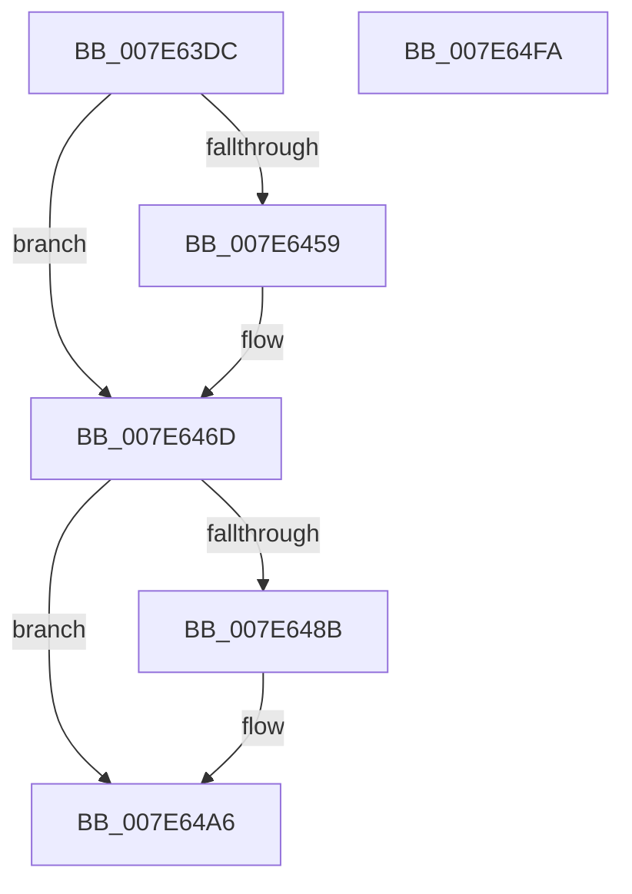

# CmpLogHiveRundownEvent

- RVA: `0x007E63DC`–`0x007E64FB` (길이 `287` bytes)
- VA: `0x00000001407E63DC`
- 실행 섹션: `PAGE`
- PDB 이름 있음: `예`; PDB Function 태그: `아니요`
- unwind 정보 RVA: `0x000D6C7C`
- 디코드: `66`개 명령, `287/287` bytes 표시
- 미해석 바이트: `0` (있으면 어셈블리에 `.byte`로 보존)

> 이 문서는 커널 이미지의 기계어와 PDB 기호를 분석해 생성했습니다. 4번과 5번은 함수 원형과 자료형을 바이너리 사용 방식에서 추정한 C 해석이며 원본 소스 복구 결과는 아닙니다.

## 1. Dependencies

- 직접 호출 지점: **2**; 고유 호출 대상: **2**
- 직접 호출자로 확인된 함수: **1**
- RIP 상대 이미지 참조: **1**

### Outgoing calls
- `0x007E64D8` → [EtwTraceSiloDcEvent](../../text/48/EtwTraceSiloDcEvent_function_0048B28C.md) (function, `0x0048B28C`)
- `0x007E64E4` → [_security_check_cookie](../../text/6A/_security_check_cookie_function_006AC640.md) (function, `0x006AC640`)

### Direct callers
- [CmEtwRunDown](../A8/CmEtwRunDown_function_00A85AC0.md) at `0x00A85D3F`

### Static image references
- `0x007E63F3` → RVA `0x00E0A740` (`.data`; read)

## 2. Other-region calls and transfers

- 다른 실행 섹션으로 향하는 call: **2**
  - `0x007E64D8` → [EtwTraceSiloDcEvent](../../text/48/EtwTraceSiloDcEvent_function_0048B28C.md) (`PAGE` → `.text`)
  - `0x007E64E4` → [_security_check_cookie](../../text/6A/_security_check_cookie_function_006AC640.md) (`PAGE` → `.text`)
- 별도 외부 분기/꼬리 이동을 확인하지 못했습니다.

## 3. Assembly (complete function range)

```asm
007E63DC  48 89 5C 24 20                  mov qword ptr [rsp + 0x20], rbx
007E63E1  48 89 4C 24 08                  mov qword ptr [rsp + 8], rcx
007E63E6  55                              push rbp
007E63E7  48 8D 6C 24 A9                  lea rbp, [rsp - 0x57]
007E63EC  48 81 EC C0 00 00 00            sub rsp, 0xc0
007E63F3  48 8B 05 46 43 62 00            mov rax, qword ptr [rip + 0x624346]
007E63FA  48 33 C4                        xor rax, rsp
007E63FD  48 89 45 47                     mov qword ptr [rbp + 0x47], rax
007E6401  33 DB                           xor ebx, ebx
007E6403  48 8D 81 08 07 00 00            lea rax, [rcx + 0x708]
007E640A  66 89 5D C7                     mov word ptr [rbp - 0x39], bx
007E640E  45 8B D8                        mov r11d, r8d
007E6411  4C 8B 89 38 07 00 00            mov r9, qword ptr [rcx + 0x738]
007E6418  4C 8B D2                        mov r10, rdx
007E641B  4C 8B 81 48 07 00 00            mov r8, qword ptr [rcx + 0x748]
007E6422  48 89 45 D7                     mov qword ptr [rbp - 0x29], rax
007E6426  48 8D 45 67                     lea rax, [rbp + 0x67]
007E642A  48 89 45 E7                     mov qword ptr [rbp - 0x19], rax
007E642E  48 8D 81 9C 12 00 00            lea rax, [rcx + 0x129c]
007E6435  48 89 45 F7                     mov qword ptr [rbp - 9], rax
007E6439  8D 53 03                        lea edx, [rbx + 3]
007E643C  48 C7 45 DF 08 00 00 00         mov qword ptr [rbp - 0x21], 8
007E6444  48 C7 45 EF 08 00 00 00         mov qword ptr [rbp - 0x11], 8
007E644C  48 C7 45 FF 04 00 00 00         mov qword ptr [rbp - 1], 4
007E6454  4D 85 C9                        test r9, r9
007E6457  74 14                           je 0x1407e646d
007E6459  0F B7 81 30 07 00 00            movzx eax, word ptr [rcx + 0x730]
007E6460  8D 53 04                        lea edx, [rbx + 4]
007E6463  89 45 0F                        mov dword ptr [rbp + 0xf], eax
007E6466  4C 89 4D 07                     mov qword ptr [rbp + 7], r9
007E646A  89 5D 13                        mov dword ptr [rbp + 0x13], ebx
007E646D  8B C2                           mov eax, edx
007E646F  4C 8D 4D C7                     lea r9, [rbp - 0x39]
007E6473  48 03 C0                        add rax, rax
007E6476  FF C2                           inc edx
007E6478  4C 89 4C C5 D7                  mov qword ptr [rbp + rax*8 - 0x29], r9
007E647D  48 C7 44 C5 DF 02 00 00 00      mov qword ptr [rbp + rax*8 - 0x21], 2
007E6486  4D 85 C0                        test r8, r8
007E6489  74 1B                           je 0x1407e64a6
007E648B  0F B7 81 40 07 00 00            movzx eax, word ptr [rcx + 0x740]
007E6492  8B CA                           mov ecx, edx
007E6494  48 03 C9                        add rcx, rcx
007E6497  FF C2                           inc edx
007E6499  4C 89 44 CD D7                  mov qword ptr [rbp + rcx*8 - 0x29], r8
007E649E  89 44 CD DF                     mov dword ptr [rbp + rcx*8 - 0x21], eax
007E64A2  89 5C CD E3                     mov dword ptr [rbp + rcx*8 - 0x1d], ebx
007E64A6  8B C2                           mov eax, edx
007E64A8  48 8D 4D C7                     lea rcx, [rbp - 0x39]
007E64AC  48 03 C0                        add rax, rax
007E64AF  C7 44 24 28 02 18 50 00         mov dword ptr [rsp + 0x28], 0x501802
007E64B7  FF C2                           inc edx
007E64B9  66 C7 44 24 20 27 09            mov word ptr [rsp + 0x20], 0x927
007E64C0  45 8B CB                        mov r9d, r11d
007E64C3  4D 8B C2                        mov r8, r10
007E64C6  48 89 4C C5 D7                  mov qword ptr [rbp + rax*8 - 0x29], rcx
007E64CB  48 8D 4D D7                     lea rcx, [rbp - 0x29]
007E64CF  48 C7 44 C5 DF 02 00 00 00      mov qword ptr [rbp + rax*8 - 0x21], 2
007E64D8  E8 AF 4D CA FF                  call 0x14048b28c
007E64DD  48 8B 4D 47                     mov rcx, qword ptr [rbp + 0x47]
007E64E1  48 33 CC                        xor rcx, rsp
007E64E4  E8 57 61 EC FF                  call 0x1406ac640
007E64E9  48 8B 9C 24 E8 00 00 00         mov rbx, qword ptr [rsp + 0xe8]
007E64F1  48 81 C4 C0 00 00 00            add rsp, 0xc0
007E64F8  5D                              pop rbp
007E64F9  C3                              ret
007E64FA  CC                              int3
```

## 4. C-style interpretation (structured pseudocode)

```c
__int64 __fastcall CmpLogHiveRundownEvent(__int64 a1, __int64 a2, int a3)
{
    __int64 result;
    __int64 v_rbx;
    __int64 v_rsp;
    unsigned __int64 v_stack_m18;
    unsigned int v_stack_m4C;
    unsigned int v_stack_m50;
    unsigned __int64 v_stack_m58;
    unsigned __int64 v_stack_m5F;
    unsigned __int64 v_stack_m60;
    unsigned __int64 v_stack_m68;
    unsigned __int64 v_stack_m70;
    unsigned __int64 v_stack_m78;
    unsigned __int64 v_stack_m80;
    unsigned __int64 v_stack_m88;
    unsigned __int16 v_stack_m98;
    unsigned int v_stack_mA0;
    unsigned __int16 v_stack_mA8;
    unsigned __int64 v_stack_p20;
    unsigned __int64 v_stack_p8;

    v_stack_p20 = v_rbx;
    v_stack_p8 = a1;
    v_rsp = (v_rsp) - (192);
    result = (*(unsigned __int64 *)(v_rip + 6439750)) ^ (v_rsp);
    v_stack_m18 = result;
    v_rbx = 0;
    v_stack_m98 = 0;
    v_stack_m88 = a1 + 1800;
    v_stack_m78 = v_stack_p8;
    v_stack_m68 = a1 + 4764;
    v_stack_m80 = 8;
    v_stack_m70 = 8;
    v_stack_m60 = 4;
    result = a1 + 4764;
    if (*(unsigned __int64 *)(a1 + 1848) != 0) {
        result = *(unsigned __int16 *)(a1 + 1840);
        a2 = v_rbx + 4;
        v_stack_m50 = (unsigned int)(result);
        v_stack_m58 = *(unsigned __int64 *)(a1 + 1848);
        v_stack_m4C = 0;
    }
    result = ((unsigned int)((unsigned int)(a2))) + ((unsigned int)((unsigned int)(a2)));
    a2 = (unsigned int)((a2) + 1);
    *(unsigned __int64 *)(v_stack_m5F + result * 8 - 41) = v_stack_m98;
    *(unsigned __int64 *)(v_stack_m5F + result * 8 - 33) = 2;
    if (*(unsigned __int64 *)(a1 + 1864) != 0) {
        result = *(unsigned __int16 *)(a1 + 1856);
        a1 = (unsigned int)(a2);
        a1 = (a1) + (a1);
        a2 = (unsigned int)((a2) + 1);
        *(unsigned __int64 *)(v_stack_m5F + a1 * 8 - 41) = *(unsigned __int64 *)(a1 + 1864);
        *(unsigned int *)(v_stack_m5F + a1 * 8 - 33) = (unsigned int)(result);
        *(unsigned int *)(v_stack_m5F + a1 * 8 - 29) = 0;
    }
    result = ((unsigned int)((unsigned int)(a2))) + ((unsigned int)((unsigned int)(a2)));
    v_stack_mA0 = 0x501802ULL;
    a2 = (unsigned int)((a2) + 1);
    v_stack_mA8 = 0x927ULL;
    *(unsigned __int64 *)(v_stack_m5F + result * 8 - 41) = v_stack_m98;
    *(unsigned __int64 *)(v_stack_m5F + result * 8 - 33) = 2;
    result = EtwTraceSiloDcEvent(v_stack_m88, a2, a2, (unsigned int)((unsigned int)((unsigned int)(a3))));
    a1 = (v_stack_m18) ^ (v_rsp);
    result = _security_check_cookie(a1, a2, a2, (unsigned int)((unsigned int)((unsigned int)(a3))));
    v_rsp = (v_rsp) + (192);
    return result;
}
```

## 5. (Beta) C Style

```c
int64_t CmpLogHiveRundownEvent(void *Arg1, int64_t Arg2, int32_t Arg3)
{
    uint8_t *arg1 = (uint8_t *)Arg1;

    int64_t result;
    int64_t local_rbx;
    int64_t local_rsp;
    uint64_t v_stack_m18;
    uint32_t v_stack_m4C;
    uint32_t v_stack_m50;
    uint64_t v_stack_m58;
    uint64_t v_stack_m5F;
    uint64_t v_stack_m60;
    uint64_t v_stack_m68;
    uint64_t v_stack_m70;
    uint64_t v_stack_m78;
    uint64_t v_stack_m80;
    uint64_t v_stack_m88;
    uint16_t v_stack_m98;
    uint32_t v_stack_mA0;
    uint16_t v_stack_mA8;
    uint64_t v_stack_p20;
    uint64_t v_stack_p8;

    v_stack_p20 = local_rbx;
    v_stack_p8 = Arg1;
    local_rsp = (local_rsp) - (192);
    result = (*(uint64_t *)(v_rip + 0x624346)) ^ (local_rsp);
    v_stack_m18 = result;
    local_rbx = 0;
    v_stack_m98 = 0;
    v_stack_m88 = Arg1 + 1800;
    v_stack_m78 = v_stack_p8;
    v_stack_m68 = Arg1 + 4764;
    v_stack_m80 = 8;
    v_stack_m70 = 8;
    v_stack_m60 = 4;
    result = Arg1 + 4764;
    if (*(uint64_t *)(arg1 + 0x738) != 0) {
        result = *(uint16_t *)(arg1 + 0x730);
        Arg2 = local_rbx + 4;
        v_stack_m50 = (uint32_t)(result);
        v_stack_m58 = *(uint64_t *)(arg1 + 0x738);
        v_stack_m4C = 0;
    }
    result = ((uint32_t)((uint32_t)(Arg2))) + ((uint32_t)((uint32_t)(Arg2)));
    Arg2 = (uint32_t)((Arg2) + 1);
    *(uint64_t *)(v_stack_m5F + result * 8 - 0x29) = v_stack_m98;
    *(uint64_t *)(v_stack_m5F + result * 8 - 0x21) = 2;
    if (*(uint64_t *)(arg1 + 0x748) != 0) {
        result = *(uint16_t *)(arg1 + 0x740);
        Arg1 = (uint32_t)(Arg2);
        Arg1 = (Arg1) + (Arg1);
        Arg2 = (uint32_t)((Arg2) + 1);
        *(uint64_t *)(v_stack_m5F + arg1 * 8 - 0x29) = *(uint64_t *)(arg1 + 0x748);
        *(uint32_t *)(v_stack_m5F + arg1 * 8 - 0x21) = (uint32_t)(result);
        *(uint32_t *)(v_stack_m5F + arg1 * 8 - 0x1D) = 0;
    }
    result = ((uint32_t)((uint32_t)(Arg2))) + ((uint32_t)((uint32_t)(Arg2)));
    v_stack_mA0 = 0x501802ULL;
    Arg2 = (uint32_t)((Arg2) + 1);
    v_stack_mA8 = 0x927ULL;
    *(uint64_t *)(v_stack_m5F + result * 8 - 0x29) = v_stack_m98;
    *(uint64_t *)(v_stack_m5F + result * 8 - 0x21) = 2;
    result = EtwTraceSiloDcEvent(v_stack_m88, Arg2, Arg2, (uint32_t)((uint32_t)((uint32_t)(Arg3))));
    Arg1 = (v_stack_m18) ^ (local_rsp);
    result = _security_check_cookie(Arg1, Arg2, Arg2, (uint32_t)((uint32_t)((uint32_t)(Arg3))));
    local_rsp = (local_rsp) + (192);
    return result;
}
```

### 관측된 메모리 오프셋

구조체 형식이 확인되지 않은 접근은 인자 기준의 오프셋으로만 기록했습니다.

| 기준 인자 | 오프셋 표현 | 폭 (bit) | 접근 |
|---|---:|---:|---|
| `Arg1` | `+ 0x708` | `64` | `R` |
| `Arg1` | `+ 0x730` | `16` | `R` |
| `Arg1` | `+ 0x738` | `64` | `R` |
| `Arg1` | `+ 0x740` | `16` | `R` |
| `Arg1` | `+ 0x748` | `64` | `R` |
| `Arg1` | `+ 0x129C` | `64` | `R` |

## 6. Execution-region graph

[열기: 2D/3D 그래프와 함수 탐색 컨트롤 패널](../../../control-panel.html?section=page&rva=0x007E63DC&view=graph)

- 2D 그래프는 위에서 아래로 흐르고, 3D 그래프는 빈 공간을 드래그해 회전합니다. Shift+드래그는 이동, 휠은 확대·축소, 함수 노드 선택은 대상 보고서 이동입니다.

### Static fallback


