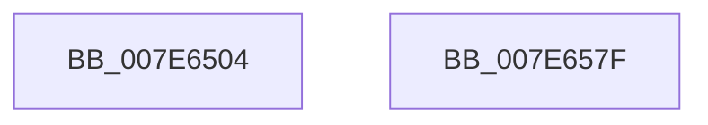

# CmpLogNotificationRegister

- RVA: `0x007E6504`–`0x007E6580` (길이 `124` bytes)
- VA: `0x00000001407E6504`
- 실행 섹션: `PAGE`
- PDB 이름 있음: `예`; PDB Function 태그: `아니요`
- unwind 정보 RVA: `0x000C3AB4`
- 디코드: `31`개 명령, `124/124` bytes 표시
- 미해석 바이트: `0` (있으면 어셈블리에 `.byte`로 보존)

> 이 문서는 커널 이미지의 기계어와 PDB 기호를 분석해 생성했습니다. 4번과 5번은 함수 원형과 자료형을 바이너리 사용 방식에서 추정한 C 해석이며 원본 소스 복구 결과는 아닙니다.

## 1. Dependencies

- 직접 호출 지점: **2**; 고유 호출 대상: **2**
- 직접 호출자로 확인된 함수: **1**
- RIP 상대 이미지 참조: **1**

### Outgoing calls
- `0x007E6568` → [EtwTraceKernelEvent](../../text/23/EtwTraceKernelEvent_function_00235350.md) (function, `0x00235350`)
- `0x007E6574` → [_security_check_cookie](../../text/6A/_security_check_cookie_function_006AC640.md) (function, `0x006AC640`)

### Direct callers
- [CmpNotifyChangeKey](../A4/CmpNotifyChangeKey_function_00A43C80.md) at `0x00A43F93`

### Static image references
- `0x007E650D` → RVA `0x00E0A740` (`.data`; read)

## 2. Other-region calls and transfers

- 다른 실행 섹션으로 향하는 call: **2**
  - `0x007E6568` → [EtwTraceKernelEvent](../../text/23/EtwTraceKernelEvent_function_00235350.md) (`PAGE` → `.text`)
  - `0x007E6574` → [_security_check_cookie](../../text/6A/_security_check_cookie_function_006AC640.md) (`PAGE` → `.text`)
- 별도 외부 분기/꼬리 이동을 확인하지 못했습니다.

## 3. Assembly (complete function range)

```asm
007E6504  40 55                           push rbp
007E6506  48 8B EC                        mov rbp, rsp
007E6509  48 83 EC 60                     sub rsp, 0x60
007E650D  48 8B 05 2C 42 62 00            mov rax, qword ptr [rip + 0x62422c]
007E6514  48 33 C4                        xor rax, rsp
007E6517  48 89 45 F8                     mov qword ptr [rbp - 8], rax
007E651B  8A 45 30                        mov al, byte ptr [rbp + 0x30]
007E651E  45 33 D2                        xor r10d, r10d
007E6521  88 45 E2                        mov byte ptr [rbp - 0x1e], al
007E6524  48 8D 45 D0                     lea rax, [rbp - 0x30]
007E6528  48 89 4D D0                     mov qword ptr [rbp - 0x30], rcx
007E652C  48 8D 4D E8                     lea rcx, [rbp - 0x18]
007E6530  48 89 55 D8                     mov qword ptr [rbp - 0x28], rdx
007E6534  44 88 45 E0                     mov byte ptr [rbp - 0x20], r8b
007E6538  41 8D 52 01                     lea edx, [r10 + 1]
007E653C  44 88 4D E1                     mov byte ptr [rbp - 0x1f], r9b
007E6540  41 B8 00 00 00 42               mov r8d, 0x42000000
007E6546  41 B9 30 09 00 00               mov r9d, 0x930
007E654C  44 89 55 E3                     mov dword ptr [rbp - 0x1d], r10d
007E6550  44 88 55 E7                     mov byte ptr [rbp - 0x19], r10b
007E6554  48 89 45 E8                     mov qword ptr [rbp - 0x18], rax
007E6558  48 C7 45 F0 13 00 00 00         mov qword ptr [rbp - 0x10], 0x13
007E6560  C7 44 24 20 02 19 60 00         mov dword ptr [rsp + 0x20], 0x601902
007E6568  E8 E3 ED A4 FF                  call 0x140235350
007E656D  48 8B 4D F8                     mov rcx, qword ptr [rbp - 8]
007E6571  48 33 CC                        xor rcx, rsp
007E6574  E8 C7 60 EC FF                  call 0x1406ac640
007E6579  48 83 C4 60                     add rsp, 0x60
007E657D  5D                              pop rbp
007E657E  C3                              ret
007E657F  CC                              int3
```

## 4. C-style interpretation (structured pseudocode)

```c
__int64 __fastcall CmpLogNotificationRegister(__int64 a1, __int64 a2, unsigned __int8 a3, unsigned __int8 a4, unsigned __int8 a5)
{
    __int64 result;
    __int64 v_r10;
    __int64 v_rsp;
    unsigned __int64 v_stack_m10;
    unsigned __int64 v_stack_m18;
    unsigned __int64 v_stack_m20;
    unsigned __int8 v_stack_m21;
    unsigned int v_stack_m25;
    unsigned __int8 v_stack_m26;
    unsigned __int8 v_stack_m27;
    unsigned __int8 v_stack_m28;
    unsigned __int64 v_stack_m30;
    unsigned __int64 v_stack_m38;
    unsigned int v_stack_m48;

    v_rsp = (v_rsp) - (96);
    result = (*(unsigned __int64 *)(v_rip + 6439468)) ^ (v_rsp);
    v_stack_m10 = result;
    v_r10 = 0;
    v_stack_m26 = a5;
    v_stack_m38 = a1;
    v_stack_m30 = a2;
    v_stack_m28 = a3;
    v_stack_m27 = a4;
    v_stack_m25 = 0;
    v_stack_m21 = 0;
    v_stack_m20 = v_stack_m38;
    v_stack_m18 = 19;
    v_stack_m48 = 0x601902ULL;
    result = EtwTraceKernelEvent(v_stack_m20, v_r10 + 1, (unsigned int)(0x42000000ULL), (unsigned int)(0x930ULL));
    a1 = (v_stack_m10) ^ (v_rsp);
    result = _security_check_cookie(a1, v_r10 + 1, (unsigned int)(0x42000000ULL), (unsigned int)(0x930ULL));
    v_rsp = (v_rsp) + (96);
    return result;
}
```

## 5. (Beta) C Style

```c
int64_t CmpLogNotificationRegister(int64_t Arg1, int64_t Arg2, uint8_t Arg3, uint8_t Arg4, uint8_t Arg5)
{
    int64_t result;
    int64_t local_r10;
    int64_t local_rsp;
    uint64_t v_stack_m10;
    uint64_t v_stack_m18;
    uint64_t v_stack_m20;
    uint8_t v_stack_m21;
    uint32_t v_stack_m25;
    uint8_t v_stack_m26;
    uint8_t v_stack_m27;
    uint8_t v_stack_m28;
    uint64_t v_stack_m30;
    uint64_t v_stack_m38;
    uint32_t v_stack_m48;

    local_rsp = (local_rsp) - (96);
    result = (*(uint64_t *)(v_rip + 0x62422C)) ^ (local_rsp);
    v_stack_m10 = result;
    local_r10 = 0;
    v_stack_m26 = Arg5;
    v_stack_m38 = Arg1;
    v_stack_m30 = Arg2;
    v_stack_m28 = Arg3;
    v_stack_m27 = Arg4;
    v_stack_m25 = 0;
    v_stack_m21 = 0;
    v_stack_m20 = v_stack_m38;
    v_stack_m18 = 19;
    v_stack_m48 = 0x601902ULL;
    result = EtwTraceKernelEvent(v_stack_m20, local_r10 + 1, (uint32_t)(0x42000000ULL), (uint32_t)(0x930ULL));
    Arg1 = (v_stack_m10) ^ (local_rsp);
    result = _security_check_cookie(Arg1, local_r10 + 1, (uint32_t)(0x42000000ULL), (uint32_t)(0x930ULL));
    local_rsp = (local_rsp) + (96);
    return result;
}
```

## 6. Execution-region graph

[열기: 2D/3D 그래프와 함수 탐색 컨트롤 패널](../../../control-panel.html?section=page&rva=0x007E6504&view=graph)

- 2D 그래프는 위에서 아래로 흐르고, 3D 그래프는 빈 공간을 드래그해 회전합니다. Shift+드래그는 이동, 휠은 확대·축소, 함수 노드 선택은 대상 보고서 이동입니다.

### Static fallback


