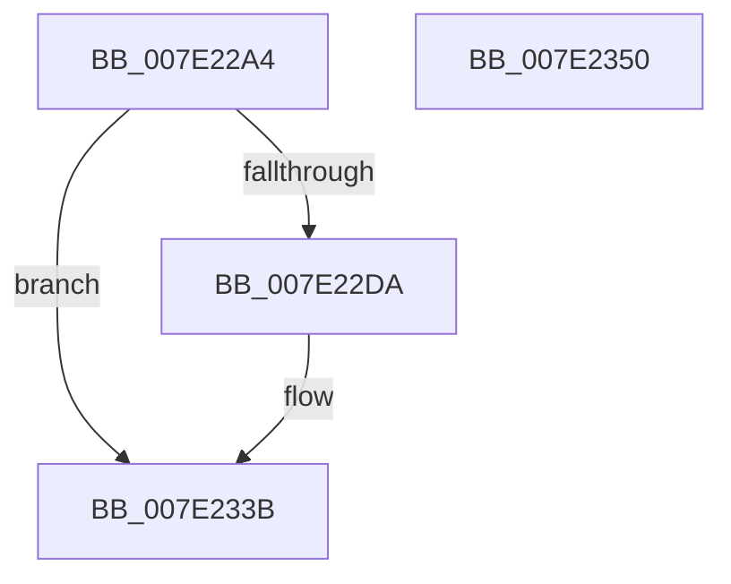

# CmpLogReorganizeEvent

- RVA: `0x007E22A4`–`0x007E2351` (길이 `173` bytes)
- VA: `0x00000001407E22A4`
- 실행 섹션: `PAGE`
- PDB 이름 있음: `예`; PDB Function 태그: `아니요`
- unwind 정보 RVA: `0x0006CF6C`
- 디코드: `43`개 명령, `173/173` bytes 표시
- 미해석 바이트: `0` (있으면 어셈블리에 `.byte`로 보존)

> 이 문서는 커널 이미지의 기계어와 PDB 기호를 분석해 생성했습니다. 4번과 5번은 함수 원형과 자료형을 바이너리 사용 방식에서 추정한 C 해석이며 원본 소스 복구 결과는 아닙니다.

## 1. Dependencies

- 직접 호출 지점: **2**; 고유 호출 대상: **2**
- 직접 호출자로 확인된 함수: **1**
- RIP 상대 이미지 참조: **3**

### Outgoing calls
- `0x007E2336` → [EtwWrite](../../text/41/EtwWrite_function_0041C720.md) (function, `0x0041C720`)
- `0x007E2342` → [_security_check_cookie](../../text/6A/_security_check_cookie_function_006AC640.md) (function, `0x006AC640`)

### Direct callers
- [sub_00B1845C](../B1/Unknown_function_00B1845C.md) at `0x00B18923`

### Static image references
- `0x007E22BA` → RVA `0x00E0A740` (`.data`; read)
- `0x007E22CE` → RVA `0x00EFFA28` (`.data`; read)
- `0x007E22EB` → RVA `0x00022440` (`.rdata`; read)

## 2. Other-region calls and transfers

- 다른 실행 섹션으로 향하는 call: **2**
  - `0x007E2336` → [EtwWrite](../../text/41/EtwWrite_function_0041C720.md) (`PAGE` → `.text`)
  - `0x007E2342` → [_security_check_cookie](../../text/6A/_security_check_cookie_function_006AC640.md) (`PAGE` → `.text`)
- 별도 외부 분기/꼬리 이동을 확인하지 못했습니다.

## 3. Assembly (complete function range)

```asm
007E22A4  44 89 44 24 18                  mov dword ptr [rsp + 0x18], r8d
007E22A9  89 54 24 10                     mov dword ptr [rsp + 0x10], edx
007E22AD  55                              push rbp
007E22AE  48 8D 6C 24 A9                  lea rbp, [rsp - 0x57]
007E22B3  48 81 EC 90 00 00 00            sub rsp, 0x90
007E22BA  48 8B 05 7F 84 62 00            mov rax, qword ptr [rip + 0x62847f]
007E22C1  48 33 C4                        xor rax, rsp
007E22C4  48 89 45 47                     mov qword ptr [rbp + 0x47], rax
007E22C8  4C 8B C1                        mov r8, rcx
007E22CB  45 33 D2                        xor r10d, r10d
007E22CE  48 8B 0D 53 D7 71 00            mov rcx, qword ptr [rip + 0x71d753]
007E22D5  48 85 C9                        test rcx, rcx
007E22D8  74 61                           je 0x1407e233b
007E22DA  41 0F B7 10                     movzx edx, word ptr [r8]
007E22DE  45 8D 4A 04                     lea r9d, [r10 + 4]
007E22E2  0F B7 C2                        movzx eax, dx
007E22E5  89 55 1F                        mov dword ptr [rbp + 0x1f], edx
007E22E8  66 D1 E8                        shr ax, 1
007E22EB  48 8D 15 4E 01 84 FF            lea rdx, [rip - 0x7bfeb2]
007E22F2  66 89 45 F7                     mov word ptr [rbp - 9], ax
007E22F6  48 8D 45 F7                     lea rax, [rbp - 9]
007E22FA  48 89 45 07                     mov qword ptr [rbp + 7], rax
007E22FE  49 8B 40 08                     mov rax, qword ptr [r8 + 8]
007E2302  45 33 C0                        xor r8d, r8d
007E2305  48 89 45 17                     mov qword ptr [rbp + 0x17], rax
007E2309  48 8D 45 6F                     lea rax, [rbp + 0x6f]
007E230D  48 89 45 27                     mov qword ptr [rbp + 0x27], rax
007E2311  48 8D 45 77                     lea rax, [rbp + 0x77]
007E2315  48 89 45 37                     mov qword ptr [rbp + 0x37], rax
007E2319  48 8D 45 07                     lea rax, [rbp + 7]
007E231D  48 89 44 24 20                  mov qword ptr [rsp + 0x20], rax
007E2322  48 C7 45 0F 02 00 00 00         mov qword ptr [rbp + 0xf], 2
007E232A  44 89 55 23                     mov dword ptr [rbp + 0x23], r10d
007E232E  4C 89 4D 2F                     mov qword ptr [rbp + 0x2f], r9
007E2332  4C 89 4D 3F                     mov qword ptr [rbp + 0x3f], r9
007E2336  E8 E5 A3 C3 FF                  call 0x14041c720
007E233B  48 8B 4D 47                     mov rcx, qword ptr [rbp + 0x47]
007E233F  48 33 CC                        xor rcx, rsp
007E2342  E8 F9 A2 EC FF                  call 0x1406ac640
007E2347  48 81 C4 90 00 00 00            add rsp, 0x90
007E234E  5D                              pop rbp
007E234F  C3                              ret
007E2350  CC                              int3
```

## 4. C-style interpretation (structured pseudocode)

```c
__int64 __fastcall CmpLogReorganizeEvent(__int64 a1, int a2, int a3)
{
    __int64 result;
    __int64 v_r10;
    __int64 v_rsp;
    unsigned __int64 v_stack_m18;
    unsigned __int64 v_stack_m20;
    unsigned __int64 v_stack_m28;
    unsigned __int64 v_stack_m30;
    unsigned __int64 v_stack_m38;
    unsigned int v_stack_m3C;
    unsigned int v_stack_m40;
    unsigned __int64 v_stack_m48;
    unsigned __int64 v_stack_m50;
    unsigned __int64 v_stack_m58;
    unsigned __int64 v_stack_m5F;
    unsigned __int16 v_stack_m68;
    unsigned __int64 v_stack_m78;
    unsigned int v_stack_p10;
    unsigned int v_stack_p18;

    v_stack_p18 = a3;
    v_stack_p10 = a2;
    v_rsp = (v_rsp) - (144);
    result = (*(unsigned __int64 *)(v_rip + 6456447)) ^ (v_rsp);
    v_stack_m18 = result;
    v_r10 = 0;
    if (*(unsigned __int64 *)(v_rip + 7460691) != 0) {
        a2 = *(unsigned __int16 *)(a1);
        a4 = v_r10 + 4;
        result = (unsigned __int16)(a2);
        v_stack_m40 = a2;
        result = (unsigned __int16)((result) >> (1));
        a2 = v_rip - 8126130;
        v_stack_m68 = (unsigned __int16)(result);
        result = v_stack_m68;
        v_stack_m58 = result;
        result = *(unsigned __int64 *)(a1 + 8);
        a3 = 0;
        v_stack_m48 = result;
        result = v_stack_p10;
        v_stack_m38 = result;
        result = v_stack_p18;
        v_stack_m28 = result;
        result = v_stack_m58;
        v_stack_m78 = result;
        v_stack_m50 = 2;
        v_stack_m3C = 0;
        v_stack_m30 = a4;
        v_stack_m20 = a4;
        result = EtwWrite(*(unsigned __int64 *)(v_rip + 7460691), a2, a3, a4);
    }
    a1 = (v_stack_m18) ^ (v_rsp);
    result = _security_check_cookie(a1, a2, a3, a4);
    v_rsp = (v_rsp) + (144);
    return result;
}
```

## 5. (Beta) C Style

```c
int64_t CmpLogReorganizeEvent(void *Arg1, int32_t Arg2, int32_t Arg3)
{
    uint8_t *arg1 = (uint8_t *)Arg1;

    int64_t result;
    int64_t local_r10;
    int64_t local_rsp;
    uint64_t v_stack_m18;
    uint64_t v_stack_m20;
    uint64_t v_stack_m28;
    uint64_t v_stack_m30;
    uint64_t v_stack_m38;
    uint32_t v_stack_m3C;
    uint32_t v_stack_m40;
    uint64_t v_stack_m48;
    uint64_t v_stack_m50;
    uint64_t v_stack_m58;
    uint64_t v_stack_m5F;
    uint16_t v_stack_m68;
    uint64_t v_stack_m78;
    uint32_t v_stack_p10;
    uint32_t v_stack_p18;

    v_stack_p18 = Arg3;
    v_stack_p10 = Arg2;
    local_rsp = (local_rsp) - (144);
    result = (*(uint64_t *)(v_rip + 0x62847F)) ^ (local_rsp);
    v_stack_m18 = result;
    local_r10 = 0;
    if (*(uint64_t *)(v_rip + 0x71D753) != 0) {
        Arg2 = *(uint16_t *)(arg1);
        a4 = local_r10 + 4;
        result = (uint16_t)(Arg2);
        v_stack_m40 = Arg2;
        result = (uint16_t)((result) >> (1));
        Arg2 = v_rip - 8126130;
        v_stack_m68 = (uint16_t)(result);
        result = v_stack_m68;
        v_stack_m58 = result;
        result = *(uint64_t *)(arg1 + 0x8);
        Arg3 = 0;
        v_stack_m48 = result;
        result = v_stack_p10;
        v_stack_m38 = result;
        result = v_stack_p18;
        v_stack_m28 = result;
        result = v_stack_m58;
        v_stack_m78 = result;
        v_stack_m50 = 2;
        v_stack_m3C = 0;
        v_stack_m30 = a4;
        v_stack_m20 = a4;
        result = EtwWrite(*(uint64_t *)(v_rip + 0x71D753), Arg2, Arg3, a4);
    }
    Arg1 = (v_stack_m18) ^ (local_rsp);
    result = _security_check_cookie(Arg1, Arg2, Arg3, a4);
    local_rsp = (local_rsp) + (144);
    return result;
}
```

### 관측된 메모리 오프셋

구조체 형식이 확인되지 않은 접근은 인자 기준의 오프셋으로만 기록했습니다.

| 기준 인자 | 오프셋 표현 | 폭 (bit) | 접근 |
|---|---:|---:|---|
| `Arg1` | `+ 0x0` | `16` | `R` |
| `Arg1` | `+ 0x8` | `64` | `R` |

## 6. Execution-region graph

[열기: 2D/3D 그래프와 함수 탐색 컨트롤 패널](../../../control-panel.html?section=page&rva=0x007E22A4&view=graph)

- 2D 그래프는 위에서 아래로 흐르고, 3D 그래프는 빈 공간을 드래그해 회전합니다. Shift+드래그는 이동, 휠은 확대·축소, 함수 노드 선택은 대상 보고서 이동입니다.

### Static fallback


