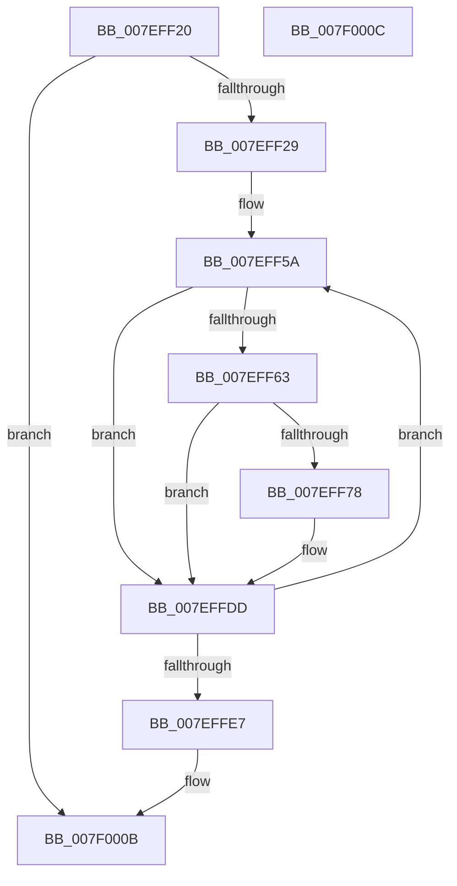

# CmpLogTransactionAbortedByName

- RVA: `0x007EFF20`–`0x007F000D` (길이 `237` bytes)
- VA: `0x00000001407EFF20`
- 실행 섹션: `PAGE`
- PDB 이름 있음: `예`; PDB Function 태그: `아니요`
- unwind 정보 RVA: `0x000D70D8`
- 디코드: `57`개 명령, `237/237` bytes 표시
- 미해석 바이트: `0` (있으면 어셈블리에 `.byte`로 보존)

> 이 문서는 커널 이미지의 기계어와 PDB 기호를 분석해 생성했습니다. 4번과 5번은 함수 원형과 자료형을 바이너리 사용 방식에서 추정한 C 해석이며 원본 소스 복구 결과는 아닙니다.

## 1. Dependencies

- 직접 호출 지점: **3**; 고유 호출 대상: **3**
- 직접 호출자로 확인된 함수: **2**
- RIP 상대 이미지 참조: **3**

### Outgoing calls
- `0x007EFF6F` → [tlgKeywordOn](../../text/42/tlgKeywordOn_function_0042EAA0.md) (function, `0x0042EAA0`)
- `0x007EFFD8` → [tlgWriteTransfer_EtwWriteTransfer](../../text/42/tlgWriteTransfer_EtwWriteTransfer_function_004260E0.md) (function, `0x004260E0`)
- `0x007EFFEE` → [_security_check_cookie](../../text/6A/_security_check_cookie_function_006AC640.md) (function, `0x006AC640`)

### Direct callers
- [CmpLogTransactionAbortedWithChildName](../9A/CmpLogTransactionAbortedWithChildName_function_009AED70.md) at `0x009AEE62`
- [sub_00B160F4](../B1/Unknown_function_00B160F4.md) at `0x00B16178`

### Static image references
- `0x007EFF44` → RVA `0x00E0A740` (`.data`; read)
- `0x007EFF5A` → RVA `0x00E09F58` (`.data`; read)
- `0x007EFF84` → RVA `0x0005722E` (`.rdata`; read)

## 2. Other-region calls and transfers

- 다른 실행 섹션으로 향하는 call: **3**
  - `0x007EFF6F` → [tlgKeywordOn](../../text/42/tlgKeywordOn_function_0042EAA0.md) (`PAGE` → `.text`)
  - `0x007EFFD8` → [tlgWriteTransfer_EtwWriteTransfer](../../text/42/tlgWriteTransfer_EtwWriteTransfer_function_004260E0.md) (`PAGE` → `.text`)
  - `0x007EFFEE` → [_security_check_cookie](../../text/6A/_security_check_cookie_function_006AC640.md) (`PAGE` → `.text`)
- 별도 외부 분기/꼬리 이동을 확인하지 못했습니다.

## 3. Assembly (complete function range)

```asm
007EFF20  45 85 C9                        test r9d, r9d
007EFF23  0F 84 E2 00 00 00               je 0x1407f000b
007EFF29  48 8B C4                        mov rax, rsp
007EFF2C  48 89 58 08                     mov qword ptr [rax + 8], rbx
007EFF30  48 89 70 10                     mov qword ptr [rax + 0x10], rsi
007EFF34  48 89 78 18                     mov qword ptr [rax + 0x18], rdi
007EFF38  55                              push rbp
007EFF39  48 8D 68 A1                     lea rbp, [rax - 0x5f]
007EFF3D  48 81 EC A0 00 00 00            sub rsp, 0xa0
007EFF44  48 8B 05 F5 A7 61 00            mov rax, qword ptr [rip + 0x61a7f5]
007EFF4B  48 33 C4                        xor rax, rsp
007EFF4E  48 89 45 47                     mov qword ptr [rbp + 0x47], rax
007EFF52  8B F2                           mov esi, edx
007EFF54  41 8B D9                        mov ebx, r9d
007EFF57  48 8B F9                        mov rdi, rcx
007EFF5A  83 3D F7 9F 61 00 04            cmp dword ptr [rip + 0x619ff7], 4
007EFF61  76 7A                           jbe 0x1407effdd
007EFF63  BA 01 00 00 00                  mov edx, 1
007EFF68  48 8D 0D E9 9F 61 00            lea rcx, [rip + 0x619fe9]
007EFF6F  E8 2C EB C3 FF                  call 0x14042eaa0
007EFF74  84 C0                           test al, al
007EFF76  74 65                           je 0x1407effdd
007EFF78  83 65 23 00                     and dword ptr [rbp + 0x23], 0
007EFF7C  48 8D 45 2F                     lea rax, [rbp + 0x2f]
007EFF80  83 65 33 00                     and dword ptr [rbp + 0x33], 0
007EFF84  48 8D 15 A3 72 86 FF            lea rdx, [rip - 0x798d5d]
007EFF8B  83 65 43 00                     and dword ptr [rbp + 0x43], 0
007EFF8F  48 8D 0D C2 9F 61 00            lea rcx, [rip + 0x619fc2]
007EFF96  48 89 45 17                     mov qword ptr [rbp + 0x17], rax
007EFF9A  45 33 C9                        xor r9d, r9d
007EFF9D  48 8B 47 08                     mov rax, qword ptr [rdi + 8]
007EFFA1  45 33 C0                        xor r8d, r8d
007EFFA4  48 89 45 27                     mov qword ptr [rbp + 0x27], rax
007EFFA8  0F B7 07                        movzx eax, word ptr [rdi]
007EFFAB  89 45 2F                        mov dword ptr [rbp + 0x2f], eax
007EFFAE  48 8D 45 E7                     lea rax, [rbp - 0x19]
007EFFB2  48 89 45 37                     mov qword ptr [rbp + 0x37], rax
007EFFB6  48 8D 45 F7                     lea rax, [rbp - 9]
007EFFBA  48 89 44 24 28                  mov qword ptr [rsp + 0x28], rax
007EFFBF  C7 44 24 20 05 00 00 00         mov dword ptr [rsp + 0x20], 5
007EFFC7  C7 45 1F 02 00 00 00            mov dword ptr [rbp + 0x1f], 2
007EFFCE  89 75 E7                        mov dword ptr [rbp - 0x19], esi
007EFFD1  C7 45 3F 04 00 00 00            mov dword ptr [rbp + 0x3f], 4
007EFFD8  E8 03 61 C3 FF                  call 0x1404260e0
007EFFDD  48 83 EB 01                     sub rbx, 1
007EFFE1  0F 85 73 FF FF FF               jne 0x1407eff5a
007EFFE7  48 8B 4D 47                     mov rcx, qword ptr [rbp + 0x47]
007EFFEB  48 33 CC                        xor rcx, rsp
007EFFEE  E8 4D C6 EB FF                  call 0x1406ac640
007EFFF3  4C 8D 9C 24 A0 00 00 00         lea r11, [rsp + 0xa0]
007EFFFB  49 8B 5B 10                     mov rbx, qword ptr [r11 + 0x10]
007EFFFF  49 8B 73 18                     mov rsi, qword ptr [r11 + 0x18]
007F0003  49 8B 7B 20                     mov rdi, qword ptr [r11 + 0x20]
007F0007  49 8B E3                        mov rsp, r11
007F000A  5D                              pop rbp
007F000B  C3                              ret
007F000C  CC                              int3
```

## 4. C-style interpretation (structured pseudocode)

```c
__int64 __fastcall CmpLogTransactionAbortedByName(__int64 a1, int a2, int a3, int a4)
{
    __int64 result;
    __int64 v_rbx;
    __int64 v_rsp;
    unsigned __int64 v_stack_m8;
    unsigned __int64 v_stack_m80;
    unsigned int v_stack_m88;

    if (a4 == 0) goto loc_007F000B;
    *(unsigned __int64 *)(v_rsp + 8) = v_rbx;
    *(unsigned __int64 *)(v_rsp + 16) = v_rsi;
    *(unsigned __int64 *)(v_rsp + 24) = v_rdi;
    v_rsp = (v_rsp) - (160);
    result = (*(unsigned __int64 *)(v_rip + 6399989)) ^ (v_rsp);
    *(unsigned __int64 *)(v_rsp - 95 + 71) = result;
loc_007EFF5A:
    if ((*(unsigned int *)(v_rip + 6397943)) <= 4) goto loc_007EFFDD;
    result = tlgKeywordOn(v_rip + 6397929, 1, a3, a4);
    if ((unsigned __int8)(result) != 0) {
        result = v_rsp - 95 + 47;
        a2 = v_rip - 7966045;
        a1 = v_rip + 6397890;
        *(unsigned __int64 *)(v_rsp - 95 + 23) = result;
        a4 = 0;
        result = *(unsigned __int64 *)(a1 + 8);
        a3 = 0;
        *(unsigned __int64 *)(v_rsp - 95 + 39) = result;
        result = *(unsigned __int16 *)(a1);
        *(unsigned int *)(v_rsp - 95 + 47) = (unsigned int)(result);
        result = v_rsp - 95 - 25;
        *(unsigned __int64 *)(v_rsp - 95 + 55) = result;
        result = v_rsp - 95 - 9;
        v_stack_m80 = result;
        v_stack_m88 = 5;
        *(unsigned int *)(v_rsp - 95 + 31) = 2;
        *(unsigned int *)(v_rsp - 95 - 25) = (unsigned int)((unsigned int)(a2));
        *(unsigned int *)(v_rsp - 95 + 63) = 4;
        result = tlgWriteTransfer_EtwWriteTransfer(a1, a2, a3, a4);
    }
    v_rbx = ((unsigned int)(a4)) - (1);
    if (condition_is_not_equal) goto loc_007EFF5A;
    a1 = (*(unsigned __int64 *)(v_rsp - 95 + 71)) ^ (v_rsp);
    result = _security_check_cookie(a1, a2, a3, a4);
loc_007F000B:
    return result;
}
```

## 5. (Beta) C Style

```c
int64_t CmpLogTransactionAbortedByName(void *Arg1, int32_t Arg2, int32_t Arg3, int32_t Arg4)
{
    uint8_t *arg1 = (uint8_t *)Arg1;

    int64_t result;
    int64_t local_rbx;
    int64_t local_rsp;
    uint64_t v_stack_m8;
    uint64_t v_stack_m80;
    uint32_t v_stack_m88;

    if (Arg4 == 0) goto loc_007F000B;
    *(uint64_t *)(local_rsp + 0x8) = local_rbx;
    *(uint64_t *)(local_rsp + 0x10) = local_rsi;
    *(uint64_t *)(local_rsp + 0x18) = local_rdi;
    local_rsp = (local_rsp) - (160);
    result = (*(uint64_t *)(v_rip + 0x61A7F5)) ^ (local_rsp);
    *(uint64_t *)(local_rsp - 0x5F + 0x47) = result;
loc_007EFF5A:
    if ((*(uint32_t *)(v_rip + 0x619FF7)) <= 4) goto loc_007EFFDD;
    result = tlgKeywordOn(v_rip + 6397929, 1, Arg3, Arg4);
    if ((uint8_t)(result) != 0) {
        result = local_rsp - 95 + 47;
        Arg2 = v_rip - 7966045;
        Arg1 = v_rip + 6397890;
        *(uint64_t *)(local_rsp - 0x5F + 0x17) = result;
        Arg4 = 0;
        result = *(uint64_t *)(arg1 + 0x8);
        Arg3 = 0;
        *(uint64_t *)(local_rsp - 0x5F + 0x27) = result;
        result = *(uint16_t *)(arg1);
        *(uint32_t *)(local_rsp - 0x5F + 0x2F) = (uint32_t)(result);
        result = local_rsp - 95 - 25;
        *(uint64_t *)(local_rsp - 0x5F + 0x37) = result;
        result = local_rsp - 95 - 9;
        v_stack_m80 = result;
        v_stack_m88 = 5;
        *(uint32_t *)(local_rsp - 0x5F + 0x1F) = 2;
        *(uint32_t *)(local_rsp - 0x5F - 0x19) = (uint32_t)((uint32_t)(Arg2));
        *(uint32_t *)(local_rsp - 0x5F + 0x3F) = 4;
        result = tlgWriteTransfer_EtwWriteTransfer(Arg1, Arg2, Arg3, Arg4);
    }
    local_rbx = ((uint32_t)(Arg4)) - (1);
    if (condition_is_not_equal) goto loc_007EFF5A;
    Arg1 = (*(uint64_t *)(local_rsp - 0x5F + 0x47)) ^ (local_rsp);
    result = _security_check_cookie(Arg1, Arg2, Arg3, Arg4);
loc_007F000B:
    return result;
}
```

### 관측된 메모리 오프셋

구조체 형식이 확인되지 않은 접근은 인자 기준의 오프셋으로만 기록했습니다.

| 기준 인자 | 오프셋 표현 | 폭 (bit) | 접근 |
|---|---:|---:|---|
| `Arg1` | `+ 0x0` | `16` | `R` |
| `Arg1` | `+ 0x8` | `64` | `R` |

## 6. Execution-region graph

[열기: 2D/3D 그래프와 함수 탐색 컨트롤 패널](../../../control-panel.html?section=page&rva=0x007EFF20&view=graph)

- 2D 그래프는 위에서 아래로 흐르고, 3D 그래프는 빈 공간을 드래그해 회전합니다. Shift+드래그는 이동, 휠은 확대·축소, 함수 노드 선택은 대상 보고서 이동입니다.

### Static fallback


