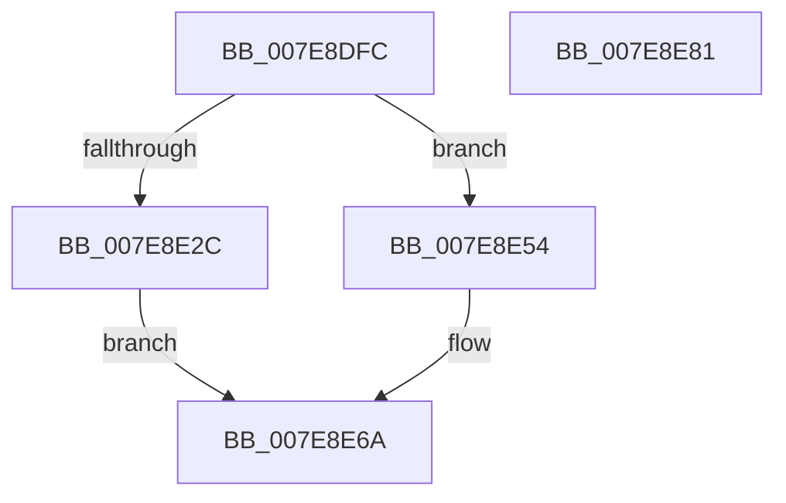

# CmpMachineHiveCacheClaimEntry

- RVA: `0x007E8DFC`–`0x007E8E82` (길이 `134` bytes)
- VA: `0x00000001407E8DFC`
- 실행 섹션: `PAGE`
- PDB 이름 있음: `예`; PDB Function 태그: `아니요`
- unwind 정보 RVA: `0x00066400`
- 디코드: `37`개 명령, `134/134` bytes 표시
- 미해석 바이트: `0` (있으면 어셈블리에 `.byte`로 보존)

> 이 문서는 커널 이미지의 기계어와 PDB 기호를 분석해 생성했습니다. 4번과 5번은 함수 원형과 자료형을 바이너리 사용 방식에서 추정한 C 해석이며 원본 소스 복구 결과는 아닙니다.

## 1. Dependencies

- 직접 호출 지점: **4**; 고유 호출 대상: **3**
- 직접 호출자로 확인된 함수: **1**
- RIP 상대 이미지 참조: **0**

### Outgoing calls
- `0x007E8E21` → [CmpHiveCacheClaimHiveEntry](../7F/CmpHiveCacheClaimHiveEntry_function_007F5970.md) (function, `0x007F5970`)
- `0x007E8E40` → [SetFailureLocation](../../text/46/SetFailureLocation_function_0046EF54.md) (function, `0x0046EF54`)
- `0x007E8E4D` → [CmpHiveCacheEntryCleanup](../7F/CmpHiveCacheEntryCleanup_function_007F5B38.md) (function, `0x007F5B38`)
- `0x007E8E5C` → [CmpHiveCacheEntryCleanup](../7F/CmpHiveCacheEntryCleanup_function_007F5B38.md) (function, `0x007F5B38`)

### Direct callers
- [CmpLoadHiveThread](../7D/CmpLoadHiveThread_function_007DB040.md) at `0x007DB1C5`

### Static image references
- 디코드된 RIP-relative 메모리 참조가 없습니다.

## 2. Other-region calls and transfers

- 다른 실행 섹션으로 향하는 call: **1**
  - `0x007E8E40` → [SetFailureLocation](../../text/46/SetFailureLocation_function_0046EF54.md) (`PAGE` → `.text`)
- 별도 외부 분기/꼬리 이동을 확인하지 못했습니다.

## 3. Assembly (complete function range)

```asm
007E8DFC  48 8B C4                        mov rax, rsp
007E8DFF  48 89 58 08                     mov qword ptr [rax + 8], rbx
007E8E03  48 89 68 10                     mov qword ptr [rax + 0x10], rbp
007E8E07  48 89 70 18                     mov qword ptr [rax + 0x18], rsi
007E8E0B  57                              push rdi
007E8E0C  48 83 EC 30                     sub rsp, 0x30
007E8E10  48 8D A9 88 01 00 00            lea rbp, [rcx + 0x188]
007E8E17  49 8B F1                        mov rsi, r9
007E8E1A  48 89 68 E8                     mov qword ptr [rax - 0x18], rbp
007E8E1E  48 8B D9                        mov rbx, rcx
007E8E21  E8 4A CB 00 00                  call 0x1407f5970
007E8E26  8B F8                           mov edi, eax
007E8E28  85 C0                           test eax, eax
007E8E2A  79 28                           jns 0x1407e8e54
007E8E2C  33 D2                           xor edx, edx
007E8E2E  C7 44 24 20 10 00 00 00         mov dword ptr [rsp + 0x20], 0x10
007E8E36  44 8B C8                        mov r9d, eax
007E8E39  48 8B CD                        mov rcx, rbp
007E8E3C  44 8D 42 34                     lea r8d, [rdx + 0x34]
007E8E40  E8 0F 61 C8 FF                  call 0x14046ef54
007E8E45  BA 02 00 00 00                  mov edx, 2
007E8E4A  48 8B CB                        mov rcx, rbx
007E8E4D  E8 E6 CC 00 00                  call 0x1407f5b38
007E8E52  EB 16                           jmp 0x1407e8e6a
007E8E54  BA 03 00 00 00                  mov edx, 3
007E8E59  48 8B CB                        mov rcx, rbx
007E8E5C  E8 D7 CC 00 00                  call 0x1407f5b38
007E8E61  8A 83 38 03 00 00               mov al, byte ptr [rbx + 0x338]
007E8E67  88 46 09                        mov byte ptr [rsi + 9], al
007E8E6A  48 8B 5C 24 40                  mov rbx, qword ptr [rsp + 0x40]
007E8E6F  8B C7                           mov eax, edi
007E8E71  48 8B 6C 24 48                  mov rbp, qword ptr [rsp + 0x48]
007E8E76  48 8B 74 24 50                  mov rsi, qword ptr [rsp + 0x50]
007E8E7B  48 83 C4 30                     add rsp, 0x30
007E8E7F  5F                              pop rdi
007E8E80  C3                              ret
007E8E81  CC                              int3
```

## 4. C-style interpretation (structured pseudocode)

```c
__int64 __fastcall CmpMachineHiveCacheClaimEntry(__int64 a1, int a2, __int64 a3, __int64 a4)
{
    __int64 result;
    __int64 v_rsp;
    unsigned int v_stack_m18;
    unsigned __int64 v_stack_p10;
    unsigned __int64 v_stack_p18;
    unsigned __int64 v_stack_p8;

    *(unsigned __int64 *)(v_rsp + 8) = v_rbx;
    *(unsigned __int64 *)(v_rsp + 16) = v_rbp;
    *(unsigned __int64 *)(v_rsp + 24) = v_rsi;
    v_rsp = (v_rsp) - (48);
    *(unsigned __int64 *)(v_rsp - 24) = a1 + 392;
    result = CmpHiveCacheClaimHiveEntry(a1, a2, a3, a4);
    if (!sign_flag) goto loc_007E8E54;
    a2 = 0;
    v_stack_m18 = 16;
    result = SetFailureLocation(a1 + 392, a2, a2 + 52, (unsigned int)((unsigned int)(result)));
    result = CmpHiveCacheEntryCleanup(a1, 2, a2 + 52, (unsigned int)((unsigned int)(result)));
    goto loc_007E8E6A;
loc_007E8E54:
    result = CmpHiveCacheEntryCleanup(a1, 3, a2 + 52, (unsigned int)((unsigned int)(result)));
    *(unsigned __int8 *)(a4 + 9) = (unsigned __int8)(*(unsigned __int8 *)(a1 + 824));
loc_007E8E6A:
    v_rsp = (v_rsp) + (48);
    return (unsigned int)((unsigned int)((unsigned int)((unsigned int)(result))));
}
```

## 5. (Beta) C Style

```c
int64_t CmpMachineHiveCacheClaimEntry(void *Arg1, int32_t Arg2, int64_t Arg3, void *Arg4)
{
    uint8_t *arg1 = (uint8_t *)Arg1;
    uint8_t *arg4 = (uint8_t *)Arg4;

    int64_t result;
    int64_t local_rsp;
    uint32_t v_stack_m18;
    uint64_t v_stack_p10;
    uint64_t v_stack_p18;
    uint64_t v_stack_p8;

    *(uint64_t *)(local_rsp + 0x8) = local_rbx;
    *(uint64_t *)(local_rsp + 0x10) = local_rbp;
    *(uint64_t *)(local_rsp + 0x18) = local_rsi;
    local_rsp = (local_rsp) - (48);
    *(void **)(local_rsp - 0x18) = Arg1 + 392;
    result = CmpHiveCacheClaimHiveEntry(Arg1, Arg2, Arg3, Arg4);
    if (!sign_flag) goto loc_007E8E54;
    Arg2 = 0;
    v_stack_m18 = 16;
    result = SetFailureLocation(Arg1 + 392, Arg2, Arg2 + 52, (uint32_t)((uint32_t)(result)));
    result = CmpHiveCacheEntryCleanup(Arg1, 2, Arg2 + 52, (uint32_t)((uint32_t)(result)));
    goto loc_007E8E6A;
loc_007E8E54:
    result = CmpHiveCacheEntryCleanup(Arg1, 3, Arg2 + 52, (uint32_t)((uint32_t)(result)));
    *(uint8_t *)(arg4 + 0x9) = (uint8_t)(*(uint8_t *)(arg1 + 0x338));
loc_007E8E6A:
    local_rsp = (local_rsp) + (48);
    return (uint32_t)((uint32_t)((uint32_t)((uint32_t)(result))));
}
```

### 관측된 메모리 오프셋

구조체 형식이 확인되지 않은 접근은 인자 기준의 오프셋으로만 기록했습니다.

| 기준 인자 | 오프셋 표현 | 폭 (bit) | 접근 |
|---|---:|---:|---|
| `Arg1` | `+ 0x188` | `64` | `R` |
| `Arg1` | `+ 0x338` | `8` | `R` |
| `Arg4` | `+ 0x9` | `8` | `W` |

## 6. Execution-region graph

[열기: 2D/3D 그래프와 함수 탐색 컨트롤 패널](../../../control-panel.html?section=page&rva=0x007E8DFC&view=graph)

- 2D 그래프는 위에서 아래로 흐르고, 3D 그래프는 빈 공간을 드래그해 회전합니다. Shift+드래그는 이동, 휠은 확대·축소, 함수 노드 선택은 대상 보고서 이동입니다.

### Static fallback


