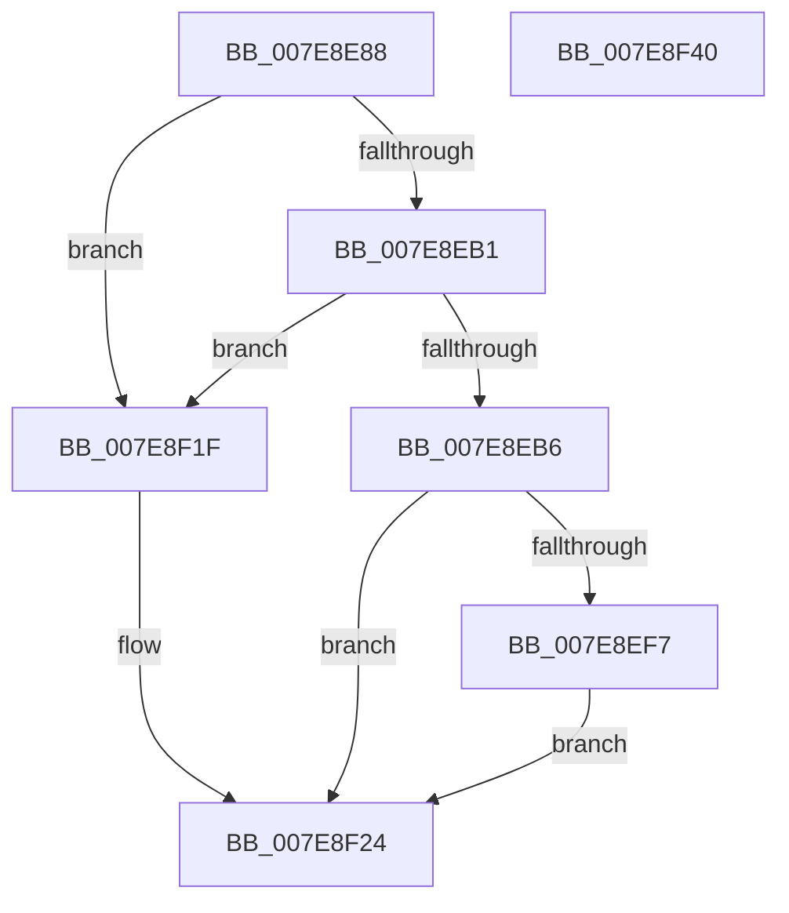

# CmpMachineHiveCachePopulateEntry

- RVA: `0x007E8E88`–`0x007E8F41` (길이 `185` bytes)
- VA: `0x00000001407E8E88`
- 실행 섹션: `PAGE`
- PDB 이름 있음: `예`; PDB Function 태그: `아니요`
- unwind 정보 RVA: `0x0007F83C`
- 디코드: `50`개 명령, `185/185` bytes 표시
- 미해석 바이트: `0` (있으면 어셈블리에 `.byte`로 보존)

> 이 문서는 커널 이미지의 기계어와 PDB 기호를 분석해 생성했습니다. 4번과 5번은 함수 원형과 자료형을 바이너리 사용 방식에서 추정한 C 해석이며 원본 소스 복구 결과는 아닙니다.

## 1. Dependencies

- 직접 호출 지점: **5**; 고유 호출 대상: **5**
- 직접 호출자로 확인된 함수: **1**
- RIP 상대 이미지 참조: **0**

### Outgoing calls
- `0x007E8EBA` → [CmpInitializeThreadInfo](../../text/3F/CmpInitializeThreadInfo_function_003FBE70.md) (function, `0x003FBE70`)
- `0x007E8EEC` → [CmpHiveCachePopulateHiveEntry](../7F/CmpHiveCachePopulateHiveEntry_function_007F5EB4.md) (function, `0x007F5EB4`)
- `0x007E8F0B` → [SetFailureLocation](../../text/46/SetFailureLocation_function_0046EF54.md) (function, `0x0046EF54`)
- `0x007E8F18` → [CmpHiveCacheEntryCleanup](../7F/CmpHiveCacheEntryCleanup_function_007F5B38.md) (function, `0x007F5B38`)
- `0x007E8F29` → [CmCleanupThreadInfo](../../text/41/CmCleanupThreadInfo_function_0041FD50.md) (function, `0x0041FD50`)

### Direct callers
- [CmpBuildMachineHiveCache](CmpBuildMachineHiveCache_function_007E8B74.md) at `0x007E8CD1`

### Static image references
- 디코드된 RIP-relative 메모리 참조가 없습니다.

## 2. Other-region calls and transfers

- 다른 실행 섹션으로 향하는 call: **3**
  - `0x007E8EBA` → [CmpInitializeThreadInfo](../../text/3F/CmpInitializeThreadInfo_function_003FBE70.md) (`PAGE` → `.text`)
  - `0x007E8F0B` → [SetFailureLocation](../../text/46/SetFailureLocation_function_0046EF54.md) (`PAGE` → `.text`)
  - `0x007E8F29` → [CmCleanupThreadInfo](../../text/41/CmCleanupThreadInfo_function_0041FD50.md) (`PAGE` → `.text`)
- 별도 외부 분기/꼬리 이동을 확인하지 못했습니다.

## 3. Assembly (complete function range)

```asm
007E8E88  4C 8B DC                        mov r11, rsp
007E8E8B  49 89 5B 08                     mov qword ptr [r11 + 8], rbx
007E8E8F  49 89 73 10                     mov qword ptr [r11 + 0x10], rsi
007E8E93  57                              push rdi
007E8E94  48 83 EC 50                     sub rsp, 0x50
007E8E98  33 C0                           xor eax, eax
007E8E9A  0F 57 C0                        xorps xmm0, xmm0
007E8E9D  4C 8B D2                        mov r10, rdx
007E8EA0  48 8B F9                        mov rdi, rcx
007E8EA3  0F 11 44 24 30                  movups xmmword ptr [rsp + 0x30], xmm0
007E8EA8  49 89 43 E8                     mov qword ptr [r11 - 0x18], rax
007E8EAC  48 85 C9                        test rcx, rcx
007E8EAF  74 6E                           je 0x1407e8f1f
007E8EB1  48 85 D2                        test rdx, rdx
007E8EB4  74 69                           je 0x1407e8f1f
007E8EB6  49 8D 4B D8                     lea rcx, [r11 - 0x28]
007E8EBA  E8 B1 2F C1 FF                  call 0x1403fbe70
007E8EBF  41 8A 42 3B                     mov al, byte ptr [r10 + 0x3b]
007E8EC3  4C 8D 8F 38 03 00 00            lea r9, [rdi + 0x338]
007E8ECA  41 88 01                        mov byte ptr [r9], al
007E8ECD  48 8D B7 88 01 00 00            lea rsi, [rdi + 0x188]
007E8ED4  45 8B 42 20                     mov r8d, dword ptr [r10 + 0x20]
007E8ED8  49 8D 92 A8 00 00 00            lea rdx, [r10 + 0xa8]
007E8EDF  48 89 74 24 28                  mov qword ptr [rsp + 0x28], rsi
007E8EE4  48 8B CF                        mov rcx, rdi
007E8EE7  4C 89 4C 24 20                  mov qword ptr [rsp + 0x20], r9
007E8EEC  E8 C3 CF 00 00                  call 0x1407f5eb4
007E8EF1  8B D8                           mov ebx, eax
007E8EF3  85 C0                           test eax, eax
007E8EF5  79 2D                           jns 0x1407e8f24
007E8EF7  33 D2                           xor edx, edx
007E8EF9  C7 44 24 20 10 00 00 00         mov dword ptr [rsp + 0x20], 0x10
007E8F01  44 8B C8                        mov r9d, eax
007E8F04  48 8B CE                        mov rcx, rsi
007E8F07  44 8D 42 33                     lea r8d, [rdx + 0x33]
007E8F0B  E8 44 60 C8 FF                  call 0x14046ef54
007E8F10  BA 01 00 00 00                  mov edx, 1
007E8F15  48 8B CF                        mov rcx, rdi
007E8F18  E8 1B CC 00 00                  call 0x1407f5b38
007E8F1D  EB 05                           jmp 0x1407e8f24
007E8F1F  BB 0D 00 00 C0                  mov ebx, 0xc000000d
007E8F24  48 8D 4C 24 30                  lea rcx, [rsp + 0x30]
007E8F29  E8 22 6E C3 FF                  call 0x14041fd50
007E8F2E  48 8B 74 24 68                  mov rsi, qword ptr [rsp + 0x68]
007E8F33  8B C3                           mov eax, ebx
007E8F35  48 8B 5C 24 60                  mov rbx, qword ptr [rsp + 0x60]
007E8F3A  48 83 C4 50                     add rsp, 0x50
007E8F3E  5F                              pop rdi
007E8F3F  C3                              ret
007E8F40  CC                              int3
```

## 4. C-style interpretation (structured pseudocode)

```c
__int64 __fastcall CmpMachineHiveCachePopulateEntry(__int64 a1, __int64 a2)
{
    __int64 result;
    __int64 v_rsp;
    unsigned __int64 v_stack_m28;
    unsigned __int64 v_stack_m30;
    unsigned __int64 v_stack_m38;
    unsigned __int64 v_stack_p10;
    unsigned __int64 v_stack_p8;

    *(unsigned __int64 *)(v_rsp + 8) = v_rbx;
    *(unsigned __int64 *)(v_rsp + 16) = v_rsi;
    v_rsp = (v_rsp) - (80);
    result = 0;
    v_stack_m28 = v_xmm0;
    *(unsigned __int64 *)(v_rsp - 24) = 0;
    if (a1 == 0) goto loc_007E8F1F;
    if (a2 == 0) goto loc_007E8F1F;
    result = CmpInitializeThreadInfo(v_rsp - 40, a2, a3, a4);
    *(unsigned __int8 *)(a1 + 824) = (unsigned __int8)(*(unsigned __int8 *)(a2 + 59));
    v_stack_m30 = a1 + 392;
    v_stack_m38 = a1 + 824;
    result = CmpHiveCachePopulateHiveEntry(a1, a2 + 168, (unsigned int)(*(unsigned int *)(a2 + 32)), a1 + 824);
    if (!sign_flag) goto loc_007E8F24;
    a2 = 0;
    v_stack_m38 = 16;
    result = SetFailureLocation(a1 + 392, a2, a2 + 51, (unsigned int)((unsigned int)(result)));
    result = CmpHiveCacheEntryCleanup(a1, 1, a2 + 51, (unsigned int)((unsigned int)(result)));
    goto loc_007E8F24;
loc_007E8F1F:
loc_007E8F24:
    result = CmCleanupThreadInfo(v_stack_m28, 1, a2 + 51, (unsigned int)((unsigned int)(result)));
    v_rsp = (v_rsp) + (80);
    return (unsigned int)((unsigned int)((unsigned int)(0xC000000DULL)));
}
```

## 5. (Beta) C Style

```c
int64_t CmpMachineHiveCachePopulateEntry(void *Arg1, int64_t Arg2)
{
    uint8_t *arg1 = (uint8_t *)Arg1;

    int64_t result;
    int64_t local_rsp;
    uint64_t v_stack_m28;
    uint64_t v_stack_m30;
    uint64_t v_stack_m38;
    uint64_t v_stack_p10;
    uint64_t v_stack_p8;

    *(uint64_t *)(local_rsp + 0x8) = local_rbx;
    *(uint64_t *)(local_rsp + 0x10) = local_rsi;
    local_rsp = (local_rsp) - (80);
    result = 0;
    v_stack_m28 = v_xmm0;
    *(uint64_t *)(local_rsp - 0x18) = 0;
    if (Arg1 == NULL) goto loc_007E8F1F;
    if (Arg2 == 0) goto loc_007E8F1F;
    result = CmpInitializeThreadInfo(local_rsp - 40, Arg2, a3, a4);
    *(uint8_t *)(arg1 + 0x338) = (uint8_t)(*(uint8_t *)(Arg2 + 0x3B));
    v_stack_m30 = Arg1 + 392;
    v_stack_m38 = Arg1 + 824;
    result = CmpHiveCachePopulateHiveEntry(Arg1, Arg2 + 168, (uint32_t)(*(uint32_t *)(Arg2 + 0x20)), Arg1 + 824);
    if (!sign_flag) goto loc_007E8F24;
    Arg2 = 0;
    v_stack_m38 = 16;
    result = SetFailureLocation(Arg1 + 392, Arg2, Arg2 + 51, (uint32_t)((uint32_t)(result)));
    result = CmpHiveCacheEntryCleanup(Arg1, 1, Arg2 + 51, (uint32_t)((uint32_t)(result)));
    goto loc_007E8F24;
loc_007E8F1F:
loc_007E8F24:
    result = CmCleanupThreadInfo(v_stack_m28, 1, Arg2 + 51, (uint32_t)((uint32_t)(result)));
    local_rsp = (local_rsp) + (80);
    return (uint32_t)((uint32_t)((uint32_t)(0xC000000DULL)));
}
```

### 관측된 메모리 오프셋

구조체 형식이 확인되지 않은 접근은 인자 기준의 오프셋으로만 기록했습니다.

| 기준 인자 | 오프셋 표현 | 폭 (bit) | 접근 |
|---|---:|---:|---|
| `Arg1` | `+ 0x0` | `8` | `W` |
| `Arg1` | `+ 0x188` | `64` | `R` |
| `Arg1` | `+ 0x338` | `64` | `R` |

## 6. Execution-region graph

[열기: 2D/3D 그래프와 함수 탐색 컨트롤 패널](../../../control-panel.html?section=page&rva=0x007E8E88&view=graph)

- 2D 그래프는 위에서 아래로 흐르고, 3D 그래프는 빈 공간을 드래그해 회전합니다. Shift+드래그는 이동, 휠은 확대·축소, 함수 노드 선택은 대상 보고서 이동입니다.

### Static fallback


