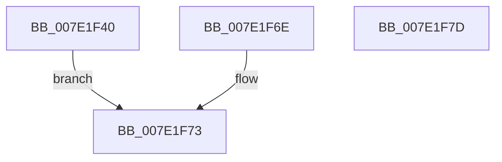

# CmpMachineHiveLoadedWorkItem

- RVA: `0x007E1F40`–`0x007E1F7E` (길이 `62` bytes)
- VA: `0x00000001407E1F40`
- 실행 섹션: `PAGE`
- PDB 이름 있음: `예`; PDB Function 태그: `아니요`
- unwind 정보 RVA: `0x000D692C`
- 디코드: `17`개 명령, `62/62` bytes 표시
- 미해석 바이트: `0` (있으면 어셈블리에 `.byte`로 보존)

> 이 문서는 커널 이미지의 기계어와 PDB 기호를 분석해 생성했습니다. 4번과 5번은 함수 원형과 자료형을 바이너리 사용 방식에서 추정한 C 해석이며 원본 소스 복구 결과는 아닙니다.

## 1. Dependencies

- 직접 호출 지점: **1**; 고유 호출 대상: **1**
- 직접 호출자로 확인된 함수: **0**
- RIP 상대 이미지 참조: **0**

### Outgoing calls
- `0x007E1F67` → [guard_dispatch_icall](../../text/6B/guard_dispatch_icall_function_006BAAD0.md) (function, `0x006BAAD0`)

### Direct callers
- 이 함수 시작 RVA로 연결되는 직접 call은 확인되지 않았습니다. 간접 호출은 완전히 역산할 수 없습니다.

### Static image references
- 디코드된 RIP-relative 메모리 참조가 없습니다.

## 2. Other-region calls and transfers

- 다른 실행 섹션으로 향하는 call: **1**
  - `0x007E1F67` → [guard_dispatch_icall](../../text/6B/guard_dispatch_icall_function_006BAAD0.md) (`PAGE` → `.text`)
- 별도 외부 분기/꼬리 이동을 확인하지 못했습니다.

## 3. Assembly (complete function range)

```asm
007E1F40  48 89 54 24 10                  mov qword ptr [rsp + 0x10], rdx
007E1F45  53                              push rbx
007E1F46  48 83 EC 20                     sub rsp, 0x20
007E1F4A  65 48 8B 04 25 88 01 00 00      mov rax, qword ptr gs:[0x188]
007E1F53  48 8D 5A 60                     lea rbx, [rdx + 0x60]
007E1F57  48 89 5C 24 40                  mov qword ptr [rsp + 0x40], rbx
007E1F5C  48 89 03                        mov qword ptr [rbx], rax
007E1F5F  48 8B 42 50                     mov rax, qword ptr [rdx + 0x50]
007E1F63  48 8B 4A 58                     mov rcx, qword ptr [rdx + 0x58]
007E1F67  E8 64 8B ED FF                  call 0x1406baad0
007E1F6C  EB 05                           jmp 0x1407e1f73
007E1F6E  48 8B 5C 24 40                  mov rbx, qword ptr [rsp + 0x40]
007E1F73  48 83 23 00                     and qword ptr [rbx], 0
007E1F77  48 83 C4 20                     add rsp, 0x20
007E1F7B  5B                              pop rbx
007E1F7C  C3                              ret
007E1F7D  CC                              int3
```

## 4. C-style interpretation (structured pseudocode)

```c
__int64 __fastcall CmpMachineHiveLoadedWorkItem(__int64 a1, __int64 a2)
{
    __int64 result;
    __int64 v_rsp;
    unsigned __int64 v_stack_p10;
    unsigned __int64 v_stack_p18;

    v_stack_p10 = a2;
    v_rsp = (v_rsp) - (32);
    v_stack_p18 = a2 + 96;
    *(unsigned __int64 *)(a2 + 96) = *(unsigned __int64 *)(gs_base + (0 + 392));
    result = guard_dispatch_icall(*(unsigned __int64 *)(a2 + 88), a2, a3, a4);
    goto loc_007E1F73;
loc_007E1F73:
    v_rsp = (v_rsp) + (32);
    return result;
}
```

## 5. (Beta) C Style

```c
int64_t CmpMachineHiveLoadedWorkItem(int64_t Arg1, void *Arg2)
{
    uint8_t *arg2 = (uint8_t *)Arg2;

    int64_t result;
    int64_t local_rsp;
    uint64_t v_stack_p10;
    uint64_t v_stack_p18;

    v_stack_p10 = Arg2;
    local_rsp = (local_rsp) - (32);
    v_stack_p18 = Arg2 + 96;
    *(uint64_t *)(arg2 + 0x60) = *(uint64_t *)(gs_base + (0 + 0x188));
    result = guard_dispatch_icall(*(uint64_t *)(arg2 + 0x58), Arg2, a3, a4);
    goto loc_007E1F73;
loc_007E1F73:
    local_rsp = (local_rsp) + (32);
    return result;
}
```

### 관측된 메모리 오프셋

구조체 형식이 확인되지 않은 접근은 인자 기준의 오프셋으로만 기록했습니다.

| 기준 인자 | 오프셋 표현 | 폭 (bit) | 접근 |
|---|---:|---:|---|
| `Arg2` | `+ 0x0` | `64` | `R/W` |
| `Arg2` | `+ 0x0` | `64` | `W` |
| `Arg2` | `+ 0x50` | `64` | `R` |
| `Arg2` | `+ 0x58` | `64` | `R` |
| `Arg2` | `+ 0x60` | `64` | `R` |

## 6. Execution-region graph

[열기: 2D/3D 그래프와 함수 탐색 컨트롤 패널](../../../control-panel.html?section=page&rva=0x007E1F40&view=graph)

- 2D 그래프는 위에서 아래로 흐르고, 3D 그래프는 빈 공간을 드래그해 회전합니다. Shift+드래그는 이동, 휠은 확대·축소, 함수 노드 선택은 대상 보고서 이동입니다.

### Static fallback


