# CmpMergeVersionDescriptors

- RVA: `0x007E7320`–`0x007E7478` (길이 `344` bytes)
- VA: `0x00000001407E7320`
- 실행 섹션: `PAGE`
- PDB 이름 있음: `예`; PDB Function 태그: `아니요`
- unwind 정보 RVA: `0x0005FEF8`
- 디코드: `100`개 명령, `344/344` bytes 표시
- 미해석 바이트: `0` (있으면 어셈블리에 `.byte`로 보존)

> 이 문서는 커널 이미지의 기계어와 PDB 기호를 분석해 생성했습니다. 4번과 5번은 함수 원형과 자료형을 바이너리 사용 방식에서 추정한 C 해석이며 원본 소스 복구 결과는 아닙니다.

## 1. Dependencies

- 직접 호출 지점: **5**; 고유 호출 대상: **1**
- 직접 호출자로 확인된 함수: **1**
- RIP 상대 이미지 참조: **0**

### Outgoing calls
- `0x007E73A6` → [RtlCopyUnicodeString](../../text/3F/RtlCopyUnicodeString_function_003FEF30.md) (function, `0x003FEF30`)
- `0x007E73C9` → [RtlCopyUnicodeString](../../text/3F/RtlCopyUnicodeString_function_003FEF30.md) (function, `0x003FEF30`)
- `0x007E73F6` → [RtlCopyUnicodeString](../../text/3F/RtlCopyUnicodeString_function_003FEF30.md) (function, `0x003FEF30`)
- `0x007E7419` → [RtlCopyUnicodeString](../../text/3F/RtlCopyUnicodeString_function_003FEF30.md) (function, `0x003FEF30`)
- `0x007E7443` → [RtlCopyUnicodeString](../../text/3F/RtlCopyUnicodeString_function_003FEF30.md) (function, `0x003FEF30`)

### Direct callers
- [CmpLoadSystemVersionData](CmpLoadSystemVersionData_function_007E70BC.md) at `0x007E720F`
- [CmpLoadSystemVersionData](CmpLoadSystemVersionData_function_007E70BC.md) at `0x007E727C`

### Static image references
- 디코드된 RIP-relative 메모리 참조가 없습니다.

## 2. Other-region calls and transfers

- 다른 실행 섹션으로 향하는 call: **5**
  - `0x007E73A6` → [RtlCopyUnicodeString](../../text/3F/RtlCopyUnicodeString_function_003FEF30.md) (`PAGE` → `.text`)
  - `0x007E73C9` → [RtlCopyUnicodeString](../../text/3F/RtlCopyUnicodeString_function_003FEF30.md) (`PAGE` → `.text`)
  - `0x007E73F6` → [RtlCopyUnicodeString](../../text/3F/RtlCopyUnicodeString_function_003FEF30.md) (`PAGE` → `.text`)
  - `0x007E7419` → [RtlCopyUnicodeString](../../text/3F/RtlCopyUnicodeString_function_003FEF30.md) (`PAGE` → `.text`)
  - `0x007E7443` → [RtlCopyUnicodeString](../../text/3F/RtlCopyUnicodeString_function_003FEF30.md) (`PAGE` → `.text`)
- 별도 외부 분기/꼬리 이동을 확인하지 못했습니다.

## 3. Assembly (complete function range)

```asm
007E7320  48 8B C4                        mov rax, rsp
007E7323  48 89 58 08                     mov qword ptr [rax + 8], rbx
007E7327  48 89 68 10                     mov qword ptr [rax + 0x10], rbp
007E732B  48 89 70 18                     mov qword ptr [rax + 0x18], rsi
007E732F  48 89 78 20                     mov qword ptr [rax + 0x20], rdi
007E7333  41 54                           push r12
007E7335  41 56                           push r14
007E7337  41 57                           push r15
007E7339  48 83 EC 20                     sub rsp, 0x20
007E733D  8B 82 20 03 00 00               mov eax, dword ptr [rdx + 0x320]
007E7343  45 33 FF                        xor r15d, r15d
007E7346  48 8B E9                        mov rbp, rcx
007E7349  48 8B DA                        mov rbx, rdx
007E734C  41 8B CF                        mov ecx, r15d
007E734F  45 8D 67 01                     lea r12d, [r15 + 1]
007E7353  48 8D BD 20 03 00 00            lea rdi, [rbp + 0x320]
007E735A  A8 20                           test al, 0x20
007E735C  74 0C                           je 0x1407e736a
007E735E  8B 42 08                        mov eax, dword ptr [rdx + 8]
007E7361  41 8B CC                        mov ecx, r12d
007E7364  83 0F 20                        or dword ptr [rdi], 0x20
007E7367  89 45 08                        mov dword ptr [rbp + 8], eax
007E736A  8B 82 20 03 00 00               mov eax, dword ptr [rdx + 0x320]
007E7370  A8 40                           test al, 0x40
007E7372  74 15                           je 0x1407e7389
007E7374  8B 42 0C                        mov eax, dword ptr [rdx + 0xc]
007E7377  4C 8D B5 20 03 00 00            lea r14, [rbp + 0x320]
007E737E  83 0F 40                        or dword ptr [rdi], 0x40
007E7381  41 8B CC                        mov ecx, r12d
007E7384  89 45 0C                        mov dword ptr [rbp + 0xc], eax
007E7387  EB 03                           jmp 0x1407e738c
007E7389  4C 8B F7                        mov r14, rdi
007E738C  48 8B F7                        mov rsi, rdi
007E738F  4C 39 7A 28                     cmp qword ptr [rdx + 0x28], r15
007E7393  74 1D                           je 0x1407e73b2
007E7395  48 83 C2 20                     add rdx, 0x20
007E7399  49 8B F6                        mov rsi, r14
007E739C  66 44 39 3A                     cmp word ptr [rdx], r15w
007E73A0  74 10                           je 0x1407e73b2
007E73A2  48 8D 4D 20                     lea rcx, [rbp + 0x20]
007E73A6  E8 85 7B C1 FF                  call 0x1403fef30
007E73AB  0F BA 2F 07                     bts dword ptr [rdi], 7
007E73AF  41 8B CC                        mov ecx, r12d
007E73B2  4C 8B F6                        mov r14, rsi
007E73B5  4C 39 7B 38                     cmp qword ptr [rbx + 0x38], r15
007E73B9  74 21                           je 0x1407e73dc
007E73BB  48 8D 53 30                     lea rdx, [rbx + 0x30]
007E73BF  66 44 39 3A                     cmp word ptr [rdx], r15w
007E73C3  74 17                           je 0x1407e73dc
007E73C5  48 8D 4D 30                     lea rcx, [rbp + 0x30]
007E73C9  E8 62 7B C1 FF                  call 0x1403fef30
007E73CE  0F BA 2E 08                     bts dword ptr [rsi], 8
007E73D2  4C 8D B5 20 03 00 00            lea r14, [rbp + 0x320]
007E73D9  41 8B CC                        mov ecx, r12d
007E73DC  48 8B FE                        mov rdi, rsi
007E73DF  4C 39 7B 48                     cmp qword ptr [rbx + 0x48], r15
007E73E3  74 1D                           je 0x1407e7402
007E73E5  48 8D 53 40                     lea rdx, [rbx + 0x40]
007E73E9  49 8B FE                        mov rdi, r14
007E73EC  66 44 39 3A                     cmp word ptr [rdx], r15w
007E73F0  74 10                           je 0x1407e7402
007E73F2  48 8D 4D 40                     lea rcx, [rbp + 0x40]
007E73F6  E8 35 7B C1 FF                  call 0x1403fef30
007E73FB  0F BA 2E 09                     bts dword ptr [rsi], 9
007E73FF  41 8B CC                        mov ecx, r12d
007E7402  48 8B F7                        mov rsi, rdi
007E7405  4C 39 7B 58                     cmp qword ptr [rbx + 0x58], r15
007E7409  74 21                           je 0x1407e742c
007E740B  48 8D 53 50                     lea rdx, [rbx + 0x50]
007E740F  66 44 39 3A                     cmp word ptr [rdx], r15w
007E7413  74 17                           je 0x1407e742c
007E7415  48 8D 4D 50                     lea rcx, [rbp + 0x50]
007E7419  E8 12 7B C1 FF                  call 0x1403fef30
007E741E  0F BA 2F 0A                     bts dword ptr [rdi], 0xa
007E7422  48 8D B5 20 03 00 00            lea rsi, [rbp + 0x320]
007E7429  41 8B CC                        mov ecx, r12d
007E742C  48 8B C7                        mov rax, rdi
007E742F  4C 39 7B 68                     cmp qword ptr [rbx + 0x68], r15
007E7433  74 19                           je 0x1407e744e
007E7435  48 8D 53 60                     lea rdx, [rbx + 0x60]
007E7439  66 44 39 3A                     cmp word ptr [rdx], r15w
007E743D  74 0F                           je 0x1407e744e
007E743F  48 8D 4D 60                     lea rcx, [rbp + 0x60]
007E7443  E8 E8 7A C1 FF                  call 0x1403fef30
007E7448  0F BA 2F 0B                     bts dword ptr [rdi], 0xb
007E744C  EB 07                           jmp 0x1407e7455
007E744E  48 8B F0                        mov rsi, rax
007E7451  85 C9                           test ecx, ecx
007E7453  74 03                           je 0x1407e7458
007E7455  83 0E 04                        or dword ptr [rsi], 4
007E7458  48 8B 5C 24 40                  mov rbx, qword ptr [rsp + 0x40]
007E745D  48 8B 6C 24 48                  mov rbp, qword ptr [rsp + 0x48]
007E7462  48 8B 74 24 50                  mov rsi, qword ptr [rsp + 0x50]
007E7467  48 8B 7C 24 58                  mov rdi, qword ptr [rsp + 0x58]
007E746C  48 83 C4 20                     add rsp, 0x20
007E7470  41 5F                           pop r15
007E7472  41 5E                           pop r14
007E7474  41 5C                           pop r12
007E7476  C3                              ret
007E7477  CC                              int3
```

## 4. C-style interpretation (structured pseudocode)

```c
__int64 __fastcall CmpMergeVersionDescriptors(__int64 a1, __int64 a2)
{
    __int64 result;
    __int64 v_r14;
    __int64 v_r15;
    __int64 v_rsi;
    __int64 v_rsp;
    unsigned __int64 v_stack_p10;
    unsigned __int64 v_stack_p18;
    unsigned __int64 v_stack_p20;
    unsigned __int64 v_stack_p8;

    *(unsigned __int64 *)(v_rsp + 8) = v_rbx;
    *(unsigned __int64 *)(v_rsp + 16) = v_rbp;
    *(unsigned __int64 *)(v_rsp + 24) = v_rsi;
    *(unsigned __int64 *)(v_rsp + 32) = v_rdi;
    v_rsp = (v_rsp) - (32);
    v_r15 = 0;
    result = (unsigned int)(*(unsigned int *)(a2 + 800));
    if ((((unsigned __int8)((unsigned int)(*(unsigned int *)(a2 + 800)))) & (32)) != 0) {
        result = *(unsigned int *)(a2 + 8);
        a1 = (unsigned int)(v_r15 + 1);
        *(unsigned int *)(a1 + 8) = (unsigned int)(result);
    }
    if ((((unsigned __int8)((unsigned int)(*(unsigned int *)(a2 + 800)))) & (64)) == 0) goto loc_007E7389;
    *(unsigned int *)(a1 + 12) = (unsigned int)((unsigned int)(*(unsigned int *)(a2 + 12)));
    goto loc_007E738C;
loc_007E7389:
loc_007E738C:
    if ((*(unsigned __int64 *)(a2 + 40)) == 0) goto loc_007E73B2;
    a2 = (a2) + (32);
    result = (unsigned int)(*(unsigned int *)(a2 + 12));
    if ((*(unsigned __int16 *)(a2)) != 0) {
        a1 = a1 + 32;
        result = RtlCopyUnicodeString(a1, a2, a3, a4);
        a1 = (unsigned int)(v_r15 + 1);
    }
    if ((*(unsigned __int64 *)(a2 + 56)) == 0) goto loc_007E73DC;
    v_r14 = a1 + 800;
    if ((*(unsigned __int16 *)(a2 + 48)) != 0) {
        a1 = a1 + 48;
        result = RtlCopyUnicodeString(a1, a2 + 48, a3, a4);
        v_r14 = a1 + 800;
        a1 = (unsigned int)(v_r15 + 1);
    }
    if ((*(unsigned __int64 *)(a2 + 72)) == 0) goto loc_007E7402;
    if ((*(unsigned __int16 *)(a2 + 64)) != 0) {
        a1 = a1 + 64;
        result = RtlCopyUnicodeString(a1, a2 + 64, a3, a4);
        a1 = (unsigned int)(v_r15 + 1);
    }
    if ((*(unsigned __int64 *)(a2 + 88)) == 0) goto loc_007E742C;
    v_rsi = v_r14;
    if ((*(unsigned __int16 *)(a2 + 80)) != 0) {
        a1 = a1 + 80;
        result = RtlCopyUnicodeString(a1, a2 + 80, a3, a4);
        v_rsi = a1 + 800;
        a1 = (unsigned int)(v_r15 + 1);
    }
    if ((*(unsigned __int64 *)(a2 + 104)) == 0) goto loc_007E744E;
    if ((*(unsigned __int16 *)(a2 + 96)) == 0) goto loc_007E744E;
    result = RtlCopyUnicodeString(a1 + 96, a2 + 96, a3, a4);
    goto loc_007E7455;
loc_007E744E:
    if ((unsigned int)(a1 + 96) != 0) {
    }
    v_rsp = (v_rsp) + (32);
    return result;
}
```

## 5. (Beta) C Style

```c
int64_t CmpMergeVersionDescriptors(void *Arg1, void *Arg2)
{
    uint8_t *arg1 = (uint8_t *)Arg1;
    uint8_t *arg2 = (uint8_t *)Arg2;

    int64_t result;
    int64_t local_r14;
    int64_t local_r15;
    int64_t local_rsi;
    int64_t local_rsp;
    uint64_t v_stack_p10;
    uint64_t v_stack_p18;
    uint64_t v_stack_p20;
    uint64_t v_stack_p8;

    *(uint64_t *)(local_rsp + 0x8) = local_rbx;
    *(uint64_t *)(local_rsp + 0x10) = local_rbp;
    *(uint64_t *)(local_rsp + 0x18) = local_rsi;
    *(uint64_t *)(local_rsp + 0x20) = local_rdi;
    local_rsp = (local_rsp) - (32);
    local_r15 = 0;
    result = (uint32_t)(*(uint32_t *)(arg2 + 0x320));
    if ((((uint8_t)((uint32_t)(*(uint32_t *)(arg2 + 0x320)))) & (32)) != 0) {
        result = *(uint32_t *)(arg2 + 0x8);
        Arg1 = (uint32_t)(local_r15 + 1);
        *(uint32_t *)(arg1 + 0x8) = (uint32_t)(result);
    }
    if ((((uint8_t)((uint32_t)(*(uint32_t *)(arg2 + 0x320)))) & (64)) == 0) goto loc_007E7389;
    *(uint32_t *)(arg1 + 0xC) = (uint32_t)((uint32_t)(*(uint32_t *)(arg2 + 0xC)));
    goto loc_007E738C;
loc_007E7389:
loc_007E738C:
    if ((*(uint64_t *)(arg2 + 0x28)) == 0) goto loc_007E73B2;
    Arg2 = (Arg2) + (32);
    result = (uint32_t)(*(uint32_t *)(arg2 + 0xC));
    if ((*(uint16_t *)(arg2)) != 0) {
        Arg1 = Arg1 + 32;
        result = RtlCopyUnicodeString(Arg1, Arg2, a3, a4);
        Arg1 = (uint32_t)(local_r15 + 1);
    }
    if ((*(uint64_t *)(arg2 + 0x38)) == 0) goto loc_007E73DC;
    local_r14 = Arg1 + 800;
    if ((*(uint16_t *)(arg2 + 0x30)) != 0) {
        Arg1 = Arg1 + 48;
        result = RtlCopyUnicodeString(Arg1, Arg2 + 48, a3, a4);
        local_r14 = Arg1 + 800;
        Arg1 = (uint32_t)(local_r15 + 1);
    }
    if ((*(uint64_t *)(arg2 + 0x48)) == 0) goto loc_007E7402;
    if ((*(uint16_t *)(arg2 + 0x40)) != 0) {
        Arg1 = Arg1 + 64;
        result = RtlCopyUnicodeString(Arg1, Arg2 + 64, a3, a4);
        Arg1 = (uint32_t)(local_r15 + 1);
    }
    if ((*(uint64_t *)(arg2 + 0x58)) == 0) goto loc_007E742C;
    local_rsi = local_r14;
    if ((*(uint16_t *)(arg2 + 0x50)) != 0) {
        Arg1 = Arg1 + 80;
        result = RtlCopyUnicodeString(Arg1, Arg2 + 80, a3, a4);
        local_rsi = Arg1 + 800;
        Arg1 = (uint32_t)(local_r15 + 1);
    }
    if ((*(uint64_t *)(arg2 + 0x68)) == 0) goto loc_007E744E;
    if ((*(uint16_t *)(arg2 + 0x60)) == 0) goto loc_007E744E;
    result = RtlCopyUnicodeString(Arg1 + 96, Arg2 + 96, a3, a4);
    goto loc_007E7455;
loc_007E744E:
    if ((uint32_t)(Arg1 + 96) != 0) {
    }
    local_rsp = (local_rsp) + (32);
    return result;
}
```

### 관측된 메모리 오프셋

구조체 형식이 확인되지 않은 접근은 인자 기준의 오프셋으로만 기록했습니다.

| 기준 인자 | 오프셋 표현 | 폭 (bit) | 접근 |
|---|---:|---:|---|
| `Arg1` | `+ 0x0` | `32` | `R/W` |
| `Arg1` | `+ 0x8` | `32` | `W` |
| `Arg1` | `+ 0xC` | `32` | `W` |
| `Arg1` | `+ 0x20` | `64` | `R` |
| `Arg1` | `+ 0x30` | `64` | `R` |
| `Arg1` | `+ 0x40` | `64` | `R` |
| `Arg1` | `+ 0x50` | `64` | `R` |
| `Arg1` | `+ 0x60` | `64` | `R` |
| `Arg1` | `+ 0x320` | `64` | `R` |
| `Arg2` | `+ 0x0` | `16` | `R` |
| `Arg2` | `+ 0x8` | `32` | `R` |
| `Arg2` | `+ 0xC` | `32` | `R` |
| `Arg2` | `+ 0x28` | `64` | `R` |
| `Arg2` | `+ 0x30` | `64` | `R` |
| `Arg2` | `+ 0x38` | `64` | `R` |
| `Arg2` | `+ 0x40` | `64` | `R` |
| `Arg2` | `+ 0x48` | `64` | `R` |
| `Arg2` | `+ 0x50` | `64` | `R` |
| `Arg2` | `+ 0x58` | `64` | `R` |
| `Arg2` | `+ 0x60` | `64` | `R` |
| `Arg2` | `+ 0x68` | `64` | `R` |
| `Arg2` | `+ 0x320` | `32` | `R` |

## 6. Execution-region graph

[열기: 2D/3D 그래프와 함수 탐색 컨트롤 패널](../../../control-panel.html?section=page&rva=0x007E7320&view=graph)

- 2D 그래프는 위에서 아래로 흐르고, 3D 그래프는 빈 공간을 드래그해 회전합니다. Shift+드래그는 이동, 휠은 확대·축소, 함수 노드 선택은 대상 보고서 이동입니다.

### Static fallback

```mermaid
flowchart TD
  bb_007E7320[BB_007E7320]
  bb_007E735E[BB_007E735E]
  bb_007E736A[BB_007E736A]
  bb_007E7374[BB_007E7374]
  bb_007E7389[BB_007E7389]
  bb_007E738C[BB_007E738C]
  bb_007E7395[BB_007E7395]
  bb_007E73A2[BB_007E73A2]
  bb_007E73B2[BB_007E73B2]
  bb_007E73BB[BB_007E73BB]
  bb_007E73C5[BB_007E73C5]
  bb_007E73DC[BB_007E73DC]
  bb_007E73E5[BB_007E73E5]
  bb_007E73F2[BB_007E73F2]
  bb_007E7402[BB_007E7402]
  bb_007E740B[BB_007E740B]
  bb_007E7415[BB_007E7415]
  bb_007E742C[BB_007E742C]
  bb_007E7435[BB_007E7435]
  bb_007E743F[BB_007E743F]
  bb_007E744E[BB_007E744E]
  bb_007E7455[BB_007E7455]
  bb_007E7458[BB_007E7458]
  bb_007E7477[BB_007E7477]
  bb_007E7320 -->|branch| bb_007E736A
  bb_007E7320 -->|fallthrough| bb_007E735E
  bb_007E735E -->|flow| bb_007E736A
  bb_007E736A -->|branch| bb_007E7389
  bb_007E736A -->|fallthrough| bb_007E7374
  bb_007E7374 -->|branch| bb_007E738C
  bb_007E7389 -->|flow| bb_007E738C
  bb_007E738C -->|branch| bb_007E73B2
  bb_007E738C -->|fallthrough| bb_007E7395
  bb_007E7395 -->|branch| bb_007E73B2
  bb_007E7395 -->|fallthrough| bb_007E73A2
  bb_007E73A2 -->|flow| bb_007E73B2
  bb_007E73B2 -->|branch| bb_007E73DC
  bb_007E73B2 -->|fallthrough| bb_007E73BB
  bb_007E73BB -->|branch| bb_007E73DC
  bb_007E73BB -->|fallthrough| bb_007E73C5
  bb_007E73C5 -->|flow| bb_007E73DC
  bb_007E73DC -->|branch| bb_007E7402
  bb_007E73DC -->|fallthrough| bb_007E73E5
  bb_007E73E5 -->|branch| bb_007E7402
  bb_007E73E5 -->|fallthrough| bb_007E73F2
  bb_007E73F2 -->|flow| bb_007E7402
  bb_007E7402 -->|branch| bb_007E742C
  bb_007E7402 -->|fallthrough| bb_007E740B
  bb_007E740B -->|branch| bb_007E742C
  bb_007E740B -->|fallthrough| bb_007E7415
  bb_007E7415 -->|flow| bb_007E742C
  bb_007E742C -->|branch| bb_007E744E
  bb_007E742C -->|fallthrough| bb_007E7435
  bb_007E7435 -->|branch| bb_007E744E
  bb_007E7435 -->|fallthrough| bb_007E743F
  bb_007E743F -->|branch| bb_007E7455
  bb_007E744E -->|branch| bb_007E7458
  bb_007E744E -->|fallthrough| bb_007E7455
  bb_007E7455 -->|flow| bb_007E7458
```


