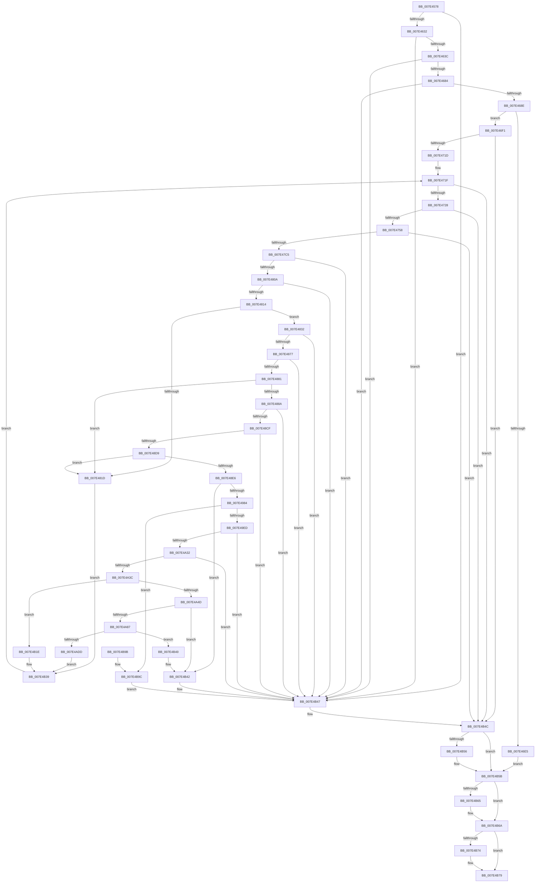

# CmpMoveBiosAliasTable

- RVA: `0x007E4578`–`0x007E4BA3` (길이 `1,579` bytes)
- VA: `0x00000001407E4578`
- 실행 섹션: `PAGE`
- PDB 이름 있음: `예`; PDB Function 태그: `아니요`
- unwind 정보 RVA: `0x000D69EC`
- 디코드: `363`개 명령, `1,579/1,579` bytes 표시
- 미해석 바이트: `0` (있으면 어셈블리에 `.byte`로 보존)

> 이 문서는 커널 이미지의 기계어와 PDB 기호를 분석해 생성했습니다. 4번과 5번은 함수 원형과 자료형을 바이너리 사용 방식에서 추정한 C 해석이며 원본 소스 복구 결과는 아닙니다.

## 1. Dependencies

- 직접 호출 지점: **41**; 고유 호출 대상: **12**
- 직접 호출자로 확인된 함수: **1**
- RIP 상대 이미지 참조: **9**

### Outgoing calls
- `0x007E45FD` → [RtlInitUnicodeString](../../text/42/RtlInitUnicodeString_function_0042A780.md) (function, `0x0042A780`)
- `0x007E4625` → [ZwQueryValueKey](../../text/6A/ZwQueryValueKey_function_006AD3B0.md) (function, `0x006AD3B0`)
- `0x007E464F` → [RtlInitUnicodeString](../../text/42/RtlInitUnicodeString_function_0042A780.md) (function, `0x0042A780`)
- `0x007E4677` → [ZwQueryValueKey](../../text/6A/ZwQueryValueKey_function_006AD3B0.md) (function, `0x006AD3B0`)
- `0x007E46A1` → [RtlInitUnicodeString](../../text/42/RtlInitUnicodeString_function_0042A780.md) (function, `0x0042A780`)
- `0x007E46DA` → [ZwOpenKey](../../text/6A/ZwOpenKey_function_006AD310.md) (function, `0x006AD310`)
- `0x007E470C` → [ZwQueryKey](../../text/6A/ZwQueryKey_function_006AD390.md) (function, `0x006AD390`)
- `0x007E4747` → [ZwEnumerateKey](../../text/6A/ZwEnumerateKey_function_006AD710.md) (function, `0x006AD710`)
- `0x007E47B6` → [ZwOpenKey](../../text/6A/ZwOpenKey_function_006AD310.md) (function, `0x006AD310`)
- `0x007E47D1` → [RtlInitUnicodeString](../../text/42/RtlInitUnicodeString_function_0042A780.md) (function, `0x0042A780`)
- `0x007E47FB` → [ZwQueryValueKey](../../text/6A/ZwQueryValueKey_function_006AD3B0.md) (function, `0x006AD3B0`)
- `0x007E4822` → [ZwClose](../../text/6A/ZwClose_function_006AD2B0.md) (function, `0x006AD2B0`)
- `0x007E483E` → [RtlInitUnicodeString](../../text/42/RtlInitUnicodeString_function_0042A780.md) (function, `0x0042A780`)
- `0x007E4868` → [ZwQueryValueKey](../../text/6A/ZwQueryValueKey_function_006AD3B0.md) (function, `0x006AD3B0`)
- `0x007E4896` → [RtlInitUnicodeString](../../text/42/RtlInitUnicodeString_function_0042A780.md) (function, `0x0042A780`)
- `0x007E48C0` → [ZwQueryValueKey](../../text/6A/ZwQueryValueKey_function_006AD3B0.md) (function, `0x006AD3B0`)
- `0x007E48F2` → [RtlInitUnicodeString](../../text/42/RtlInitUnicodeString_function_0042A780.md) (function, `0x0042A780`)
- `0x007E4919` → [ZwSetValueKey](../../text/6A/ZwSetValueKey_function_006ADCD0.md) (function, `0x006ADCD0`)
- `0x007E4923` → [ZwClose](../../text/6A/ZwClose_function_006AD2B0.md) (function, `0x006AD2B0`)
- `0x007E493B` → [RtlInitUnicodeString](../../text/42/RtlInitUnicodeString_function_0042A780.md) (function, `0x0042A780`)
- `0x007E4977` → [ZwOpenKey](../../text/6A/ZwOpenKey_function_006AD310.md) (function, `0x006AD310`)
- `0x007E4996` → [swprintf_s](../../text/50/swprintf_s_function_00504B20.md) (function, `0x00504B20`)
- `0x007E49A3` → [RtlInitUnicodeString](../../text/42/RtlInitUnicodeString_function_0042A780.md) (function, `0x0042A780`)
- `0x007E49E0` → [ZwOpenKey](../../text/6A/ZwOpenKey_function_006AD310.md) (function, `0x006AD310`)
- `0x007E49F9` → [RtlInitUnicodeString](../../text/42/RtlInitUnicodeString_function_0042A780.md) (function, `0x0042A780`)
- `0x007E4A21` → [ZwQueryValueKey](../../text/6A/ZwQueryValueKey_function_006AD3B0.md) (function, `0x006AD3B0`)
- `0x007E4A4D` → [ZwDeleteKey](../../text/6A/ZwDeleteKey_function_006AEC50.md) (function, `0x006AEC50`)
- `0x007E4A57` → [ZwClose](../../text/6A/ZwClose_function_006AD2B0.md) (function, `0x006AD2B0`)
- `0x007E4A61` → [ZwClose](../../text/6A/ZwClose_function_006AD2B0.md) (function, `0x006AD2B0`)
- `0x007E4A7A` → [CmpOpenDevicesControlSet](../7D/CmpOpenDevicesControlSet_function_007DC5B0.md) (function, `0x007DC5B0`)
- `0x007E4AC1` → [ZwOpenKey](../../text/6A/ZwOpenKey_function_006AD310.md) (function, `0x006AD310`)
- `0x007E4ACD` → [ZwClose](../../text/6A/ZwClose_function_006AD2B0.md) (function, `0x006AD2B0`)
- `0x007E4AEF` → [swprintf_s](../../text/50/swprintf_s_function_00504B20.md) (function, `0x00504B20`)
- `0x007E4B05` → [CmDeleteKeyRecursive](CmDeleteKeyRecursive_function_007E23F8.md) (function, `0x007E23F8`)
- `0x007E4B11` → [ZwClose](../../text/6A/ZwClose_function_006AD2B0.md) (function, `0x006AD2B0`)
- `0x007E4B1E` → [ZwClose](../../text/6A/ZwClose_function_006AD2B0.md) (function, `0x006AD2B0`)
- `0x007E4B28` → [ZwClose](../../text/6A/ZwClose_function_006AD2B0.md) (function, `0x006AD2B0`)
- `0x007E4B56` → [ZwClose](../../text/6A/ZwClose_function_006AD2B0.md) (function, `0x006AD2B0`)
- `0x007E4B65` → [ZwClose](../../text/6A/ZwClose_function_006AD2B0.md) (function, `0x006AD2B0`)
- `0x007E4B74` → [ZwClose](../../text/6A/ZwClose_function_006AD2B0.md) (function, `0x006AD2B0`)
- `0x007E4B82` → [_security_check_cookie](../../text/6A/_security_check_cookie_function_006AC640.md) (function, `0x006AC640`)

### Direct callers
- [CmSetAcpiHwProfile](CmSetAcpiHwProfile_function_007E2584.md) at `0x007E296A`

### Static image references
- `0x007E4591` → RVA `0x00E0A740` (`.data`; read)
- `0x007E45BB` → RVA `0x00B09200` (` ?? ::NNGAKEGL::`string'`; read)
- `0x007E463F` → RVA `0x00B09160` (` ?? ::NNGAKEGL::`string'`; read)
- `0x007E4691` → RVA `0x00B09170` (` ?? ::NNGAKEGL::`string'`; read)
- `0x007E47C5` → RVA `0x00B09290` (` ?? ::NNGAKEGL::`string'`; read)
- `0x007E492A` → RVA `0x00B09130` (` ?? ::NNGAKEGL::`string'`; read)
- `0x007E4987` → RVA `0x00B09240` (` ?? ::NNGAKEGL::`string'`; read)
- `0x007E49ED` → RVA `0x00B093E0` (` ?? ::NNGAKEGL::`string'`; read)
- `0x007E4A9A` → RVA `0x00B4AFB8` (`CmpHardwareProfilesString`; read)

## 2. Other-region calls and transfers

- 다른 실행 섹션으로 향하는 call: **39**
  - `0x007E45FD` → [RtlInitUnicodeString](../../text/42/RtlInitUnicodeString_function_0042A780.md) (`PAGE` → `.text`)
  - `0x007E4625` → [ZwQueryValueKey](../../text/6A/ZwQueryValueKey_function_006AD3B0.md) (`PAGE` → `.text`)
  - `0x007E464F` → [RtlInitUnicodeString](../../text/42/RtlInitUnicodeString_function_0042A780.md) (`PAGE` → `.text`)
  - `0x007E4677` → [ZwQueryValueKey](../../text/6A/ZwQueryValueKey_function_006AD3B0.md) (`PAGE` → `.text`)
  - `0x007E46A1` → [RtlInitUnicodeString](../../text/42/RtlInitUnicodeString_function_0042A780.md) (`PAGE` → `.text`)
  - `0x007E46DA` → [ZwOpenKey](../../text/6A/ZwOpenKey_function_006AD310.md) (`PAGE` → `.text`)
  - `0x007E470C` → [ZwQueryKey](../../text/6A/ZwQueryKey_function_006AD390.md) (`PAGE` → `.text`)
  - `0x007E4747` → [ZwEnumerateKey](../../text/6A/ZwEnumerateKey_function_006AD710.md) (`PAGE` → `.text`)
  - `0x007E47B6` → [ZwOpenKey](../../text/6A/ZwOpenKey_function_006AD310.md) (`PAGE` → `.text`)
  - `0x007E47D1` → [RtlInitUnicodeString](../../text/42/RtlInitUnicodeString_function_0042A780.md) (`PAGE` → `.text`)
  - `0x007E47FB` → [ZwQueryValueKey](../../text/6A/ZwQueryValueKey_function_006AD3B0.md) (`PAGE` → `.text`)
  - `0x007E4822` → [ZwClose](../../text/6A/ZwClose_function_006AD2B0.md) (`PAGE` → `.text`)
  - `0x007E483E` → [RtlInitUnicodeString](../../text/42/RtlInitUnicodeString_function_0042A780.md) (`PAGE` → `.text`)
  - `0x007E4868` → [ZwQueryValueKey](../../text/6A/ZwQueryValueKey_function_006AD3B0.md) (`PAGE` → `.text`)
  - `0x007E4896` → [RtlInitUnicodeString](../../text/42/RtlInitUnicodeString_function_0042A780.md) (`PAGE` → `.text`)
  - `0x007E48C0` → [ZwQueryValueKey](../../text/6A/ZwQueryValueKey_function_006AD3B0.md) (`PAGE` → `.text`)
  - `0x007E48F2` → [RtlInitUnicodeString](../../text/42/RtlInitUnicodeString_function_0042A780.md) (`PAGE` → `.text`)
  - `0x007E4919` → [ZwSetValueKey](../../text/6A/ZwSetValueKey_function_006ADCD0.md) (`PAGE` → `.text`)
  - `0x007E4923` → [ZwClose](../../text/6A/ZwClose_function_006AD2B0.md) (`PAGE` → `.text`)
  - `0x007E493B` → [RtlInitUnicodeString](../../text/42/RtlInitUnicodeString_function_0042A780.md) (`PAGE` → `.text`)
  - `0x007E4977` → [ZwOpenKey](../../text/6A/ZwOpenKey_function_006AD310.md) (`PAGE` → `.text`)
  - `0x007E4996` → [swprintf_s](../../text/50/swprintf_s_function_00504B20.md) (`PAGE` → `.text`)
  - `0x007E49A3` → [RtlInitUnicodeString](../../text/42/RtlInitUnicodeString_function_0042A780.md) (`PAGE` → `.text`)
  - `0x007E49E0` → [ZwOpenKey](../../text/6A/ZwOpenKey_function_006AD310.md) (`PAGE` → `.text`)
  - `0x007E49F9` → [RtlInitUnicodeString](../../text/42/RtlInitUnicodeString_function_0042A780.md) (`PAGE` → `.text`)
  - `0x007E4A21` → [ZwQueryValueKey](../../text/6A/ZwQueryValueKey_function_006AD3B0.md) (`PAGE` → `.text`)
  - `0x007E4A4D` → [ZwDeleteKey](../../text/6A/ZwDeleteKey_function_006AEC50.md) (`PAGE` → `.text`)
  - `0x007E4A57` → [ZwClose](../../text/6A/ZwClose_function_006AD2B0.md) (`PAGE` → `.text`)
  - `0x007E4A61` → [ZwClose](../../text/6A/ZwClose_function_006AD2B0.md) (`PAGE` → `.text`)
  - `0x007E4AC1` → [ZwOpenKey](../../text/6A/ZwOpenKey_function_006AD310.md) (`PAGE` → `.text`)
  - `0x007E4ACD` → [ZwClose](../../text/6A/ZwClose_function_006AD2B0.md) (`PAGE` → `.text`)
  - `0x007E4AEF` → [swprintf_s](../../text/50/swprintf_s_function_00504B20.md) (`PAGE` → `.text`)
  - `0x007E4B11` → [ZwClose](../../text/6A/ZwClose_function_006AD2B0.md) (`PAGE` → `.text`)
  - `0x007E4B1E` → [ZwClose](../../text/6A/ZwClose_function_006AD2B0.md) (`PAGE` → `.text`)
  - `0x007E4B28` → [ZwClose](../../text/6A/ZwClose_function_006AD2B0.md) (`PAGE` → `.text`)
  - `0x007E4B56` → [ZwClose](../../text/6A/ZwClose_function_006AD2B0.md) (`PAGE` → `.text`)
  - `0x007E4B65` → [ZwClose](../../text/6A/ZwClose_function_006AD2B0.md) (`PAGE` → `.text`)
  - `0x007E4B74` → [ZwClose](../../text/6A/ZwClose_function_006AD2B0.md) (`PAGE` → `.text`)
  - `0x007E4B82` → [_security_check_cookie](../../text/6A/_security_check_cookie_function_006AC640.md) (`PAGE` → `.text`)
- 별도 외부 분기/꼬리 이동을 확인하지 못했습니다.

## 3. Assembly (complete function range)

```asm
007E4578  40 55                           push rbp
007E457A  53                              push rbx
007E457B  56                              push rsi
007E457C  57                              push rdi
007E457D  41 54                           push r12
007E457F  41 55                           push r13
007E4581  41 56                           push r14
007E4583  41 57                           push r15
007E4585  48 8D 6C 24 F9                  lea rbp, [rsp - 7]
007E458A  48 81 EC E8 00 00 00            sub rsp, 0xe8
007E4591  48 8B 05 A8 61 62 00            mov rax, qword ptr [rip + 0x6261a8]
007E4598  48 33 C4                        xor rax, rsp
007E459B  48 89 45 EF                     mov qword ptr [rbp - 0x11], rax
007E459F  4C 8B 7D 6F                     mov r15, qword ptr [rbp + 0x6f]
007E45A3  33 C0                           xor eax, eax
007E45A5  48 8B 7D 7F                     mov rdi, qword ptr [rbp + 0x7f]
007E45A9  0F 57 C0                        xorps xmm0, xmm0
007E45AC  48 8B DA                        mov rbx, rdx
007E45AF  48 89 4D B7                     mov qword ptr [rbp - 0x49], rcx
007E45B3  48 8B F1                        mov rsi, rcx
007E45B6  48 89 44 24 58                  mov qword ptr [rsp + 0x58], rax
007E45BB  48 8D 15 3E 4C 32 00            lea rdx, [rip + 0x324c3e]
007E45C2  48 89 44 24 30                  mov qword ptr [rsp + 0x30], rax
007E45C7  48 8D 4C 24 48                  lea rcx, [rsp + 0x48]
007E45CC  48 89 44 24 40                  mov qword ptr [rsp + 0x40], rax
007E45D1  0F 11 44 24 48                  movups xmmword ptr [rsp + 0x48], xmm0
007E45D6  89 44 24 38                     mov dword ptr [rsp + 0x38], eax
007E45DA  45 8B F0                        mov r14d, r8d
007E45DD  0F 11 44 24 60                  movups xmmword ptr [rsp + 0x60], xmm0
007E45E2  48 89 45 9F                     mov qword ptr [rbp - 0x61], rax
007E45E6  0F 11 45 8F                     movups xmmword ptr [rbp - 0x71], xmm0
007E45EA  89 45 A7                        mov dword ptr [rbp - 0x59], eax
007E45ED  0F 11 45 BF                     movups xmmword ptr [rbp - 0x41], xmm0
007E45F1  44 89 4D AF                     mov dword ptr [rbp - 0x51], r9d
007E45F5  0F 11 45 CF                     movups xmmword ptr [rbp - 0x31], xmm0
007E45F9  0F 11 45 DF                     movups xmmword ptr [rbp - 0x21], xmm0
007E45FD  E8 7E 61 C4 FF                  call 0x14042a780
007E4602  48 8D 44 24 38                  lea rax, [rsp + 0x38]
007E4607  4C 8B CF                        mov r9, rdi
007E460A  48 89 44 24 28                  mov qword ptr [rsp + 0x28], rax
007E460F  48 8D 54 24 48                  lea rdx, [rsp + 0x48]
007E4614  41 B8 01 00 00 00               mov r8d, 1
007E461A  C7 44 24 20 00 01 00 00         mov dword ptr [rsp + 0x20], 0x100
007E4622  48 8B CB                        mov rcx, rbx
007E4625  E8 86 8D EC FF                  call 0x1406ad3b0
007E462A  85 C0                           test eax, eax
007E462C  0F 88 15 05 00 00               js 0x1407e4b47
007E4632  83 7F 04 04                     cmp dword ptr [rdi + 4], 4
007E4636  0F 85 0B 05 00 00               jne 0x1407e4b47
007E463C  8B 47 08                        mov eax, dword ptr [rdi + 8]
007E463F  48 8D 15 1A 4B 32 00            lea rdx, [rip + 0x324b1a]
007E4646  48 8D 4C 24 48                  lea rcx, [rsp + 0x48]
007E464B  44 8B 2C 38                     mov r13d, dword ptr [rax + rdi]
007E464F  E8 2C 61 C4 FF                  call 0x14042a780
007E4654  48 8D 44 24 38                  lea rax, [rsp + 0x38]
007E4659  4C 8B CF                        mov r9, rdi
007E465C  48 89 44 24 28                  mov qword ptr [rsp + 0x28], rax
007E4661  48 8D 54 24 48                  lea rdx, [rsp + 0x48]
007E4666  41 B8 01 00 00 00               mov r8d, 1
007E466C  C7 44 24 20 00 01 00 00         mov dword ptr [rsp + 0x20], 0x100
007E4674  48 8B CB                        mov rcx, rbx
007E4677  E8 34 8D EC FF                  call 0x1406ad3b0
007E467C  85 C0                           test eax, eax
007E467E  0F 88 C3 04 00 00               js 0x1407e4b47
007E4684  83 7F 04 04                     cmp dword ptr [rdi + 4], 4
007E4688  0F 85 B9 04 00 00               jne 0x1407e4b47
007E468E  8B 47 08                        mov eax, dword ptr [rdi + 8]
007E4691  48 8D 15 D8 4A 32 00            lea rdx, [rip + 0x324ad8]
007E4698  48 8D 4C 24 48                  lea rcx, [rsp + 0x48]
007E469D  44 8B 24 38                     mov r12d, dword ptr [rax + rdi]
007E46A1  E8 DA 60 C4 FF                  call 0x14042a780
007E46A6  48 8D 44 24 48                  lea rax, [rsp + 0x48]
007E46AB  48 89 75 87                     mov qword ptr [rbp - 0x79], rsi
007E46AF  0F 57 C0                        xorps xmm0, xmm0
007E46B2  48 89 45 8F                     mov qword ptr [rbp - 0x71], rax
007E46B6  BB 30 00 00 00                  mov ebx, 0x30
007E46BB  C7 45 97 40 02 00 00            mov dword ptr [rbp - 0x69], 0x240
007E46C2  4C 8D 44 24 60                  lea r8, [rsp + 0x60]
007E46C7  89 5C 24 60                     mov dword ptr [rsp + 0x60], ebx
007E46CB  BA 19 00 02 00                  mov edx, 0x20019
007E46D0  48 8D 4C 24 58                  lea rcx, [rsp + 0x58]
007E46D5  F3 0F 7F 45 9F                  movdqu xmmword ptr [rbp - 0x61], xmm0
007E46DA  E8 31 8C EC FF                  call 0x1406ad310
007E46DF  33 C9                           xor ecx, ecx
007E46E1  85 C0                           test eax, eax
007E46E3  79 0C                           jns 0x1407e46f1
007E46E5  8B D9                           mov ebx, ecx
007E46E7  48 89 4C 24 58                  mov qword ptr [rsp + 0x58], rcx
007E46EC  E9 6A 04 00 00                  jmp 0x1407e4b5b
007E46F1  48 8B 4C 24 58                  mov rcx, qword ptr [rsp + 0x58]
007E46F6  48 8D 44 24 38                  lea rax, [rsp + 0x38]
007E46FB  44 8B CB                        mov r9d, ebx
007E46FE  48 89 44 24 20                  mov qword ptr [rsp + 0x20], rax
007E4703  4C 8D 45 BF                     lea r8, [rbp - 0x41]
007E4707  BA 02 00 00 00                  mov edx, 2
007E470C  E8 7F 8C EC FF                  call 0x1406ad390
007E4711  33 C9                           xor ecx, ecx
007E4713  8B D8                           mov ebx, eax
007E4715  85 C0                           test eax, eax
007E4717  0F 88 2F 04 00 00               js 0x1407e4b4c
007E471D  8B F1                           mov esi, ecx
007E471F  3B 75 D3                        cmp esi, dword ptr [rbp - 0x2d]
007E4722  0F 83 24 04 00 00               jae 0x1407e4b4c
007E4728  48 8B 4C 24 58                  mov rcx, qword ptr [rsp + 0x58]
007E472D  48 8D 44 24 38                  lea rax, [rsp + 0x38]
007E4732  48 89 44 24 28                  mov qword ptr [rsp + 0x28], rax
007E4737  4C 8B CF                        mov r9, rdi
007E473A  45 33 C0                        xor r8d, r8d
007E473D  C7 44 24 20 FE 00 00 00         mov dword ptr [rsp + 0x20], 0xfe
007E4745  8B D6                           mov edx, esi
007E4747  E8 C4 8F EC FF                  call 0x1406ad710
007E474C  33 C9                           xor ecx, ecx
007E474E  8B D8                           mov ebx, eax
007E4750  85 C0                           test eax, eax
007E4752  0F 88 F4 03 00 00               js 0x1407e4b4c
007E4758  8B 47 0C                        mov eax, dword ptr [rdi + 0xc]
007E475B  4C 8D 44 24 60                  lea r8, [rsp + 0x60]
007E4760  48 D1 E8                        shr rax, 1
007E4763  0F 57 C0                        xorps xmm0, xmm0
007E4766  BA 1F 00 02 00                  mov edx, 0x2001f
007E476B  66 89 4C 47 10                  mov word ptr [rdi + rax*2 + 0x10], cx
007E4770  48 8D 4C 24 30                  lea rcx, [rsp + 0x30]
007E4775  0F B7 47 0C                     movzx eax, word ptr [rdi + 0xc]
007E4779  66 89 44 24 48                  mov word ptr [rsp + 0x48], ax
007E477E  66 83 C0 02                     add ax, 2
007E4782  66 89 44 24 4A                  mov word ptr [rsp + 0x4a], ax
007E4787  48 8D 47 10                     lea rax, [rdi + 0x10]
007E478B  48 89 44 24 50                  mov qword ptr [rsp + 0x50], rax
007E4790  48 8B 44 24 58                  mov rax, qword ptr [rsp + 0x58]
007E4795  48 89 45 87                     mov qword ptr [rbp - 0x79], rax
007E4799  48 8D 44 24 48                  lea rax, [rsp + 0x48]
007E479E  48 89 45 8F                     mov qword ptr [rbp - 0x71], rax
007E47A2  C7 44 24 60 30 00 00 00         mov dword ptr [rsp + 0x60], 0x30
007E47AA  C7 45 97 40 02 00 00            mov dword ptr [rbp - 0x69], 0x240
007E47B1  F3 0F 7F 45 9F                  movdqu xmmword ptr [rbp - 0x61], xmm0
007E47B6  E8 55 8B EC FF                  call 0x1406ad310
007E47BB  8B D8                           mov ebx, eax
007E47BD  85 C0                           test eax, eax
007E47BF  0F 88 87 03 00 00               js 0x1407e4b4c
007E47C5  48 8D 15 C4 4A 32 00            lea rdx, [rip + 0x324ac4]
007E47CC  48 8D 4C 24 48                  lea rcx, [rsp + 0x48]
007E47D1  E8 AA 5F C4 FF                  call 0x14042a780
007E47D6  48 8B 4C 24 30                  mov rcx, qword ptr [rsp + 0x30]
007E47DB  48 8D 44 24 38                  lea rax, [rsp + 0x38]
007E47E0  48 89 44 24 28                  mov qword ptr [rsp + 0x28], rax
007E47E5  48 8D 54 24 48                  lea rdx, [rsp + 0x48]
007E47EA  4C 8B CF                        mov r9, rdi
007E47ED  C7 44 24 20 00 01 00 00         mov dword ptr [rsp + 0x20], 0x100
007E47F5  41 B8 01 00 00 00               mov r8d, 1
007E47FB  E8 B0 8B EC FF                  call 0x1406ad3b0
007E4800  8B D8                           mov ebx, eax
007E4802  85 C0                           test eax, eax
007E4804  0F 88 3D 03 00 00               js 0x1407e4b47
007E480A  83 7F 04 04                     cmp dword ptr [rdi + 4], 4
007E480E  0F 85 33 03 00 00               jne 0x1407e4b47
007E4814  8B 47 08                        mov eax, dword ptr [rdi + 8]
007E4817  44 3B 34 38                     cmp r14d, dword ptr [rax + rdi]
007E481B  74 15                           je 0x1407e4832
007E481D  48 8B 4C 24 30                  mov rcx, qword ptr [rsp + 0x30]
007E4822  E8 89 8A EC FF                  call 0x1406ad2b0
007E4827  48 83 64 24 30 00               and qword ptr [rsp + 0x30], 0
007E482D  E9 07 03 00 00                  jmp 0x1407e4b39
007E4832  48 8D 15 27 49 32 00            lea rdx, [rip + 0x324927]
007E4839  48 8D 4C 24 48                  lea rcx, [rsp + 0x48]
007E483E  E8 3D 5F C4 FF                  call 0x14042a780
007E4843  48 8B 4C 24 30                  mov rcx, qword ptr [rsp + 0x30]
007E4848  48 8D 44 24 38                  lea rax, [rsp + 0x38]
007E484D  48 89 44 24 28                  mov qword ptr [rsp + 0x28], rax
007E4852  48 8D 54 24 48                  lea rdx, [rsp + 0x48]
007E4857  4C 8B CF                        mov r9, rdi
007E485A  C7 44 24 20 00 01 00 00         mov dword ptr [rsp + 0x20], 0x100
007E4862  41 B8 01 00 00 00               mov r8d, 1
007E4868  E8 43 8B EC FF                  call 0x1406ad3b0
007E486D  8B D8                           mov ebx, eax
007E486F  85 C0                           test eax, eax
007E4871  0F 88 D0 02 00 00               js 0x1407e4b47
007E4877  83 7F 04 04                     cmp dword ptr [rdi + 4], 4
007E487B  0F 85 C6 02 00 00               jne 0x1407e4b47
007E4881  8B 47 08                        mov eax, dword ptr [rdi + 8]
007E4884  44 3B 24 38                     cmp r12d, dword ptr [rax + rdi]
007E4888  75 93                           jne 0x1407e481d
007E488A  48 8D 15 6F 49 32 00            lea rdx, [rip + 0x32496f]
007E4891  48 8D 4C 24 48                  lea rcx, [rsp + 0x48]
007E4896  E8 E5 5E C4 FF                  call 0x14042a780
007E489B  48 8B 4C 24 30                  mov rcx, qword ptr [rsp + 0x30]
007E48A0  48 8D 44 24 38                  lea rax, [rsp + 0x38]
007E48A5  48 89 44 24 28                  mov qword ptr [rsp + 0x28], rax
007E48AA  48 8D 54 24 48                  lea rdx, [rsp + 0x48]
007E48AF  4C 8B CF                        mov r9, rdi
007E48B2  C7 44 24 20 00 01 00 00         mov dword ptr [rsp + 0x20], 0x100
007E48BA  41 B8 01 00 00 00               mov r8d, 1
007E48C0  E8 EB 8A EC FF                  call 0x1406ad3b0
007E48C5  8B D8                           mov ebx, eax
007E48C7  85 C0                           test eax, eax
007E48C9  0F 88 78 02 00 00               js 0x1407e4b47
007E48CF  83 7F 04 04                     cmp dword ptr [rdi + 4], 4
007E48D3  0F 85 6E 02 00 00               jne 0x1407e4b47
007E48D9  8B 47 08                        mov eax, dword ptr [rdi + 8]
007E48DC  44 3B 2C 38                     cmp r13d, dword ptr [rax + rdi]
007E48E0  0F 85 37 FF FF FF               jne 0x1407e481d
007E48E6  48 8D 15 A3 49 32 00            lea rdx, [rip + 0x3249a3]
007E48ED  48 8D 4C 24 48                  lea rcx, [rsp + 0x48]
007E48F2  E8 89 5E C4 FF                  call 0x14042a780
007E48F7  B9 04 00 00 00                  mov ecx, 4
007E48FC  48 8D 45 AF                     lea rax, [rbp - 0x51]
007E4900  89 4C 24 28                     mov dword ptr [rsp + 0x28], ecx
007E4904  48 8D 54 24 48                  lea rdx, [rsp + 0x48]
007E4909  44 8B C9                        mov r9d, ecx
007E490C  48 89 44 24 20                  mov qword ptr [rsp + 0x20], rax
007E4911  48 8B 4C 24 30                  mov rcx, qword ptr [rsp + 0x30]
007E4916  45 33 C0                        xor r8d, r8d
007E4919  E8 B2 93 EC FF                  call 0x1406adcd0
007E491E  48 8B 4C 24 30                  mov rcx, qword ptr [rsp + 0x30]
007E4923  E8 88 89 EC FF                  call 0x1406ad2b0
007E4928  33 DB                           xor ebx, ebx
007E492A  48 8D 15 FF 47 32 00            lea rdx, [rip + 0x3247ff]
007E4931  48 8D 4C 24 48                  lea rcx, [rsp + 0x48]
007E4936  48 89 5C 24 30                  mov qword ptr [rsp + 0x30], rbx
007E493B  E8 40 5E C4 FF                  call 0x14042a780
007E4940  48 8B 45 B7                     mov rax, qword ptr [rbp - 0x49]
007E4944  4C 8D 44 24 60                  lea r8, [rsp + 0x60]
007E4949  48 89 45 87                     mov qword ptr [rbp - 0x79], rax
007E494D  48 8D 4C 24 40                  lea rcx, [rsp + 0x40]
007E4952  48 8D 44 24 48                  lea rax, [rsp + 0x48]
007E4957  C7 44 24 60 30 00 00 00         mov dword ptr [rsp + 0x60], 0x30
007E495F  0F 57 C0                        xorps xmm0, xmm0
007E4962  48 89 45 8F                     mov qword ptr [rbp - 0x71], rax
007E4966  BA 1F 00 02 00                  mov edx, 0x2001f
007E496B  C7 45 97 40 02 00 00            mov dword ptr [rbp - 0x69], 0x240
007E4972  F3 0F 7F 45 9F                  movdqu xmmword ptr [rbp - 0x61], xmm0
007E4977  E8 94 89 EC FF                  call 0x1406ad310
007E497C  85 C0                           test eax, eax
007E497E  0F 88 BE 01 00 00               js 0x1407e4b42
007E4984  45 8B CE                        mov r9d, r14d
007E4987  4C 8D 05 B2 48 32 00            lea r8, [rip + 0x3248b2]
007E498E  BA 80 00 00 00                  mov edx, 0x80
007E4993  49 8B CF                        mov rcx, r15
007E4996  E8 85 01 D2 FF                  call 0x140504b20
007E499B  49 8B D7                        mov rdx, r15
007E499E  48 8D 4C 24 48                  lea rcx, [rsp + 0x48]
007E49A3  E8 D8 5D C4 FF                  call 0x14042a780
007E49A8  48 8B 44 24 40                  mov rax, qword ptr [rsp + 0x40]
007E49AD  4C 8D 44 24 60                  lea r8, [rsp + 0x60]
007E49B2  48 89 45 87                     mov qword ptr [rbp - 0x79], rax
007E49B6  48 8D 4C 24 30                  lea rcx, [rsp + 0x30]
007E49BB  48 8D 44 24 48                  lea rax, [rsp + 0x48]
007E49C0  C7 44 24 60 30 00 00 00         mov dword ptr [rsp + 0x60], 0x30
007E49C8  0F 57 C0                        xorps xmm0, xmm0
007E49CB  48 89 45 8F                     mov qword ptr [rbp - 0x71], rax
007E49CF  BA 3F 00 0F 00                  mov edx, 0xf003f
007E49D4  C7 45 97 40 02 00 00            mov dword ptr [rbp - 0x69], 0x240
007E49DB  F3 0F 7F 45 9F                  movdqu xmmword ptr [rbp - 0x61], xmm0
007E49E0  E8 2B 89 EC FF                  call 0x1406ad310
007E49E5  85 C0                           test eax, eax
007E49E7  0F 88 AF 01 00 00               js 0x1407e4b9c
007E49ED  48 8D 15 EC 49 32 00            lea rdx, [rip + 0x3249ec]
007E49F4  48 8D 4C 24 48                  lea rcx, [rsp + 0x48]
007E49F9  E8 82 5D C4 FF                  call 0x14042a780
007E49FE  48 8B 4C 24 30                  mov rcx, qword ptr [rsp + 0x30]
007E4A03  48 8D 44 24 38                  lea rax, [rsp + 0x38]
007E4A08  48 89 44 24 28                  mov qword ptr [rsp + 0x28], rax
007E4A0D  44 8D 43 01                     lea r8d, [rbx + 1]
007E4A11  4C 8B CF                        mov r9, rdi
007E4A14  C7 44 24 20 00 01 00 00         mov dword ptr [rsp + 0x20], 0x100
007E4A1C  48 8D 54 24 48                  lea rdx, [rsp + 0x48]
007E4A21  E8 8A 89 EC FF                  call 0x1406ad3b0
007E4A26  33 C9                           xor ecx, ecx
007E4A28  8B D8                           mov ebx, eax
007E4A2A  85 C0                           test eax, eax
007E4A2C  0F 88 15 01 00 00               js 0x1407e4b47
007E4A32  83 7F 04 04                     cmp dword ptr [rdi + 4], 4
007E4A36  0F 85 0B 01 00 00               jne 0x1407e4b47
007E4A3C  8B 47 08                        mov eax, dword ptr [rdi + 8]
007E4A3F  39 0C 38                        cmp dword ptr [rax + rdi], ecx
007E4A42  48 8B 4C 24 30                  mov rcx, qword ptr [rsp + 0x30]
007E4A47  0F 84 D1 00 00 00               je 0x1407e4b1e
007E4A4D  E8 FE A1 EC FF                  call 0x1406aec50
007E4A52  48 8B 4C 24 30                  mov rcx, qword ptr [rsp + 0x30]
007E4A57  E8 54 88 EC FF                  call 0x1406ad2b0
007E4A5C  48 8B 4C 24 40                  mov rcx, qword ptr [rsp + 0x40]
007E4A61  E8 4A 88 EC FF                  call 0x1406ad2b0
007E4A66  33 DB                           xor ebx, ebx
007E4A68  48 8D 54 24 30                  lea rdx, [rsp + 0x30]
007E4A6D  45 33 C0                        xor r8d, r8d
007E4A70  48 89 5C 24 40                  mov qword ptr [rsp + 0x40], rbx
007E4A75  48 89 5C 24 30                  mov qword ptr [rsp + 0x30], rbx
007E4A7A  E8 31 7B FF FF                  call 0x1407dc5b0
007E4A7F  85 C0                           test eax, eax
007E4A81  0F 88 BB 00 00 00               js 0x1407e4b42
007E4A87  48 8B 44 24 30                  mov rax, qword ptr [rsp + 0x30]
007E4A8C  4C 8D 44 24 60                  lea r8, [rsp + 0x60]
007E4A91  48 89 45 87                     mov qword ptr [rbp - 0x79], rax
007E4A95  48 8D 4C 24 40                  lea rcx, [rsp + 0x40]
007E4A9A  48 8D 05 17 65 36 00            lea rax, [rip + 0x366517]
007E4AA1  C7 44 24 60 30 00 00 00         mov dword ptr [rsp + 0x60], 0x30
007E4AA9  0F 57 C0                        xorps xmm0, xmm0
007E4AAC  48 89 45 8F                     mov qword ptr [rbp - 0x71], rax
007E4AB0  BA 1F 00 02 00                  mov edx, 0x2001f
007E4AB5  C7 45 97 40 02 00 00            mov dword ptr [rbp - 0x69], 0x240
007E4ABC  F3 0F 7F 45 9F                  movdqu xmmword ptr [rbp - 0x61], xmm0
007E4AC1  E8 4A 88 EC FF                  call 0x1406ad310
007E4AC6  48 8B 4C 24 30                  mov rcx, qword ptr [rsp + 0x30]
007E4ACB  8B D8                           mov ebx, eax
007E4ACD  E8 DE 87 EC FF                  call 0x1406ad2b0
007E4AD2  33 C0                           xor eax, eax
007E4AD4  48 89 44 24 30                  mov qword ptr [rsp + 0x30], rax
007E4AD9  85 DB                           test ebx, ebx
007E4ADB  78 63                           js 0x1407e4b40
007E4ADD  45 8B CE                        mov r9d, r14d
007E4AE0  4C 8D 05 59 47 32 00            lea r8, [rip + 0x324759]
007E4AE7  BA 80 00 00 00                  mov edx, 0x80
007E4AEC  49 8B CF                        mov rcx, r15
007E4AEF  E8 2C 00 D2 FF                  call 0x140504b20
007E4AF4  48 8B 4C 24 40                  mov rcx, qword ptr [rsp + 0x40]
007E4AF9  41 B9 00 01 00 00               mov r9d, 0x100
007E4AFF  4C 8B C7                        mov r8, rdi
007E4B02  49 8B D7                        mov rdx, r15
007E4B05  E8 EE D8 FF FF                  call 0x1407e23f8
007E4B0A  48 8B 4C 24 40                  mov rcx, qword ptr [rsp + 0x40]
007E4B0F  8B D8                           mov ebx, eax
007E4B11  E8 9A 87 EC FF                  call 0x1406ad2b0
007E4B16  48 83 64 24 40 00               and qword ptr [rsp + 0x40], 0
007E4B1C  EB 1B                           jmp 0x1407e4b39
007E4B1E  E8 8D 87 EC FF                  call 0x1406ad2b0
007E4B23  48 8B 4C 24 40                  mov rcx, qword ptr [rsp + 0x40]
007E4B28  E8 83 87 EC FF                  call 0x1406ad2b0
007E4B2D  33 C9                           xor ecx, ecx
007E4B2F  48 89 4C 24 40                  mov qword ptr [rsp + 0x40], rcx
007E4B34  48 89 4C 24 30                  mov qword ptr [rsp + 0x30], rcx
007E4B39  FF C6                           inc esi
007E4B3B  E9 DF FB FF FF                  jmp 0x1407e471f
007E4B40  33 DB                           xor ebx, ebx
007E4B42  48 89 5C 24 40                  mov qword ptr [rsp + 0x40], rbx
007E4B47  BB 4C 01 00 C0                  mov ebx, 0xc000014c
007E4B4C  48 8B 4C 24 58                  mov rcx, qword ptr [rsp + 0x58]
007E4B51  48 85 C9                        test rcx, rcx
007E4B54  74 05                           je 0x1407e4b5b
007E4B56  E8 55 87 EC FF                  call 0x1406ad2b0
007E4B5B  48 8B 4C 24 30                  mov rcx, qword ptr [rsp + 0x30]
007E4B60  48 85 C9                        test rcx, rcx
007E4B63  74 05                           je 0x1407e4b6a
007E4B65  E8 46 87 EC FF                  call 0x1406ad2b0
007E4B6A  48 8B 4C 24 40                  mov rcx, qword ptr [rsp + 0x40]
007E4B6F  48 85 C9                        test rcx, rcx
007E4B72  74 05                           je 0x1407e4b79
007E4B74  E8 37 87 EC FF                  call 0x1406ad2b0
007E4B79  8B C3                           mov eax, ebx
007E4B7B  48 8B 4D EF                     mov rcx, qword ptr [rbp - 0x11]
007E4B7F  48 33 CC                        xor rcx, rsp
007E4B82  E8 B9 7A EC FF                  call 0x1406ac640
007E4B87  48 81 C4 E8 00 00 00            add rsp, 0xe8
007E4B8E  41 5F                           pop r15
007E4B90  41 5E                           pop r14
007E4B92  41 5D                           pop r13
007E4B94  41 5C                           pop r12
007E4B96  5F                              pop rdi
007E4B97  5E                              pop rsi
007E4B98  5B                              pop rbx
007E4B99  5D                              pop rbp
007E4B9A  C3                              ret
007E4B9B  CC                              int3
007E4B9C  48 89 5C 24 30                  mov qword ptr [rsp + 0x30], rbx
007E4BA1  EB A4                           jmp 0x1407e4b47
```

## 4. C-style interpretation (structured pseudocode)

```c
__int64 __fastcall CmpMoveBiosAliasTable(__int64 a1, __int64 a2, int a3, int a4, __int64 a5, __int64 a6, __int64 a7)
{
    __int64 result;
    __int64 v_rbx;
    __int64 v_rsi;
    __int64 v_rsp;
    unsigned __int64 v_stack_m100;
    unsigned int v_stack_m108;
    unsigned __int64 v_stack_m47;
    unsigned __int64 v_stack_m58;
    unsigned __int64 v_stack_m68;
    unsigned int v_stack_m74;
    unsigned __int64 v_stack_m78;
    unsigned __int64 v_stack_m88;
    unsigned __int64 v_stack_m90;
    unsigned int v_stack_m98;
    unsigned int v_stack_mA0;
    unsigned __int64 v_stack_mA8;
    unsigned int v_stack_mB0;
    unsigned __int64 v_stack_mB8;
    unsigned __int64 v_stack_mC0;
    unsigned __int64 v_stack_mC8;
    unsigned __int64 v_stack_mD0;
    unsigned __int64 v_stack_mD8;
    unsigned __int16 v_stack_mDE;
    unsigned __int64 v_stack_mE0;
    unsigned __int64 v_stack_mE8;
    unsigned int v_stack_mF0;
    unsigned __int64 v_stack_mF8;
    unsigned __int64 v_stack_p30;

    v_rsp = (v_rsp) - (232);
    result = (*(unsigned __int64 *)(v_rip + 6447528)) ^ (v_rsp);
    v_stack_m58 = result;
    result = 0;
    v_stack_m90 = a1;
    v_stack_mD0 = 0;
    v_stack_mF8 = 0;
    v_stack_mE8 = 0;
    v_stack_mE0 = v_xmm0;
    v_stack_mF0 = 0;
    v_stack_mC8 = v_xmm0;
    v_stack_mA8 = 0;
    v_stack_mB8 = v_xmm0;
    v_stack_mA0 = 0;
    v_stack_m88 = v_xmm0;
    v_stack_m98 = a4;
    v_stack_m78 = v_xmm0;
    v_stack_m68 = v_xmm0;
    result = RtlInitUnicodeString(v_stack_mE0, v_rip + 3296318, a3, a4);
    v_stack_m100 = v_stack_mF0;
    v_stack_m108 = 256;
    result = ZwQueryValueKey(a2, v_stack_mE0, 1, a7);
    if (sign_flag) goto loc_007E4B47;
    if ((*(unsigned int *)(a7 + 4)) != 4) goto loc_007E4B47;
    result = RtlInitUnicodeString(v_stack_mE0, v_rip + 3296026, 1, a7);
    v_stack_m100 = v_stack_mF0;
    v_stack_m108 = 256;
    result = ZwQueryValueKey(a2, v_stack_mE0, 1, a7);
    if (sign_flag) goto loc_007E4B47;
    if ((*(unsigned int *)(a7 + 4)) != 4) goto loc_007E4B47;
    result = RtlInitUnicodeString(v_stack_mE0, v_rip + 3295960, 1, a7);
    v_stack_mC0 = a1;
    v_stack_mB8 = v_stack_mE0;
    v_stack_mB0 = 576;
    v_stack_mC8 = 48;
    v_stack_mA8 = v_xmm0;
    result = ZwOpenKey(v_stack_mD0, (unsigned int)(0x20019ULL), v_stack_mC8, a7);
    a1 = 0;
    if (!sign_flag) goto loc_007E46F1;
    v_stack_mD0 = 0;
    goto loc_007E4B5B;
loc_007E46F1:
    v_stack_m108 = v_stack_mF0;
    result = ZwQueryKey(v_stack_mD0, 2, v_stack_m88, 0);
    a1 = 0;
    if (sign_flag) goto loc_007E4B4C;
loc_007E471F:
    if (0 >= v_stack_m74) goto loc_007E4B4C;
    v_stack_m100 = v_stack_mF0;
    a3 = 0;
    v_stack_m108 = 254;
    result = ZwEnumerateKey(v_stack_mD0, 0, a3, a7);
    a1 = 0;
    if (sign_flag) goto loc_007E4B4C;
    result = ((unsigned int)(*(unsigned int *)(a7 + 12))) >> (1);
    *(unsigned __int16 *)(a7 + result * 2 + 16) = 0;
    v_stack_mE0 = (unsigned __int16)(*(unsigned __int16 *)(a7 + 12));
    result = (unsigned __int16)((*(unsigned __int16 *)(a7 + 12)) + (2));
    v_stack_mDE = (unsigned __int16)(result);
    v_stack_mD8 = a7 + 16;
    v_stack_mC0 = v_stack_mD0;
    v_stack_mB8 = v_stack_mE0;
    v_stack_mC8 = 48;
    v_stack_mB0 = 576;
    v_stack_mA8 = v_xmm0;
    result = ZwOpenKey(v_stack_mF8, (unsigned int)(0x2001FULL), v_stack_mC8, a7);
    if (sign_flag) goto loc_007E4B4C;
    result = RtlInitUnicodeString(v_stack_mE0, v_rip + 3295940, v_stack_mC8, a7);
    v_stack_m100 = v_stack_mF0;
    v_stack_m108 = 256;
    result = ZwQueryValueKey(v_stack_mF8, v_stack_mE0, 1, a7);
    if (sign_flag) goto loc_007E4B47;
    if ((*(unsigned int *)(a7 + 4)) != 4) goto loc_007E4B47;
    if (((unsigned int)((unsigned int)(a3))) == (*(unsigned int *)((unsigned int)(*(unsigned int *)(a7 + 8)) + a7 * 1))) goto loc_007E4832;
loc_007E481D:
    result = ZwClose(v_stack_mF8, v_stack_mE0, 1, a7);
    goto loc_007E4B39;
loc_007E4832:
    result = RtlInitUnicodeString(v_stack_mE0, v_rip + 3295527, 1, a7);
    v_stack_m100 = v_stack_mF0;
    v_stack_m108 = 256;
    result = ZwQueryValueKey(v_stack_mF8, v_stack_mE0, 1, a7);
    if (sign_flag) goto loc_007E4B47;
    if ((*(unsigned int *)(a7 + 4)) != 4) goto loc_007E4B47;
    if (((unsigned int)((unsigned int)(*(unsigned int *)((unsigned int)(*(unsigned int *)(a7 + 8)) + a7 * 1)))) != (*(unsigned int *)((unsigned int)(*(unsigned int *)(a7 + 8)) + a7 * 1))) goto loc_007E481D;
    result = RtlInitUnicodeString(v_stack_mE0, v_rip + 3295599, 1, a7);
    v_stack_m100 = v_stack_mF0;
    v_stack_m108 = 256;
    result = ZwQueryValueKey(v_stack_mF8, v_stack_mE0, 1, a7);
    if (sign_flag) goto loc_007E4B47;
    if ((*(unsigned int *)(a7 + 4)) != 4) goto loc_007E4B47;
    if (((unsigned int)((unsigned int)(*(unsigned int *)((unsigned int)(*(unsigned int *)(a7 + 8)) + a7 * 1)))) != (*(unsigned int *)((unsigned int)(*(unsigned int *)(a7 + 8)) + a7 * 1))) goto loc_007E481D;
    result = RtlInitUnicodeString(v_stack_mE0, v_rip + 3295651, 1, a7);
    v_stack_m100 = 4;
    v_stack_m108 = v_stack_m98;
    a3 = 0;
    result = ZwSetValueKey(v_stack_mF8, v_stack_mE0, a3, 4);
    result = ZwClose(v_stack_mF8, v_stack_mE0, a3, 4);
    v_rbx = 0;
    v_stack_mF8 = 0;
    result = RtlInitUnicodeString(v_stack_mE0, v_rip + 3295231, a3, 4);
    v_stack_mC0 = v_stack_m90;
    v_stack_mC8 = 48;
    v_stack_mB8 = v_stack_mE0;
    v_stack_mB0 = 576;
    v_stack_mA8 = v_xmm0;
    result = ZwOpenKey(v_stack_mE8, (unsigned int)(0x2001FULL), v_stack_mC8, 4);
    if (sign_flag) goto loc_007E4B42;
    result = swprintf_s(a5, 128, v_rip + 3295410, (unsigned int)((unsigned int)((unsigned int)(a3))));
    result = RtlInitUnicodeString(v_stack_mE0, a5, v_rip + 3295410, (unsigned int)((unsigned int)((unsigned int)(a3))));
    v_stack_mC0 = v_stack_mE8;
    v_stack_mC8 = 48;
    v_stack_mB8 = v_stack_mE0;
    v_stack_mB0 = 576;
    v_stack_mA8 = v_xmm0;
    result = ZwOpenKey(v_stack_mF8, (unsigned int)(0xF003FULL), v_stack_mC8, (unsigned int)((unsigned int)((unsigned int)(a3))));
    if (sign_flag) goto loc_007E4B9C;
    result = RtlInitUnicodeString(v_stack_mE0, v_rip + 3295724, v_stack_mC8, (unsigned int)((unsigned int)((unsigned int)(a3))));
    v_stack_m100 = v_stack_mF0;
    v_stack_m108 = 256;
    result = ZwQueryValueKey(v_stack_mF8, v_stack_mE0, v_rbx + 1, a7);
    a1 = 0;
    if (sign_flag) goto loc_007E4B47;
    if ((*(unsigned int *)(a7 + 4)) != 4) goto loc_007E4B47;
    if ((*(unsigned int *)((unsigned int)(*(unsigned int *)(a7 + 8)) + a7 * 1)) == 0) goto loc_007E4B1E;
    result = ZwDeleteKey(v_stack_mF8, v_stack_mE0, v_rbx + 1, a7);
    result = ZwClose(v_stack_mF8, v_stack_mE0, v_rbx + 1, a7);
    result = ZwClose(v_stack_mE8, v_stack_mE0, v_rbx + 1, a7);
    v_rbx = 0;
    a3 = 0;
    v_stack_mE8 = 0;
    v_stack_mF8 = 0;
    result = CmpOpenDevicesControlSet(v_stack_mE8, v_stack_mF8, a3, a7);
    if (sign_flag) goto loc_007E4B42;
    v_stack_mC0 = v_stack_mF8;
    v_stack_mC8 = 48;
    v_stack_mB8 = v_rip + 3564823;
    v_stack_mB0 = 576;
    v_stack_mA8 = v_xmm0;
    result = ZwOpenKey(v_stack_mE8, (unsigned int)(0x2001FULL), v_stack_mC8, a7);
    result = ZwClose(v_stack_mF8, (unsigned int)(0x2001FULL), v_stack_mC8, a7);
    result = 0;
    v_stack_mF8 = 0;
    if (sign_flag) goto loc_007E4B40;
    result = swprintf_s(a5, 128, v_rip + 3295065, (unsigned int)((unsigned int)((unsigned int)(a3))));
    result = CmDeleteKeyRecursive(v_stack_mE8, a5, a7, 256);
    result = ZwClose(v_stack_mE8, a5, a7, 256);
    goto loc_007E4B39;
loc_007E4B1E:
    result = ZwClose(v_stack_mE8, a5, a7, 256);
    result = ZwClose(v_stack_mE8, a5, a7, 256);
    a1 = 0;
    v_stack_mE8 = 0;
    v_stack_mF8 = 0;
loc_007E4B39:
    v_rsi = (unsigned int)((0) + 1);
    goto loc_007E471F;
loc_007E4B40:
    v_rbx = 0;
loc_007E4B42:
    v_stack_mE8 = 0;
loc_007E4B47:
loc_007E4B4C:
    if (v_stack_mD0 != 0) {
        result = ZwClose(v_stack_mD0, a5, a7, 256);
    }
    if (v_stack_mF8 != 0) {
        result = ZwClose(v_stack_mF8, a5, a7, 256);
    }
    if (v_stack_mE8 != 0) {
        result = ZwClose(v_stack_mE8, a5, a7, 256);
    }
    a1 = (v_stack_m58) ^ (v_rsp);
    result = _security_check_cookie(a1, a5, a7, 256);
    v_rsp = (v_rsp) + (232);
    return result;
loc_007E4B9C:
    v_stack_p30 = (unsigned int)(0xC000014CULL);
    goto loc_007E4B47;
}
```

## 5. (Beta) C Style

```c
int64_t CmpMoveBiosAliasTable(int64_t Arg1, int64_t Arg2, int32_t Arg3, int32_t Arg4, int64_t Arg5, uint64_t Arg6, void *Arg7)
{
    uint8_t *arg7 = (uint8_t *)Arg7;

    int64_t result;
    int64_t local_rbx;
    int64_t local_rsi;
    int64_t local_rsp;
    uint64_t v_stack_m100;
    uint32_t v_stack_m108;
    uint64_t v_stack_m47;
    uint64_t v_stack_m58;
    uint64_t v_stack_m68;
    uint32_t v_stack_m74;
    uint64_t v_stack_m78;
    uint64_t v_stack_m88;
    uint64_t v_stack_m90;
    uint32_t v_stack_m98;
    uint32_t v_stack_mA0;
    uint64_t v_stack_mA8;
    uint32_t v_stack_mB0;
    uint64_t v_stack_mB8;
    uint64_t v_stack_mC0;
    uint64_t v_stack_mC8;
    uint64_t v_stack_mD0;
    uint64_t v_stack_mD8;
    uint16_t v_stack_mDE;
    uint64_t v_stack_mE0;
    uint64_t v_stack_mE8;
    uint32_t v_stack_mF0;
    uint64_t v_stack_mF8;
    uint64_t v_stack_p30;

    local_rsp = (local_rsp) - (232);
    result = (*(uint64_t *)(v_rip + 0x6261A8)) ^ (local_rsp);
    v_stack_m58 = result;
    result = 0;
    v_stack_m90 = Arg1;
    v_stack_mD0 = 0;
    v_stack_mF8 = 0;
    v_stack_mE8 = 0;
    v_stack_mE0 = v_xmm0;
    v_stack_mF0 = 0;
    v_stack_mC8 = v_xmm0;
    v_stack_mA8 = 0;
    v_stack_mB8 = v_xmm0;
    v_stack_mA0 = 0;
    v_stack_m88 = v_xmm0;
    v_stack_m98 = Arg4;
    v_stack_m78 = v_xmm0;
    v_stack_m68 = v_xmm0;
    result = RtlInitUnicodeString(v_stack_mE0, v_rip + 3296318, Arg3, Arg4);
    v_stack_m100 = v_stack_mF0;
    v_stack_m108 = 256;
    result = ZwQueryValueKey(Arg2, v_stack_mE0, 1, Arg7);
    if (sign_flag) goto loc_007E4B47;
    if ((*(uint32_t *)(arg7 + 0x4)) != 4) goto loc_007E4B47;
    result = RtlInitUnicodeString(v_stack_mE0, v_rip + 3296026, 1, Arg7);
    v_stack_m100 = v_stack_mF0;
    v_stack_m108 = 256;
    result = ZwQueryValueKey(Arg2, v_stack_mE0, 1, Arg7);
    if (sign_flag) goto loc_007E4B47;
    if ((*(uint32_t *)(arg7 + 0x4)) != 4) goto loc_007E4B47;
    result = RtlInitUnicodeString(v_stack_mE0, v_rip + 3295960, 1, Arg7);
    v_stack_mC0 = Arg1;
    v_stack_mB8 = v_stack_mE0;
    v_stack_mB0 = 576;
    v_stack_mC8 = 48;
    v_stack_mA8 = v_xmm0;
    result = ZwOpenKey(v_stack_mD0, (uint32_t)(0x20019ULL), v_stack_mC8, Arg7);
    Arg1 = 0;
    if (!sign_flag) goto loc_007E46F1;
    v_stack_mD0 = 0;
    goto loc_007E4B5B;
loc_007E46F1:
    v_stack_m108 = v_stack_mF0;
    result = ZwQueryKey(v_stack_mD0, 2, v_stack_m88, 0);
    Arg1 = 0;
    if (sign_flag) goto loc_007E4B4C;
loc_007E471F:
    if (0 >= v_stack_m74) goto loc_007E4B4C;
    v_stack_m100 = v_stack_mF0;
    Arg3 = 0;
    v_stack_m108 = 254;
    result = ZwEnumerateKey(v_stack_mD0, 0, Arg3, Arg7);
    Arg1 = 0;
    if (sign_flag) goto loc_007E4B4C;
    result = ((uint32_t)(*(uint32_t *)(arg7 + 0xC))) >> (1);
    *(uint16_t *)(arg7 + result * 2 + 0x10) = 0;
    v_stack_mE0 = (uint16_t)(*(uint16_t *)(arg7 + 0xC));
    result = (uint16_t)((*(uint16_t *)(arg7 + 0xC)) + (2));
    v_stack_mDE = (uint16_t)(result);
    v_stack_mD8 = Arg7 + 16;
    v_stack_mC0 = v_stack_mD0;
    v_stack_mB8 = v_stack_mE0;
    v_stack_mC8 = 48;
    v_stack_mB0 = 576;
    v_stack_mA8 = v_xmm0;
    result = ZwOpenKey(v_stack_mF8, (uint32_t)(0x2001FULL), v_stack_mC8, Arg7);
    if (sign_flag) goto loc_007E4B4C;
    result = RtlInitUnicodeString(v_stack_mE0, v_rip + 3295940, v_stack_mC8, Arg7);
    v_stack_m100 = v_stack_mF0;
    v_stack_m108 = 256;
    result = ZwQueryValueKey(v_stack_mF8, v_stack_mE0, 1, Arg7);
    if (sign_flag) goto loc_007E4B47;
    if ((*(uint32_t *)(arg7 + 0x4)) != 4) goto loc_007E4B47;
    if (((uint32_t)((uint32_t)(Arg3))) == (*(uint32_t *)((uint32_t)(*(uint32_t *)(arg7 + 0x8)) + arg7 * 1))) goto loc_007E4832;
loc_007E481D:
    result = ZwClose(v_stack_mF8, v_stack_mE0, 1, Arg7);
    goto loc_007E4B39;
loc_007E4832:
    result = RtlInitUnicodeString(v_stack_mE0, v_rip + 3295527, 1, Arg7);
    v_stack_m100 = v_stack_mF0;
    v_stack_m108 = 256;
    result = ZwQueryValueKey(v_stack_mF8, v_stack_mE0, 1, Arg7);
    if (sign_flag) goto loc_007E4B47;
    if ((*(uint32_t *)(arg7 + 0x4)) != 4) goto loc_007E4B47;
    if (((uint32_t)((uint32_t)(*(uint32_t *)((uint32_t)(*(uint32_t *)(arg7 + 0x8)) + arg7 * 1)))) != (*(uint32_t *)((uint32_t)(*(uint32_t *)(arg7 + 0x8)) + arg7 * 1))) goto loc_007E481D;
    result = RtlInitUnicodeString(v_stack_mE0, v_rip + 3295599, 1, Arg7);
    v_stack_m100 = v_stack_mF0;
    v_stack_m108 = 256;
    result = ZwQueryValueKey(v_stack_mF8, v_stack_mE0, 1, Arg7);
    if (sign_flag) goto loc_007E4B47;
    if ((*(uint32_t *)(arg7 + 0x4)) != 4) goto loc_007E4B47;
    if (((uint32_t)((uint32_t)(*(uint32_t *)((uint32_t)(*(uint32_t *)(arg7 + 0x8)) + arg7 * 1)))) != (*(uint32_t *)((uint32_t)(*(uint32_t *)(arg7 + 0x8)) + arg7 * 1))) goto loc_007E481D;
    result = RtlInitUnicodeString(v_stack_mE0, v_rip + 3295651, 1, Arg7);
    v_stack_m100 = 4;
    v_stack_m108 = v_stack_m98;
    Arg3 = 0;
    result = ZwSetValueKey(v_stack_mF8, v_stack_mE0, Arg3, 4);
    result = ZwClose(v_stack_mF8, v_stack_mE0, Arg3, 4);
    local_rbx = 0;
    v_stack_mF8 = 0;
    result = RtlInitUnicodeString(v_stack_mE0, v_rip + 3295231, Arg3, 4);
    v_stack_mC0 = v_stack_m90;
    v_stack_mC8 = 48;
    v_stack_mB8 = v_stack_mE0;
    v_stack_mB0 = 576;
    v_stack_mA8 = v_xmm0;
    result = ZwOpenKey(v_stack_mE8, (uint32_t)(0x2001FULL), v_stack_mC8, 4);
    if (sign_flag) goto loc_007E4B42;
    result = swprintf_s(Arg5, 128, v_rip + 3295410, (uint32_t)((uint32_t)((uint32_t)(Arg3))));
    result = RtlInitUnicodeString(v_stack_mE0, Arg5, v_rip + 3295410, (uint32_t)((uint32_t)((uint32_t)(Arg3))));
    v_stack_mC0 = v_stack_mE8;
    v_stack_mC8 = 48;
    v_stack_mB8 = v_stack_mE0;
    v_stack_mB0 = 576;
    v_stack_mA8 = v_xmm0;
    result = ZwOpenKey(v_stack_mF8, (uint32_t)(0xF003FULL), v_stack_mC8, (uint32_t)((uint32_t)((uint32_t)(Arg3))));
    if (sign_flag) goto loc_007E4B9C;
    result = RtlInitUnicodeString(v_stack_mE0, v_rip + 3295724, v_stack_mC8, (uint32_t)((uint32_t)((uint32_t)(Arg3))));
    v_stack_m100 = v_stack_mF0;
    v_stack_m108 = 256;
    result = ZwQueryValueKey(v_stack_mF8, v_stack_mE0, local_rbx + 1, Arg7);
    Arg1 = 0;
    if (sign_flag) goto loc_007E4B47;
    if ((*(uint32_t *)(arg7 + 0x4)) != 4) goto loc_007E4B47;
    if ((*(uint32_t *)((uint32_t)(*(uint32_t *)(arg7 + 0x8)) + arg7 * 1)) == 0) goto loc_007E4B1E;
    result = ZwDeleteKey(v_stack_mF8, v_stack_mE0, local_rbx + 1, Arg7);
    result = ZwClose(v_stack_mF8, v_stack_mE0, local_rbx + 1, Arg7);
    result = ZwClose(v_stack_mE8, v_stack_mE0, local_rbx + 1, Arg7);
    local_rbx = 0;
    Arg3 = 0;
    v_stack_mE8 = 0;
    v_stack_mF8 = 0;
    result = CmpOpenDevicesControlSet(v_stack_mE8, v_stack_mF8, Arg3, Arg7);
    if (sign_flag) goto loc_007E4B42;
    v_stack_mC0 = v_stack_mF8;
    v_stack_mC8 = 48;
    v_stack_mB8 = v_rip + 3564823;
    v_stack_mB0 = 576;
    v_stack_mA8 = v_xmm0;
    result = ZwOpenKey(v_stack_mE8, (uint32_t)(0x2001FULL), v_stack_mC8, Arg7);
    result = ZwClose(v_stack_mF8, (uint32_t)(0x2001FULL), v_stack_mC8, Arg7);
    result = 0;
    v_stack_mF8 = 0;
    if (sign_flag) goto loc_007E4B40;
    result = swprintf_s(Arg5, 128, v_rip + 3295065, (uint32_t)((uint32_t)((uint32_t)(Arg3))));
    result = CmDeleteKeyRecursive(v_stack_mE8, Arg5, Arg7, 256);
    result = ZwClose(v_stack_mE8, Arg5, Arg7, 256);
    goto loc_007E4B39;
loc_007E4B1E:
    result = ZwClose(v_stack_mE8, Arg5, Arg7, 256);
    result = ZwClose(v_stack_mE8, Arg5, Arg7, 256);
    Arg1 = 0;
    v_stack_mE8 = 0;
    v_stack_mF8 = 0;
loc_007E4B39:
    local_rsi = (uint32_t)((0) + 1);
    goto loc_007E471F;
loc_007E4B40:
    local_rbx = 0;
loc_007E4B42:
    v_stack_mE8 = 0;
loc_007E4B47:
loc_007E4B4C:
    if (v_stack_mD0 != 0) {
        result = ZwClose(v_stack_mD0, Arg5, Arg7, 256);
    }
    if (v_stack_mF8 != 0) {
        result = ZwClose(v_stack_mF8, Arg5, Arg7, 256);
    }
    if (v_stack_mE8 != 0) {
        result = ZwClose(v_stack_mE8, Arg5, Arg7, 256);
    }
    Arg1 = (v_stack_m58) ^ (local_rsp);
    result = _security_check_cookie(Arg1, Arg5, Arg7, 256);
    local_rsp = (local_rsp) + (232);
    return result;
loc_007E4B9C:
    v_stack_p30 = (uint32_t)(0xC000014CULL);
    goto loc_007E4B47;
}
```

### 관측된 메모리 오프셋

구조체 형식이 확인되지 않은 접근은 인자 기준의 오프셋으로만 기록했습니다.

| 기준 인자 | 오프셋 표현 | 폭 (bit) | 접근 |
|---|---:|---:|---|
| `Arg7` | `+ 0x4` | `32` | `R` |
| `Arg7` | `+ 0x8` | `32` | `R` |
| `Arg7` | `+ 0xC` | `16` | `R` |
| `Arg7` | `+ 0xC` | `32` | `R` |
| `Arg7` | `+ 0x10` | `64` | `R` |
| `Arg7` | `+ 0x10 + rax*2` | `16` | `W` |

## 6. Execution-region graph

[열기: 2D/3D 그래프와 함수 탐색 컨트롤 패널](../../../control-panel.html?section=page&rva=0x007E4578&view=graph)

- 2D 그래프는 위에서 아래로 흐르고, 3D 그래프는 빈 공간을 드래그해 회전합니다. Shift+드래그는 이동, 휠은 확대·축소, 함수 노드 선택은 대상 보고서 이동입니다.

### Static fallback


