# CmpPostApcRunDown

- RVA: `0x007E1F90`–`0x007E2136` (길이 `422` bytes)
- VA: `0x00000001407E1F90`
- 실행 섹션: `PAGE`
- PDB 이름 있음: `예`; PDB Function 태그: `아니요`
- unwind 정보 RVA: `0x000D6950`
- 디코드: `113`개 명령, `422/422` bytes 표시
- 미해석 바이트: `0` (있으면 어셈블리에 `.byte`로 보존)

> 이 문서는 커널 이미지의 기계어와 PDB 기호를 분석해 생성했습니다. 4번과 5번은 함수 원형과 자료형을 바이너리 사용 방식에서 추정한 C 해석이며 원본 소스 복구 결과는 아닙니다.

## 1. Dependencies

- 직접 호출 지점: **8**; 고유 호출 대상: **7**
- 직접 호출자로 확인된 함수: **0**
- RIP 상대 이미지 참조: **4**

### Outgoing calls
- `0x007E1FBD` → [KiRaiseIrqlProcessIrqlFlags](../../text/4F/KiRaiseIrqlProcessIrqlFlags_function_004F56FC.md) (function, `0x004F56FC`)
- `0x007E1FDF` → [DbgPrint](../../text/35/DbgPrint_function_00358CB0.md) (function, `0x00358CB0`)
- `0x007E2093` → [DbgPrint](../../text/35/DbgPrint_function_00358CB0.md) (function, `0x00358CB0`)
- `0x007E20C9` → [KeSetEvent](../../text/33/KeSetEvent_function_0033F310.md) (function, `0x0033F310`)
- `0x007E20D6` → [ObfDereferenceObject](../../text/2F/ObfDereferenceObject_function_002F9350.md) (function, `0x002F9350`)
- `0x007E20FB` → [CmpFreeSubordinatePost](../90/CmpFreeSubordinatePost_function_00906CA0.md) (function, `0x00906CA0`)
- `0x007E2103` → [CmpFreePostBlock](../84/CmpFreePostBlock_function_00848560.md) (function, `0x00848560`)
- `0x007E2118` → [KiLowerIrqlProcessIrqlFlags](../../text/4F/KiLowerIrqlProcessIrqlFlags_function_004F5698.md) (function, `0x004F5698`)

### Direct callers
- 이 함수 시작 RVA로 연결되는 직접 call은 확인되지 않았습니다. 간접 호출은 완전히 역산할 수 없습니다.

### Static image references
- `0x007E1FAE` → RVA `0x00FC6D20` (`ALMOSTRO`; read)
- `0x007E1FD8` → RVA `0x00B090F0` (` ?? ::NNGAKEGL::`string'`; read)
- `0x007E1FE4` → RVA `0x00F475F8` (`.data`; read)
- `0x007E1FED` → RVA `0x00F475DC` (`.data`; read)

## 2. Other-region calls and transfers

- 다른 실행 섹션으로 향하는 call: **6**
  - `0x007E1FBD` → [KiRaiseIrqlProcessIrqlFlags](../../text/4F/KiRaiseIrqlProcessIrqlFlags_function_004F56FC.md) (`PAGE` → `.text`)
  - `0x007E1FDF` → [DbgPrint](../../text/35/DbgPrint_function_00358CB0.md) (`PAGE` → `.text`)
  - `0x007E2093` → [DbgPrint](../../text/35/DbgPrint_function_00358CB0.md) (`PAGE` → `.text`)
  - `0x007E20C9` → [KeSetEvent](../../text/33/KeSetEvent_function_0033F310.md) (`PAGE` → `.text`)
  - `0x007E20D6` → [ObfDereferenceObject](../../text/2F/ObfDereferenceObject_function_002F9350.md) (`PAGE` → `.text`)
  - `0x007E2118` → [KiLowerIrqlProcessIrqlFlags](../../text/4F/KiLowerIrqlProcessIrqlFlags_function_004F5698.md) (`PAGE` → `.text`)
- 별도 외부 분기/꼬리 이동을 확인하지 못했습니다.

## 3. Assembly (complete function range)

```asm
007E1F90  40 56                           push rsi
007E1F92  57                              push rdi
007E1F93  41 56                           push r14
007E1F95  48 83 EC 30                     sub rsp, 0x30
007E1F99  48 8B F9                        mov rdi, rcx
007E1F9C  45 0F 20 C6                     mov r14, cr8
007E1FA0  44 88 74 24 60                  mov byte ptr [rsp + 0x60], r14b
007E1FA5  BE 01 00 00 00                  mov esi, 1
007E1FAA  44 0F 22 C6                     mov cr8, rsi
007E1FAE  83 3D 6B 4D 7E 00 00            cmp dword ptr [rip + 0x7e4d6b], 0
007E1FB5  74 0B                           je 0x1407e1fc2
007E1FB7  40 8A D6                        mov dl, sil
007E1FBA  41 8A CE                        mov cl, r14b
007E1FBD  E8 3A 37 D1 FF                  call 0x1404f56fc
007E1FC2  48 8B 7F 48                     mov rdi, qword ptr [rdi + 0x48]
007E1FC6  48 89 7C 24 68                  mov qword ptr [rsp + 0x68], rdi
007E1FCB  48 8B 57 40                     mov rdx, qword ptr [rdi + 0x40]
007E1FCF  48 8D 42 68                     lea rax, [rdx + 0x68]
007E1FD3  48 39 00                        cmp qword ptr [rax], rax
007E1FD6  75 1F                           jne 0x1407e1ff7
007E1FD8  48 8D 0D 11 71 32 00            lea rcx, [rip + 0x327111]
007E1FDF  E8 CC 6C B7 FF                  call 0x140358cb0
007E1FE4  80 3D 0D 56 76 00 00            cmp byte ptr [rip + 0x76560d], 0
007E1FEB  74 0A                           je 0x1407e1ff7
007E1FED  80 3D E8 55 76 00 00            cmp byte ptr [rip + 0x7655e8], 0
007E1FF4  75 01                           jne 0x1407e1ff7
007E1FF6  CC                              int3
007E1FF7  65 48 8B 04 25 88 01 00 00      mov rax, qword ptr gs:[0x188]
007E2000  48 89 44 24 20                  mov qword ptr [rsp + 0x20], rax
007E2005  48 8B 80 B8 00 00 00            mov rax, qword ptr [rax + 0xb8]
007E200C  48 83 B8 10 03 00 00 00         cmp qword ptr [rax + 0x310], 0
007E2014  74 37                           je 0x1407e204d
007E2016  0F B7 80 EC 06 00 00            movzx eax, word ptr [rax + 0x6ec]
007E201D  B9 4C 01 00 00                  mov ecx, 0x14c
007E2022  66 3B C1                        cmp ax, cx
007E2025  74 13                           je 0x1407e203a
007E2027  B9 C4 01 00 00                  mov ecx, 0x1c4
007E202C  66 3B C1                        cmp ax, cx
007E202F  74 09                           je 0x1407e203a
007E2031  C6 44 24 50 00                  mov byte ptr [rsp + 0x50], 0
007E2036  32 C0                           xor al, al
007E2038  EB 08                           jmp 0x1407e2042
007E203A  40 88 74 24 50                  mov byte ptr [rsp + 0x50], sil
007E203F  40 8A C6                        mov al, sil
007E2042  84 C0                           test al, al
007E2044  74 07                           je 0x1407e204d
007E2046  40 88 74 24 58                  mov byte ptr [rsp + 0x58], sil
007E204B  EB 08                           jmp 0x1407e2055
007E204D  C6 44 24 58 00                  mov byte ptr [rsp + 0x58], 0
007E2052  40 32 F6                        xor sil, sil
007E2055  48 8B 47 40                     mov rax, qword ptr [rdi + 0x40]
007E2059  48 8B 48 68                     mov rcx, qword ptr [rax + 0x68]
007E205D  C7 01 0B 01 00 00               mov dword ptr [rcx], 0x10b
007E2063  48 8B 47 40                     mov rax, qword ptr [rdi + 0x40]
007E2067  40 84 F6                        test sil, sil
007E206A  74 0A                           je 0x1407e2076
007E206C  48 8B 48 68                     mov rcx, qword ptr [rax + 0x68]
007E2070  83 61 04 00                     and dword ptr [rcx + 4], 0
007E2074  EB 09                           jmp 0x1407e207f
007E2076  48 8B 50 68                     mov rdx, qword ptr [rax + 0x68]
007E207A  48 83 62 08 00                  and qword ptr [rdx + 8], 0
007E207F  48 8B 57 40                     mov rdx, qword ptr [rdi + 0x40]
007E2083  48 8D 42 68                     lea rax, [rdx + 0x68]
007E2087  48 39 00                        cmp qword ptr [rax], rax
007E208A  75 1F                           jne 0x1407e20ab
007E208C  48 8D 0D 5D 70 32 00            lea rcx, [rip + 0x32705d]
007E2093  E8 18 6C B7 FF                  call 0x140358cb0
007E2098  80 3D 59 55 76 00 00            cmp byte ptr [rip + 0x765559], 0
007E209F  74 0A                           je 0x1407e20ab
007E20A1  80 3D 34 55 76 00 00            cmp byte ptr [rip + 0x765534], 0
007E20A8  75 01                           jne 0x1407e20ab
007E20AA  CC                              int3
007E20AB  EB 0A                           jmp 0x1407e20b7
007E20AD  48 8B 7C 24 68                  mov rdi, qword ptr [rsp + 0x68]
007E20B2  44 8A 74 24 60                  mov r14b, byte ptr [rsp + 0x60]
007E20B7  48 8B 47 40                     mov rax, qword ptr [rdi + 0x40]
007E20BB  48 8B 48 08                     mov rcx, qword ptr [rax + 8]
007E20BF  48 85 C9                        test rcx, rcx
007E20C2  74 17                           je 0x1407e20db
007E20C4  45 33 C0                        xor r8d, r8d
007E20C7  33 D2                           xor edx, edx
007E20C9  E8 42 D2 B5 FF                  call 0x14033f310
007E20CE  48 8B 4F 40                     mov rcx, qword ptr [rdi + 0x40]
007E20D2  48 8B 49 08                     mov rcx, qword ptr [rcx + 8]
007E20D6  E8 75 72 B1 FF                  call 0x1402f9350
007E20DB  48 8D 47 10                     lea rax, [rdi + 0x10]
007E20DF  48 8B 10                        mov rdx, qword ptr [rax]
007E20E2  48 8B 48 08                     mov rcx, qword ptr [rax + 8]
007E20E6  48 39 42 08                     cmp qword ptr [rdx + 8], rax
007E20EA  75 43                           jne 0x1407e212f
007E20EC  48 39 01                        cmp qword ptr [rcx], rax
007E20EF  75 3E                           jne 0x1407e212f
007E20F1  48 89 11                        mov qword ptr [rcx], rdx
007E20F4  48 89 4A 08                     mov qword ptr [rdx + 8], rcx
007E20F8  48 8B CF                        mov rcx, rdi
007E20FB  E8 A0 4B 12 00                  call 0x140906ca0
007E2100  48 8B CF                        mov rcx, rdi
007E2103  E8 58 64 06 00                  call 0x140848560
007E2108  83 3D 11 4C 7E 00 00            cmp dword ptr [rip + 0x7e4c11], 0
007E210F  74 0C                           je 0x1407e211d
007E2111  44 0F 20 C1                     mov rcx, cr8
007E2115  41 8A D6                        mov dl, r14b
007E2118  E8 7B 35 D1 FF                  call 0x1404f5698
007E211D  41 0F B6 C6                     movzx eax, r14b
007E2121  44 0F 22 C0                     mov cr8, rax
007E2125  48 83 C4 30                     add rsp, 0x30
007E2129  41 5E                           pop r14
007E212B  5F                              pop rdi
007E212C  5E                              pop rsi
007E212D  C3                              ret
007E212E  CC                              int3
007E212F  B9 03 00 00 00                  mov ecx, 3
007E2134  CD 29                           int 0x29
```

## 4. C-style interpretation (structured pseudocode)

```c
__int64 __fastcall CmpPostApcRunDown(__int64 a1, __int64 a2, int a3)
{
    __int64 result;
    __int64 v_rsi;
    __int64 v_rsp;
    unsigned __int64 v_stack_m28;
    unsigned __int8 v_stack_p10;
    unsigned __int8 v_stack_p18;
    unsigned __int64 v_stack_p20;
    unsigned __int8 v_stack_p8;

    v_rsp = (v_rsp) - (48);
    v_stack_p18 = (unsigned __int8)(v_cr8);
    if ((*(unsigned int *)(v_rip + 8277355)) != 0) {
        a2 = 1;
        a1 = (unsigned __int8)(v_cr8);
        result = KiRaiseIrqlProcessIrqlFlags(a1, a2, a3, a4);
    }
    v_stack_p20 = *(unsigned __int64 *)(a1 + 72);
    if ((*(unsigned __int64 *)(*(unsigned __int64 *)(*(unsigned __int64 *)(a1 + 72) + 64) + 104)) != (*(unsigned __int64 *)(*(unsigned __int64 *)(a1 + 72) + 64) + 104)) goto loc_007E1FF7;
    result = DbgPrint(v_rip + 3305745, *(unsigned __int64 *)(*(unsigned __int64 *)(a1 + 72) + 64), a3, a4);
    if ((*(unsigned __int8 *)(v_rip + 7755277)) == 0) goto loc_007E1FF7;
    if ((*(unsigned __int8 *)(v_rip + 7755240)) == 0) {
    }
    v_stack_m28 = *(unsigned __int64 *)(gs_base + (0 + 392));
    if ((*(unsigned __int64 *)(*(unsigned __int64 *)(*(unsigned __int64 *)(gs_base + (0 + 392)) + 184) + 784)) == 0) goto loc_007E204D;
    if (((unsigned __int16)(*(unsigned __int16 *)(*(unsigned __int64 *)(*(unsigned __int64 *)(gs_base + (0 + 392)) + 184) + 1772))) == 332) goto loc_007E203A;
    if (((unsigned __int16)(*(unsigned __int16 *)(*(unsigned __int64 *)(*(unsigned __int64 *)(gs_base + (0 + 392)) + 184) + 1772))) == 452) goto loc_007E203A;
    v_stack_p8 = 0;
    result = 0;
    goto loc_007E2042;
loc_007E203A:
    v_stack_p8 = 1;
loc_007E2042:
    if (1 == 0) goto loc_007E204D;
    v_stack_p10 = 1;
    goto loc_007E2055;
loc_007E204D:
    v_stack_p10 = 0;
    v_rsi = 0;
loc_007E2055:
    *(unsigned int *)(*(unsigned __int64 *)(*(unsigned __int64 *)(*(unsigned __int64 *)(a1 + 72) + 64) + 104)) = 267;
    if (0 == 0) goto loc_007E2076;
    goto loc_007E207F;
loc_007E2076:
loc_007E207F:
    if ((*(unsigned __int64 *)(*(unsigned __int64 *)(*(unsigned __int64 *)(a1 + 72) + 64) + 104)) != (*(unsigned __int64 *)(*(unsigned __int64 *)(a1 + 72) + 64) + 104)) goto loc_007E20AB;
    result = DbgPrint(v_rip + 3305565, *(unsigned __int64 *)(*(unsigned __int64 *)(a1 + 72) + 64), a3, a4);
    if ((*(unsigned __int8 *)(v_rip + 7755097)) == 0) goto loc_007E20AB;
    if ((*(unsigned __int8 *)(v_rip + 7755060)) == 0) {
    }
    goto loc_007E20B7;
loc_007E20B7:
    result = *(unsigned __int64 *)(*(unsigned __int64 *)(a1 + 72) + 64);
    if (*(unsigned __int64 *)(*(unsigned __int64 *)(*(unsigned __int64 *)(a1 + 72) + 64) + 8) != 0) {
        a3 = 0;
        a2 = 0;
        result = KeSetEvent(*(unsigned __int64 *)(*(unsigned __int64 *)(*(unsigned __int64 *)(a1 + 72) + 64) + 8), a2, a3, a4);
        a1 = *(unsigned __int64 *)(*(unsigned __int64 *)(a1 + 72) + 64);
        a1 = *(unsigned __int64 *)(a1 + 8);
        result = ObfDereferenceObject(a1, a2, a3, a4);
    }
    if ((*(unsigned __int64 *)(*(unsigned __int64 *)(*(unsigned __int64 *)(a1 + 72) + 16) + 8)) != (*(unsigned __int64 *)(a1 + 72) + 16)) goto loc_007E212F;
    if ((*(unsigned __int64 *)(*(unsigned __int64 *)(*(unsigned __int64 *)(a1 + 72) + 16 + 8))) != (*(unsigned __int64 *)(a1 + 72) + 16)) goto loc_007E212F;
    *(unsigned __int64 *)(*(unsigned __int64 *)(*(unsigned __int64 *)(a1 + 72) + 16 + 8)) = *(unsigned __int64 *)(*(unsigned __int64 *)(a1 + 72) + 16);
    *(unsigned __int64 *)(*(unsigned __int64 *)(*(unsigned __int64 *)(a1 + 72) + 16) + 8) = *(unsigned __int64 *)(*(unsigned __int64 *)(a1 + 72) + 16 + 8);
    result = CmpFreeSubordinatePost(*(unsigned __int64 *)(a1 + 72), *(unsigned __int64 *)(*(unsigned __int64 *)(a1 + 72) + 16), a3, a4);
    result = CmpFreePostBlock(*(unsigned __int64 *)(a1 + 72), *(unsigned __int64 *)(*(unsigned __int64 *)(a1 + 72) + 16), a3, a4);
    if ((*(unsigned int *)(v_rip + 8277009)) != 0) {
        a1 = 1;
        a2 = (unsigned __int8)(v_cr8);
        result = KiLowerIrqlProcessIrqlFlags(a1, a2, a3, a4);
    }
    v_rsp = (v_rsp) + (48);
    return (unsigned __int8)(v_cr8);
loc_007E212F:
    return (unsigned __int8)(v_cr8);
}
```

## 5. (Beta) C Style

```c
int64_t CmpPostApcRunDown(void *Arg1, int64_t Arg2, int32_t Arg3)
{
    uint8_t *arg1 = (uint8_t *)Arg1;

    int64_t result;
    int64_t local_rsi;
    int64_t local_rsp;
    uint64_t v_stack_m28;
    uint8_t v_stack_p10;
    uint8_t v_stack_p18;
    uint64_t v_stack_p20;
    uint8_t v_stack_p8;

    local_rsp = (local_rsp) - (48);
    v_stack_p18 = (uint8_t)(v_cr8);
    if ((*(uint32_t *)(v_rip + 0x7E4D6B)) != 0) {
        Arg2 = 1;
        Arg1 = (uint8_t)(v_cr8);
        result = KiRaiseIrqlProcessIrqlFlags(Arg1, Arg2, Arg3, a4);
    }
    v_stack_p20 = *(uint64_t *)(arg1 + 0x48);
    if ((*(uint64_t *)(*(uint64_t *)(*(uint64_t *)(arg1 + 0x48) + 0x40) + 0x68)) != (*(uint64_t *)(*(uint64_t *)(arg1 + 0x48) + 0x40) + 104)) goto loc_007E1FF7;
    result = DbgPrint(v_rip + 3305745, *(uint64_t *)(*(uint64_t *)(arg1 + 0x48) + 0x40), Arg3, a4);
    if ((*(uint8_t *)(v_rip + 0x76560D)) == 0) goto loc_007E1FF7;
    if ((*(uint8_t *)(v_rip + 0x7655E8)) == 0) {
    }
    v_stack_m28 = *(uint64_t *)(gs_base + (0 + 0x188));
    if ((*(uint64_t *)(*(uint64_t *)(*(uint64_t *)(gs_base + (0 + 0x188)) + 0xB8) + 0x310)) == 0) goto loc_007E204D;
    if (((uint16_t)(*(uint16_t *)(*(uint64_t *)(*(uint64_t *)(gs_base + (0 + 0x188)) + 0xB8) + 0x6EC))) == 332) goto loc_007E203A;
    if (((uint16_t)(*(uint16_t *)(*(uint64_t *)(*(uint64_t *)(gs_base + (0 + 0x188)) + 0xB8) + 0x6EC))) == 452) goto loc_007E203A;
    v_stack_p8 = 0;
    result = 0;
    goto loc_007E2042;
loc_007E203A:
    v_stack_p8 = 1;
loc_007E2042:
    if (1 == 0) goto loc_007E204D;
    v_stack_p10 = 1;
    goto loc_007E2055;
loc_007E204D:
    v_stack_p10 = 0;
    local_rsi = 0;
loc_007E2055:
    *(uint32_t *)(*(uint64_t *)(*(uint64_t *)(*(uint64_t *)(arg1 + 0x48) + 0x40) + 0x68)) = 267;
    if (0 == 0) goto loc_007E2076;
    goto loc_007E207F;
loc_007E2076:
loc_007E207F:
    if ((*(uint64_t *)(*(uint64_t *)(*(uint64_t *)(arg1 + 0x48) + 0x40) + 0x68)) != (*(uint64_t *)(*(uint64_t *)(arg1 + 0x48) + 0x40) + 104)) goto loc_007E20AB;
    result = DbgPrint(v_rip + 3305565, *(uint64_t *)(*(uint64_t *)(arg1 + 0x48) + 0x40), Arg3, a4);
    if ((*(uint8_t *)(v_rip + 0x765559)) == 0) goto loc_007E20AB;
    if ((*(uint8_t *)(v_rip + 0x765534)) == 0) {
    }
    goto loc_007E20B7;
loc_007E20B7:
    result = *(uint64_t *)(*(uint64_t *)(arg1 + 0x48) + 0x40);
    if (*(uint64_t *)(*(uint64_t *)(*(uint64_t *)(arg1 + 0x48) + 0x40) + 0x8) != 0) {
        Arg3 = 0;
        Arg2 = 0;
        result = KeSetEvent(*(uint64_t *)(*(uint64_t *)(*(uint64_t *)(arg1 + 0x48) + 0x40) + 0x8), Arg2, Arg3, a4);
        Arg1 = *(uint64_t *)(*(uint64_t *)(arg1 + 0x48) + 0x40);
        Arg1 = *(uint64_t *)(arg1 + 0x8);
        result = ObfDereferenceObject(Arg1, Arg2, Arg3, a4);
    }
    if ((*(uint64_t *)(*(uint64_t *)(*(uint64_t *)(arg1 + 0x48) + 0x10) + 0x8)) != (*(uint64_t *)(arg1 + 0x48) + 16)) goto loc_007E212F;
    if ((*(uint64_t *)(*(uint64_t *)(*(uint64_t *)(arg1 + 0x48) + 0x10 + 0x8))) != (*(uint64_t *)(arg1 + 0x48) + 16)) goto loc_007E212F;
    *(uint64_t *)(*(uint64_t *)(*(uint64_t *)(arg1 + 0x48) + 0x10 + 0x8)) = *(uint64_t *)(*(uint64_t *)(arg1 + 0x48) + 0x10);
    *(uint64_t *)(*(uint64_t *)(*(uint64_t *)(arg1 + 0x48) + 0x10) + 0x8) = *(uint64_t *)(*(uint64_t *)(arg1 + 0x48) + 0x10 + 0x8);
    result = CmpFreeSubordinatePost(*(uint64_t *)(arg1 + 0x48), *(uint64_t *)(*(uint64_t *)(arg1 + 0x48) + 0x10), Arg3, a4);
    result = CmpFreePostBlock(*(uint64_t *)(arg1 + 0x48), *(uint64_t *)(*(uint64_t *)(arg1 + 0x48) + 0x10), Arg3, a4);
    if ((*(uint32_t *)(v_rip + 0x7E4C11)) != 0) {
        Arg1 = 1;
        Arg2 = (uint8_t)(v_cr8);
        result = KiLowerIrqlProcessIrqlFlags(Arg1, Arg2, Arg3, a4);
    }
    local_rsp = (local_rsp) + (48);
    return (uint8_t)(v_cr8);
loc_007E212F:
    return (uint8_t)(v_cr8);
}
```

### 관측된 메모리 오프셋

구조체 형식이 확인되지 않은 접근은 인자 기준의 오프셋으로만 기록했습니다.

| 기준 인자 | 오프셋 표현 | 폭 (bit) | 접근 |
|---|---:|---:|---|
| `Arg1` | `+ 0x48` | `64` | `R` |

## 6. Execution-region graph

[열기: 2D/3D 그래프와 함수 탐색 컨트롤 패널](../../../control-panel.html?section=page&rva=0x007E1F90&view=graph)

- 2D 그래프는 위에서 아래로 흐르고, 3D 그래프는 빈 공간을 드래그해 회전합니다. Shift+드래그는 이동, 휠은 확대·축소, 함수 노드 선택은 대상 보고서 이동입니다.

### Static fallback

```mermaid
flowchart TD
  bb_007E1F90[BB_007E1F90]
  bb_007E1FB7[BB_007E1FB7]
  bb_007E1FC2[BB_007E1FC2]
  bb_007E1FD8[BB_007E1FD8]
  bb_007E1FED[BB_007E1FED]
  bb_007E1FF6[BB_007E1FF6]
  bb_007E1FF7[BB_007E1FF7]
  bb_007E2016[BB_007E2016]
  bb_007E2027[BB_007E2027]
  bb_007E2031[BB_007E2031]
  bb_007E203A[BB_007E203A]
  bb_007E2042[BB_007E2042]
  bb_007E2046[BB_007E2046]
  bb_007E204D[BB_007E204D]
  bb_007E2055[BB_007E2055]
  bb_007E206C[BB_007E206C]
  bb_007E2076[BB_007E2076]
  bb_007E207F[BB_007E207F]
  bb_007E208C[BB_007E208C]
  bb_007E20A1[BB_007E20A1]
  bb_007E20AA[BB_007E20AA]
  bb_007E20AB[BB_007E20AB]
  bb_007E20AD[BB_007E20AD]
  bb_007E20B7[BB_007E20B7]
  bb_007E20C4[BB_007E20C4]
  bb_007E20DB[BB_007E20DB]
  bb_007E20EC[BB_007E20EC]
  bb_007E20F1[BB_007E20F1]
  bb_007E2111[BB_007E2111]
  bb_007E211D[BB_007E211D]
  bb_007E212E[BB_007E212E]
  bb_007E212F[BB_007E212F]
  bb_007E1F90 -->|branch| bb_007E1FC2
  bb_007E1F90 -->|fallthrough| bb_007E1FB7
  bb_007E1FB7 -->|flow| bb_007E1FC2
  bb_007E1FC2 -->|branch| bb_007E1FF7
  bb_007E1FC2 -->|fallthrough| bb_007E1FD8
  bb_007E1FD8 -->|branch| bb_007E1FF7
  bb_007E1FD8 -->|fallthrough| bb_007E1FED
  bb_007E1FED -->|branch| bb_007E1FF7
  bb_007E1FED -->|fallthrough| bb_007E1FF6
  bb_007E1FF6 -->|flow| bb_007E1FF7
  bb_007E1FF7 -->|branch| bb_007E204D
  bb_007E1FF7 -->|fallthrough| bb_007E2016
  bb_007E2016 -->|branch| bb_007E203A
  bb_007E2016 -->|fallthrough| bb_007E2027
  bb_007E2027 -->|branch| bb_007E203A
  bb_007E2027 -->|fallthrough| bb_007E2031
  bb_007E2031 -->|branch| bb_007E2042
  bb_007E203A -->|flow| bb_007E2042
  bb_007E2042 -->|branch| bb_007E204D
  bb_007E2042 -->|fallthrough| bb_007E2046
  bb_007E2046 -->|branch| bb_007E2055
  bb_007E204D -->|flow| bb_007E2055
  bb_007E2055 -->|branch| bb_007E2076
  bb_007E2055 -->|fallthrough| bb_007E206C
  bb_007E206C -->|branch| bb_007E207F
  bb_007E2076 -->|flow| bb_007E207F
  bb_007E207F -->|branch| bb_007E20AB
  bb_007E207F -->|fallthrough| bb_007E208C
  bb_007E208C -->|branch| bb_007E20AB
  bb_007E208C -->|fallthrough| bb_007E20A1
  bb_007E20A1 -->|branch| bb_007E20AB
  bb_007E20A1 -->|fallthrough| bb_007E20AA
  bb_007E20AA -->|flow| bb_007E20AB
  bb_007E20AB -->|branch| bb_007E20B7
  bb_007E20AD -->|flow| bb_007E20B7
  bb_007E20B7 -->|branch| bb_007E20DB
  bb_007E20B7 -->|fallthrough| bb_007E20C4
  bb_007E20C4 -->|flow| bb_007E20DB
  bb_007E20DB -->|branch| bb_007E212F
  bb_007E20DB -->|fallthrough| bb_007E20EC
  bb_007E20EC -->|branch| bb_007E212F
  bb_007E20EC -->|fallthrough| bb_007E20F1
  bb_007E20F1 -->|branch| bb_007E211D
  bb_007E20F1 -->|fallthrough| bb_007E2111
  bb_007E2111 -->|flow| bb_007E211D
  bb_007E212E -->|flow| bb_007E212F
```


