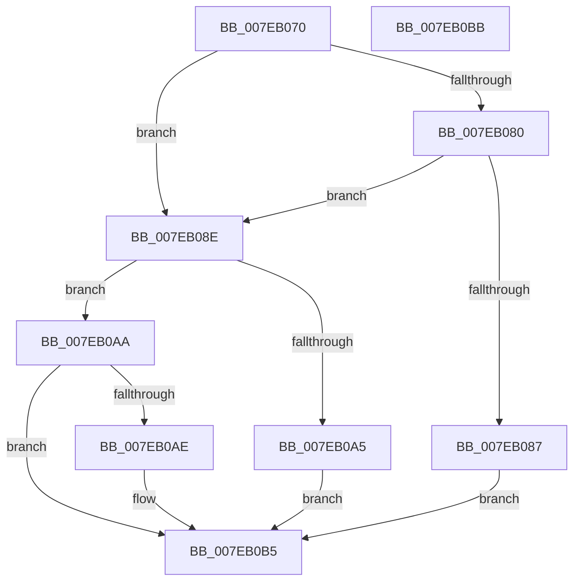

# CmpPrepareForSubtreeInvalidationWorker

- RVA: `0x007EB070`–`0x007EB0BC` (길이 `76` bytes)
- VA: `0x00000001407EB070`
- 실행 섹션: `PAGE`
- PDB 이름 있음: `예`; PDB Function 태그: `아니요`
- unwind 정보 RVA: `0x0005CF00`
- 디코드: `29`개 명령, `76/76` bytes 표시
- 미해석 바이트: `0` (있으면 어셈블리에 `.byte`로 보존)

> 이 문서는 커널 이미지의 기계어와 PDB 기호를 분석해 생성했습니다. 4번과 5번은 함수 원형과 자료형을 바이너리 사용 방식에서 추정한 C 해석이며 원본 소스 복구 결과는 아닙니다.

## 1. Dependencies

- 직접 호출 지점: **1**; 고유 호출 대상: **1**
- 직접 호출자로 확인된 함수: **0**
- RIP 상대 이미지 참조: **0**

### Outgoing calls
- `0x007EB094` → [CmpTryAcquireKcbIXLocks](../9B/CmpTryAcquireKcbIXLocks_function_009B056C.md) (function, `0x009B056C`)

### Direct callers
- 이 함수 시작 RVA로 연결되는 직접 call은 확인되지 않았습니다. 간접 호출은 완전히 역산할 수 없습니다.

### Static image references
- 디코드된 RIP-relative 메모리 참조가 없습니다.

## 2. Other-region calls and transfers

- 다른 실행 섹션으로 향하는 call: **0**
- 별도 외부 분기/꼬리 이동을 확인하지 못했습니다.

## 3. Assembly (complete function range)

```asm
007EB070  40 53                           push rbx
007EB072  48 83 EC 20                     sub rsp, 0x20
007EB076  8B 42 18                        mov eax, dword ptr [rdx + 0x18]
007EB079  48 8B DA                        mov rbx, rdx
007EB07C  A8 04                           test al, 4
007EB07E  75 0E                           jne 0x1407eb08e
007EB080  8B 41 08                        mov eax, dword ptr [rcx + 8]
007EB083  84 C0                           test al, al
007EB085  79 07                           jns 0x1407eb08e
007EB087  FF 42 04                        inc dword ptr [rdx + 4]
007EB08A  33 C0                           xor eax, eax
007EB08C  EB 27                           jmp 0x1407eb0b5
007EB08E  4C 8B 4A 10                     mov r9, qword ptr [rdx + 0x10]
007EB092  B2 01                           mov dl, 1
007EB094  E8 D3 54 1C 00                  call 0x1409b056c
007EB099  8B C8                           mov ecx, eax
007EB09B  33 C0                           xor eax, eax
007EB09D  81 F9 2D 02 00 C0               cmp ecx, 0xc000022d
007EB0A3  75 05                           jne 0x1407eb0aa
007EB0A5  FF 43 08                        inc dword ptr [rbx + 8]
007EB0A8  EB 0B                           jmp 0x1407eb0b5
007EB0AA  85 C9                           test ecx, ecx
007EB0AC  79 07                           jns 0x1407eb0b5
007EB0AE  89 0B                           mov dword ptr [rbx], ecx
007EB0B0  B8 01 00 00 00                  mov eax, 1
007EB0B5  48 83 C4 20                     add rsp, 0x20
007EB0B9  5B                              pop rbx
007EB0BA  C3                              ret
007EB0BB  CC                              int3
```

## 4. C-style interpretation (structured pseudocode)

```c
__int64 __fastcall CmpPrepareForSubtreeInvalidationWorker(__int64 a1, __int64 a2)
{
    __int64 result;
    __int64 v_rsp;

    v_rsp = (v_rsp) - (32);
    if ((((unsigned __int8)((unsigned int)(*(unsigned int *)(a2 + 24)))) & (4)) != 0) goto loc_007EB08E;
    if (!sign_flag) goto loc_007EB08E;
    result = 0;
    goto loc_007EB0B5;
loc_007EB08E:
    result = CmpTryAcquireKcbIXLocks(a1, 1, a3, *(unsigned __int64 *)(a2 + 16));
    result = 0;
    if (((unsigned int)((unsigned int)((unsigned int)(result)))) != 0xC000022DULL) goto loc_007EB0AA;
    goto loc_007EB0B5;
loc_007EB0AA:
    if (sign_flag) {
        *(unsigned int *)(a2) = (unsigned int)((unsigned int)((unsigned int)(result)));
        result = 1;
    }
    v_rsp = (v_rsp) + (32);
    return result;
}
```

## 5. (Beta) C Style

```c
int64_t CmpPrepareForSubtreeInvalidationWorker(void *Arg1, void *Arg2)
{
    uint8_t *arg1 = (uint8_t *)Arg1;
    uint8_t *arg2 = (uint8_t *)Arg2;

    int64_t result;
    int64_t local_rsp;

    local_rsp = (local_rsp) - (32);
    if ((((uint8_t)((uint32_t)(*(uint32_t *)(arg2 + 0x18)))) & (4)) != 0) goto loc_007EB08E;
    if (!sign_flag) goto loc_007EB08E;
    result = 0;
    goto loc_007EB0B5;
loc_007EB08E:
    result = CmpTryAcquireKcbIXLocks(Arg1, 1, a3, *(uint64_t *)(arg2 + 0x10));
    result = 0;
    if (((uint32_t)((uint32_t)((uint32_t)(result)))) != 0xC000022DULL) goto loc_007EB0AA;
    goto loc_007EB0B5;
loc_007EB0AA:
    if (sign_flag) {
        *(uint32_t *)(arg2) = (uint32_t)((uint32_t)((uint32_t)(result)));
        result = 1;
    }
    local_rsp = (local_rsp) + (32);
    return result;
}
```

### 관측된 메모리 오프셋

구조체 형식이 확인되지 않은 접근은 인자 기준의 오프셋으로만 기록했습니다.

| 기준 인자 | 오프셋 표현 | 폭 (bit) | 접근 |
|---|---:|---:|---|
| `Arg1` | `+ 0x8` | `32` | `R` |
| `Arg2` | `+ 0x0` | `32` | `W` |
| `Arg2` | `+ 0x4` | `32` | `R/W` |
| `Arg2` | `+ 0x8` | `32` | `R/W` |
| `Arg2` | `+ 0x10` | `64` | `R` |
| `Arg2` | `+ 0x18` | `32` | `R` |

## 6. Execution-region graph

[열기: 2D/3D 그래프와 함수 탐색 컨트롤 패널](../../../control-panel.html?section=page&rva=0x007EB070&view=graph)

- 2D 그래프는 위에서 아래로 흐르고, 3D 그래프는 빈 공간을 드래그해 회전합니다. Shift+드래그는 이동, 휠은 확대·축소, 함수 노드 선택은 대상 보고서 이동입니다.

### Static fallback


