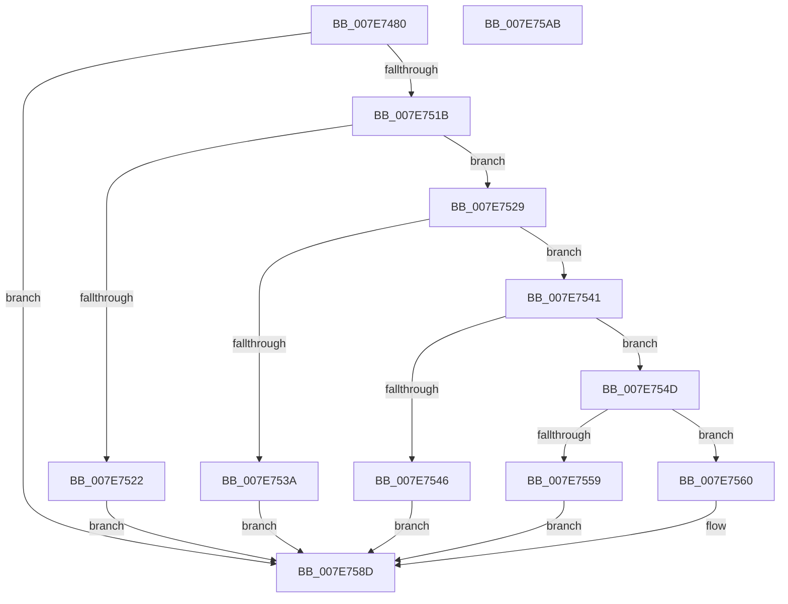

# CmpQueryLayerVersionString

- RVA: `0x007E7480`–`0x007E75AC` (길이 `300` bytes)
- VA: `0x00000001407E7480`
- 실행 섹션: `PAGE`
- PDB 이름 있음: `예`; PDB Function 태그: `아니요`
- unwind 정보 RVA: `0x000C39E4`
- 디코드: `86`개 명령, `300/300` bytes 표시
- 미해석 바이트: `0` (있으면 어셈블리에 `.byte`로 보존)

> 이 문서는 커널 이미지의 기계어와 PDB 기호를 분석해 생성했습니다. 4번과 5번은 함수 원형과 자료형을 바이너리 사용 방식에서 추정한 C 해석이며 원본 소스 복구 결과는 아닙니다.

## 1. Dependencies

- 직접 호출 지점: **6**; 고유 호출 대상: **5**
- 직접 호출자로 확인된 함수: **1**
- RIP 상대 이미지 참조: **1**

### Outgoing calls
- `0x007E74CE` → [memset](../../text/6C/memset_function_006C6C40.md) (function, `0x006C6C40`)
- `0x007E74EA` → [RtlInitUnicodeString](../../text/42/RtlInitUnicodeString_function_0042A780.md) (function, `0x0042A780`)
- `0x007E7512` → [ZwQueryValueKey](../../text/6A/ZwQueryValueKey_function_006AD3B0.md) (function, `0x006AD3B0`)
- `0x007E7571` → [memcpy](../../text/6C/memcpy_function_006C6840.md) (function, `0x006C6840`)
- `0x007E7581` → [RtlInitUnicodeString](../../text/42/RtlInitUnicodeString_function_0042A780.md) (function, `0x0042A780`)
- `0x007E7594` → [_security_check_cookie](../../text/6A/_security_check_cookie_function_006AC640.md) (function, `0x006AC640`)

### Direct callers
- [CmpLoadLayerVersion](CmpLoadLayerVersion_function_007E6A74.md) at `0x007E6C47`
- [CmpLoadLayerVersion](CmpLoadLayerVersion_function_007E6A74.md) at `0x007E6C99`
- [CmpLoadLayerVersion](CmpLoadLayerVersion_function_007E6A74.md) at `0x007E6CEB`
- [CmpLoadLayerVersion](CmpLoadLayerVersion_function_007E6A74.md) at `0x007E6D3D`
- [CmpLoadLayerVersion](CmpLoadLayerVersion_function_007E6A74.md) at `0x007E6D92`

### Static image references
- `0x007E7497` → RVA `0x00E0A740` (`.data`; read)

## 2. Other-region calls and transfers

- 다른 실행 섹션으로 향하는 call: **6**
  - `0x007E74CE` → [memset](../../text/6C/memset_function_006C6C40.md) (`PAGE` → `.text`)
  - `0x007E74EA` → [RtlInitUnicodeString](../../text/42/RtlInitUnicodeString_function_0042A780.md) (`PAGE` → `.text`)
  - `0x007E7512` → [ZwQueryValueKey](../../text/6A/ZwQueryValueKey_function_006AD3B0.md) (`PAGE` → `.text`)
  - `0x007E7571` → [memcpy](../../text/6C/memcpy_function_006C6840.md) (`PAGE` → `.text`)
  - `0x007E7581` → [RtlInitUnicodeString](../../text/42/RtlInitUnicodeString_function_0042A780.md) (`PAGE` → `.text`)
  - `0x007E7594` → [_security_check_cookie](../../text/6A/_security_check_cookie_function_006AC640.md) (`PAGE` → `.text`)
- 별도 외부 분기/꼬리 이동을 확인하지 못했습니다.

## 3. Assembly (complete function range)

```asm
007E7480  40 55                           push rbp
007E7482  53                              push rbx
007E7483  56                              push rsi
007E7484  57                              push rdi
007E7485  41 55                           push r13
007E7487  41 56                           push r14
007E7489  41 57                           push r15
007E748B  48 8D 6C 24 A0                  lea rbp, [rsp - 0x60]
007E7490  48 81 EC 60 01 00 00            sub rsp, 0x160
007E7497  48 8B 05 A2 32 62 00            mov rax, qword ptr [rip + 0x6232a2]
007E749E  48 33 C4                        xor rax, rsp
007E74A1  48 89 45 50                     mov qword ptr [rbp + 0x50], rax
007E74A5  48 8B BD C0 00 00 00            mov rdi, qword ptr [rbp + 0xc0]
007E74AC  48 8B F2                        mov rsi, rdx
007E74AF  45 0F B7 F0                     movzx r14d, r8w
007E74B3  4C 8B F9                        mov r15, rcx
007E74B6  0F 57 C0                        xorps xmm0, xmm0
007E74B9  48 8D 4C 24 50                  lea rcx, [rsp + 0x50]
007E74BE  33 D2                           xor edx, edx
007E74C0  41 B8 00 01 00 00               mov r8d, 0x100
007E74C6  0F 11 44 24 38                  movups xmmword ptr [rsp + 0x38], xmm0
007E74CB  49 8B D9                        mov rbx, r9
007E74CE  E8 6D F7 ED FF                  call 0x1406c6c40
007E74D3  0F 57 C0                        xorps xmm0, xmm0
007E74D6  48 8D 4C 24 38                  lea rcx, [rsp + 0x38]
007E74DB  45 33 ED                        xor r13d, r13d
007E74DE  48 8B D3                        mov rdx, rbx
007E74E1  41 0F 11 07                     movups xmmword ptr [r15], xmm0
007E74E5  44 89 6C 24 30                  mov dword ptr [rsp + 0x30], r13d
007E74EA  E8 91 32 C4 FF                  call 0x14042a780
007E74EF  48 8D 44 24 30                  lea rax, [rsp + 0x30]
007E74F4  48 8B CF                        mov rcx, rdi
007E74F7  48 89 44 24 28                  mov qword ptr [rsp + 0x28], rax
007E74FC  4C 8D 4C 24 50                  lea r9, [rsp + 0x50]
007E7501  45 8D 45 01                     lea r8d, [r13 + 1]
007E7505  C7 44 24 20 00 01 00 00         mov dword ptr [rsp + 0x20], 0x100
007E750D  48 8D 54 24 38                  lea rdx, [rsp + 0x38]
007E7512  E8 99 5E EC FF                  call 0x1406ad3b0
007E7517  85 C0                           test eax, eax
007E7519  78 72                           js 0x1407e758d
007E751B  83 7C 24 54 01                  cmp dword ptr [rsp + 0x54], 1
007E7520  74 07                           je 0x1407e7529
007E7522  B8 24 00 00 C0                  mov eax, 0xc0000024
007E7527  EB 64                           jmp 0x1407e758d
007E7529  8B 4C 24 5C                     mov ecx, dword ptr [rsp + 0x5c]
007E752D  8B 54 24 58                     mov edx, dword ptr [rsp + 0x58]
007E7531  8D 04 11                        lea eax, [rcx + rdx]
007E7534  3B 44 24 30                     cmp eax, dword ptr [rsp + 0x30]
007E7538  74 07                           je 0x1407e7541
007E753A  B8 3C 00 00 C0                  mov eax, 0xc000003c
007E753F  EB 4C                           jmp 0x1407e758d
007E7541  F6 C1 01                        test cl, 1
007E7544  74 07                           je 0x1407e754d
007E7546  B8 06 02 00 C0                  mov eax, 0xc0000206
007E754B  EB 40                           jmp 0x1407e758d
007E754D  48 8B D9                        mov rbx, rcx
007E7550  48 83 C1 02                     add rcx, 2
007E7554  49 3B CE                        cmp rcx, r14
007E7557  76 07                           jbe 0x1407e7560
007E7559  B8 23 00 00 C0                  mov eax, 0xc0000023
007E755E  EB 2D                           jmp 0x1407e758d
007E7560  48 8B C2                        mov rax, rdx
007E7563  4C 8B C3                        mov r8, rbx
007E7566  48 8D 54 24 50                  lea rdx, [rsp + 0x50]
007E756B  48 8B CE                        mov rcx, rsi
007E756E  48 03 D0                        add rdx, rax
007E7571  E8 CA F2 ED FF                  call 0x1406c6840
007E7576  48 8B D6                        mov rdx, rsi
007E7579  66 44 89 2C 33                  mov word ptr [rbx + rsi], r13w
007E757E  49 8B CF                        mov rcx, r15
007E7581  E8 FA 31 C4 FF                  call 0x14042a780
007E7586  33 C0                           xor eax, eax
007E7588  66 45 89 77 02                  mov word ptr [r15 + 2], r14w
007E758D  48 8B 4D 50                     mov rcx, qword ptr [rbp + 0x50]
007E7591  48 33 CC                        xor rcx, rsp
007E7594  E8 A7 50 EC FF                  call 0x1406ac640
007E7599  48 81 C4 60 01 00 00            add rsp, 0x160
007E75A0  41 5F                           pop r15
007E75A2  41 5E                           pop r14
007E75A4  41 5D                           pop r13
007E75A6  5F                              pop rdi
007E75A7  5E                              pop rsi
007E75A8  5B                              pop rbx
007E75A9  5D                              pop rbp
007E75AA  C3                              ret
007E75AB  CC                              int3
```

## 4. C-style interpretation (structured pseudocode)

```c
__int64 __fastcall CmpQueryLayerVersionString(__int64 a1, __int64 a2, unsigned __int16 a3, __int64 a4, __int64 a5)
{
    __int64 result;
    __int64 v_r13;
    __int64 v_rsp;
    unsigned int v_stack_m13C;
    unsigned int v_stack_m140;
    unsigned int v_stack_m144;
    unsigned __int64 v_stack_m148;
    unsigned __int64 v_stack_m160;
    unsigned int v_stack_m168;
    unsigned __int64 v_stack_m170;
    unsigned int v_stack_m178;
    unsigned __int64 v_stack_m48;
    unsigned __int64 v_stack_m98;

    v_rsp = (v_rsp) - (352);
    result = (*(unsigned __int64 *)(v_rip + 6435490)) ^ (v_rsp);
    v_stack_m48 = result;
    a2 = 0;
    v_stack_m160 = v_xmm0;
    result = memset(v_stack_m148, a2, 256, a4);
    v_r13 = 0;
    *(unsigned __int64 *)(a1) = v_xmm0;
    v_stack_m168 = 0;
    result = RtlInitUnicodeString(v_stack_m160, a4, 256, a4);
    v_stack_m170 = v_stack_m168;
    v_stack_m178 = 256;
    result = ZwQueryValueKey(a5, v_stack_m160, v_r13 + 1, v_stack_m148);
    if (sign_flag) goto loc_007E758D;
    if (v_stack_m144 == 1) goto loc_007E7529;
    goto loc_007E758D;
loc_007E7529:
    if (((unsigned int)((unsigned int)(v_stack_m13C) + (unsigned int)(v_stack_m140) * 1)) == v_stack_m168) goto loc_007E7541;
    goto loc_007E758D;
loc_007E7541:
    if ((((unsigned __int8)((unsigned int)(v_stack_m13C))) & (1)) == 0) goto loc_007E754D;
    goto loc_007E758D;
loc_007E754D:
    a1 = ((unsigned int)(v_stack_m13C)) + (2);
    if (a1 <= a3) goto loc_007E7560;
    goto loc_007E758D;
loc_007E7560:
    a2 = (v_stack_m148) + ((unsigned int)(v_stack_m140));
    result = memcpy(0, a2, (unsigned int)(v_stack_m13C), v_stack_m148);
    *(unsigned __int16 *)((unsigned int)(v_stack_m13C) + a2 * 1) = 0;
    result = RtlInitUnicodeString(a1, a2, (unsigned int)(v_stack_m13C), v_stack_m148);
    result = 0;
    *(unsigned __int16 *)(a1 + 2) = a3;
loc_007E758D:
    a1 = (v_stack_m48) ^ (v_rsp);
    result = _security_check_cookie(a1, a2, (unsigned int)(v_stack_m13C), v_stack_m148);
    v_rsp = (v_rsp) + (352);
    return result;
}
```

## 5. (Beta) C Style

```c
int64_t CmpQueryLayerVersionString(void *Arg1, int64_t Arg2, uint16_t Arg3, int64_t Arg4, int64_t Arg5)
{
    uint8_t *arg1 = (uint8_t *)Arg1;

    int64_t result;
    int64_t local_r13;
    int64_t local_rsp;
    uint32_t v_stack_m13C;
    uint32_t v_stack_m140;
    uint32_t v_stack_m144;
    uint64_t v_stack_m148;
    uint64_t v_stack_m160;
    uint32_t v_stack_m168;
    uint64_t v_stack_m170;
    uint32_t v_stack_m178;
    uint64_t v_stack_m48;
    uint64_t v_stack_m98;

    local_rsp = (local_rsp) - (352);
    result = (*(uint64_t *)(v_rip + 0x6232A2)) ^ (local_rsp);
    v_stack_m48 = result;
    Arg2 = 0;
    v_stack_m160 = v_xmm0;
    result = memset(v_stack_m148, Arg2, 256, Arg4);
    local_r13 = 0;
    *(uint64_t *)(arg1) = v_xmm0;
    v_stack_m168 = 0;
    result = RtlInitUnicodeString(v_stack_m160, Arg4, 256, Arg4);
    v_stack_m170 = v_stack_m168;
    v_stack_m178 = 256;
    result = ZwQueryValueKey(Arg5, v_stack_m160, local_r13 + 1, v_stack_m148);
    if (sign_flag) goto loc_007E758D;
    if (v_stack_m144 == 1) goto loc_007E7529;
    goto loc_007E758D;
loc_007E7529:
    if (((uint32_t)((uint32_t)(v_stack_m13C) + (uint32_t)(v_stack_m140) * 1)) == v_stack_m168) goto loc_007E7541;
    goto loc_007E758D;
loc_007E7541:
    if ((((uint8_t)((uint32_t)(v_stack_m13C))) & (1)) == 0) goto loc_007E754D;
    goto loc_007E758D;
loc_007E754D:
    Arg1 = ((uint32_t)(v_stack_m13C)) + (2);
    if (Arg1 <= Arg3) goto loc_007E7560;
    goto loc_007E758D;
loc_007E7560:
    Arg2 = (v_stack_m148) + ((uint32_t)(v_stack_m140));
    result = memcpy(0, Arg2, (uint32_t)(v_stack_m13C), v_stack_m148);
    *(uint16_t *)((uint32_t)(v_stack_m13C) + Arg2 * 1) = 0;
    result = RtlInitUnicodeString(Arg1, Arg2, (uint32_t)(v_stack_m13C), v_stack_m148);
    result = 0;
    *(uint16_t *)(arg1 + 0x2) = Arg3;
loc_007E758D:
    Arg1 = (v_stack_m48) ^ (local_rsp);
    result = _security_check_cookie(Arg1, Arg2, (uint32_t)(v_stack_m13C), v_stack_m148);
    local_rsp = (local_rsp) + (352);
    return result;
}
```

### 관측된 메모리 오프셋

구조체 형식이 확인되지 않은 접근은 인자 기준의 오프셋으로만 기록했습니다.

| 기준 인자 | 오프셋 표현 | 폭 (bit) | 접근 |
|---|---:|---:|---|
| `Arg1` | `+ 0x0` | `128` | `R` |
| `Arg1` | `+ 0x2` | `16` | `W` |

## 6. Execution-region graph

[열기: 2D/3D 그래프와 함수 탐색 컨트롤 패널](../../../control-panel.html?section=page&rva=0x007E7480&view=graph)

- 2D 그래프는 위에서 아래로 흐르고, 3D 그래프는 빈 공간을 드래그해 회전합니다. Shift+드래그는 이동, 휠은 확대·축소, 함수 노드 선택은 대상 보고서 이동입니다.

### Static fallback


