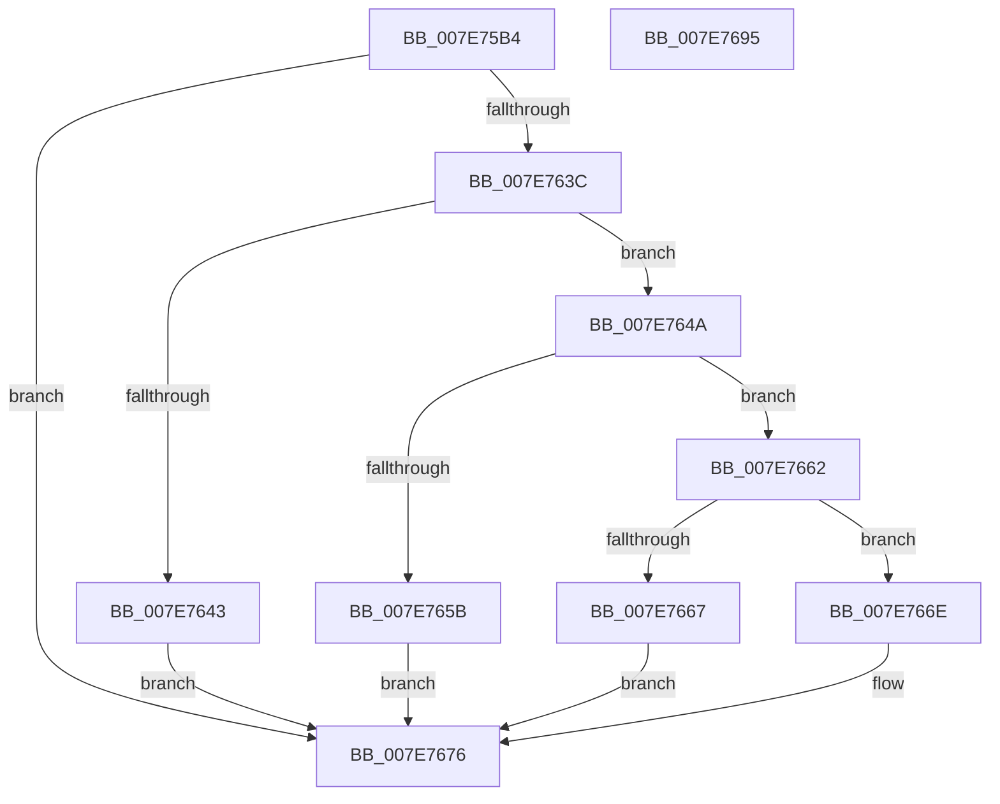

# CmpQueryLayerVersionUlong

- RVA: `0x007E75B4`–`0x007E7696` (길이 `226` bytes)
- VA: `0x00000001407E75B4`
- 실행 섹션: `PAGE`
- PDB 이름 있음: `예`; PDB Function 태그: `아니요`
- unwind 정보 RVA: `0x000D6CF4`
- 디코드: `61`개 명령, `226/226` bytes 표시
- 미해석 바이트: `0` (있으면 어셈블리에 `.byte`로 보존)

> 이 문서는 커널 이미지의 기계어와 PDB 기호를 분석해 생성했습니다. 4번과 5번은 함수 원형과 자료형을 바이너리 사용 방식에서 추정한 C 해석이며 원본 소스 복구 결과는 아닙니다.

## 1. Dependencies

- 직접 호출 지점: **4**; 고유 호출 대상: **4**
- 직접 호출자로 확인된 함수: **1**
- RIP 상대 이미지 참조: **1**

### Outgoing calls
- `0x007E75F4` → [memset](../../text/6C/memset_function_006C6C40.md) (function, `0x006C6C40`)
- `0x007E7609` → [RtlInitUnicodeString](../../text/42/RtlInitUnicodeString_function_0042A780.md) (function, `0x0042A780`)
- `0x007E7633` → [ZwQueryValueKey](../../text/6A/ZwQueryValueKey_function_006AD3B0.md) (function, `0x006AD3B0`)
- `0x007E767D` → [_security_check_cookie](../../text/6A/_security_check_cookie_function_006AC640.md) (function, `0x006AC640`)

### Direct callers
- [CmpLoadLayerVersion](CmpLoadLayerVersion_function_007E6A74.md) at `0x007E6B49`
- [CmpLoadLayerVersion](CmpLoadLayerVersion_function_007E6A74.md) at `0x007E6B86`
- [CmpLoadLayerVersion](CmpLoadLayerVersion_function_007E6A74.md) at `0x007E6BBE`
- [CmpLoadLayerVersion](CmpLoadLayerVersion_function_007E6A74.md) at `0x007E6BFD`
- [CmpLoadLayerVersion](CmpLoadLayerVersion_function_007E6A74.md) at `0x007E6E18`
- [CmpLoadLayerVersion](CmpLoadLayerVersion_function_007E6A74.md) at `0x007E6E4A`
- [CmpLoadLayerVersion](CmpLoadLayerVersion_function_007E6A74.md) at `0x007E6E7F`

### Static image references
- `0x007E75C8` → RVA `0x00E0A740` (`.data`; read)

## 2. Other-region calls and transfers

- 다른 실행 섹션으로 향하는 call: **4**
  - `0x007E75F4` → [memset](../../text/6C/memset_function_006C6C40.md) (`PAGE` → `.text`)
  - `0x007E7609` → [RtlInitUnicodeString](../../text/42/RtlInitUnicodeString_function_0042A780.md) (`PAGE` → `.text`)
  - `0x007E7633` → [ZwQueryValueKey](../../text/6A/ZwQueryValueKey_function_006AD3B0.md) (`PAGE` → `.text`)
  - `0x007E767D` → [_security_check_cookie](../../text/6A/_security_check_cookie_function_006AC640.md) (`PAGE` → `.text`)
- 별도 외부 분기/꼬리 이동을 확인하지 못했습니다.

## 3. Assembly (complete function range)

```asm
007E75B4  48 89 5C 24 20                  mov qword ptr [rsp + 0x20], rbx
007E75B9  55                              push rbp
007E75BA  56                              push rsi
007E75BB  57                              push rdi
007E75BC  48 8D 6C 24 A0                  lea rbp, [rsp - 0x60]
007E75C1  48 81 EC 60 01 00 00            sub rsp, 0x160
007E75C8  48 8B 05 71 31 62 00            mov rax, qword ptr [rip + 0x623171]
007E75CF  48 33 C4                        xor rax, rsp
007E75D2  48 89 45 50                     mov qword ptr [rbp + 0x50], rax
007E75D6  49 8B F8                        mov rdi, r8
007E75D9  48 8B DA                        mov rbx, rdx
007E75DC  48 8B F1                        mov rsi, rcx
007E75DF  0F 57 C0                        xorps xmm0, xmm0
007E75E2  33 D2                           xor edx, edx
007E75E4  48 8D 4C 24 50                  lea rcx, [rsp + 0x50]
007E75E9  41 B8 00 01 00 00               mov r8d, 0x100
007E75EF  0F 11 44 24 38                  movups xmmword ptr [rsp + 0x38], xmm0
007E75F4  E8 47 F6 ED FF                  call 0x1406c6c40
007E75F9  83 64 24 30 00                  and dword ptr [rsp + 0x30], 0
007E75FE  48 8D 4C 24 38                  lea rcx, [rsp + 0x38]
007E7603  83 26 00                        and dword ptr [rsi], 0
007E7606  48 8B D3                        mov rdx, rbx
007E7609  E8 72 31 C4 FF                  call 0x14042a780
007E760E  48 8D 44 24 30                  lea rax, [rsp + 0x30]
007E7613  41 B8 01 00 00 00               mov r8d, 1
007E7619  48 89 44 24 28                  mov qword ptr [rsp + 0x28], rax
007E761E  4C 8D 4C 24 50                  lea r9, [rsp + 0x50]
007E7623  48 8D 54 24 38                  lea rdx, [rsp + 0x38]
007E7628  C7 44 24 20 00 01 00 00         mov dword ptr [rsp + 0x20], 0x100
007E7630  48 8B CF                        mov rcx, rdi
007E7633  E8 78 5D EC FF                  call 0x1406ad3b0
007E7638  85 C0                           test eax, eax
007E763A  78 3A                           js 0x1407e7676
007E763C  83 7C 24 54 04                  cmp dword ptr [rsp + 0x54], 4
007E7641  74 07                           je 0x1407e764a
007E7643  B8 24 00 00 C0                  mov eax, 0xc0000024
007E7648  EB 2C                           jmp 0x1407e7676
007E764A  8B 4C 24 5C                     mov ecx, dword ptr [rsp + 0x5c]
007E764E  8B 54 24 58                     mov edx, dword ptr [rsp + 0x58]
007E7652  8D 04 11                        lea eax, [rcx + rdx]
007E7655  3B 44 24 30                     cmp eax, dword ptr [rsp + 0x30]
007E7659  74 07                           je 0x1407e7662
007E765B  B8 3C 00 00 C0                  mov eax, 0xc000003c
007E7660  EB 14                           jmp 0x1407e7676
007E7662  83 F9 04                        cmp ecx, 4
007E7665  74 07                           je 0x1407e766e
007E7667  B8 06 02 00 C0                  mov eax, 0xc0000206
007E766C  EB 08                           jmp 0x1407e7676
007E766E  8B 4C 14 50                     mov ecx, dword ptr [rsp + rdx + 0x50]
007E7672  33 C0                           xor eax, eax
007E7674  89 0E                           mov dword ptr [rsi], ecx
007E7676  48 8B 4D 50                     mov rcx, qword ptr [rbp + 0x50]
007E767A  48 33 CC                        xor rcx, rsp
007E767D  E8 BE 4F EC FF                  call 0x1406ac640
007E7682  48 8B 9C 24 98 01 00 00         mov rbx, qword ptr [rsp + 0x198]
007E768A  48 81 C4 60 01 00 00            add rsp, 0x160
007E7691  5F                              pop rdi
007E7692  5E                              pop rsi
007E7693  5D                              pop rbp
007E7694  C3                              ret
007E7695  CC                              int3
```

## 4. C-style interpretation (structured pseudocode)

```c
__int64 __fastcall CmpQueryLayerVersionUlong(__int64 a1, __int64 a2, __int64 a3)
{
    __int64 result;
    __int64 v_rsp;
    unsigned int v_stack_m11C;
    unsigned int v_stack_m120;
    unsigned int v_stack_m124;
    unsigned __int64 v_stack_m128;
    unsigned __int64 v_stack_m140;
    unsigned int v_stack_m148;
    unsigned __int64 v_stack_m150;
    unsigned int v_stack_m158;
    unsigned __int64 v_stack_m28;
    unsigned __int64 v_stack_m78;
    unsigned __int64 v_stack_p20;

    v_stack_p20 = v_rbx;
    v_rsp = (v_rsp) - (352);
    result = (*(unsigned __int64 *)(v_rip + 6435185)) ^ (v_rsp);
    v_stack_m28 = result;
    a2 = 0;
    v_stack_m140 = v_xmm0;
    result = memset(v_stack_m128, a2, 256, a4);
    result = RtlInitUnicodeString(v_stack_m140, 0, 256, a4);
    v_stack_m150 = v_stack_m148;
    v_stack_m158 = 256;
    result = ZwQueryValueKey(a3, v_stack_m140, 1, v_stack_m128);
    if (sign_flag) goto loc_007E7676;
    if (v_stack_m124 == 4) goto loc_007E764A;
    goto loc_007E7676;
loc_007E764A:
    if (((unsigned int)((unsigned int)(v_stack_m11C) + (unsigned int)(v_stack_m120) * 1)) == v_stack_m148) goto loc_007E7662;
    goto loc_007E7676;
loc_007E7662:
    if (((unsigned int)((unsigned int)(v_stack_m11C))) == 4) goto loc_007E766E;
    goto loc_007E7676;
loc_007E766E:
    result = 0;
    *(unsigned int *)(a1) = (unsigned int)((unsigned int)(*(unsigned int *)(v_rsp + (unsigned int)(v_stack_m120) * 1 + 80)));
loc_007E7676:
    a1 = (v_stack_m28) ^ (v_rsp);
    result = _security_check_cookie(a1, (unsigned int)(v_stack_m120), 1, v_stack_m128);
    v_rsp = (v_rsp) + (352);
    return result;
}
```

## 5. (Beta) C Style

```c
int64_t CmpQueryLayerVersionUlong(void *Arg1, int64_t Arg2, int64_t Arg3)
{
    uint8_t *arg1 = (uint8_t *)Arg1;

    int64_t result;
    int64_t local_rsp;
    uint32_t v_stack_m11C;
    uint32_t v_stack_m120;
    uint32_t v_stack_m124;
    uint64_t v_stack_m128;
    uint64_t v_stack_m140;
    uint32_t v_stack_m148;
    uint64_t v_stack_m150;
    uint32_t v_stack_m158;
    uint64_t v_stack_m28;
    uint64_t v_stack_m78;
    uint64_t v_stack_p20;

    v_stack_p20 = local_rbx;
    local_rsp = (local_rsp) - (352);
    result = (*(uint64_t *)(v_rip + 0x623171)) ^ (local_rsp);
    v_stack_m28 = result;
    Arg2 = 0;
    v_stack_m140 = v_xmm0;
    result = memset(v_stack_m128, Arg2, 256, a4);
    result = RtlInitUnicodeString(v_stack_m140, 0, 256, a4);
    v_stack_m150 = v_stack_m148;
    v_stack_m158 = 256;
    result = ZwQueryValueKey(Arg3, v_stack_m140, 1, v_stack_m128);
    if (sign_flag) goto loc_007E7676;
    if (v_stack_m124 == 4) goto loc_007E764A;
    goto loc_007E7676;
loc_007E764A:
    if (((uint32_t)((uint32_t)(v_stack_m11C) + (uint32_t)(v_stack_m120) * 1)) == v_stack_m148) goto loc_007E7662;
    goto loc_007E7676;
loc_007E7662:
    if (((uint32_t)((uint32_t)(v_stack_m11C))) == 4) goto loc_007E766E;
    goto loc_007E7676;
loc_007E766E:
    result = 0;
    *(uint32_t *)(arg1) = (uint32_t)((uint32_t)(*(uint32_t *)(local_rsp + (uint32_t)(v_stack_m120) * 1 + 0x50)));
loc_007E7676:
    Arg1 = (v_stack_m28) ^ (local_rsp);
    result = _security_check_cookie(Arg1, (uint32_t)(v_stack_m120), 1, v_stack_m128);
    local_rsp = (local_rsp) + (352);
    return result;
}
```

### 관측된 메모리 오프셋

구조체 형식이 확인되지 않은 접근은 인자 기준의 오프셋으로만 기록했습니다.

| 기준 인자 | 오프셋 표현 | 폭 (bit) | 접근 |
|---|---:|---:|---|
| `Arg1` | `+ 0x0` | `32` | `R/W` |
| `Arg1` | `+ 0x0` | `32` | `W` |

## 6. Execution-region graph

[열기: 2D/3D 그래프와 함수 탐색 컨트롤 패널](../../../control-panel.html?section=page&rva=0x007E75B4&view=graph)

- 2D 그래프는 위에서 아래로 흐르고, 3D 그래프는 빈 공간을 드래그해 회전합니다. Shift+드래그는 이동, 휠은 확대·축소, 함수 노드 선택은 대상 보고서 이동입니다.

### Static fallback


