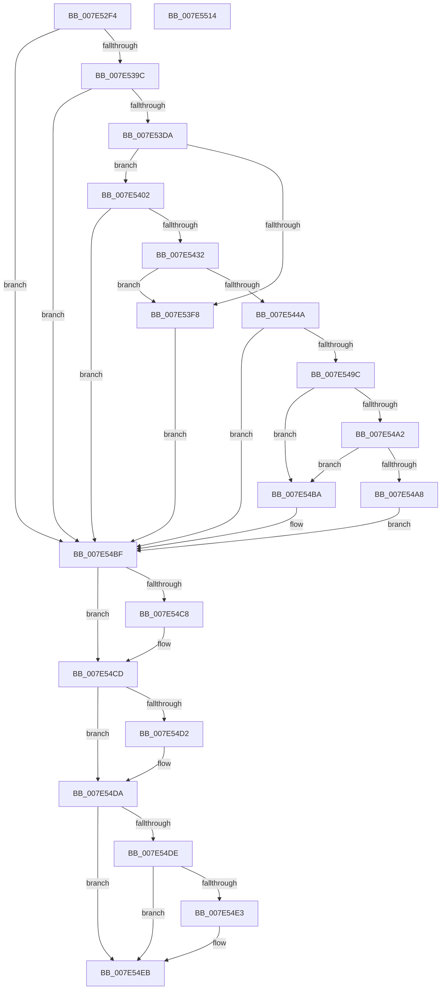

# CmpReadBuildVersion

- RVA: `0x007E52F4`–`0x007E5515` (길이 `545` bytes)
- VA: `0x00000001407E52F4`
- 실행 섹션: `PAGE`
- PDB 이름 있음: `예`; PDB Function 태그: `아니요`
- unwind 정보 RVA: `0x000C43F4`
- 디코드: `148`개 명령, `545/545` bytes 표시
- 미해석 바이트: `0` (있으면 어셈블리에 `.byte`로 보존)

> 이 문서는 커널 이미지의 기계어와 PDB 기호를 분석해 생성했습니다. 4번과 5번은 함수 원형과 자료형을 바이너리 사용 방식에서 추정한 C 해석이며 원본 소스 복구 결과는 아닙니다.

## 1. Dependencies

- 직접 호출 지점: **14**; 고유 호출 대상: **8**
- 직접 호출자로 확인된 함수: **1**
- RIP 상대 이미지 참조: **4**

### Outgoing calls
- `0x007E5359` → [RtlInitUnicodeString](../../text/42/RtlInitUnicodeString_function_0042A780.md) (function, `0x0042A780`)
- `0x007E538D` → [ZwOpenKey](../../text/6A/ZwOpenKey_function_006AD310.md) (function, `0x006AD310`)
- `0x007E53A7` → [RtlInitUnicodeString](../../text/42/RtlInitUnicodeString_function_0042A780.md) (function, `0x0042A780`)
- `0x007E53C8` → [ZwQueryValueKey](../../text/6A/ZwQueryValueKey_function_006AD3B0.md) (function, `0x006AD3B0`)
- `0x007E53EB` → [CmpAllocatePool](../../text/3C/CmpAllocatePool_function_003CD504.md) (function, `0x003CD504`)
- `0x007E5423` → [ZwQueryValueKey](../../text/6A/ZwQueryValueKey_function_006AD3B0.md) (function, `0x006AD3B0`)
- `0x007E543D` → [CmpAllocatePool](../../text/3C/CmpAllocatePool_function_003CD504.md) (function, `0x003CD504`)
- `0x007E5455` → [memcpy](../../text/6C/memcpy_function_006C6840.md) (function, `0x006C6840`)
- `0x007E5469` → [RtlInitUnicodeString](../../text/42/RtlInitUnicodeString_function_0042A780.md) (function, `0x0042A780`)
- `0x007E5491` → [ZwQueryValueKey](../../text/6A/ZwQueryValueKey_function_006AD3B0.md) (function, `0x006AD3B0`)
- `0x007E54C8` → [ZwClose](../../text/6A/ZwClose_function_006AD2B0.md) (function, `0x006AD2B0`)
- `0x007E54D5` → [CmSiFreeMemory](../../text/47/CmSiFreeMemory_function_00475D80.md) (function, `0x00475D80`)
- `0x007E54E6` → [CmSiFreeMemory](../../text/47/CmSiFreeMemory_function_00475D80.md) (function, `0x00475D80`)
- `0x007E54F4` → [_security_check_cookie](../../text/6A/_security_check_cookie_function_006AC640.md) (function, `0x006AC640`)

### Direct callers
- [CmpRecordShutdownStopTime](CmpRecordShutdownStopTime_function_007E551C.md) at `0x007E56AC`

### Static image references
- `0x007E5310` → RVA `0x00E0A740` (`.data`; read)
- `0x007E532D` → RVA `0x00B56E40` (` ?? ::LBKOJDO::`string'`; read)
- `0x007E539C` → RVA `0x00B09480` (` ?? ::NNGAKEGL::`string'`; read)
- `0x007E545E` → RVA `0x00B09430` (` ?? ::NNGAKEGL::`string'`; read)

## 2. Other-region calls and transfers

- 다른 실행 섹션으로 향하는 call: **14**
  - `0x007E5359` → [RtlInitUnicodeString](../../text/42/RtlInitUnicodeString_function_0042A780.md) (`PAGE` → `.text`)
  - `0x007E538D` → [ZwOpenKey](../../text/6A/ZwOpenKey_function_006AD310.md) (`PAGE` → `.text`)
  - `0x007E53A7` → [RtlInitUnicodeString](../../text/42/RtlInitUnicodeString_function_0042A780.md) (`PAGE` → `.text`)
  - `0x007E53C8` → [ZwQueryValueKey](../../text/6A/ZwQueryValueKey_function_006AD3B0.md) (`PAGE` → `.text`)
  - `0x007E53EB` → [CmpAllocatePool](../../text/3C/CmpAllocatePool_function_003CD504.md) (`PAGE` → `.text`)
  - `0x007E5423` → [ZwQueryValueKey](../../text/6A/ZwQueryValueKey_function_006AD3B0.md) (`PAGE` → `.text`)
  - `0x007E543D` → [CmpAllocatePool](../../text/3C/CmpAllocatePool_function_003CD504.md) (`PAGE` → `.text`)
  - `0x007E5455` → [memcpy](../../text/6C/memcpy_function_006C6840.md) (`PAGE` → `.text`)
  - `0x007E5469` → [RtlInitUnicodeString](../../text/42/RtlInitUnicodeString_function_0042A780.md) (`PAGE` → `.text`)
  - `0x007E5491` → [ZwQueryValueKey](../../text/6A/ZwQueryValueKey_function_006AD3B0.md) (`PAGE` → `.text`)
  - `0x007E54C8` → [ZwClose](../../text/6A/ZwClose_function_006AD2B0.md) (`PAGE` → `.text`)
  - `0x007E54D5` → [CmSiFreeMemory](../../text/47/CmSiFreeMemory_function_00475D80.md) (`PAGE` → `.text`)
  - `0x007E54E6` → [CmSiFreeMemory](../../text/47/CmSiFreeMemory_function_00475D80.md) (`PAGE` → `.text`)
  - `0x007E54F4` → [_security_check_cookie](../../text/6A/_security_check_cookie_function_006AC640.md) (`PAGE` → `.text`)
- 별도 외부 분기/꼬리 이동을 확인하지 못했습니다.

## 3. Assembly (complete function range)

```asm
007E52F4  48 89 5C 24 20                  mov qword ptr [rsp + 0x20], rbx
007E52F9  55                              push rbp
007E52FA  56                              push rsi
007E52FB  57                              push rdi
007E52FC  41 54                           push r12
007E52FE  41 55                           push r13
007E5300  41 56                           push r14
007E5302  41 57                           push r15
007E5304  48 8D 6C 24 D9                  lea rbp, [rsp - 0x27]
007E5309  48 81 EC A0 00 00 00            sub rsp, 0xa0
007E5310  48 8B 05 29 54 62 00            mov rax, qword ptr [rip + 0x625429]
007E5317  48 33 C4                        xor rax, rsp
007E531A  48 89 45 1F                     mov qword ptr [rbp + 0x1f], rax
007E531E  33 C0                           xor eax, eax
007E5320  0F 57 C0                        xorps xmm0, xmm0
007E5323  21 45 F3                        and dword ptr [rbp - 0xd], eax
007E5326  4C 8B EA                        mov r13, rdx
007E5329  48 21 45 BF                     and qword ptr [rbp - 0x41], rax
007E532D  48 8D 15 0C 1B 37 00            lea rdx, [rip + 0x371b0c]
007E5334  21 45 BB                        and dword ptr [rbp - 0x45], eax
007E5337  4C 8B E1                        mov r12, rcx
007E533A  21 45 B7                        and dword ptr [rbp - 0x49], eax
007E533D  48 8D 4D C7                     lea rcx, [rbp - 0x39]
007E5341  89 45 DB                        mov dword ptr [rbp - 0x25], eax
007E5344  4D 8B F8                        mov r15, r8
007E5347  21 45 DB                        and dword ptr [rbp - 0x25], eax
007E534A  33 F6                           xor esi, esi
007E534C  0F 11 45 C7                     movups xmmword ptr [rbp - 0x39], xmm0
007E5350  33 FF                           xor edi, edi
007E5352  89 45 17                        mov dword ptr [rbp + 0x17], eax
007E5355  0F 11 45 07                     movups xmmword ptr [rbp + 7], xmm0
007E5359  E8 22 54 C4 FF                  call 0x14042a780
007E535E  48 21 75 DF                     and qword ptr [rbp - 0x21], rsi
007E5362  48 8D 45 C7                     lea rax, [rbp - 0x39]
007E5366  0F 57 C0                        xorps xmm0, xmm0
007E5369  48 89 45 E7                     mov qword ptr [rbp - 0x19], rax
007E536D  4C 8D 45 D7                     lea r8, [rbp - 0x29]
007E5371  C7 45 D7 30 00 00 00            mov dword ptr [rbp - 0x29], 0x30
007E5378  BA 19 00 02 00                  mov edx, 0x20019
007E537D  C7 45 EF 40 02 00 00            mov dword ptr [rbp - 0x11], 0x240
007E5384  48 8D 4D BF                     lea rcx, [rbp - 0x41]
007E5388  F3 0F 7F 45 F7                  movdqu xmmword ptr [rbp - 9], xmm0
007E538D  E8 7E 7F EC FF                  call 0x1406ad310
007E5392  8B D8                           mov ebx, eax
007E5394  85 C0                           test eax, eax
007E5396  0F 88 23 01 00 00               js 0x1407e54bf
007E539C  48 8D 15 DD 40 32 00            lea rdx, [rip + 0x3240dd]
007E53A3  48 8D 4D C7                     lea rcx, [rbp - 0x39]
007E53A7  E8 D4 53 C4 FF                  call 0x14042a780
007E53AC  48 8B 4D BF                     mov rcx, qword ptr [rbp - 0x41]
007E53B0  48 8D 45 B7                     lea rax, [rbp - 0x49]
007E53B4  48 89 44 24 28                  mov qword ptr [rsp + 0x28], rax
007E53B9  44 8D 46 02                     lea r8d, [rsi + 2]
007E53BD  21 74 24 20                     and dword ptr [rsp + 0x20], esi
007E53C1  48 8D 55 C7                     lea rdx, [rbp - 0x39]
007E53C5  45 33 C9                        xor r9d, r9d
007E53C8  E8 E3 7F EC FF                  call 0x1406ad3b0
007E53CD  8B D8                           mov ebx, eax
007E53CF  3D 23 00 00 C0                  cmp eax, 0xc0000023
007E53D4  0F 85 E5 00 00 00               jne 0x1407e54bf
007E53DA  8B 55 B7                        mov edx, dword ptr [rbp - 0x49]
007E53DD  41 BE 43 4D 38 30               mov r14d, 0x30384d43
007E53E3  45 8B C6                        mov r8d, r14d
007E53E6  B9 00 01 00 00                  mov ecx, 0x100
007E53EB  E8 14 81 BE FF                  call 0x1403cd504
007E53F0  48 8B F8                        mov rdi, rax
007E53F3  48 85 C0                        test rax, rax
007E53F6  75 0A                           jne 0x1407e5402
007E53F8  BB 9A 00 00 C0                  mov ebx, 0xc000009a
007E53FD  E9 BD 00 00 00                  jmp 0x1407e54bf
007E5402  48 8B 4D BF                     mov rcx, qword ptr [rbp - 0x41]
007E5406  48 8D 45 BB                     lea rax, [rbp - 0x45]
007E540A  48 89 44 24 28                  mov qword ptr [rsp + 0x28], rax
007E540F  48 8D 55 C7                     lea rdx, [rbp - 0x39]
007E5413  8B 45 B7                        mov eax, dword ptr [rbp - 0x49]
007E5416  4C 8B CF                        mov r9, rdi
007E5419  41 B8 02 00 00 00               mov r8d, 2
007E541F  89 44 24 20                     mov dword ptr [rsp + 0x20], eax
007E5423  E8 88 7F EC FF                  call 0x1406ad3b0
007E5428  8B D8                           mov ebx, eax
007E542A  85 C0                           test eax, eax
007E542C  0F 88 8D 00 00 00               js 0x1407e54bf
007E5432  8B 57 08                        mov edx, dword ptr [rdi + 8]
007E5435  45 8B C6                        mov r8d, r14d
007E5438  B9 00 01 00 00                  mov ecx, 0x100
007E543D  E8 C2 80 BE FF                  call 0x1403cd504
007E5442  48 8B F0                        mov rsi, rax
007E5445  48 85 C0                        test rax, rax
007E5448  74 AE                           je 0x1407e53f8
007E544A  44 8B 47 08                     mov r8d, dword ptr [rdi + 8]
007E544E  48 8D 57 0C                     lea rdx, [rdi + 0xc]
007E5452  48 8B C8                        mov rcx, rax
007E5455  E8 E6 13 EE FF                  call 0x1406c6840
007E545A  44 8B 77 08                     mov r14d, dword ptr [rdi + 8]
007E545E  48 8D 15 CB 3F 32 00            lea rdx, [rip + 0x323fcb]
007E5465  48 8D 4D C7                     lea rcx, [rbp - 0x39]
007E5469  E8 12 53 C4 FF                  call 0x14042a780
007E546E  48 8B 4D BF                     mov rcx, qword ptr [rbp - 0x41]
007E5472  48 8D 45 BB                     lea rax, [rbp - 0x45]
007E5476  48 89 44 24 28                  mov qword ptr [rsp + 0x28], rax
007E547B  4C 8D 4D 07                     lea r9, [rbp + 7]
007E547F  41 B8 02 00 00 00               mov r8d, 2
007E5485  C7 44 24 20 14 00 00 00         mov dword ptr [rsp + 0x20], 0x14
007E548D  48 8D 55 C7                     lea rdx, [rbp - 0x39]
007E5491  E8 1A 7F EC FF                  call 0x1406ad3b0
007E5496  8B D8                           mov ebx, eax
007E5498  85 C0                           test eax, eax
007E549A  78 23                           js 0x1407e54bf
007E549C  83 7D 0B 04                     cmp dword ptr [rbp + 0xb], 4
007E54A0  75 18                           jne 0x1407e54ba
007E54A2  83 7D 0F 04                     cmp dword ptr [rbp + 0xf], 4
007E54A6  75 12                           jne 0x1407e54ba
007E54A8  8B 45 13                        mov eax, dword ptr [rbp + 0x13]
007E54AB  41 89 07                        mov dword ptr [r15], eax
007E54AE  49 89 34 24                     mov qword ptr [r12], rsi
007E54B2  33 F6                           xor esi, esi
007E54B4  45 89 75 00                     mov dword ptr [r13], r14d
007E54B8  EB 05                           jmp 0x1407e54bf
007E54BA  BB 3E 00 00 C0                  mov ebx, 0xc000003e
007E54BF  48 8B 4D BF                     mov rcx, qword ptr [rbp - 0x41]
007E54C3  48 85 C9                        test rcx, rcx
007E54C6  74 05                           je 0x1407e54cd
007E54C8  E8 E3 7D EC FF                  call 0x1406ad2b0
007E54CD  48 85 FF                        test rdi, rdi
007E54D0  74 08                           je 0x1407e54da
007E54D2  48 8B CF                        mov rcx, rdi
007E54D5  E8 A6 08 C9 FF                  call 0x140475d80
007E54DA  85 DB                           test ebx, ebx
007E54DC  79 0D                           jns 0x1407e54eb
007E54DE  48 85 F6                        test rsi, rsi
007E54E1  74 08                           je 0x1407e54eb
007E54E3  48 8B CE                        mov rcx, rsi
007E54E6  E8 95 08 C9 FF                  call 0x140475d80
007E54EB  8B C3                           mov eax, ebx
007E54ED  48 8B 4D 1F                     mov rcx, qword ptr [rbp + 0x1f]
007E54F1  48 33 CC                        xor rcx, rsp
007E54F4  E8 47 71 EC FF                  call 0x1406ac640
007E54F9  48 8B 9C 24 F8 00 00 00         mov rbx, qword ptr [rsp + 0xf8]
007E5501  48 81 C4 A0 00 00 00            add rsp, 0xa0
007E5508  41 5F                           pop r15
007E550A  41 5E                           pop r14
007E550C  41 5D                           pop r13
007E550E  41 5C                           pop r12
007E5510  5F                              pop rdi
007E5511  5E                              pop rsi
007E5512  5D                              pop rbp
007E5513  C3                              ret
007E5514  CC                              int3
```

## 4. C-style interpretation (structured pseudocode)

```c
__int64 __fastcall CmpReadBuildVersion(__int64 a1, __int64 a2, __int64 a3, int a4)
{
    __int64 result;
    __int64 v_rdi;
    __int64 v_rsi;
    __int64 v_rsp;
    unsigned __int64 v_stack_m40;
    unsigned int v_stack_m48;
    unsigned int v_stack_m4C;
    unsigned int v_stack_m50;
    unsigned int v_stack_m54;
    unsigned __int64 v_stack_m58;
    unsigned __int64 v_stack_m5F;
    unsigned __int64 v_stack_m68;
    unsigned int v_stack_m6C;
    unsigned int v_stack_m70;
    unsigned __int64 v_stack_m78;
    unsigned __int64 v_stack_m80;
    unsigned int v_stack_m84;
    unsigned __int64 v_stack_m88;
    unsigned __int64 v_stack_m98;
    unsigned __int64 v_stack_mA0;
    unsigned int v_stack_mA4;
    unsigned int v_stack_mA8;
    unsigned __int64 v_stack_mB0;
    unsigned int v_stack_mB8;
    unsigned __int64 v_stack_p20;

    v_stack_p20 = v_rbx;
    v_rsp = (v_rsp) - (160);
    result = (*(unsigned __int64 *)(v_rip + 6444073)) ^ (v_rsp);
    v_stack_m40 = result;
    result = 0;
    v_stack_m84 = 0;
    v_rsi = 0;
    v_stack_m98 = v_xmm0;
    v_rdi = 0;
    v_stack_m48 = 0;
    v_stack_m58 = v_xmm0;
    result = RtlInitUnicodeString(v_stack_m98, v_rip + 3611404, a3, a4);
    v_stack_m78 = v_stack_m98;
    v_stack_m88 = 48;
    v_stack_m70 = 576;
    v_stack_m68 = v_xmm0;
    result = ZwOpenKey(v_stack_mA0, (unsigned int)(0x20019ULL), v_stack_m88, a4);
    if (sign_flag) goto loc_007E54BF;
    result = RtlInitUnicodeString(v_stack_m98, v_rip + 3293405, v_stack_m88, a4);
    v_stack_mB0 = v_stack_mA8;
    a4 = 0;
    result = ZwQueryValueKey(v_stack_mA0, v_stack_m98, v_rsi + 2, a4);
    if (((unsigned int)(result)) != 0xC0000023ULL) goto loc_007E54BF;
    result = CmpAllocatePool(256, (unsigned int)(v_stack_mA8), (unsigned int)((unsigned int)((unsigned int)(0x30384D43ULL))), a4);
    if (result != 0) goto loc_007E5402;
loc_007E53F8:
    goto loc_007E54BF;
loc_007E5402:
    v_stack_mB0 = v_stack_mA4;
    v_stack_mB8 = (unsigned int)((unsigned int)(v_stack_mA8));
    result = ZwQueryValueKey(v_stack_mA0, v_stack_m98, 2, result);
    if (sign_flag) goto loc_007E54BF;
    result = CmpAllocatePool(256, (unsigned int)(*(unsigned int *)(result + 8)), (unsigned int)((unsigned int)((unsigned int)(0x30384D43ULL))), result);
    if (result == 0) goto loc_007E53F8;
    result = memcpy(result, result + 12, (unsigned int)(*(unsigned int *)(result + 8)), result);
    result = RtlInitUnicodeString(v_stack_m98, v_rip + 3293131, (unsigned int)(*(unsigned int *)(result + 8)), result);
    v_stack_mB0 = v_stack_mA4;
    v_stack_mB8 = 20;
    result = ZwQueryValueKey(v_stack_mA0, v_stack_m98, 2, v_stack_m58);
    if (sign_flag) goto loc_007E54BF;
    if (v_stack_m54 != 4) goto loc_007E54BA;
    if (v_stack_m50 != 4) goto loc_007E54BA;
    *(unsigned int *)(a3) = (unsigned int)((unsigned int)(v_stack_m4C));
    *(unsigned __int64 *)(a1) = result;
    v_rsi = 0;
    *(unsigned int *)(a2) = (unsigned int)((unsigned int)(*(unsigned int *)(result + 8)));
    goto loc_007E54BF;
loc_007E54BA:
loc_007E54BF:
    result = (unsigned int)(v_stack_m4C);
    if (v_stack_mA0 != 0) {
        result = ZwClose(v_stack_mA0, v_stack_m98, 2, v_stack_m58);
    }
    if (result != 0) {
        a1 = result;
        result = CmSiFreeMemory(a1, v_stack_m98, 2, v_stack_m58);
    }
    if (!sign_flag) goto loc_007E54EB;
    if (0 != 0) {
        a1 = 0;
        result = CmSiFreeMemory(a1, v_stack_m98, 2, v_stack_m58);
    }
    a1 = (v_stack_m40) ^ (v_rsp);
    result = _security_check_cookie(a1, v_stack_m98, 2, v_stack_m58);
    v_rsp = (v_rsp) + (160);
    return result;
}
```

## 5. (Beta) C Style

```c
int64_t CmpReadBuildVersion(void *Arg1, void *Arg2, void *Arg3, int32_t Arg4)
{
    uint8_t *arg1 = (uint8_t *)Arg1;
    uint8_t *arg2 = (uint8_t *)Arg2;
    uint8_t *arg3 = (uint8_t *)Arg3;

    int64_t result;
    int64_t local_rdi;
    int64_t local_rsi;
    int64_t local_rsp;
    uint64_t v_stack_m40;
    uint32_t v_stack_m48;
    uint32_t v_stack_m4C;
    uint32_t v_stack_m50;
    uint32_t v_stack_m54;
    uint64_t v_stack_m58;
    uint64_t v_stack_m5F;
    uint64_t v_stack_m68;
    uint32_t v_stack_m6C;
    uint32_t v_stack_m70;
    uint64_t v_stack_m78;
    uint64_t v_stack_m80;
    uint32_t v_stack_m84;
    uint64_t v_stack_m88;
    uint64_t v_stack_m98;
    uint64_t v_stack_mA0;
    uint32_t v_stack_mA4;
    uint32_t v_stack_mA8;
    uint64_t v_stack_mB0;
    uint32_t v_stack_mB8;
    uint64_t v_stack_p20;

    v_stack_p20 = local_rbx;
    local_rsp = (local_rsp) - (160);
    result = (*(uint64_t *)(v_rip + 0x625429)) ^ (local_rsp);
    v_stack_m40 = result;
    result = 0;
    v_stack_m84 = 0;
    local_rsi = 0;
    v_stack_m98 = v_xmm0;
    local_rdi = 0;
    v_stack_m48 = 0;
    v_stack_m58 = v_xmm0;
    result = RtlInitUnicodeString(v_stack_m98, v_rip + 3611404, Arg3, Arg4);
    v_stack_m78 = v_stack_m98;
    v_stack_m88 = 48;
    v_stack_m70 = 576;
    v_stack_m68 = v_xmm0;
    result = ZwOpenKey(v_stack_mA0, (uint32_t)(0x20019ULL), v_stack_m88, Arg4);
    if (sign_flag) goto loc_007E54BF;
    result = RtlInitUnicodeString(v_stack_m98, v_rip + 3293405, v_stack_m88, Arg4);
    v_stack_mB0 = v_stack_mA8;
    Arg4 = 0;
    result = ZwQueryValueKey(v_stack_mA0, v_stack_m98, local_rsi + 2, Arg4);
    if (((uint32_t)(result)) != 0xC0000023ULL) goto loc_007E54BF;
    result = CmpAllocatePool(256, (uint32_t)(v_stack_mA8), (uint32_t)((uint32_t)((uint32_t)(0x30384D43ULL))), Arg4);
    if (result != 0) goto loc_007E5402;
loc_007E53F8:
    goto loc_007E54BF;
loc_007E5402:
    v_stack_mB0 = v_stack_mA4;
    v_stack_mB8 = (uint32_t)((uint32_t)(v_stack_mA8));
    result = ZwQueryValueKey(v_stack_mA0, v_stack_m98, 2, result);
    if (sign_flag) goto loc_007E54BF;
    result = CmpAllocatePool(256, (uint32_t)(*(uint32_t *)(result + 0x8)), (uint32_t)((uint32_t)((uint32_t)(0x30384D43ULL))), result);
    if (result == 0) goto loc_007E53F8;
    result = memcpy(result, result + 12, (uint32_t)(*(uint32_t *)(result + 0x8)), result);
    result = RtlInitUnicodeString(v_stack_m98, v_rip + 3293131, (uint32_t)(*(uint32_t *)(result + 0x8)), result);
    v_stack_mB0 = v_stack_mA4;
    v_stack_mB8 = 20;
    result = ZwQueryValueKey(v_stack_mA0, v_stack_m98, 2, v_stack_m58);
    if (sign_flag) goto loc_007E54BF;
    if (v_stack_m54 != 4) goto loc_007E54BA;
    if (v_stack_m50 != 4) goto loc_007E54BA;
    *(uint32_t *)(arg3) = (uint32_t)((uint32_t)(v_stack_m4C));
    *(uint64_t *)(arg1) = result;
    local_rsi = 0;
    *(uint32_t *)(arg2) = (uint32_t)((uint32_t)(*(uint32_t *)(result + 0x8)));
    goto loc_007E54BF;
loc_007E54BA:
loc_007E54BF:
    result = (uint32_t)(v_stack_m4C);
    if (v_stack_mA0 != 0) {
        result = ZwClose(v_stack_mA0, v_stack_m98, 2, v_stack_m58);
    }
    if (result != 0) {
        Arg1 = result;
        result = CmSiFreeMemory(Arg1, v_stack_m98, 2, v_stack_m58);
    }
    if (!sign_flag) goto loc_007E54EB;
    if (0 != 0) {
        Arg1 = 0;
        result = CmSiFreeMemory(Arg1, v_stack_m98, 2, v_stack_m58);
    }
    Arg1 = (v_stack_m40) ^ (local_rsp);
    result = _security_check_cookie(Arg1, v_stack_m98, 2, v_stack_m58);
    local_rsp = (local_rsp) + (160);
    return result;
}
```

### 관측된 메모리 오프셋

구조체 형식이 확인되지 않은 접근은 인자 기준의 오프셋으로만 기록했습니다.

| 기준 인자 | 오프셋 표현 | 폭 (bit) | 접근 |
|---|---:|---:|---|
| `Arg1` | `+ 0x0` | `64` | `W` |
| `Arg2` | `+ 0x0` | `32` | `W` |
| `Arg3` | `+ 0x0` | `32` | `W` |

## 6. Execution-region graph

[열기: 2D/3D 그래프와 함수 탐색 컨트롤 패널](../../../control-panel.html?section=page&rva=0x007E52F4&view=graph)

- 2D 그래프는 위에서 아래로 흐르고, 3D 그래프는 빈 공간을 드래그해 회전합니다. Shift+드래그는 이동, 휠은 확대·축소, 함수 노드 선택은 대상 보고서 이동입니다.

### Static fallback


