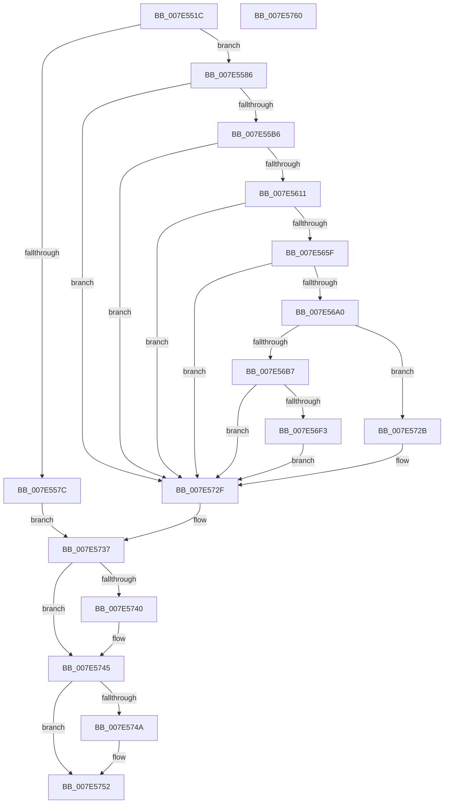

# CmpRecordShutdownStopTime

- RVA: `0x007E551C`–`0x007E5761` (길이 `581` bytes)
- VA: `0x00000001407E551C`
- 실행 섹션: `PAGE`
- PDB 이름 있음: `예`; PDB Function 태그: `아니요`
- unwind 정보 RVA: `0x000D64F8`
- 디코드: `147`개 명령, `581/581` bytes 표시
- 미해석 바이트: `0` (있으면 어셈블리에 `.byte`로 보존)

> 이 문서는 커널 이미지의 기계어와 PDB 기호를 분석해 생성했습니다. 4번과 5번은 함수 원형과 자료형을 바이너리 사용 방식에서 추정한 C 해석이며 원본 소스 복구 결과는 아닙니다.

## 1. Dependencies

- 직접 호출 지점: **17**; 고유 호출 대상: **9**
- 직접 호출자로 확인된 함수: **1**
- RIP 상대 이미지 참조: **6**

### Outgoing calls
- `0x007E556F` → [CmpAllocatePool](../../text/3C/CmpAllocatePool_function_003CD504.md) (function, `0x003CD504`)
- `0x007E55A7` → [RtlGetPersistedStateLocation](../8C/RtlGetPersistedStateLocation_function_008C8DE0.md) (function, `0x008C8DE0`)
- `0x007E55BD` → [RtlInitUnicodeString](../../text/42/RtlInitUnicodeString_function_0042A780.md) (function, `0x0042A780`)
- `0x007E5602` → [ZwCreateKey](../../text/6A/ZwCreateKey_function_006AD470.md) (function, `0x006AD470`)
- `0x007E5615` → [KeQueryPerformanceCounter](../../text/37/KeQueryPerformanceCounter_function_0037E7E0.md) (function, `0x0037E7E0`)
- `0x007E5629` → [RtlInitUnicodeString](../../text/42/RtlInitUnicodeString_function_0042A780.md) (function, `0x0042A780`)
- `0x007E5650` → [ZwSetValueKey](../../text/6A/ZwSetValueKey_function_006ADCD0.md) (function, `0x006ADCD0`)
- `0x007E566A` → [RtlInitUnicodeString](../../text/42/RtlInitUnicodeString_function_0042A780.md) (function, `0x0042A780`)
- `0x007E5691` → [ZwSetValueKey](../../text/6A/ZwSetValueKey_function_006ADCD0.md) (function, `0x006ADCD0`)
- `0x007E56AC` → [CmpReadBuildVersion](CmpReadBuildVersion_function_007E52F4.md) (function, `0x007E52F4`)
- `0x007E56C2` → [RtlInitUnicodeString](../../text/42/RtlInitUnicodeString_function_0042A780.md) (function, `0x0042A780`)
- `0x007E56E8` → [ZwSetValueKey](../../text/6A/ZwSetValueKey_function_006ADCD0.md) (function, `0x006ADCD0`)
- `0x007E56FE` → [RtlInitUnicodeString](../../text/42/RtlInitUnicodeString_function_0042A780.md) (function, `0x0042A780`)
- `0x007E5722` → [ZwSetValueKey](../../text/6A/ZwSetValueKey_function_006ADCD0.md) (function, `0x006ADCD0`)
- `0x007E5732` → [CmSiFreeMemory](../../text/47/CmSiFreeMemory_function_00475D80.md) (function, `0x00475D80`)
- `0x007E5740` → [ZwClose](../../text/6A/ZwClose_function_006AD2B0.md) (function, `0x006AD2B0`)
- `0x007E574D` → [CmSiFreeMemory](../../text/47/CmSiFreeMemory_function_00475D80.md) (function, `0x00475D80`)

### Direct callers
- [CmShutdownSystem1](../../text/66/CmShutdownSystem1_function_0066A5B0.md) at `0x0066A726`

### Static image references
- `0x007E558B` → RVA `0x00B56BA0` (` ?? ::LBKOJDO::`string'`; read)
- `0x007E5596` → RVA `0x00B09550` (` ?? ::NNGAKEGL::`string'`; read)
- `0x007E561A` → RVA `0x00B09570` (` ?? ::NNGAKEGL::`string'`; read)
- `0x007E565F` → RVA `0x00B094B0` (` ?? ::NNGAKEGL::`string'`; read)
- `0x007E56B7` → RVA `0x00B094F0` (` ?? ::NNGAKEGL::`string'`; read)
- `0x007E56F3` → RVA `0x00B09440` (` ?? ::NNGAKEGL::`string'`; read)

## 2. Other-region calls and transfers

- 다른 실행 섹션으로 향하는 call: **15**
  - `0x007E556F` → [CmpAllocatePool](../../text/3C/CmpAllocatePool_function_003CD504.md) (`PAGE` → `.text`)
  - `0x007E55BD` → [RtlInitUnicodeString](../../text/42/RtlInitUnicodeString_function_0042A780.md) (`PAGE` → `.text`)
  - `0x007E5602` → [ZwCreateKey](../../text/6A/ZwCreateKey_function_006AD470.md) (`PAGE` → `.text`)
  - `0x007E5615` → [KeQueryPerformanceCounter](../../text/37/KeQueryPerformanceCounter_function_0037E7E0.md) (`PAGE` → `.text`)
  - `0x007E5629` → [RtlInitUnicodeString](../../text/42/RtlInitUnicodeString_function_0042A780.md) (`PAGE` → `.text`)
  - `0x007E5650` → [ZwSetValueKey](../../text/6A/ZwSetValueKey_function_006ADCD0.md) (`PAGE` → `.text`)
  - `0x007E566A` → [RtlInitUnicodeString](../../text/42/RtlInitUnicodeString_function_0042A780.md) (`PAGE` → `.text`)
  - `0x007E5691` → [ZwSetValueKey](../../text/6A/ZwSetValueKey_function_006ADCD0.md) (`PAGE` → `.text`)
  - `0x007E56C2` → [RtlInitUnicodeString](../../text/42/RtlInitUnicodeString_function_0042A780.md) (`PAGE` → `.text`)
  - `0x007E56E8` → [ZwSetValueKey](../../text/6A/ZwSetValueKey_function_006ADCD0.md) (`PAGE` → `.text`)
  - `0x007E56FE` → [RtlInitUnicodeString](../../text/42/RtlInitUnicodeString_function_0042A780.md) (`PAGE` → `.text`)
  - `0x007E5722` → [ZwSetValueKey](../../text/6A/ZwSetValueKey_function_006ADCD0.md) (`PAGE` → `.text`)
  - `0x007E5732` → [CmSiFreeMemory](../../text/47/CmSiFreeMemory_function_00475D80.md) (`PAGE` → `.text`)
  - `0x007E5740` → [ZwClose](../../text/6A/ZwClose_function_006AD2B0.md) (`PAGE` → `.text`)
  - `0x007E574D` → [CmSiFreeMemory](../../text/47/CmSiFreeMemory_function_00475D80.md) (`PAGE` → `.text`)
- 별도 외부 분기/꼬리 이동을 확인하지 못했습니다.

## 3. Assembly (complete function range)

```asm
007E551C  40 55                           push rbp
007E551E  53                              push rbx
007E551F  56                              push rsi
007E5520  57                              push rdi
007E5521  48 8D 6C 24 C1                  lea rbp, [rsp - 0x3f]
007E5526  48 81 EC 98 00 00 00            sub rsp, 0x98
007E552D  33 C0                           xor eax, eax
007E552F  0F 57 C0                        xorps xmm0, xmm0
007E5532  48 21 45 77                     and qword ptr [rbp + 0x77], rax
007E5536  BB 10 04 00 00                  mov ebx, 0x410
007E553B  48 21 45 E7                     and qword ptr [rbp - 0x19], rax
007E553F  33 FF                           xor edi, edi
007E5541  48 21 45 EF                     and qword ptr [rbp - 0x11], rax
007E5545  8B D3                           mov edx, ebx
007E5547  21 45 67                        and dword ptr [rbp + 0x67], eax
007E554A  41 B8 43 4D 38 30               mov r8d, 0x30384d43
007E5550  21 45 6F                        and dword ptr [rbp + 0x6f], eax
007E5553  B9 00 01 00 00                  mov ecx, 0x100
007E5558  0F 11 45 07                     movups xmmword ptr [rbp + 7], xmm0
007E555C  48 89 45 27                     mov qword ptr [rbp + 0x27], rax
007E5560  0F 11 45 17                     movups xmmword ptr [rbp + 0x17], xmm0
007E5564  89 45 2F                        mov dword ptr [rbp + 0x2f], eax
007E5567  0F 11 45 F7                     movups xmmword ptr [rbp - 9], xmm0
007E556B  48 89 7D 7F                     mov qword ptr [rbp + 0x7f], rdi
007E556F  E8 90 7F BE FF                  call 0x1403cd504
007E5574  48 8B F0                        mov rsi, rax
007E5577  48 85 C0                        test rax, rax
007E557A  75 0A                           jne 0x1407e5586
007E557C  BB 9A 00 00 C0                  mov ebx, 0xc000009a
007E5581  E9 B1 01 00 00                  jmp 0x1407e5737
007E5586  48 21 7C 24 30                  and qword ptr [rsp + 0x30], rdi
007E558B  4C 8D 05 0E 16 37 00            lea r8, [rip + 0x37160e]
007E5592  89 5C 24 28                     mov dword ptr [rsp + 0x28], ebx
007E5596  48 8D 0D B3 3F 32 00            lea rcx, [rip + 0x323fb3]
007E559D  45 33 C9                        xor r9d, r9d
007E55A0  48 89 74 24 20                  mov qword ptr [rsp + 0x20], rsi
007E55A5  33 D2                           xor edx, edx
007E55A7  E8 34 38 0E 00                  call 0x1408c8de0
007E55AC  8B D8                           mov ebx, eax
007E55AE  85 C0                           test eax, eax
007E55B0  0F 88 79 01 00 00               js 0x1407e572f
007E55B6  48 8B D6                        mov rdx, rsi
007E55B9  48 8D 4D F7                     lea rcx, [rbp - 9]
007E55BD  E8 BE 51 C4 FF                  call 0x14042a780
007E55C2  48 21 7C 24 30                  and qword ptr [rsp + 0x30], rdi
007E55C7  48 8D 45 F7                     lea rax, [rbp - 9]
007E55CB  21 7C 24 28                     and dword ptr [rsp + 0x28], edi
007E55CF  4C 8D 45 07                     lea r8, [rbp + 7]
007E55D3  48 21 7D 0F                     and qword ptr [rbp + 0xf], rdi
007E55D7  48 8D 4D 77                     lea rcx, [rbp + 0x77]
007E55DB  48 21 7C 24 20                  and qword ptr [rsp + 0x20], rdi
007E55E0  0F 57 C0                        xorps xmm0, xmm0
007E55E3  45 33 C9                        xor r9d, r9d
007E55E6  48 89 45 17                     mov qword ptr [rbp + 0x17], rax
007E55EA  BA 06 00 02 00                  mov edx, 0x20006
007E55EF  C7 45 07 30 00 00 00            mov dword ptr [rbp + 7], 0x30
007E55F6  F3 0F 7F 45 27                  movdqu xmmword ptr [rbp + 0x27], xmm0
007E55FB  C7 45 1F 40 02 00 00            mov dword ptr [rbp + 0x1f], 0x240
007E5602  E8 69 7E EC FF                  call 0x1406ad470
007E5607  8B D8                           mov ebx, eax
007E5609  85 C0                           test eax, eax
007E560B  0F 88 1E 01 00 00               js 0x1407e572f
007E5611  48 8D 4D EF                     lea rcx, [rbp - 0x11]
007E5615  E8 C6 91 B9 FF                  call 0x14037e7e0
007E561A  48 8D 15 4F 3F 32 00            lea rdx, [rip + 0x323f4f]
007E5621  48 89 45 E7                     mov qword ptr [rbp - 0x19], rax
007E5625  48 8D 4D F7                     lea rcx, [rbp - 9]
007E5629  E8 52 51 C4 FF                  call 0x14042a780
007E562E  48 8B 4D 77                     mov rcx, qword ptr [rbp + 0x77]
007E5632  48 8D 45 E7                     lea rax, [rbp - 0x19]
007E5636  C7 44 24 28 08 00 00 00         mov dword ptr [rsp + 0x28], 8
007E563E  48 8D 55 F7                     lea rdx, [rbp - 9]
007E5642  41 B9 0B 00 00 00               mov r9d, 0xb
007E5648  48 89 44 24 20                  mov qword ptr [rsp + 0x20], rax
007E564D  45 33 C0                        xor r8d, r8d
007E5650  E8 7B 86 EC FF                  call 0x1406adcd0
007E5655  8B D8                           mov ebx, eax
007E5657  85 C0                           test eax, eax
007E5659  0F 88 D0 00 00 00               js 0x1407e572f
007E565F  48 8D 15 4A 3E 32 00            lea rdx, [rip + 0x323e4a]
007E5666  48 8D 4D F7                     lea rcx, [rbp - 9]
007E566A  E8 11 51 C4 FF                  call 0x14042a780
007E566F  48 8B 4D 77                     mov rcx, qword ptr [rbp + 0x77]
007E5673  48 8D 45 EF                     lea rax, [rbp - 0x11]
007E5677  C7 44 24 28 08 00 00 00         mov dword ptr [rsp + 0x28], 8
007E567F  48 8D 55 F7                     lea rdx, [rbp - 9]
007E5683  41 B9 0B 00 00 00               mov r9d, 0xb
007E5689  48 89 44 24 20                  mov qword ptr [rsp + 0x20], rax
007E568E  45 33 C0                        xor r8d, r8d
007E5691  E8 3A 86 EC FF                  call 0x1406adcd0
007E5696  8B D8                           mov ebx, eax
007E5698  85 C0                           test eax, eax
007E569A  0F 88 8F 00 00 00               js 0x1407e572f
007E56A0  4C 8D 45 6F                     lea r8, [rbp + 0x6f]
007E56A4  48 8D 55 67                     lea rdx, [rbp + 0x67]
007E56A8  48 8D 4D 7F                     lea rcx, [rbp + 0x7f]
007E56AC  E8 43 FC FF FF                  call 0x1407e52f4
007E56B1  8B D8                           mov ebx, eax
007E56B3  85 C0                           test eax, eax
007E56B5  78 74                           js 0x1407e572b
007E56B7  48 8D 15 32 3E 32 00            lea rdx, [rip + 0x323e32]
007E56BE  48 8D 4D F7                     lea rcx, [rbp - 9]
007E56C2  E8 B9 50 C4 FF                  call 0x14042a780
007E56C7  8B 45 67                        mov eax, dword ptr [rbp + 0x67]
007E56CA  48 8D 55 F7                     lea rdx, [rbp - 9]
007E56CE  48 8B 7D 7F                     mov rdi, qword ptr [rbp + 0x7f]
007E56D2  41 B9 01 00 00 00               mov r9d, 1
007E56D8  48 8B 4D 77                     mov rcx, qword ptr [rbp + 0x77]
007E56DC  45 33 C0                        xor r8d, r8d
007E56DF  89 44 24 28                     mov dword ptr [rsp + 0x28], eax
007E56E3  48 89 7C 24 20                  mov qword ptr [rsp + 0x20], rdi
007E56E8  E8 E3 85 EC FF                  call 0x1406adcd0
007E56ED  8B D8                           mov ebx, eax
007E56EF  85 C0                           test eax, eax
007E56F1  78 3C                           js 0x1407e572f
007E56F3  48 8D 15 46 3D 32 00            lea rdx, [rip + 0x323d46]
007E56FA  48 8D 4D F7                     lea rcx, [rbp - 9]
007E56FE  E8 7D 50 C4 FF                  call 0x14042a780
007E5703  48 8B 4D 77                     mov rcx, qword ptr [rbp + 0x77]
007E5707  48 8D 45 6F                     lea rax, [rbp + 0x6f]
007E570B  41 B9 04 00 00 00               mov r9d, 4
007E5711  48 8D 55 F7                     lea rdx, [rbp - 9]
007E5715  44 89 4C 24 28                  mov dword ptr [rsp + 0x28], r9d
007E571A  45 33 C0                        xor r8d, r8d
007E571D  48 89 44 24 20                  mov qword ptr [rsp + 0x20], rax
007E5722  E8 A9 85 EC FF                  call 0x1406adcd0
007E5727  8B D8                           mov ebx, eax
007E5729  EB 04                           jmp 0x1407e572f
007E572B  48 8B 7D 7F                     mov rdi, qword ptr [rbp + 0x7f]
007E572F  48 8B CE                        mov rcx, rsi
007E5732  E8 49 06 C9 FF                  call 0x140475d80
007E5737  48 8B 4D 77                     mov rcx, qword ptr [rbp + 0x77]
007E573B  48 85 C9                        test rcx, rcx
007E573E  74 05                           je 0x1407e5745
007E5740  E8 6B 7B EC FF                  call 0x1406ad2b0
007E5745  48 85 FF                        test rdi, rdi
007E5748  74 08                           je 0x1407e5752
007E574A  48 8B CF                        mov rcx, rdi
007E574D  E8 2E 06 C9 FF                  call 0x140475d80
007E5752  8B C3                           mov eax, ebx
007E5754  48 81 C4 98 00 00 00            add rsp, 0x98
007E575B  5F                              pop rdi
007E575C  5E                              pop rsi
007E575D  5B                              pop rbx
007E575E  5D                              pop rbp
007E575F  C3                              ret
007E5760  CC                              int3
```

## 4. C-style interpretation (structured pseudocode)

```c
__int64 __fastcall CmpRecordShutdownStopTime(__int64 a1, __int64 a2, __int64 a3, int a4)
{
    __int64 result;
    __int64 v_rdi;
    __int64 v_rsp;
    unsigned int v_stack_m30;
    unsigned __int64 v_stack_m38;
    unsigned int v_stack_m40;
    unsigned __int64 v_stack_m48;
    unsigned __int64 v_stack_m50;
    unsigned __int64 v_stack_m58;
    unsigned __int64 v_stack_m5F;
    unsigned __int64 v_stack_m68;
    unsigned __int64 v_stack_m70;
    unsigned __int64 v_stack_m78;
    unsigned __int64 v_stack_m88;
    unsigned int v_stack_m90;
    unsigned __int64 v_stack_m98;
    unsigned int v_stack_p10;
    unsigned __int64 v_stack_p18;
    unsigned __int64 v_stack_p20;
    unsigned int v_stack_p8;

    v_rsp = (v_rsp) - (152);
    result = 0;
    v_rdi = 0;
    v_stack_m58 = v_xmm0;
    v_stack_m38 = 0;
    v_stack_m48 = v_xmm0;
    v_stack_m30 = 0;
    v_stack_m68 = v_xmm0;
    v_stack_p20 = 0;
    result = CmpAllocatePool(256, (unsigned int)((unsigned int)((unsigned int)(0x410ULL))), (unsigned int)(0x30384D43ULL), a4);
    if (result != 0) goto loc_007E5586;
    goto loc_007E5737;
loc_007E5586:
    v_stack_m90 = (unsigned int)((unsigned int)(0xC000009AULL));
    a4 = 0;
    v_stack_m98 = result;
    a2 = 0;
    result = RtlGetPersistedStateLocation(v_rip + 3293107, a2, v_rip + 3610126, a4);
    if (sign_flag) goto loc_007E572F;
    result = RtlInitUnicodeString(v_stack_m68, result, v_rip + 3610126, a4);
    a4 = 0;
    v_stack_m48 = v_stack_m68;
    v_stack_m58 = 48;
    v_stack_m38 = v_xmm0;
    v_stack_m40 = 576;
    result = ZwCreateKey(v_stack_p18, (unsigned int)(0x20006ULL), v_stack_m58, a4);
    if (sign_flag) goto loc_007E572F;
    result = KeQueryPerformanceCounter(v_stack_m70, (unsigned int)(0x20006ULL), v_stack_m58, a4);
    v_stack_m78 = result;
    result = RtlInitUnicodeString(v_stack_m68, v_rip + 3293007, v_stack_m58, a4);
    v_stack_m90 = 8;
    v_stack_m98 = v_stack_m78;
    a3 = 0;
    result = ZwSetValueKey(v_stack_p18, v_stack_m68, a3, 11);
    if (sign_flag) goto loc_007E572F;
    result = RtlInitUnicodeString(v_stack_m68, v_rip + 3292746, a3, 11);
    v_stack_m90 = 8;
    v_stack_m98 = v_stack_m70;
    a3 = 0;
    result = ZwSetValueKey(v_stack_p18, v_stack_m68, a3, 11);
    if (sign_flag) goto loc_007E572F;
    result = CmpReadBuildVersion(v_stack_p20, v_stack_p8, v_stack_p10, 11);
    if (sign_flag) goto loc_007E572B;
    result = RtlInitUnicodeString(v_stack_m68, v_rip + 3292722, v_stack_p10, 11);
    a3 = 0;
    v_stack_m90 = (unsigned int)((unsigned int)(v_stack_p8));
    v_stack_m98 = v_stack_p20;
    result = ZwSetValueKey(v_stack_p18, v_stack_m68, a3, 1);
    if (sign_flag) goto loc_007E572F;
    result = RtlInitUnicodeString(v_stack_m68, v_rip + 3292486, a3, 1);
    v_stack_m90 = 4;
    a3 = 0;
    v_stack_m98 = v_stack_p10;
    result = ZwSetValueKey(v_stack_p18, v_stack_m68, a3, 4);
    goto loc_007E572F;
loc_007E572B:
loc_007E572F:
    result = CmSiFreeMemory(result, v_stack_m68, a3, 4);
loc_007E5737:
    if (v_stack_p18 != 0) {
        result = ZwClose(v_stack_p18, v_stack_m68, a3, 4);
    }
    if (v_stack_p20 != 0) {
        a1 = v_stack_p20;
        result = CmSiFreeMemory(a1, v_stack_m68, a3, 4);
    }
    v_rsp = (v_rsp) + (152);
    return (unsigned int)((unsigned int)((unsigned int)((unsigned int)(result))));
}
```

## 5. (Beta) C Style

```c
int64_t CmpRecordShutdownStopTime(int64_t Arg1, int64_t Arg2, int64_t Arg3, int32_t Arg4)
{
    int64_t result;
    int64_t local_rdi;
    int64_t local_rsp;
    uint32_t v_stack_m30;
    uint64_t v_stack_m38;
    uint32_t v_stack_m40;
    uint64_t v_stack_m48;
    uint64_t v_stack_m50;
    uint64_t v_stack_m58;
    uint64_t v_stack_m5F;
    uint64_t v_stack_m68;
    uint64_t v_stack_m70;
    uint64_t v_stack_m78;
    uint64_t v_stack_m88;
    uint32_t v_stack_m90;
    uint64_t v_stack_m98;
    uint32_t v_stack_p10;
    uint64_t v_stack_p18;
    uint64_t v_stack_p20;
    uint32_t v_stack_p8;

    local_rsp = (local_rsp) - (152);
    result = 0;
    local_rdi = 0;
    v_stack_m58 = v_xmm0;
    v_stack_m38 = 0;
    v_stack_m48 = v_xmm0;
    v_stack_m30 = 0;
    v_stack_m68 = v_xmm0;
    v_stack_p20 = 0;
    result = CmpAllocatePool(256, (uint32_t)((uint32_t)((uint32_t)(0x410ULL))), (uint32_t)(0x30384D43ULL), Arg4);
    if (result != 0) goto loc_007E5586;
    goto loc_007E5737;
loc_007E5586:
    v_stack_m90 = (uint32_t)((uint32_t)(0xC000009AULL));
    Arg4 = 0;
    v_stack_m98 = result;
    Arg2 = 0;
    result = RtlGetPersistedStateLocation(v_rip + 3293107, Arg2, v_rip + 3610126, Arg4);
    if (sign_flag) goto loc_007E572F;
    result = RtlInitUnicodeString(v_stack_m68, result, v_rip + 3610126, Arg4);
    Arg4 = 0;
    v_stack_m48 = v_stack_m68;
    v_stack_m58 = 48;
    v_stack_m38 = v_xmm0;
    v_stack_m40 = 576;
    result = ZwCreateKey(v_stack_p18, (uint32_t)(0x20006ULL), v_stack_m58, Arg4);
    if (sign_flag) goto loc_007E572F;
    result = KeQueryPerformanceCounter(v_stack_m70, (uint32_t)(0x20006ULL), v_stack_m58, Arg4);
    v_stack_m78 = result;
    result = RtlInitUnicodeString(v_stack_m68, v_rip + 3293007, v_stack_m58, Arg4);
    v_stack_m90 = 8;
    v_stack_m98 = v_stack_m78;
    Arg3 = 0;
    result = ZwSetValueKey(v_stack_p18, v_stack_m68, Arg3, 11);
    if (sign_flag) goto loc_007E572F;
    result = RtlInitUnicodeString(v_stack_m68, v_rip + 3292746, Arg3, 11);
    v_stack_m90 = 8;
    v_stack_m98 = v_stack_m70;
    Arg3 = 0;
    result = ZwSetValueKey(v_stack_p18, v_stack_m68, Arg3, 11);
    if (sign_flag) goto loc_007E572F;
    result = CmpReadBuildVersion(v_stack_p20, v_stack_p8, v_stack_p10, 11);
    if (sign_flag) goto loc_007E572B;
    result = RtlInitUnicodeString(v_stack_m68, v_rip + 3292722, v_stack_p10, 11);
    Arg3 = 0;
    v_stack_m90 = (uint32_t)((uint32_t)(v_stack_p8));
    v_stack_m98 = v_stack_p20;
    result = ZwSetValueKey(v_stack_p18, v_stack_m68, Arg3, 1);
    if (sign_flag) goto loc_007E572F;
    result = RtlInitUnicodeString(v_stack_m68, v_rip + 3292486, Arg3, 1);
    v_stack_m90 = 4;
    Arg3 = 0;
    v_stack_m98 = v_stack_p10;
    result = ZwSetValueKey(v_stack_p18, v_stack_m68, Arg3, 4);
    goto loc_007E572F;
loc_007E572B:
loc_007E572F:
    result = CmSiFreeMemory(result, v_stack_m68, Arg3, 4);
loc_007E5737:
    if (v_stack_p18 != 0) {
        result = ZwClose(v_stack_p18, v_stack_m68, Arg3, 4);
    }
    if (v_stack_p20 != 0) {
        Arg1 = v_stack_p20;
        result = CmSiFreeMemory(Arg1, v_stack_m68, Arg3, 4);
    }
    local_rsp = (local_rsp) + (152);
    return (uint32_t)((uint32_t)((uint32_t)((uint32_t)(result))));
}
```

## 6. Execution-region graph

[열기: 2D/3D 그래프와 함수 탐색 컨트롤 패널](../../../control-panel.html?section=page&rva=0x007E551C&view=graph)

- 2D 그래프는 위에서 아래로 흐르고, 3D 그래프는 빈 공간을 드래그해 회전합니다. Shift+드래그는 이동, 휠은 확대·축소, 함수 노드 선택은 대상 보고서 이동입니다.

### Static fallback


