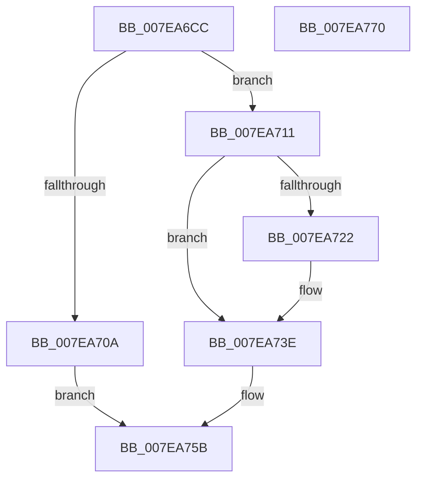

# CmpRecordUnloadEventForHive

- RVA: `0x007EA6CC`–`0x007EA771` (길이 `165` bytes)
- VA: `0x00000001407EA6CC`
- 실행 섹션: `PAGE`
- PDB 이름 있음: `예`; PDB Function 태그: `아니요`
- unwind 정보 RVA: `0x0005C954`
- 디코드: `44`개 명령, `165/165` bytes 표시
- 미해석 바이트: `0` (있으면 어셈블리에 `.byte`로 보존)

> 이 문서는 커널 이미지의 기계어와 PDB 기호를 분석해 생성했습니다. 4번과 5번은 함수 원형과 자료형을 바이너리 사용 방식에서 추정한 C 해석이며 원본 소스 복구 결과는 아닙니다.

## 1. Dependencies

- 직접 호출 지점: **4**; 고유 호출 대상: **4**
- 직접 호출자로 확인된 함수: **3**
- RIP 상대 이미지 참조: **0**

### Outgoing calls
- `0x007EA6FD` → [ExAllocatePool2](../../poolcode/B8/ExAllocatePool2_function_00B820F0.md) (function, `0x00B820F0`)
- `0x007EA72F` → [memcpy](../../text/6C/memcpy_function_006C6840.md) (function, `0x006C6840`)
- `0x007EA739` → [ExFreePoolWithTag](../../poolcode/B8/ExFreePoolWithTag_function_00B82870.md) (function, `0x00B82870`)
- `0x007EA754` → [ObfReferenceObject](../../text/20/ObfReferenceObject_function_0020FA20.md) (function, `0x0020FA20`)

### Direct callers
- [CmpLinkHiveToMaster](../87/CmpLinkHiveToMaster_function_00877D6C.md) at `0x008781D6`
- [CmpFreezeHive](../9A/CmpFreezeHive_function_009AE818.md) at `0x009AE841`
- [sub_00B49062](../B4/Unknown_function_00B49062.md) at `0x00B49123`

### Static image references
- 디코드된 RIP-relative 메모리 참조가 없습니다.

## 2. Other-region calls and transfers

- 다른 실행 섹션으로 향하는 call: **4**
  - `0x007EA6FD` → [ExAllocatePool2](../../poolcode/B8/ExAllocatePool2_function_00B820F0.md) (`PAGE` → `POOLCODE`)
  - `0x007EA72F` → [memcpy](../../text/6C/memcpy_function_006C6840.md) (`PAGE` → `.text`)
  - `0x007EA739` → [ExFreePoolWithTag](../../poolcode/B8/ExFreePoolWithTag_function_00B82870.md) (`PAGE` → `POOLCODE`)
  - `0x007EA754` → [ObfReferenceObject](../../text/20/ObfReferenceObject_function_0020FA20.md) (`PAGE` → `.text`)
- 별도 외부 분기/꼬리 이동을 확인하지 못했습니다.

## 3. Assembly (complete function range)

```asm
007EA6CC  48 89 5C 24 08                  mov qword ptr [rsp + 8], rbx
007EA6D1  48 89 6C 24 10                  mov qword ptr [rsp + 0x10], rbp
007EA6D6  48 89 74 24 18                  mov qword ptr [rsp + 0x18], rsi
007EA6DB  57                              push rdi
007EA6DC  48 83 EC 20                     sub rsp, 0x20
007EA6E0  48 8B EA                        mov rbp, rdx
007EA6E3  48 8B D9                        mov rbx, rcx
007EA6E6  8B 91 68 0B 00 00               mov edx, dword ptr [rcx + 0xb68]
007EA6EC  41 B8 43 6D 45 76               mov r8d, 0x76456d43
007EA6F2  FF C2                           inc edx
007EA6F4  B9 00 01 00 00                  mov ecx, 0x100
007EA6F9  48 C1 E2 03                     shl rdx, 3
007EA6FD  E8 EE 79 39 00                  call 0x140b820f0
007EA702  48 8B F0                        mov rsi, rax
007EA705  48 85 C0                        test rax, rax
007EA708  75 07                           jne 0x1407ea711
007EA70A  B8 9A 00 00 C0                  mov eax, 0xc000009a
007EA70F  EB 4A                           jmp 0x1407ea75b
007EA711  8B 83 68 0B 00 00               mov eax, dword ptr [rbx + 0xb68]
007EA717  48 8D BB 70 0B 00 00            lea rdi, [rbx + 0xb70]
007EA71E  85 C0                           test eax, eax
007EA720  74 1C                           je 0x1407ea73e
007EA722  48 8B 17                        mov rdx, qword ptr [rdi]
007EA725  44 8B C0                        mov r8d, eax
007EA728  49 C1 E0 03                     shl r8, 3
007EA72C  48 8B CE                        mov rcx, rsi
007EA72F  E8 0C C1 ED FF                  call 0x1406c6840
007EA734  48 8B 0F                        mov rcx, qword ptr [rdi]
007EA737  33 D2                           xor edx, edx
007EA739  E8 32 81 39 00                  call 0x140b82870
007EA73E  8B 83 68 0B 00 00               mov eax, dword ptr [rbx + 0xb68]
007EA744  48 8B CD                        mov rcx, rbp
007EA747  48 89 37                        mov qword ptr [rdi], rsi
007EA74A  48 89 2C C6                     mov qword ptr [rsi + rax*8], rbp
007EA74E  FF 83 68 0B 00 00               inc dword ptr [rbx + 0xb68]
007EA754  E8 C7 52 A2 FF                  call 0x14020fa20
007EA759  33 C0                           xor eax, eax
007EA75B  48 8B 5C 24 30                  mov rbx, qword ptr [rsp + 0x30]
007EA760  48 8B 6C 24 38                  mov rbp, qword ptr [rsp + 0x38]
007EA765  48 8B 74 24 40                  mov rsi, qword ptr [rsp + 0x40]
007EA76A  48 83 C4 20                     add rsp, 0x20
007EA76E  5F                              pop rdi
007EA76F  C3                              ret
007EA770  CC                              int3
```

## 4. C-style interpretation (structured pseudocode)

```c
__int64 __fastcall CmpRecordUnloadEventForHive(__int64 a1, __int64 a2)
{
    __int64 result;
    __int64 v_rsp;
    unsigned __int64 v_stack_p10;
    unsigned __int64 v_stack_p18;
    unsigned __int64 v_stack_p8;

    v_stack_p8 = v_rbx;
    v_stack_p10 = v_rbp;
    v_stack_p18 = v_rsi;
    v_rsp = (v_rsp) - (32);
    a2 = (unsigned int)(((unsigned int)(*(unsigned int *)(a1 + 2920))) + 1);
    a2 = (a2) << (3);
    result = ExAllocatePool2(256, a2, (unsigned int)(0x76456D43ULL), a4);
    if (result != 0) goto loc_007EA711;
    goto loc_007EA75B;
loc_007EA711:
    result = (unsigned int)(*(unsigned int *)(a1 + 2920));
    if ((unsigned int)((unsigned int)(*(unsigned int *)(a1 + 2920))) != 0) {
        a2 = *(unsigned __int64 *)(a1 + 2928);
        a3 = (unsigned int)((unsigned int)(*(unsigned int *)(a1 + 2920)));
        a3 = (a3) << (3);
        a1 = result;
        result = memcpy(a1, a2, a3, a4);
        a1 = *(unsigned __int64 *)(a1 + 2928);
        a2 = 0;
        result = ExFreePoolWithTag(a1, a2, a3, a4);
    }
    *(unsigned __int64 *)(a1 + 2928) = result;
    *(unsigned __int64 *)(result + (unsigned int)(*(unsigned int *)(a1 + 2920)) * 8) = 0;
    result = ObfReferenceObject(0, a2, a3, a4);
    result = 0;
loc_007EA75B:
    v_rsp = (v_rsp) + (32);
    return result;
}
```

## 5. (Beta) C Style

```c
int64_t CmpRecordUnloadEventForHive(void *Arg1, int64_t Arg2)
{
    uint8_t *arg1 = (uint8_t *)Arg1;

    int64_t result;
    int64_t local_rsp;
    uint64_t v_stack_p10;
    uint64_t v_stack_p18;
    uint64_t v_stack_p8;

    v_stack_p8 = local_rbx;
    v_stack_p10 = local_rbp;
    v_stack_p18 = local_rsi;
    local_rsp = (local_rsp) - (32);
    Arg2 = (uint32_t)(((uint32_t)(*(uint32_t *)(arg1 + 0xB68))) + 1);
    Arg2 = (Arg2) << (3);
    result = ExAllocatePool2(256, Arg2, (uint32_t)(0x76456D43ULL), a4);
    if (result != 0) goto loc_007EA711;
    goto loc_007EA75B;
loc_007EA711:
    result = (uint32_t)(*(uint32_t *)(arg1 + 0xB68));
    if ((uint32_t)((uint32_t)(*(uint32_t *)(arg1 + 0xB68))) != 0) {
        Arg2 = *(uint64_t *)(arg1 + 0xB70);
        a3 = (uint32_t)((uint32_t)(*(uint32_t *)(arg1 + 0xB68)));
        a3 = (a3) << (3);
        Arg1 = result;
        result = memcpy(Arg1, Arg2, a3, a4);
        Arg1 = *(uint64_t *)(arg1 + 0xB70);
        Arg2 = 0;
        result = ExFreePoolWithTag(Arg1, Arg2, a3, a4);
    }
    *(uint64_t *)(arg1 + 0xB70) = result;
    *(uint64_t *)(result + (uint32_t)(*(uint32_t *)(arg1 + 0xB68)) * 8) = 0;
    result = ObfReferenceObject(0, Arg2, a3, a4);
    result = 0;
loc_007EA75B:
    local_rsp = (local_rsp) + (32);
    return result;
}
```

### 관측된 메모리 오프셋

구조체 형식이 확인되지 않은 접근은 인자 기준의 오프셋으로만 기록했습니다.

| 기준 인자 | 오프셋 표현 | 폭 (bit) | 접근 |
|---|---:|---:|---|
| `Arg1` | `+ 0x0` | `64` | `R` |
| `Arg1` | `+ 0x0` | `64` | `W` |
| `Arg1` | `+ 0xB68` | `32` | `R` |
| `Arg1` | `+ 0xB68` | `32` | `R/W` |
| `Arg1` | `+ 0xB70` | `64` | `R` |

## 6. Execution-region graph

[열기: 2D/3D 그래프와 함수 탐색 컨트롤 패널](../../../control-panel.html?section=page&rva=0x007EA6CC&view=graph)

- 2D 그래프는 위에서 아래로 흐르고, 3D 그래프는 빈 공간을 드래그해 회전합니다. Shift+드래그는 이동, 휠은 확대·축소, 함수 노드 선택은 대상 보고서 이동입니다.

### Static fallback


