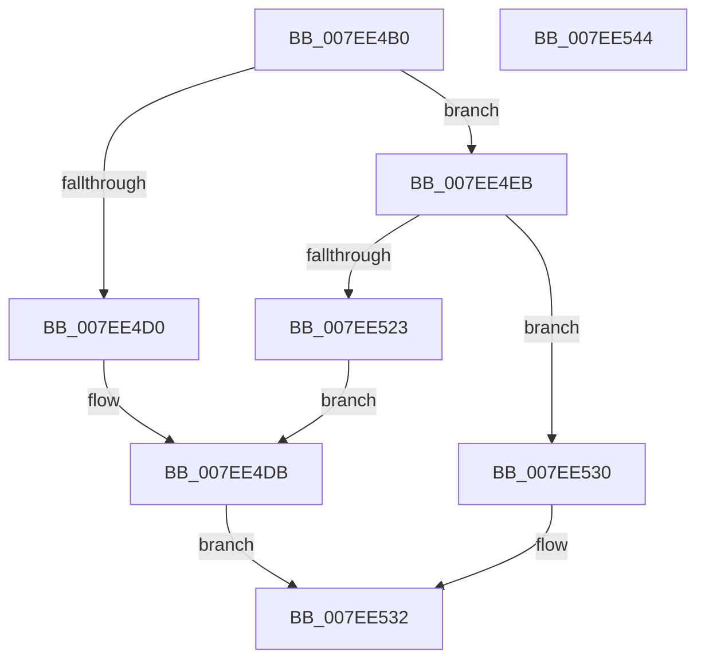

# CmpRecoverFlushProtocolStateFromFiles

- RVA: `0x007EE4B0`–`0x007EE545` (길이 `149` bytes)
- VA: `0x00000001407EE4B0`
- 실행 섹션: `PAGE`
- PDB 이름 있음: `예`; PDB Function 태그: `아니요`
- unwind 정보 RVA: `0x000794E0`
- 디코드: `43`개 명령, `149/149` bytes 표시
- 미해석 바이트: `0` (있으면 어셈블리에 `.byte`로 보존)

> 이 문서는 커널 이미지의 기계어와 PDB 기호를 분석해 생성했습니다. 4번과 5번은 함수 원형과 자료형을 바이너리 사용 방식에서 추정한 C 해석이며 원본 소스 복구 결과는 아닙니다.

## 1. Dependencies

- 직접 호출 지점: **9**; 고유 호출 대상: **9**
- 직접 호출자로 확인된 함수: **2**
- RIP 상대 이미지 참조: **0**

### Outgoing calls
- `0x007EE4C5` → [HvRecoverFlushProtocolStateFromFiles](HvRecoverFlushProtocolStateFromFiles_function_007EF224.md) (function, `0x007EF224`)
- `0x007EE4E4` → [SetFailureLocation](../../text/46/SetFailureLocation_function_0046EF54.md) (function, `0x0046EF54`)
- `0x007EE4EB` → [CmpLockRegistry](../../pagecmrc/BC/CmpLockRegistry_function_00BC9B34.md) (function, `0x00BC9B34`)
- `0x007EE4F3` → [HvLockHiveFlusherShared](../84/HvLockHiveFlusherShared_function_0084F95C.md) (function, `0x0084F95C`)
- `0x007EE4FB` → [HvLockHiveWriter](../85/HvLockHiveWriter_function_00859894.md) (function, `0x00859894`)
- `0x007EE503` → [HvCheckAndUpdateHiveBackupTimeStamp](../87/HvCheckAndUpdateHiveBackupTimeStamp_function_0087BE90.md) (function, `0x0087BE90`)
- `0x007EE50D` → [HvUnlockHiveWriter](../85/HvUnlockHiveWriter_function_008598E4.md) (function, `0x008598E4`)
- `0x007EE515` → [HvUnlockHiveFlusherShared](../84/HvUnlockHiveFlusherShared_function_00848738.md) (function, `0x00848738`)
- `0x007EE51A` → [CmpUnlockRegistry](../../pagecmrc/BC/CmpUnlockRegistry_function_00BC9A84.md) (function, `0x00BC9A84`)

### Direct callers
- [CmpLoadHiveThread](../7D/CmpLoadHiveThread_function_007DB040.md) at `0x007DB814`
- [CmpMountPreloadedHives](../7D/CmpMountPreloadedHives_function_007DBE18.md) at `0x007DC2DD`

### Static image references
- 디코드된 RIP-relative 메모리 참조가 없습니다.

## 2. Other-region calls and transfers

- 다른 실행 섹션으로 향하는 call: **3**
  - `0x007EE4E4` → [SetFailureLocation](../../text/46/SetFailureLocation_function_0046EF54.md) (`PAGE` → `.text`)
  - `0x007EE4EB` → [CmpLockRegistry](../../pagecmrc/BC/CmpLockRegistry_function_00BC9B34.md) (`PAGE` → `PAGECMRC`)
  - `0x007EE51A` → [CmpUnlockRegistry](../../pagecmrc/BC/CmpUnlockRegistry_function_00BC9A84.md) (`PAGE` → `PAGECMRC`)
- 별도 외부 분기/꼬리 이동을 확인하지 못했습니다.

## 3. Assembly (complete function range)

```asm
007EE4B0  48 89 5C 24 08                  mov qword ptr [rsp + 8], rbx
007EE4B5  48 89 74 24 10                  mov qword ptr [rsp + 0x10], rsi
007EE4BA  57                              push rdi
007EE4BB  48 83 EC 30                     sub rsp, 0x30
007EE4BF  48 8B F2                        mov rsi, rdx
007EE4C2  48 8B F9                        mov rdi, rcx
007EE4C5  E8 5A 0D 00 00                  call 0x1407ef224
007EE4CA  8B D8                           mov ebx, eax
007EE4CC  85 C0                           test eax, eax
007EE4CE  79 1B                           jns 0x1407ee4eb
007EE4D0  C7 44 24 20 10 00 00 00         mov dword ptr [rsp + 0x20], 0x10
007EE4D8  44 8B C8                        mov r9d, eax
007EE4DB  33 D2                           xor edx, edx
007EE4DD  48 8B CE                        mov rcx, rsi
007EE4E0  44 8D 42 25                     lea r8d, [rdx + 0x25]
007EE4E4  E8 6B 0A C8 FF                  call 0x14046ef54
007EE4E9  EB 47                           jmp 0x1407ee532
007EE4EB  E8 44 B6 3D 00                  call 0x140bc9b34
007EE4F0  48 8B CF                        mov rcx, rdi
007EE4F3  E8 64 14 06 00                  call 0x14084f95c
007EE4F8  48 8B CF                        mov rcx, rdi
007EE4FB  E8 94 B3 06 00                  call 0x140859894
007EE500  48 8B CF                        mov rcx, rdi
007EE503  E8 88 D9 08 00                  call 0x14087be90
007EE508  48 8B CF                        mov rcx, rdi
007EE50B  8B D8                           mov ebx, eax
007EE50D  E8 D2 B3 06 00                  call 0x1408598e4
007EE512  48 8B CF                        mov rcx, rdi
007EE515  E8 1E A2 05 00                  call 0x140848738
007EE51A  E8 65 B5 3D 00                  call 0x140bc9a84
007EE51F  85 DB                           test ebx, ebx
007EE521  79 0D                           jns 0x1407ee530
007EE523  C7 44 24 20 20 00 00 00         mov dword ptr [rsp + 0x20], 0x20
007EE52B  44 8B CB                        mov r9d, ebx
007EE52E  EB AB                           jmp 0x1407ee4db
007EE530  33 DB                           xor ebx, ebx
007EE532  48 8B 74 24 48                  mov rsi, qword ptr [rsp + 0x48]
007EE537  8B C3                           mov eax, ebx
007EE539  48 8B 5C 24 40                  mov rbx, qword ptr [rsp + 0x40]
007EE53E  48 83 C4 30                     add rsp, 0x30
007EE542  5F                              pop rdi
007EE543  C3                              ret
007EE544  CC                              int3
```

## 4. C-style interpretation (structured pseudocode)

```c
__int64 __fastcall CmpRecoverFlushProtocolStateFromFiles(__int64 a1, __int64 a2)
{
    __int64 result;
    __int64 v_rbx;
    __int64 v_rsp;
    unsigned int v_stack_m18;
    unsigned __int64 v_stack_p10;
    unsigned __int64 v_stack_p8;

    v_stack_p8 = v_rbx;
    v_stack_p10 = v_rsi;
    v_rsp = (v_rsp) - (48);
    result = HvRecoverFlushProtocolStateFromFiles(a1, a2, a3, a4);
    if (!sign_flag) goto loc_007EE4EB;
    v_stack_m18 = 16;
loc_007EE4DB:
    a2 = 0;
    result = SetFailureLocation(0, a2, a2 + 37, (unsigned int)((unsigned int)(result)));
    goto loc_007EE532;
loc_007EE4EB:
    result = CmpLockRegistry(0, a2, a2 + 37, (unsigned int)((unsigned int)(result)));
    result = HvLockHiveFlusherShared(a1, a2, a2 + 37, (unsigned int)((unsigned int)(result)));
    result = HvLockHiveWriter(a1, a2, a2 + 37, (unsigned int)((unsigned int)(result)));
    result = HvCheckAndUpdateHiveBackupTimeStamp(a1, a2, a2 + 37, (unsigned int)((unsigned int)(result)));
    result = HvUnlockHiveWriter(a1, a2, a2 + 37, (unsigned int)((unsigned int)(result)));
    result = HvUnlockHiveFlusherShared(a1, a2, a2 + 37, (unsigned int)((unsigned int)(result)));
    result = CmpUnlockRegistry(a1, a2, a2 + 37, (unsigned int)((unsigned int)(result)));
    if (!sign_flag) goto loc_007EE530;
    v_stack_m18 = 32;
    goto loc_007EE4DB;
loc_007EE530:
    v_rbx = 0;
loc_007EE532:
    v_rsp = (v_rsp) + (48);
    return 0;
}
```

## 5. (Beta) C Style

```c
int64_t CmpRecoverFlushProtocolStateFromFiles(int64_t Arg1, int64_t Arg2)
{
    int64_t result;
    int64_t local_rbx;
    int64_t local_rsp;
    uint32_t v_stack_m18;
    uint64_t v_stack_p10;
    uint64_t v_stack_p8;

    v_stack_p8 = local_rbx;
    v_stack_p10 = local_rsi;
    local_rsp = (local_rsp) - (48);
    result = HvRecoverFlushProtocolStateFromFiles(Arg1, Arg2, a3, a4);
    if (!sign_flag) goto loc_007EE4EB;
    v_stack_m18 = 16;
loc_007EE4DB:
    Arg2 = 0;
    result = SetFailureLocation(0, Arg2, Arg2 + 37, (uint32_t)((uint32_t)(result)));
    goto loc_007EE532;
loc_007EE4EB:
    result = CmpLockRegistry(0, Arg2, Arg2 + 37, (uint32_t)((uint32_t)(result)));
    result = HvLockHiveFlusherShared(Arg1, Arg2, Arg2 + 37, (uint32_t)((uint32_t)(result)));
    result = HvLockHiveWriter(Arg1, Arg2, Arg2 + 37, (uint32_t)((uint32_t)(result)));
    result = HvCheckAndUpdateHiveBackupTimeStamp(Arg1, Arg2, Arg2 + 37, (uint32_t)((uint32_t)(result)));
    result = HvUnlockHiveWriter(Arg1, Arg2, Arg2 + 37, (uint32_t)((uint32_t)(result)));
    result = HvUnlockHiveFlusherShared(Arg1, Arg2, Arg2 + 37, (uint32_t)((uint32_t)(result)));
    result = CmpUnlockRegistry(Arg1, Arg2, Arg2 + 37, (uint32_t)((uint32_t)(result)));
    if (!sign_flag) goto loc_007EE530;
    v_stack_m18 = 32;
    goto loc_007EE4DB;
loc_007EE530:
    local_rbx = 0;
loc_007EE532:
    local_rsp = (local_rsp) + (48);
    return 0;
}
```

## 6. Execution-region graph

[열기: 2D/3D 그래프와 함수 탐색 컨트롤 패널](../../../control-panel.html?section=page&rva=0x007EE4B0&view=graph)

- 2D 그래프는 위에서 아래로 흐르고, 3D 그래프는 빈 공간을 드래그해 회전합니다. Shift+드래그는 이동, 휠은 확대·축소, 함수 노드 선택은 대상 보고서 이동입니다.

### Static fallback


