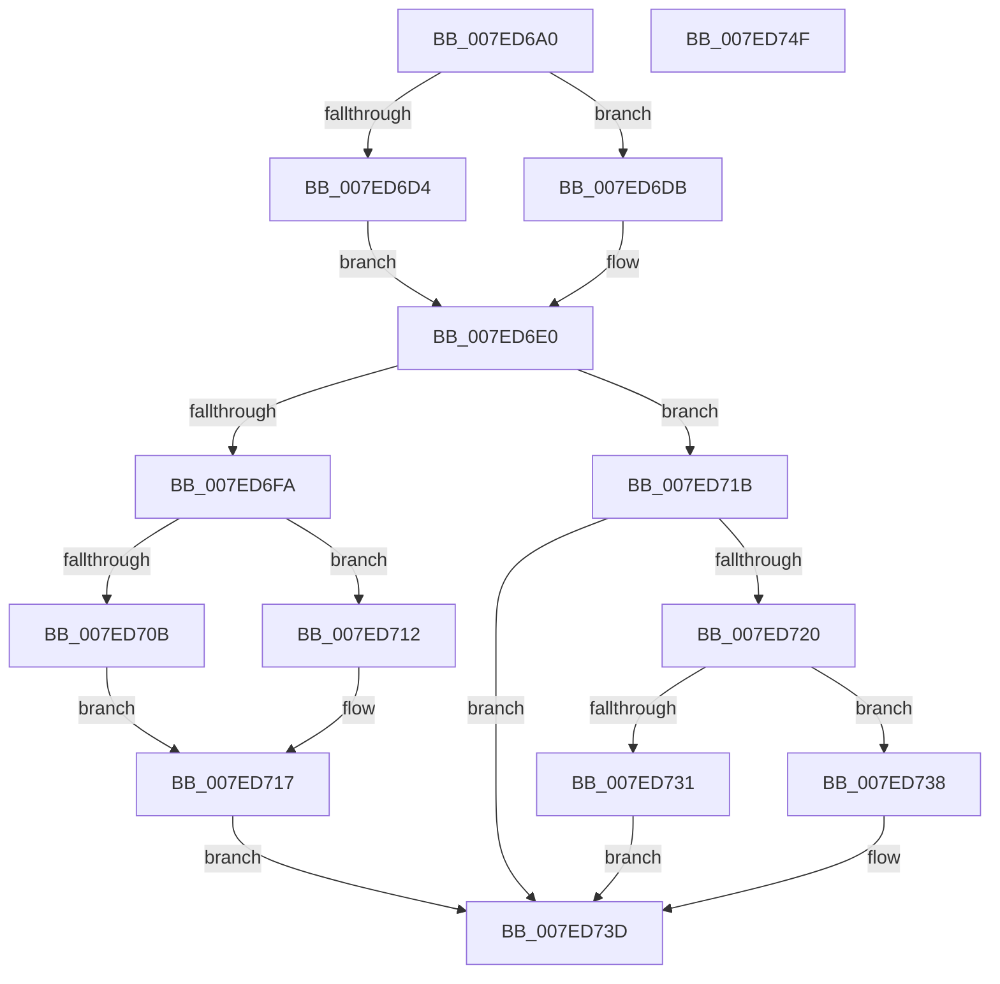

# CmpReferenceSecurityNode

- RVA: `0x007ED6A0`–`0x007ED750` (길이 `176` bytes)
- VA: `0x00000001407ED6A0`
- 실행 섹션: `PAGE`
- PDB 이름 있음: `예`; PDB Function 태그: `아니요`
- unwind 정보 RVA: `0x000A9ACC`
- 디코드: `51`개 명령, `176/176` bytes 표시
- 미해석 바이트: `0` (있으면 어셈블리에 `.byte`로 보존)

> 이 문서는 커널 이미지의 기계어와 PDB 기호를 분석해 생성했습니다. 4번과 5번은 함수 원형과 자료형을 바이너리 사용 방식에서 추정한 C 해석이며 원본 소스 복구 결과는 아닙니다.

## 1. Dependencies

- 직접 호출 지점: **8**; 고유 호출 대상: **6**
- 직접 호출자로 확인된 함수: **1**
- RIP 상대 이미지 참조: **0**

### Outgoing calls
- `0x007ED6BE` → [HvpGetCellContextInitialize](../85/HvpGetCellContextInitialize_function_00855F10.md) (function, `0x00855F10`)
- `0x007ED6D4` → [HvpGetCellFlat](../85/HvpGetCellFlat_function_00854C60.md) (function, `0x00854C60`)
- `0x007ED6DB` → [HvpGetCellPaged](../85/HvpGetCellPaged_function_00854CB0.md) (function, `0x00854CB0`)
- `0x007ED6EF` → [CmpKeySecurityIncrementReferenceCount](../../text/49/CmpKeySecurityIncrementReferenceCount_function_0049FC64.md) (function, `0x0049FC64`)
- `0x007ED70B` → [HvpReleaseCellFlat](../85/HvpReleaseCellFlat_function_0085CC20.md) (function, `0x0085CC20`)
- `0x007ED712` → [HvpReleaseCellPaged](../85/HvpReleaseCellPaged_function_00855F40.md) (function, `0x00855F40`)
- `0x007ED731` → [HvpReleaseCellFlat](../85/HvpReleaseCellFlat_function_0085CC20.md) (function, `0x0085CC20`)
- `0x007ED738` → [HvpReleaseCellPaged](../85/HvpReleaseCellPaged_function_00855F40.md) (function, `0x00855F40`)

### Direct callers
- [CmRenameKey](CmRenameKey_function_007E8F48.md) at `0x007E9BBE`

### Static image references
- 디코드된 RIP-relative 메모리 참조가 없습니다.

## 2. Other-region calls and transfers

- 다른 실행 섹션으로 향하는 call: **1**
  - `0x007ED6EF` → [CmpKeySecurityIncrementReferenceCount](../../text/49/CmpKeySecurityIncrementReferenceCount_function_0049FC64.md) (`PAGE` → `.text`)
- 별도 외부 분기/꼬리 이동을 확인하지 못했습니다.

## 3. Assembly (complete function range)

```asm
007ED6A0  48 8B C4                        mov rax, rsp
007ED6A3  48 89 58 10                     mov qword ptr [rax + 0x10], rbx
007ED6A7  48 89 70 18                     mov qword ptr [rax + 0x18], rsi
007ED6AB  57                              push rdi
007ED6AC  48 83 EC 20                     sub rsp, 0x20
007ED6B0  48 83 60 08 00                  and qword ptr [rax + 8], 0
007ED6B5  48 8B D9                        mov rbx, rcx
007ED6B8  48 8D 48 08                     lea rcx, [rax + 8]
007ED6BC  8B FA                           mov edi, edx
007ED6BE  E8 4D 88 06 00                  call 0x140855f10
007ED6C3  F6 83 8C 00 00 00 01            test byte ptr [rbx + 0x8c], 1
007ED6CA  4C 8D 44 24 30                  lea r8, [rsp + 0x30]
007ED6CF  48 8B CB                        mov rcx, rbx
007ED6D2  74 07                           je 0x1407ed6db
007ED6D4  E8 87 75 06 00                  call 0x140854c60
007ED6D9  EB 05                           jmp 0x1407ed6e0
007ED6DB  E8 D0 75 06 00                  call 0x140854cb0
007ED6E0  45 33 C9                        xor r9d, r9d
007ED6E3  44 8B C7                        mov r8d, edi
007ED6E6  48 8B D3                        mov rdx, rbx
007ED6E9  48 8B C8                        mov rcx, rax
007ED6EC  48 8B F0                        mov rsi, rax
007ED6EF  E8 70 25 CB FF                  call 0x14049fc64
007ED6F4  8B F8                           mov edi, eax
007ED6F6  85 C0                           test eax, eax
007ED6F8  78 21                           js 0x1407ed71b
007ED6FA  F6 83 8C 00 00 00 01            test byte ptr [rbx + 0x8c], 1
007ED701  48 8D 54 24 30                  lea rdx, [rsp + 0x30]
007ED706  48 8B CB                        mov rcx, rbx
007ED709  74 07                           je 0x1407ed712
007ED70B  E8 10 F5 06 00                  call 0x14085cc20
007ED710  EB 05                           jmp 0x1407ed717
007ED712  E8 29 88 06 00                  call 0x140855f40
007ED717  33 FF                           xor edi, edi
007ED719  EB 22                           jmp 0x1407ed73d
007ED71B  48 85 F6                        test rsi, rsi
007ED71E  74 1D                           je 0x1407ed73d
007ED720  F6 83 8C 00 00 00 01            test byte ptr [rbx + 0x8c], 1
007ED727  48 8D 54 24 30                  lea rdx, [rsp + 0x30]
007ED72C  48 8B CB                        mov rcx, rbx
007ED72F  74 07                           je 0x1407ed738
007ED731  E8 EA F4 06 00                  call 0x14085cc20
007ED736  EB 05                           jmp 0x1407ed73d
007ED738  E8 03 88 06 00                  call 0x140855f40
007ED73D  48 8B 5C 24 38                  mov rbx, qword ptr [rsp + 0x38]
007ED742  8B C7                           mov eax, edi
007ED744  48 8B 74 24 40                  mov rsi, qword ptr [rsp + 0x40]
007ED749  48 83 C4 20                     add rsp, 0x20
007ED74D  5F                              pop rdi
007ED74E  C3                              ret
007ED74F  CC                              int3
```

## 4. C-style interpretation (structured pseudocode)

```c
__int64 __fastcall CmpReferenceSecurityNode(__int64 a1, int a2, __int64 a3, int a4)
{
    __int64 result;
    __int64 v_rdi;
    __int64 v_rsp;
    unsigned __int64 v_stack_p10;
    unsigned __int64 v_stack_p18;
    unsigned __int64 v_stack_p8;

    *(unsigned __int64 *)(v_rsp + 16) = v_rbx;
    *(unsigned __int64 *)(v_rsp + 24) = v_rsi;
    v_rsp = (v_rsp) - (32);
    result = HvpGetCellContextInitialize(v_rsp + 8, a2, a3, a4);
    if (((*(unsigned __int8 *)(a1 + 140)) & (1)) == 0) goto loc_007ED6DB;
    result = HvpGetCellFlat(a1, a2, v_stack_p8, a4);
    goto loc_007ED6E0;
loc_007ED6DB:
    result = HvpGetCellPaged(a1, a2, v_stack_p8, a4);
loc_007ED6E0:
    a4 = 0;
    result = CmpKeySecurityIncrementReferenceCount(result, a1, (unsigned int)((unsigned int)((unsigned int)(a2))), a4);
    if (sign_flag) goto loc_007ED71B;
    if (((*(unsigned __int8 *)(a1 + 140)) & (1)) == 0) goto loc_007ED712;
    result = HvpReleaseCellFlat(a1, v_stack_p8, (unsigned int)((unsigned int)((unsigned int)(a2))), a4);
    goto loc_007ED717;
loc_007ED712:
    result = HvpReleaseCellPaged(a1, v_stack_p8, (unsigned int)((unsigned int)((unsigned int)(a2))), a4);
loc_007ED717:
    v_rdi = 0;
    goto loc_007ED73D;
loc_007ED71B:
    if (result == 0) goto loc_007ED73D;
    if (((*(unsigned __int8 *)(a1 + 140)) & (1)) == 0) goto loc_007ED738;
    result = HvpReleaseCellFlat(a1, v_stack_p8, (unsigned int)((unsigned int)((unsigned int)(a2))), a4);
    goto loc_007ED73D;
loc_007ED738:
    result = HvpReleaseCellPaged(a1, v_stack_p8, (unsigned int)((unsigned int)((unsigned int)(a2))), a4);
loc_007ED73D:
    v_rsp = (v_rsp) + (32);
    return 0;
}
```

## 5. (Beta) C Style

```c
int64_t CmpReferenceSecurityNode(void *Arg1, int32_t Arg2, int64_t Arg3, int32_t Arg4)
{
    uint8_t *arg1 = (uint8_t *)Arg1;

    int64_t result;
    int64_t local_rdi;
    int64_t local_rsp;
    uint64_t v_stack_p10;
    uint64_t v_stack_p18;
    uint64_t v_stack_p8;

    *(uint64_t *)(local_rsp + 0x10) = local_rbx;
    *(uint64_t *)(local_rsp + 0x18) = local_rsi;
    local_rsp = (local_rsp) - (32);
    result = HvpGetCellContextInitialize(local_rsp + 8, Arg2, Arg3, Arg4);
    if (((*(uint8_t *)(arg1 + 0x8C)) & (1)) == 0) goto loc_007ED6DB;
    result = HvpGetCellFlat(Arg1, Arg2, v_stack_p8, Arg4);
    goto loc_007ED6E0;
loc_007ED6DB:
    result = HvpGetCellPaged(Arg1, Arg2, v_stack_p8, Arg4);
loc_007ED6E0:
    Arg4 = 0;
    result = CmpKeySecurityIncrementReferenceCount(result, Arg1, (uint32_t)((uint32_t)((uint32_t)(Arg2))), Arg4);
    if (sign_flag) goto loc_007ED71B;
    if (((*(uint8_t *)(arg1 + 0x8C)) & (1)) == 0) goto loc_007ED712;
    result = HvpReleaseCellFlat(Arg1, v_stack_p8, (uint32_t)((uint32_t)((uint32_t)(Arg2))), Arg4);
    goto loc_007ED717;
loc_007ED712:
    result = HvpReleaseCellPaged(Arg1, v_stack_p8, (uint32_t)((uint32_t)((uint32_t)(Arg2))), Arg4);
loc_007ED717:
    local_rdi = 0;
    goto loc_007ED73D;
loc_007ED71B:
    if (result == 0) goto loc_007ED73D;
    if (((*(uint8_t *)(arg1 + 0x8C)) & (1)) == 0) goto loc_007ED738;
    result = HvpReleaseCellFlat(Arg1, v_stack_p8, (uint32_t)((uint32_t)((uint32_t)(Arg2))), Arg4);
    goto loc_007ED73D;
loc_007ED738:
    result = HvpReleaseCellPaged(Arg1, v_stack_p8, (uint32_t)((uint32_t)((uint32_t)(Arg2))), Arg4);
loc_007ED73D:
    local_rsp = (local_rsp) + (32);
    return 0;
}
```

### 관측된 메모리 오프셋

구조체 형식이 확인되지 않은 접근은 인자 기준의 오프셋으로만 기록했습니다.

| 기준 인자 | 오프셋 표현 | 폭 (bit) | 접근 |
|---|---:|---:|---|
| `Arg1` | `+ 0x8C` | `8` | `R` |

## 6. Execution-region graph

[열기: 2D/3D 그래프와 함수 탐색 컨트롤 패널](../../../control-panel.html?section=page&rva=0x007ED6A0&view=graph)

- 2D 그래프는 위에서 아래로 흐르고, 3D 그래프는 빈 공간을 드래그해 회전합니다. Shift+드래그는 이동, 휠은 확대·축소, 함수 노드 선택은 대상 보고서 이동입니다.

### Static fallback


