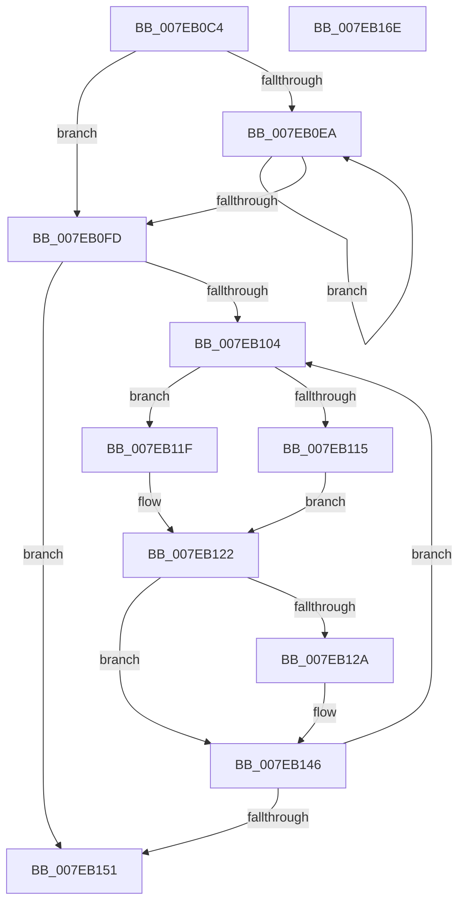

# CmpRehashKcbSubtree

- RVA: `0x007EB0C4`–`0x007EB16F` (길이 `171` bytes)
- VA: `0x00000001407EB0C4`
- 실행 섹션: `PAGE`
- PDB 이름 있음: `예`; PDB Function 태그: `아니요`
- unwind 정보 RVA: `0x0005E6B4`
- 디코드: `54`개 명령, `171/171` bytes 표시
- 미해석 바이트: `0` (있으면 어셈블리에 `.byte`로 보존)

> 이 문서는 커널 이미지의 기계어와 PDB 기호를 분석해 생성했습니다. 4번과 5번은 함수 원형과 자료형을 바이너리 사용 방식에서 추정한 C 해석이며 원본 소스 복구 결과는 아닙니다.

## 1. Dependencies

- 직접 호출 지점: **2**; 고유 호출 대상: **2**
- 직접 호출자로 확인된 함수: **1**
- RIP 상대 이미지 참조: **0**

### Outgoing calls
- `0x007EB131` → [CmpRemoveKeyHash](../9B/CmpRemoveKeyHash_function_009B31D8.md) (function, `0x009B31D8`)
- `0x007EB13F` → [CmpInsertKeyHash](CmpInsertKeyHash_function_007EAE68.md) (function, `0x007EAE68`)

### Direct callers
- [CmpSearchAndRehashWorker](CmpSearchAndRehashWorker_function_007EB1A0.md) at `0x007EB1AF`

### Static image references
- 디코드된 RIP-relative 메모리 참조가 없습니다.

## 2. Other-region calls and transfers

- 다른 실행 섹션으로 향하는 call: **0**
- 별도 외부 분기/꼬리 이동을 확인하지 못했습니다.

## 3. Assembly (complete function range)

```asm
007EB0C4  48 8B C4                        mov rax, rsp
007EB0C7  48 89 58 08                     mov qword ptr [rax + 8], rbx
007EB0CB  48 89 68 10                     mov qword ptr [rax + 0x10], rbp
007EB0CF  48 89 70 18                     mov qword ptr [rax + 0x18], rsi
007EB0D3  48 89 78 20                     mov qword ptr [rax + 0x20], rdi
007EB0D7  41 56                           push r14
007EB0D9  48 83 EC 20                     sub rsp, 0x20
007EB0DD  33 FF                           xor edi, edi
007EB0DF  4C 8B F2                        mov r14, rdx
007EB0E2  4C 8B C2                        mov r8, rdx
007EB0E5  48 85 C9                        test rcx, rcx
007EB0E8  74 13                           je 0x1407eb0fd
007EB0EA  49 8B 40 48                     mov rax, qword ptr [r8 + 0x48]
007EB0EE  49 89 78 48                     mov qword ptr [r8 + 0x48], rdi
007EB0F2  49 8B F8                        mov rdi, r8
007EB0F5  4C 8B C0                        mov r8, rax
007EB0F8  48 3B F9                        cmp rdi, rcx
007EB0FB  75 ED                           jne 0x1407eb0ea
007EB0FD  32 C9                           xor cl, cl
007EB0FF  48 85 FF                        test rdi, rdi
007EB102  74 4D                           je 0x1407eb151
007EB104  48 8B 6F 48                     mov rbp, qword ptr [rdi + 0x48]
007EB108  48 8B 47 50                     mov rax, qword ptr [rdi + 0x50]
007EB10C  4C 89 47 48                     mov qword ptr [rdi + 0x48], r8
007EB110  4D 85 C0                        test r8, r8
007EB113  74 0A                           je 0x1407eb11f
007EB115  41 6B 58 10 25                  imul ebx, dword ptr [r8 + 0x10], 0x25
007EB11A  03 58 08                        add ebx, dword ptr [rax + 8]
007EB11D  EB 03                           jmp 0x1407eb122
007EB11F  8B 58 08                        mov ebx, dword ptr [rax + 8]
007EB122  48 8D 77 10                     lea rsi, [rdi + 0x10]
007EB126  3B 1E                           cmp ebx, dword ptr [rsi]
007EB128  74 1C                           je 0x1407eb146
007EB12A  49 8B 4E 20                     mov rcx, qword ptr [r14 + 0x20]
007EB12E  48 8B D6                        mov rdx, rsi
007EB131  E8 A2 80 1C 00                  call 0x1409b31d8
007EB136  89 1E                           mov dword ptr [rsi], ebx
007EB138  48 8B D6                        mov rdx, rsi
007EB13B  49 8B 4E 20                     mov rcx, qword ptr [r14 + 0x20]
007EB13F  E8 24 FD FF FF                  call 0x1407eae68
007EB144  B1 01                           mov cl, 1
007EB146  4C 8B C7                        mov r8, rdi
007EB149  48 8B FD                        mov rdi, rbp
007EB14C  48 85 ED                        test rbp, rbp
007EB14F  75 B3                           jne 0x1407eb104
007EB151  48 8B 5C 24 30                  mov rbx, qword ptr [rsp + 0x30]
007EB156  8A C1                           mov al, cl
007EB158  48 8B 6C 24 38                  mov rbp, qword ptr [rsp + 0x38]
007EB15D  48 8B 74 24 40                  mov rsi, qword ptr [rsp + 0x40]
007EB162  48 8B 7C 24 48                  mov rdi, qword ptr [rsp + 0x48]
007EB167  48 83 C4 20                     add rsp, 0x20
007EB16B  41 5E                           pop r14
007EB16D  C3                              ret
007EB16E  CC                              int3
```

## 4. C-style interpretation (structured pseudocode)

```c
__int64 __fastcall CmpRehashKcbSubtree(__int64 a1, __int64 a2)
{
    __int64 result;
    __int64 v_rbx;
    __int64 v_rdi;
    __int64 v_rsp;
    unsigned __int64 v_stack_p10;
    unsigned __int64 v_stack_p18;
    unsigned __int64 v_stack_p20;
    unsigned __int64 v_stack_p8;

    *(unsigned __int64 *)(v_rsp + 8) = v_rbx;
    *(unsigned __int64 *)(v_rsp + 16) = v_rbp;
    *(unsigned __int64 *)(v_rsp + 24) = v_rsi;
    *(unsigned __int64 *)(v_rsp + 32) = v_rdi;
    v_rsp = (v_rsp) - (32);
    v_rdi = 0;
    if (a1 == 0) goto loc_007EB0FD;
loc_007EB0EA:
    *(unsigned __int64 *)(a2 + 72) = 0;
    if (a2 != a1) goto loc_007EB0EA;
loc_007EB0FD:
    a1 = 0;
    if (a2 == 0) goto loc_007EB151;
loc_007EB104:
    *(unsigned __int64 *)(a2 + 72) = *(unsigned __int64 *)(a2 + 72);
    if (*(unsigned __int64 *)(a2 + 72) == 0) goto loc_007EB11F;
    v_rbx = (unsigned int)((v_rbx) * (*(unsigned int *)(*(unsigned __int64 *)(a2 + 72) + 16)));
    v_rbx = (unsigned int)((v_rbx) + (*(unsigned int *)(*(unsigned __int64 *)(a2 + 80) + 8)));
    goto loc_007EB122;
loc_007EB11F:
loc_007EB122:
    result = *(unsigned __int64 *)(a2 + 80);
    if (((unsigned int)((unsigned int)(*(unsigned int *)(*(unsigned __int64 *)(a2 + 80) + 8)))) != (*(unsigned int *)(a2 + 16))) {
        a1 = *(unsigned __int64 *)(a2 + 32);
        a2 = a2 + 16;
        result = CmpRemoveKeyHash(a1, a2, *(unsigned __int64 *)(a2 + 72), a4);
        *(unsigned int *)(a2 + 16) = (unsigned int)((unsigned int)(*(unsigned int *)(*(unsigned __int64 *)(a2 + 80) + 8)));
        a2 = a2 + 16;
        a1 = *(unsigned __int64 *)(a2 + 32);
        result = CmpInsertKeyHash(a1, a2, *(unsigned __int64 *)(a2 + 72), a4);
        a1 = 1;
    }
    if (*(unsigned __int64 *)(a2 + 72) != 0) goto loc_007EB104;
loc_007EB151:
    v_rsp = (v_rsp) + (32);
    return (unsigned __int8)(a1);
}
```

## 5. (Beta) C Style

```c
int64_t CmpRehashKcbSubtree(int64_t Arg1, void *Arg2)
{
    uint8_t *arg2 = (uint8_t *)Arg2;

    int64_t result;
    int64_t local_rbx;
    int64_t local_rdi;
    int64_t local_rsp;
    uint64_t v_stack_p10;
    uint64_t v_stack_p18;
    uint64_t v_stack_p20;
    uint64_t v_stack_p8;

    *(uint64_t *)(local_rsp + 0x8) = local_rbx;
    *(uint64_t *)(local_rsp + 0x10) = local_rbp;
    *(uint64_t *)(local_rsp + 0x18) = local_rsi;
    *(uint64_t *)(local_rsp + 0x20) = local_rdi;
    local_rsp = (local_rsp) - (32);
    local_rdi = 0;
    if (Arg1 == 0) goto loc_007EB0FD;
loc_007EB0EA:
    *(uint64_t *)(arg2 + 0x48) = 0;
    if (Arg2 != Arg1) goto loc_007EB0EA;
loc_007EB0FD:
    Arg1 = 0;
    if (Arg2 == NULL) goto loc_007EB151;
loc_007EB104:
    *(uint64_t *)(arg2 + 0x48) = *(uint64_t *)(arg2 + 0x48);
    if (*(uint64_t *)(arg2 + 0x48) == 0) goto loc_007EB11F;
    local_rbx = (uint32_t)((local_rbx) * (*(uint32_t *)(*(uint64_t *)(arg2 + 0x48) + 0x10)));
    local_rbx = (uint32_t)((local_rbx) + (*(uint32_t *)(*(uint64_t *)(arg2 + 0x50) + 0x8)));
    goto loc_007EB122;
loc_007EB11F:
loc_007EB122:
    result = *(uint64_t *)(arg2 + 0x50);
    if (((uint32_t)((uint32_t)(*(uint32_t *)(*(uint64_t *)(arg2 + 0x50) + 0x8)))) != (*(uint32_t *)(arg2 + 0x10))) {
        Arg1 = *(uint64_t *)(arg2 + 0x20);
        Arg2 = Arg2 + 16;
        result = CmpRemoveKeyHash(Arg1, Arg2, *(uint64_t *)(arg2 + 0x48), a4);
        *(uint32_t *)(arg2 + 0x10) = (uint32_t)((uint32_t)(*(uint32_t *)(*(uint64_t *)(arg2 + 0x50) + 0x8)));
        Arg2 = Arg2 + 16;
        Arg1 = *(uint64_t *)(arg2 + 0x20);
        result = CmpInsertKeyHash(Arg1, Arg2, *(uint64_t *)(arg2 + 0x48), a4);
        Arg1 = 1;
    }
    if (*(uint64_t *)(arg2 + 0x48) != 0) goto loc_007EB104;
loc_007EB151:
    local_rsp = (local_rsp) + (32);
    return (uint8_t)(Arg1);
}
```

### 관측된 메모리 오프셋

구조체 형식이 확인되지 않은 접근은 인자 기준의 오프셋으로만 기록했습니다.

| 기준 인자 | 오프셋 표현 | 폭 (bit) | 접근 |
|---|---:|---:|---|
| `Arg2` | `+ 0x20` | `64` | `R` |

## 6. Execution-region graph

[열기: 2D/3D 그래프와 함수 탐색 컨트롤 패널](../../../control-panel.html?section=page&rva=0x007EB0C4&view=graph)

- 2D 그래프는 위에서 아래로 흐르고, 3D 그래프는 빈 공간을 드래그해 회전합니다. Shift+드래그는 이동, 휠은 확대·축소, 함수 노드 선택은 대상 보고서 이동입니다.

### Static fallback


