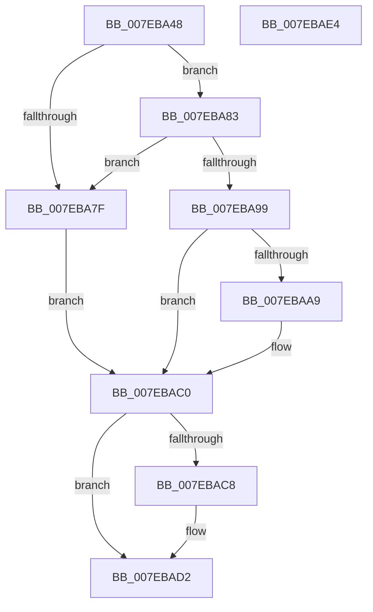

# CmpReparseToVirtualPath

- RVA: `0x007EBA48`–`0x007EBAE5` (길이 `157` bytes)
- VA: `0x00000001407EBA48`
- 실행 섹션: `PAGE`
- PDB 이름 있음: `예`; PDB Function 태그: `아니요`
- unwind 정보 RVA: `0x000733E4`
- 디코드: `46`개 명령, `157/157` bytes 표시
- 미해석 바이트: `0` (있으면 어셈블리에 `.byte`로 보존)

> 이 문서는 커널 이미지의 기계어와 PDB 기호를 분석해 생성했습니다. 4번과 5번은 함수 원형과 자료형을 바이너리 사용 방식에서 추정한 C 해석이며 원본 소스 복구 결과는 아닙니다.

## 1. Dependencies

- 직접 호출 지점: **5**; 고유 호출 대상: **4**
- 직접 호출자로 확인된 함수: **4**
- RIP 상대 이미지 참조: **0**

### Outgoing calls
- `0x007EBA6E` → [RtlInitUnicodeString](../../text/42/RtlInitUnicodeString_function_0042A780.md) (function, `0x0042A780`)
- `0x007EBA90` → [CmRealKCBToVirtualPath](../99/CmRealKCBToVirtualPath_function_00990130.md) (function, `0x00990130`)
- `0x007EBA9E` → [CmpVirtualPathPresent](CmpVirtualPathPresent_function_007EBDB4.md) (function, `0x007EBDB4`)
- `0x007EBAB9` → [RtlInitUnicodeString](../../text/42/RtlInitUnicodeString_function_0042A780.md) (function, `0x0042A780`)
- `0x007EBACD` → [RtlFreeAnsiString](../9C/RtlFreeAnsiString_function_009C0800.md) (function, `0x009C0800`)

### Direct callers
- [CmKeyBodyReplicateToVirtual](../84/CmKeyBodyReplicateToVirtual_function_00843FE4.md) at `0x0084412D`
- [CmKeyBodyReplicateToVirtual](../84/CmKeyBodyReplicateToVirtual_function_00843FE4.md) at `0x008441F9`
- [sub_008B4D32](../8B/Unknown_function_008B4D32.md) at `0x008B4D9F`
- [CmKeyBodyRemapToVirtual](../AC/CmKeyBodyRemapToVirtual_function_00AC9494.md) at `0x00AC95C9`
- [sub_00B37F04](../B3/Unknown_function_00B37F04.md) at `0x00B37F0E`

### Static image references
- 디코드된 RIP-relative 메모리 참조가 없습니다.

## 2. Other-region calls and transfers

- 다른 실행 섹션으로 향하는 call: **2**
  - `0x007EBA6E` → [RtlInitUnicodeString](../../text/42/RtlInitUnicodeString_function_0042A780.md) (`PAGE` → `.text`)
  - `0x007EBAB9` → [RtlInitUnicodeString](../../text/42/RtlInitUnicodeString_function_0042A780.md) (`PAGE` → `.text`)
- 별도 외부 분기/꼬리 이동을 확인하지 못했습니다.

## 3. Assembly (complete function range)

```asm
007EBA48  48 8B C4                        mov rax, rsp
007EBA4B  48 89 58 08                     mov qword ptr [rax + 8], rbx
007EBA4F  48 89 70 10                     mov qword ptr [rax + 0x10], rsi
007EBA53  57                              push rdi
007EBA54  48 83 EC 30                     sub rsp, 0x30
007EBA58  48 8B D9                        mov rbx, rcx
007EBA5B  0F 57 C0                        xorps xmm0, xmm0
007EBA5E  48 8D 48 E8                     lea rcx, [rax - 0x18]
007EBA62  33 D2                           xor edx, edx
007EBA64  0F 11 40 E8                     movups xmmword ptr [rax - 0x18], xmm0
007EBA68  49 8B F9                        mov rdi, r9
007EBA6B  49 8B F0                        mov rsi, r8
007EBA6E  E8 0D ED C3 FF                  call 0x14042a780
007EBA73  F7 83 B8 00 00 00 00 00 80 00   test dword ptr [rbx + 0xb8], 0x800000
007EBA7D  75 04                           jne 0x1407eba83
007EBA7F  32 DB                           xor bl, bl
007EBA81  EB 3D                           jmp 0x1407ebac0
007EBA83  4C 8D 4C 24 20                  lea r9, [rsp + 0x20]
007EBA88  4C 8B C6                        mov r8, rsi
007EBA8B  33 D2                           xor edx, edx
007EBA8D  48 8B CB                        mov rcx, rbx
007EBA90  E8 9B 46 1A 00                  call 0x140990130
007EBA95  85 C0                           test eax, eax
007EBA97  78 E6                           js 0x1407eba7f
007EBA99  48 8D 4C 24 20                  lea rcx, [rsp + 0x20]
007EBA9E  E8 11 03 00 00                  call 0x1407ebdb4
007EBAA3  8A D8                           mov bl, al
007EBAA5  84 C0                           test al, al
007EBAA7  74 17                           je 0x1407ebac0
007EBAA9  0F 10 44 24 20                  movups xmm0, xmmword ptr [rsp + 0x20]
007EBAAE  33 D2                           xor edx, edx
007EBAB0  48 8D 4C 24 20                  lea rcx, [rsp + 0x20]
007EBAB5  F3 0F 7F 07                     movdqu xmmword ptr [rdi], xmm0
007EBAB9  E8 C2 EC C3 FF                  call 0x14042a780
007EBABE  B3 01                           mov bl, 1
007EBAC0  48 83 7C 24 28 00               cmp qword ptr [rsp + 0x28], 0
007EBAC6  74 0A                           je 0x1407ebad2
007EBAC8  48 8D 4C 24 20                  lea rcx, [rsp + 0x20]
007EBACD  E8 2E 4D 1D 00                  call 0x1409c0800
007EBAD2  48 8B 74 24 48                  mov rsi, qword ptr [rsp + 0x48]
007EBAD7  8A C3                           mov al, bl
007EBAD9  48 8B 5C 24 40                  mov rbx, qword ptr [rsp + 0x40]
007EBADE  48 83 C4 30                     add rsp, 0x30
007EBAE2  5F                              pop rdi
007EBAE3  C3                              ret
007EBAE4  CC                              int3
```

## 4. C-style interpretation (structured pseudocode)

```c
__int64 __fastcall CmpReparseToVirtualPath(__int64 a1, int a2, __int64 a3, __int64 a4)
{
    __int64 result;
    __int64 v_rbx;
    __int64 v_rsp;
    unsigned __int64 v_stack_m10;
    unsigned __int64 v_stack_m18;
    unsigned __int64 v_stack_p10;
    unsigned __int64 v_stack_p8;

    *(unsigned __int64 *)(v_rsp + 8) = v_rbx;
    *(unsigned __int64 *)(v_rsp + 16) = v_rsi;
    v_rsp = (v_rsp) - (48);
    a2 = 0;
    *(unsigned __int64 *)(v_rsp - 24) = v_xmm0;
    result = RtlInitUnicodeString(v_rsp - 24, a2, a3, a4);
    if (((*(unsigned int *)(a1 + 184)) & (0x800000ULL)) != 0) goto loc_007EBA83;
loc_007EBA7F:
    v_rbx = 0;
    goto loc_007EBAC0;
loc_007EBA83:
    a2 = 0;
    result = CmRealKCBToVirtualPath(0, a2, a3, v_stack_m18);
    if (sign_flag) goto loc_007EBA7F;
    result = CmpVirtualPathPresent(v_stack_m18, a2, a3, v_stack_m18);
    v_rbx = (unsigned __int8)(result);
    if ((unsigned __int8)(result) != 0) {
        a2 = 0;
        a1 = v_stack_m18;
        *(unsigned __int64 *)(a4) = v_xmm0;
        result = RtlInitUnicodeString(a1, a2, a3, v_stack_m18);
        v_rbx = 1;
    }
    if (v_stack_m10 != 0) {
        a1 = v_stack_m18;
        result = RtlFreeAnsiString(a1, a2, a3, v_stack_m18);
    }
    v_rsp = (v_rsp) + (48);
    return (unsigned __int8)(v_rbx);
}
```

## 5. (Beta) C Style

```c
int64_t CmpReparseToVirtualPath(void *Arg1, int32_t Arg2, int64_t Arg3, void *Arg4)
{
    uint8_t *arg1 = (uint8_t *)Arg1;
    uint8_t *arg4 = (uint8_t *)Arg4;

    int64_t result;
    int64_t local_rbx;
    int64_t local_rsp;
    uint64_t v_stack_m10;
    uint64_t v_stack_m18;
    uint64_t v_stack_p10;
    uint64_t v_stack_p8;

    *(uint64_t *)(local_rsp + 0x8) = local_rbx;
    *(uint64_t *)(local_rsp + 0x10) = local_rsi;
    local_rsp = (local_rsp) - (48);
    Arg2 = 0;
    *(uint64_t *)(local_rsp - 0x18) = v_xmm0;
    result = RtlInitUnicodeString(local_rsp - 24, Arg2, Arg3, Arg4);
    if (((*(uint32_t *)(arg1 + 0xB8)) & (0x800000ULL)) != 0) goto loc_007EBA83;
loc_007EBA7F:
    local_rbx = 0;
    goto loc_007EBAC0;
loc_007EBA83:
    Arg2 = 0;
    result = CmRealKCBToVirtualPath(0, Arg2, Arg3, v_stack_m18);
    if (sign_flag) goto loc_007EBA7F;
    result = CmpVirtualPathPresent(v_stack_m18, Arg2, Arg3, v_stack_m18);
    local_rbx = (uint8_t)(result);
    if ((uint8_t)(result) != 0) {
        Arg2 = 0;
        Arg1 = v_stack_m18;
        *(uint64_t *)(arg4) = v_xmm0;
        result = RtlInitUnicodeString(Arg1, Arg2, Arg3, v_stack_m18);
        local_rbx = 1;
    }
    if (v_stack_m10 != 0) {
        Arg1 = v_stack_m18;
        result = RtlFreeAnsiString(Arg1, Arg2, Arg3, v_stack_m18);
    }
    local_rsp = (local_rsp) + (48);
    return (uint8_t)(local_rbx);
}
```

### 관측된 메모리 오프셋

구조체 형식이 확인되지 않은 접근은 인자 기준의 오프셋으로만 기록했습니다.

| 기준 인자 | 오프셋 표현 | 폭 (bit) | 접근 |
|---|---:|---:|---|
| `Arg1` | `+ 0xB8` | `32` | `R` |
| `Arg4` | `+ 0x0` | `128` | `W` |

## 6. Execution-region graph

[열기: 2D/3D 그래프와 함수 탐색 컨트롤 패널](../../../control-panel.html?section=page&rva=0x007EBA48&view=graph)

- 2D 그래프는 위에서 아래로 흐르고, 3D 그래프는 빈 공간을 드래그해 회전합니다. Shift+드래그는 이동, 휠은 확대·축소, 함수 노드 선택은 대상 보고서 이동입니다.

### Static fallback


