# CmpReplicateKeyToVirtual

- RVA: `0x007EBAEC`–`0x007EBD44` (길이 `600` bytes)
- VA: `0x00000001407EBAEC`
- 실행 섹션: `PAGE`
- PDB 이름 있음: `예`; PDB Function 태그: `아니요`
- unwind 정보 RVA: `0x000BE45C`
- 디코드: `173`개 명령, `600/600` bytes 표시
- 미해석 바이트: `0` (있으면 어셈블리에 `.byte`로 보존)

> 이 문서는 커널 이미지의 기계어와 PDB 기호를 분석해 생성했습니다. 4번과 5번은 함수 원형과 자료형을 바이너리 사용 방식에서 추정한 C 해석이며 원본 소스 복구 결과는 아닙니다.

## 1. Dependencies

- 직접 호출 지점: **17**; 고유 호출 대상: **15**
- 직접 호출자로 확인된 함수: **2**
- RIP 상대 이미지 참조: **4**

### Outgoing calls
- `0x007EBB4B` → [EtwGetKernelTraceTimestamp](../../text/39/EtwGetKernelTraceTimestamp_function_0039FC50.md) (function, `0x0039FC50`)
- `0x007EBB65` → [RtlInitUnicodeString](../../text/42/RtlInitUnicodeString_function_0042A780.md) (function, `0x0042A780`)
- `0x007EBB8A` → [ExTryConvertSharedToExclusiveLite](../../text/65/ExTryConvertSharedToExclusiveLite_function_00658DDC.md) (function, `0x00658DDC`)
- `0x007EBBA3` → [CmpUnlockKcb](../../pagecmrc/BC/CmpUnlockKcb_function_00BC92C0.md) (function, `0x00BC92C0`)
- `0x007EBBB4` → [CmRealKCBToVirtualPath](../99/CmRealKCBToVirtualPath_function_00990130.md) (function, `0x00990130`)
- `0x007EBBE9` → [guard_dispatch_icall](../../text/6B/guard_dispatch_icall_function_006BAAD0.md) (function, `0x006BAAD0`)
- `0x007EBC02` → [CmpBuildVirtualReplicationStack](CmpBuildVirtualReplicationStack_function_007EB1F0.md) (function, `0x007EB1F0`)
- `0x007EBC36` → [CmpGetVirtualStoreRoot](CmpGetVirtualStoreRoot_function_007EB974.md) (function, `0x007EB974`)
- `0x007EBC64` → [CmpDoBuildVirtualStack](CmpDoBuildVirtualStack_function_007EB4C4.md) (function, `0x007EB4C4`)
- `0x007EBC88` → [CmpDereferenceKeyControlBlock](../85/CmpDereferenceKeyControlBlock_function_00851310.md) (function, `0x00851310`)
- `0x007EBC9E` → [CmpDereferenceKeyControlBlock](../85/CmpDereferenceKeyControlBlock_function_00851310.md) (function, `0x00851310`)
- `0x007EBCB7` → [ExFreePoolWithTag](../../poolcode/B8/ExFreePoolWithTag_function_00B82870.md) (function, `0x00B82870`)
- `0x007EBCC1` → [CmpLockKcbExclusive](../86/CmpLockKcbExclusive_function_00861EB0.md) (function, `0x00861EB0`)
- `0x007EBCDB` → [ExConvertExclusiveToSharedLite](../../text/34/ExConvertExclusiveToSharedLite_function_0034F700.md) (function, `0x0034F700`)
- `0x007EBD06` → [guard_dispatch_icall](../../text/6B/guard_dispatch_icall_function_006BAAD0.md) (function, `0x006BAAD0`)
- `0x007EBD15` → [RtlFreeAnsiString](../9C/RtlFreeAnsiString_function_009C0800.md) (function, `0x009C0800`)
- `0x007EBD23` → [_security_check_cookie](../../text/6A/_security_check_cookie_function_006AC640.md) (function, `0x006AC640`)

### Direct callers
- [CmKeyBodyReplicateToVirtual](../84/CmKeyBodyReplicateToVirtual_function_00843FE4.md) at `0x00844183`
- [sub_00B37F04](../B3/Unknown_function_00B37F04.md) at `0x00B37FC6`

### Static image references
- `0x007EBB08` → RVA `0x00E0A740` (`.data`; read)
- `0x007EBB1B` → RVA `0x00FD8008` (`PAGEDATA`; read)
- `0x007EBB82` → RVA `0x00EF7108` (`.data`; read)
- `0x007EBCD4` → RVA `0x00EF7110` (`.data`; read)

## 2. Other-region calls and transfers

- 다른 실행 섹션으로 향하는 call: **9**
  - `0x007EBB4B` → [EtwGetKernelTraceTimestamp](../../text/39/EtwGetKernelTraceTimestamp_function_0039FC50.md) (`PAGE` → `.text`)
  - `0x007EBB65` → [RtlInitUnicodeString](../../text/42/RtlInitUnicodeString_function_0042A780.md) (`PAGE` → `.text`)
  - `0x007EBB8A` → [ExTryConvertSharedToExclusiveLite](../../text/65/ExTryConvertSharedToExclusiveLite_function_00658DDC.md) (`PAGE` → `.text`)
  - `0x007EBBA3` → [CmpUnlockKcb](../../pagecmrc/BC/CmpUnlockKcb_function_00BC92C0.md) (`PAGE` → `PAGECMRC`)
  - `0x007EBBE9` → [guard_dispatch_icall](../../text/6B/guard_dispatch_icall_function_006BAAD0.md) (`PAGE` → `.text`)
  - `0x007EBCB7` → [ExFreePoolWithTag](../../poolcode/B8/ExFreePoolWithTag_function_00B82870.md) (`PAGE` → `POOLCODE`)
  - `0x007EBCDB` → [ExConvertExclusiveToSharedLite](../../text/34/ExConvertExclusiveToSharedLite_function_0034F700.md) (`PAGE` → `.text`)
  - `0x007EBD06` → [guard_dispatch_icall](../../text/6B/guard_dispatch_icall_function_006BAAD0.md) (`PAGE` → `.text`)
  - `0x007EBD23` → [_security_check_cookie](../../text/6A/_security_check_cookie_function_006AC640.md) (`PAGE` → `.text`)
- 별도 외부 분기/꼬리 이동을 확인하지 못했습니다.

## 3. Assembly (complete function range)

```asm
007EBAEC  48 89 5C 24 18                  mov qword ptr [rsp + 0x18], rbx
007EBAF1  55                              push rbp
007EBAF2  56                              push rsi
007EBAF3  57                              push rdi
007EBAF4  41 54                           push r12
007EBAF6  41 55                           push r13
007EBAF8  41 56                           push r14
007EBAFA  41 57                           push r15
007EBAFC  48 8D 6C 24 D9                  lea rbp, [rsp - 0x27]
007EBB01  48 81 EC A0 00 00 00            sub rsp, 0xa0
007EBB08  48 8B 05 31 EC 61 00            mov rax, qword ptr [rip + 0x61ec31]
007EBB0F  48 33 C4                        xor rax, rsp
007EBB12  48 89 45 1F                     mov qword ptr [rbp + 0x1f], rax
007EBB16  33 F6                           xor esi, esi
007EBB18  0F 57 C0                        xorps xmm0, xmm0
007EBB1B  48 39 35 E6 C4 7E 00            cmp qword ptr [rip + 0x7ec4e6], rsi
007EBB22  4D 8B E1                        mov r12, r9
007EBB25  41 8A D8                        mov bl, r8b
007EBB28  89 75 CF                        mov dword ptr [rbp - 0x31], esi
007EBB2B  4C 8B F2                        mov r14, rdx
007EBB2E  4C 8B F9                        mov r15, rcx
007EBB31  0F 11 45 D7                     movups xmmword ptr [rbp - 0x29], xmm0
007EBB35  44 8B EE                        mov r13d, esi
007EBB38  0F 11 45 FF                     movups xmmword ptr [rbp - 1], xmm0
007EBB3C  0F 11 45 0F                     movups xmmword ptr [rbp + 0xf], xmm0
007EBB40  74 0E                           je 0x1407ebb50
007EBB42  BA 00 00 02 00                  mov edx, 0x20000
007EBB47  48 8D 4D FF                     lea rcx, [rbp - 1]
007EBB4B  E8 00 41 BB FF                  call 0x14039fc50
007EBB50  33 D2                           xor edx, edx
007EBB52  48 89 75 EF                     mov qword ptr [rbp - 0x11], rsi
007EBB56  48 8D 4D D7                     lea rcx, [rbp - 0x29]
007EBB5A  48 89 75 E7                     mov qword ptr [rbp - 0x19], rsi
007EBB5E  89 75 CB                        mov dword ptr [rbp - 0x35], esi
007EBB61  40 88 75 C7                     mov byte ptr [rbp - 0x39], sil
007EBB65  E8 16 EC C3 FF                  call 0x14042a780
007EBB6A  48 39 35 97 C4 7E 00            cmp qword ptr [rip + 0x7ec497], rsi
007EBB71  48 89 75 F7                     mov qword ptr [rbp - 9], rsi
007EBB75  74 07                           je 0x1407ebb7e
007EBB77  4D 85 FF                        test r15, r15
007EBB7A  4D 0F 45 EF                     cmovne r13, r15
007EBB7E  84 DB                           test bl, bl
007EBB80  75 1E                           jne 0x1407ebba0
007EBB82  39 35 80 B5 70 00               cmp dword ptr [rip + 0x70b580], esi
007EBB88  75 0C                           jne 0x1407ebb96
007EBB8A  E8 4D D2 E6 FF                  call 0x140658ddc
007EBB8F  88 45 C7                        mov byte ptr [rbp - 0x39], al
007EBB92  84 C0                           test al, al
007EBB94  75 0A                           jne 0x1407ebba0
007EBB96  BB 55 00 00 C0                  mov ebx, 0xc0000055
007EBB9B  E9 40 01 00 00                  jmp 0x1407ebce0
007EBBA0  49 8B CF                        mov rcx, r15
007EBBA3  E8 18 D7 3D 00                  call 0x140bc92c0
007EBBA8  4C 8D 4D D7                     lea r9, [rbp - 0x29]
007EBBAC  4D 8B C6                        mov r8, r14
007EBBAF  33 D2                           xor edx, edx
007EBBB1  49 8B CF                        mov rcx, r15
007EBBB4  E8 77 45 1A 00                  call 0x140990130
007EBBB9  8B D8                           mov ebx, eax
007EBBBB  85 C0                           test eax, eax
007EBBBD  79 34                           jns 0x1407ebbf3
007EBBBF  48 8B 05 42 C4 7E 00            mov rax, qword ptr [rip + 0x7ec442]
007EBBC6  48 85 C0                        test rax, rax
007EBBC9  0F 84 4B 01 00 00               je 0x1407ebd1a
007EBBCF  48 8D 4D D7                     lea rcx, [rbp - 0x29]
007EBBD3  45 33 C9                        xor r9d, r9d
007EBBD6  48 89 4C 24 28                  mov qword ptr [rsp + 0x28], rcx
007EBBDB  48 8D 55 FF                     lea rdx, [rbp - 1]
007EBBDF  B1 1A                           mov cl, 0x1a
007EBBE1  4C 89 6C 24 20                  mov qword ptr [rsp + 0x20], r13
007EBBE6  44 8B C3                        mov r8d, ebx
007EBBE9  E8 E2 EE EC FF                  call 0x1406baad0
007EBBEE  E9 27 01 00 00                  jmp 0x1407ebd1a
007EBBF3  4C 8D 4D E7                     lea r9, [rbp - 0x19]
007EBBF7  49 8B CF                        mov rcx, r15
007EBBFA  4C 8D 45 CB                     lea r8, [rbp - 0x35]
007EBBFE  48 8D 55 D7                     lea rdx, [rbp - 0x29]
007EBC02  E8 E9 F5 FF FF                  call 0x1407eb1f0
007EBC07  85 C0                           test eax, eax
007EBC09  79 0A                           jns 0x1407ebc15
007EBC0B  BB 9A 00 00 C0                  mov ebx, 0xc000009a
007EBC10  E9 A9 00 00 00                  jmp 0x1407ebcbe
007EBC15  8B 7D CB                        mov edi, dword ptr [rbp - 0x35]
007EBC18  48 8B 75 E7                     mov rsi, qword ptr [rbp - 0x19]
007EBC1C  85 FF                           test edi, edi
007EBC1E  75 07                           jne 0x1407ebc27
007EBC20  BB 0D 00 00 C0                  mov ebx, 0xc000000d
007EBC25  EB 44                           jmp 0x1407ebc6b
007EBC27  4C 8D 4D F7                     lea r9, [rbp - 9]
007EBC2B  49 8B CE                        mov rcx, r14
007EBC2E  4C 8D 45 CF                     lea r8, [rbp - 0x31]
007EBC32  48 8D 55 EF                     lea rdx, [rbp - 0x11]
007EBC36  E8 39 FD FF FF                  call 0x1407eb974
007EBC3B  8B D8                           mov ebx, eax
007EBC3D  85 C0                           test eax, eax
007EBC3F  78 2A                           js 0x1407ebc6b
007EBC41  48 8B 4D F7                     mov rcx, qword ptr [rbp - 9]
007EBC45  4D 8B CF                        mov r9, r15
007EBC48  4C 8B 45 EF                     mov r8, qword ptr [rbp - 0x11]
007EBC4C  8B D7                           mov edx, edi
007EBC4E  4D 89 04 24                     mov qword ptr [r12], r8
007EBC52  4C 89 74 24 20                  mov qword ptr [rsp + 0x20], r14
007EBC57  8B 41 28                        mov eax, dword ptr [rcx + 0x28]
007EBC5A  89 46 20                        mov dword ptr [rsi + 0x20], eax
007EBC5D  48 89 4E 10                     mov qword ptr [rsi + 0x10], rcx
007EBC61  48 8B CE                        mov rcx, rsi
007EBC64  E8 5B F8 FF FF                  call 0x1407eb4c4
007EBC69  8B D8                           mov ebx, eax
007EBC6B  48 85 F6                        test rsi, rsi
007EBC6E  74 4C                           je 0x1407ebcbc
007EBC70  45 33 F6                        xor r14d, r14d
007EBC73  85 FF                           test edi, edi
007EBC75  74 3B                           je 0x1407ebcb2
007EBC77  8D 47 FF                        lea eax, [rdi - 1]
007EBC7A  4C 8D 66 18                     lea r12, [rsi + 0x18]
007EBC7E  49 8B 4C 24 F8                  mov rcx, qword ptr [r12 - 8]
007EBC83  48 85 C9                        test rcx, rcx
007EBC86  74 08                           je 0x1407ebc90
007EBC88  E8 83 56 06 00                  call 0x140851310
007EBC8D  8D 47 FF                        lea eax, [rdi - 1]
007EBC90  44 3B F0                        cmp r14d, eax
007EBC93  75 11                           jne 0x1407ebca6
007EBC95  49 8B 0C 24                     mov rcx, qword ptr [r12]
007EBC99  48 85 C9                        test rcx, rcx
007EBC9C  74 08                           je 0x1407ebca6
007EBC9E  E8 6D 56 06 00                  call 0x140851310
007EBCA3  8D 47 FF                        lea eax, [rdi - 1]
007EBCA6  41 FF C6                        inc r14d
007EBCA9  49 83 C4 30                     add r12, 0x30
007EBCAD  44 3B F7                        cmp r14d, edi
007EBCB0  72 CC                           jb 0x1407ebc7e
007EBCB2  33 D2                           xor edx, edx
007EBCB4  48 8B CE                        mov rcx, rsi
007EBCB7  E8 B4 6B 39 00                  call 0x140b82870
007EBCBC  33 F6                           xor esi, esi
007EBCBE  49 8B CF                        mov rcx, r15
007EBCC1  E8 EA 61 07 00                  call 0x140861eb0
007EBCC6  40 38 75 C7                     cmp byte ptr [rbp - 0x39], sil
007EBCCA  74 14                           je 0x1407ebce0
007EBCCC  39 35 36 B4 70 00               cmp dword ptr [rip + 0x70b436], esi
007EBCD2  75 0C                           jne 0x1407ebce0
007EBCD4  48 8B 0D 35 B4 70 00            mov rcx, qword ptr [rip + 0x70b435]
007EBCDB  E8 20 3A B6 FF                  call 0x14034f700
007EBCE0  48 8B 05 21 C3 7E 00            mov rax, qword ptr [rip + 0x7ec321]
007EBCE7  48 85 C0                        test rax, rax
007EBCEA  74 1F                           je 0x1407ebd0b
007EBCEC  48 8D 4D D7                     lea rcx, [rbp - 0x29]
007EBCF0  45 33 C9                        xor r9d, r9d
007EBCF3  48 89 4C 24 28                  mov qword ptr [rsp + 0x28], rcx
007EBCF8  48 8D 55 FF                     lea rdx, [rbp - 1]
007EBCFC  B1 1A                           mov cl, 0x1a
007EBCFE  4C 89 6C 24 20                  mov qword ptr [rsp + 0x20], r13
007EBD03  44 8B C3                        mov r8d, ebx
007EBD06  E8 C5 ED EC FF                  call 0x1406baad0
007EBD0B  48 39 75 DF                     cmp qword ptr [rbp - 0x21], rsi
007EBD0F  74 09                           je 0x1407ebd1a
007EBD11  48 8D 4D D7                     lea rcx, [rbp - 0x29]
007EBD15  E8 E6 4A 1D 00                  call 0x1409c0800
007EBD1A  8B C3                           mov eax, ebx
007EBD1C  48 8B 4D 1F                     mov rcx, qword ptr [rbp + 0x1f]
007EBD20  48 33 CC                        xor rcx, rsp
007EBD23  E8 18 09 EC FF                  call 0x1406ac640
007EBD28  48 8B 9C 24 F0 00 00 00         mov rbx, qword ptr [rsp + 0xf0]
007EBD30  48 81 C4 A0 00 00 00            add rsp, 0xa0
007EBD37  41 5F                           pop r15
007EBD39  41 5E                           pop r14
007EBD3B  41 5D                           pop r13
007EBD3D  41 5C                           pop r12
007EBD3F  5F                              pop rdi
007EBD40  5E                              pop rsi
007EBD41  5D                              pop rbp
007EBD42  C3                              ret
007EBD43  CC                              int3
```

## 4. C-style interpretation (structured pseudocode)

```c
__int64 __fastcall CmpReplicateKeyToVirtual(__int64 a1, __int64 a2, unsigned __int8 a3, __int64 a4)
{
    __int64 result;
    __int64 v_r12;
    __int64 v_r13;
    __int64 v_r14;
    __int64 v_rbx;
    __int64 v_rsi;
    __int64 v_rsp;
    unsigned __int64 v_stack_m40;
    unsigned __int64 v_stack_m50;
    unsigned __int64 v_stack_m5F;
    unsigned __int64 v_stack_m60;
    unsigned __int64 v_stack_m68;
    unsigned __int64 v_stack_m70;
    unsigned __int64 v_stack_m78;
    unsigned __int64 v_stack_m80;
    unsigned __int64 v_stack_m88;
    unsigned int v_stack_m90;
    unsigned int v_stack_m94;
    unsigned __int8 v_stack_m98;
    unsigned __int64 v_stack_mB0;
    unsigned __int64 v_stack_mB8;
    unsigned __int64 v_stack_p18;

    v_stack_p18 = v_rbx;
    v_rsp = (v_rsp) - (160);
    result = (*(unsigned __int64 *)(v_rip + 6417457)) ^ (v_rsp);
    v_stack_m40 = result;
    v_rsi = 0;
    v_stack_m90 = 0;
    v_stack_m88 = v_xmm0;
    v_stack_m60 = v_xmm0;
    v_stack_m50 = v_xmm0;
    if ((*(unsigned __int64 *)(v_rip + 8307942)) != 0) {
        a2 = 0x20000ULL;
        a1 = v_stack_m60;
        result = EtwGetKernelTraceTimestamp(a1, a2, a3, a4);
    }
    a2 = 0;
    v_stack_m70 = 0;
    v_stack_m78 = 0;
    v_stack_m94 = 0;
    v_stack_m98 = 0;
    result = RtlInitUnicodeString(v_stack_m88, a2, a3, a4);
    v_stack_m68 = 0;
    v_r13 = 0;
    if ((*(unsigned __int64 *)(v_rip + 8307863)) != 0) {
        v_r13 = 0;
        if (a1 != 0) { v_r13 = a1; }
    }
    if (a3 != 0) goto loc_007EBBA0;
    if ((*(unsigned int *)(v_rip + 7386496)) != 0) goto loc_007EBB96;
    result = ExTryConvertSharedToExclusiveLite(v_stack_m88, a2, a3, a4);
    v_stack_m98 = (unsigned __int8)(result);
    if ((unsigned __int8)(result) != 0) goto loc_007EBBA0;
loc_007EBB96:
    goto loc_007EBCE0;
loc_007EBBA0:
    result = CmpUnlockKcb(a1, a2, a3, a4);
    a2 = 0;
    result = CmRealKCBToVirtualPath(a1, a2, 0, v_stack_m88);
    if (!sign_flag) goto loc_007EBBF3;
    if (*(unsigned __int64 *)(v_rip + 8307778) == 0) goto loc_007EBD1A;
    a4 = 0;
    v_stack_mB0 = v_stack_m88;
    v_stack_mB8 = v_r13;
    result = guard_dispatch_icall(26, v_stack_m60, (unsigned int)((unsigned int)((unsigned int)((unsigned int)(result)))), a4);
    goto loc_007EBD1A;
loc_007EBBF3:
    result = CmpBuildVirtualReplicationStack(a1, v_stack_m88, v_stack_m94, v_stack_m78);
    if (!sign_flag) goto loc_007EBC15;
    goto loc_007EBCBE;
loc_007EBC15:
    if ((unsigned int)((unsigned int)(v_stack_m94)) != 0) goto loc_007EBC27;
    goto loc_007EBC6B;
loc_007EBC27:
    result = CmpGetVirtualStoreRoot(0, v_stack_m70, v_stack_m90, v_stack_m68);
    v_rbx = (unsigned int)((unsigned int)(result));
    if (!(sign_flag)) {
        a1 = v_stack_m68;
        a4 = a1;
        a3 = v_stack_m70;
        a2 = (unsigned int)((unsigned int)(v_stack_m94));
        *(unsigned __int64 *)(a4) = a3;
        v_stack_mB8 = a2;
        result = *(unsigned int *)(a1 + 40);
        *(unsigned int *)(v_stack_m78 + 32) = (unsigned int)(result);
        *(unsigned __int64 *)(v_stack_m78 + 16) = a1;
        a1 = v_stack_m78;
        result = CmpDoBuildVirtualStack(a1, a2, a3, a4);
        v_rbx = (unsigned int)(result);
    }
    if (v_stack_m78 == 0) goto loc_007EBCBC;
    v_r14 = 0;
    if ((unsigned int)((unsigned int)(v_stack_m94)) == 0) goto loc_007EBCB2;
loc_007EBC7E:
    result = (unsigned int)(v_stack_m94) - 1;
    if (*(unsigned __int64 *)(v_stack_m78 + 24 - 8) != 0) {
        result = CmpDereferenceKeyControlBlock(*(unsigned __int64 *)(v_stack_m78 + 24 - 8), a2, a3, a4);
        result = (unsigned int)(v_stack_m94) - 1;
    }
    if (0 != ((unsigned int)(result))) goto loc_007EBCA6;
    if (*(unsigned __int64 *)(v_stack_m78 + 24) != 0) {
        result = CmpDereferenceKeyControlBlock(*(unsigned __int64 *)(v_stack_m78 + 24), a2, a3, a4);
        result = (unsigned int)(v_stack_m94) - 1;
    }
    v_r14 = (unsigned int)((v_r14) + 1);
    v_r12 = (v_stack_m78 + 24) + (48);
    if (((unsigned int)(v_r14)) < ((unsigned int)((unsigned int)(v_stack_m94)))) goto loc_007EBC7E;
loc_007EBCB2:
    a2 = 0;
    result = ExFreePoolWithTag(v_stack_m78, a2, a3, a4);
loc_007EBCBC:
    v_rsi = 0;
loc_007EBCBE:
    result = CmpLockKcbExclusive(a1, a2, a3, a4);
    if (v_stack_m98 == 0) goto loc_007EBCE0;
    if ((*(unsigned int *)(v_rip + 7386166)) == 0) {
        a1 = *(unsigned __int64 *)(v_rip + 7386165);
        result = ExConvertExclusiveToSharedLite(a1, a2, a3, a4);
    }
    result = *(unsigned __int64 *)(v_rip + 8307489);
    if (*(unsigned __int64 *)(v_rip + 8307489) != 0) {
        a1 = v_stack_m88;
        a4 = 0;
        v_stack_mB0 = a1;
        a2 = v_stack_m60;
        a1 = 26;
        v_stack_mB8 = v_r13;
        a3 = (unsigned int)(v_rbx);
        result = guard_dispatch_icall(a1, a2, a3, a4);
    }
    if (v_stack_m80 != 0) {
        a1 = v_stack_m88;
        result = RtlFreeAnsiString(a1, a2, a3, a4);
    }
    a1 = (v_stack_m40) ^ (v_rsp);
    result = _security_check_cookie(a1, a2, a3, a4);
    v_rsp = (v_rsp) + (160);
    return result;
}
```

## 5. (Beta) C Style

```c
int64_t CmpReplicateKeyToVirtual(int64_t Arg1, int64_t Arg2, uint8_t Arg3, void *Arg4)
{
    uint8_t *arg4 = (uint8_t *)Arg4;

    int64_t result;
    int64_t local_r12;
    int64_t local_r13;
    int64_t local_r14;
    int64_t local_rbx;
    int64_t local_rsi;
    int64_t local_rsp;
    uint64_t v_stack_m40;
    uint64_t v_stack_m50;
    uint64_t v_stack_m5F;
    uint64_t v_stack_m60;
    uint64_t v_stack_m68;
    uint64_t v_stack_m70;
    uint64_t v_stack_m78;
    uint64_t v_stack_m80;
    uint64_t v_stack_m88;
    uint32_t v_stack_m90;
    uint32_t v_stack_m94;
    uint8_t v_stack_m98;
    uint64_t v_stack_mB0;
    uint64_t v_stack_mB8;
    uint64_t v_stack_p18;

    v_stack_p18 = local_rbx;
    local_rsp = (local_rsp) - (160);
    result = (*(uint64_t *)(v_rip + 0x61EC31)) ^ (local_rsp);
    v_stack_m40 = result;
    local_rsi = 0;
    v_stack_m90 = 0;
    v_stack_m88 = v_xmm0;
    v_stack_m60 = v_xmm0;
    v_stack_m50 = v_xmm0;
    if ((*(uint64_t *)(v_rip + 0x7EC4E6)) != 0) {
        Arg2 = 0x20000ULL;
        Arg1 = v_stack_m60;
        result = EtwGetKernelTraceTimestamp(Arg1, Arg2, Arg3, Arg4);
    }
    Arg2 = 0;
    v_stack_m70 = 0;
    v_stack_m78 = 0;
    v_stack_m94 = 0;
    v_stack_m98 = 0;
    result = RtlInitUnicodeString(v_stack_m88, Arg2, Arg3, Arg4);
    v_stack_m68 = 0;
    local_r13 = 0;
    if ((*(uint64_t *)(v_rip + 0x7EC497)) != 0) {
        local_r13 = 0;
        if (Arg1 != 0) { local_r13 = Arg1; }
    }
    if (Arg3 != 0) goto loc_007EBBA0;
    if ((*(uint32_t *)(v_rip + 0x70B580)) != 0) goto loc_007EBB96;
    result = ExTryConvertSharedToExclusiveLite(v_stack_m88, Arg2, Arg3, Arg4);
    v_stack_m98 = (uint8_t)(result);
    if ((uint8_t)(result) != 0) goto loc_007EBBA0;
loc_007EBB96:
    goto loc_007EBCE0;
loc_007EBBA0:
    result = CmpUnlockKcb(Arg1, Arg2, Arg3, Arg4);
    Arg2 = 0;
    result = CmRealKCBToVirtualPath(Arg1, Arg2, 0, v_stack_m88);
    if (!sign_flag) goto loc_007EBBF3;
    if (*(uint64_t *)(v_rip + 0x7EC442) == 0) goto loc_007EBD1A;
    Arg4 = 0;
    v_stack_mB0 = v_stack_m88;
    v_stack_mB8 = local_r13;
    result = guard_dispatch_icall(26, v_stack_m60, (uint32_t)((uint32_t)((uint32_t)((uint32_t)(result)))), Arg4);
    goto loc_007EBD1A;
loc_007EBBF3:
    result = CmpBuildVirtualReplicationStack(Arg1, v_stack_m88, v_stack_m94, v_stack_m78);
    if (!sign_flag) goto loc_007EBC15;
    goto loc_007EBCBE;
loc_007EBC15:
    if ((uint32_t)((uint32_t)(v_stack_m94)) != 0) goto loc_007EBC27;
    goto loc_007EBC6B;
loc_007EBC27:
    result = CmpGetVirtualStoreRoot(0, v_stack_m70, v_stack_m90, v_stack_m68);
    local_rbx = (uint32_t)((uint32_t)(result));
    if (!(sign_flag)) {
        Arg1 = v_stack_m68;
        Arg4 = Arg1;
        Arg3 = v_stack_m70;
        Arg2 = (uint32_t)((uint32_t)(v_stack_m94));
        *(uint64_t *)(arg4) = Arg3;
        v_stack_mB8 = Arg2;
        result = *(uint32_t *)(Arg1 + 0x28);
        *(uint32_t *)(v_stack_m78 + 0x20) = (uint32_t)(result);
        *(uint64_t *)(v_stack_m78 + 0x10) = Arg1;
        Arg1 = v_stack_m78;
        result = CmpDoBuildVirtualStack(Arg1, Arg2, Arg3, Arg4);
        local_rbx = (uint32_t)(result);
    }
    if (v_stack_m78 == 0) goto loc_007EBCBC;
    local_r14 = 0;
    if ((uint32_t)((uint32_t)(v_stack_m94)) == 0) goto loc_007EBCB2;
loc_007EBC7E:
    result = (uint32_t)(v_stack_m94) - 1;
    if (*(uint64_t *)(v_stack_m78 + 0x18 - 0x8) != 0) {
        result = CmpDereferenceKeyControlBlock(*(uint64_t *)(v_stack_m78 + 0x18 - 0x8), Arg2, Arg3, Arg4);
        result = (uint32_t)(v_stack_m94) - 1;
    }
    if (0 != ((uint32_t)(result))) goto loc_007EBCA6;
    if (*(uint64_t *)(v_stack_m78 + 0x18) != 0) {
        result = CmpDereferenceKeyControlBlock(*(uint64_t *)(v_stack_m78 + 0x18), Arg2, Arg3, Arg4);
        result = (uint32_t)(v_stack_m94) - 1;
    }
    local_r14 = (uint32_t)((local_r14) + 1);
    local_r12 = (v_stack_m78 + 24) + (48);
    if (((uint32_t)(local_r14)) < ((uint32_t)((uint32_t)(v_stack_m94)))) goto loc_007EBC7E;
loc_007EBCB2:
    Arg2 = 0;
    result = ExFreePoolWithTag(v_stack_m78, Arg2, Arg3, Arg4);
loc_007EBCBC:
    local_rsi = 0;
loc_007EBCBE:
    result = CmpLockKcbExclusive(Arg1, Arg2, Arg3, Arg4);
    if (v_stack_m98 == 0) goto loc_007EBCE0;
    if ((*(uint32_t *)(v_rip + 0x70B436)) == 0) {
        Arg1 = *(uint64_t *)(v_rip + 0x70B435);
        result = ExConvertExclusiveToSharedLite(Arg1, Arg2, Arg3, Arg4);
    }
    result = *(uint64_t *)(v_rip + 0x7EC321);
    if (*(uint64_t *)(v_rip + 0x7EC321) != 0) {
        Arg1 = v_stack_m88;
        Arg4 = 0;
        v_stack_mB0 = Arg1;
        Arg2 = v_stack_m60;
        Arg1 = 26;
        v_stack_mB8 = local_r13;
        Arg3 = (uint32_t)(local_rbx);
        result = guard_dispatch_icall(Arg1, Arg2, Arg3, Arg4);
    }
    if (v_stack_m80 != 0) {
        Arg1 = v_stack_m88;
        result = RtlFreeAnsiString(Arg1, Arg2, Arg3, Arg4);
    }
    Arg1 = (v_stack_m40) ^ (local_rsp);
    result = _security_check_cookie(Arg1, Arg2, Arg3, Arg4);
    local_rsp = (local_rsp) + (160);
    return result;
}
```

### 관측된 메모리 오프셋

구조체 형식이 확인되지 않은 접근은 인자 기준의 오프셋으로만 기록했습니다.

| 기준 인자 | 오프셋 표현 | 폭 (bit) | 접근 |
|---|---:|---:|---|
| `Arg4` | `+ 0x0` | `64` | `W` |

## 6. Execution-region graph

[열기: 2D/3D 그래프와 함수 탐색 컨트롤 패널](../../../control-panel.html?section=page&rva=0x007EBAEC&view=graph)

- 2D 그래프는 위에서 아래로 흐르고, 3D 그래프는 빈 공간을 드래그해 회전합니다. Shift+드래그는 이동, 휠은 확대·축소, 함수 노드 선택은 대상 보고서 이동입니다.

### Static fallback

```mermaid
flowchart TD
  bb_007EBAEC[BB_007EBAEC]
  bb_007EBB42[BB_007EBB42]
  bb_007EBB50[BB_007EBB50]
  bb_007EBB77[BB_007EBB77]
  bb_007EBB7E[BB_007EBB7E]
  bb_007EBB82[BB_007EBB82]
  bb_007EBB8A[BB_007EBB8A]
  bb_007EBB96[BB_007EBB96]
  bb_007EBBA0[BB_007EBBA0]
  bb_007EBBBF[BB_007EBBBF]
  bb_007EBBCF[BB_007EBBCF]
  bb_007EBBF3[BB_007EBBF3]
  bb_007EBC0B[BB_007EBC0B]
  bb_007EBC15[BB_007EBC15]
  bb_007EBC20[BB_007EBC20]
  bb_007EBC27[BB_007EBC27]
  bb_007EBC41[BB_007EBC41]
  bb_007EBC6B[BB_007EBC6B]
  bb_007EBC70[BB_007EBC70]
  bb_007EBC77[BB_007EBC77]
  bb_007EBC7E[BB_007EBC7E]
  bb_007EBC88[BB_007EBC88]
  bb_007EBC90[BB_007EBC90]
  bb_007EBC95[BB_007EBC95]
  bb_007EBC9E[BB_007EBC9E]
  bb_007EBCA6[BB_007EBCA6]
  bb_007EBCB2[BB_007EBCB2]
  bb_007EBCBC[BB_007EBCBC]
  bb_007EBCBE[BB_007EBCBE]
  bb_007EBCCC[BB_007EBCCC]
  bb_007EBCD4[BB_007EBCD4]
  bb_007EBCE0[BB_007EBCE0]
  bb_007EBCEC[BB_007EBCEC]
  bb_007EBD0B[BB_007EBD0B]
  bb_007EBD11[BB_007EBD11]
  bb_007EBD1A[BB_007EBD1A]
  bb_007EBD43[BB_007EBD43]
  bb_007EBAEC -->|branch| bb_007EBB50
  bb_007EBAEC -->|fallthrough| bb_007EBB42
  bb_007EBB42 -->|flow| bb_007EBB50
  bb_007EBB50 -->|branch| bb_007EBB7E
  bb_007EBB50 -->|fallthrough| bb_007EBB77
  bb_007EBB77 -->|flow| bb_007EBB7E
  bb_007EBB7E -->|branch| bb_007EBBA0
  bb_007EBB7E -->|fallthrough| bb_007EBB82
  bb_007EBB82 -->|branch| bb_007EBB96
  bb_007EBB82 -->|fallthrough| bb_007EBB8A
  bb_007EBB8A -->|branch| bb_007EBBA0
  bb_007EBB8A -->|fallthrough| bb_007EBB96
  bb_007EBB96 -->|branch| bb_007EBCE0
  bb_007EBBA0 -->|branch| bb_007EBBF3
  bb_007EBBA0 -->|fallthrough| bb_007EBBBF
  bb_007EBBBF -->|branch| bb_007EBD1A
  bb_007EBBBF -->|fallthrough| bb_007EBBCF
  bb_007EBBCF -->|branch| bb_007EBD1A
  bb_007EBBF3 -->|branch| bb_007EBC15
  bb_007EBBF3 -->|fallthrough| bb_007EBC0B
  bb_007EBC0B -->|branch| bb_007EBCBE
  bb_007EBC15 -->|branch| bb_007EBC27
  bb_007EBC15 -->|fallthrough| bb_007EBC20
  bb_007EBC20 -->|branch| bb_007EBC6B
  bb_007EBC27 -->|branch| bb_007EBC6B
  bb_007EBC27 -->|fallthrough| bb_007EBC41
  bb_007EBC41 -->|flow| bb_007EBC6B
  bb_007EBC6B -->|branch| bb_007EBCBC
  bb_007EBC6B -->|fallthrough| bb_007EBC70
  bb_007EBC70 -->|branch| bb_007EBCB2
  bb_007EBC70 -->|fallthrough| bb_007EBC77
  bb_007EBC77 -->|flow| bb_007EBC7E
  bb_007EBC7E -->|branch| bb_007EBC90
  bb_007EBC7E -->|fallthrough| bb_007EBC88
  bb_007EBC88 -->|flow| bb_007EBC90
  bb_007EBC90 -->|branch| bb_007EBCA6
  bb_007EBC90 -->|fallthrough| bb_007EBC95
  bb_007EBC95 -->|branch| bb_007EBCA6
  bb_007EBC95 -->|fallthrough| bb_007EBC9E
  bb_007EBC9E -->|flow| bb_007EBCA6
  bb_007EBCA6 -->|branch| bb_007EBC7E
  bb_007EBCA6 -->|fallthrough| bb_007EBCB2
  bb_007EBCB2 -->|flow| bb_007EBCBC
  bb_007EBCBC -->|flow| bb_007EBCBE
  bb_007EBCBE -->|branch| bb_007EBCE0
  bb_007EBCBE -->|fallthrough| bb_007EBCCC
  bb_007EBCCC -->|branch| bb_007EBCE0
  bb_007EBCCC -->|fallthrough| bb_007EBCD4
  bb_007EBCD4 -->|flow| bb_007EBCE0
  bb_007EBCE0 -->|branch| bb_007EBD0B
  bb_007EBCE0 -->|fallthrough| bb_007EBCEC
  bb_007EBCEC -->|flow| bb_007EBD0B
  bb_007EBD0B -->|branch| bb_007EBD1A
  bb_007EBD0B -->|fallthrough| bb_007EBD11
  bb_007EBD11 -->|flow| bb_007EBD1A
```


