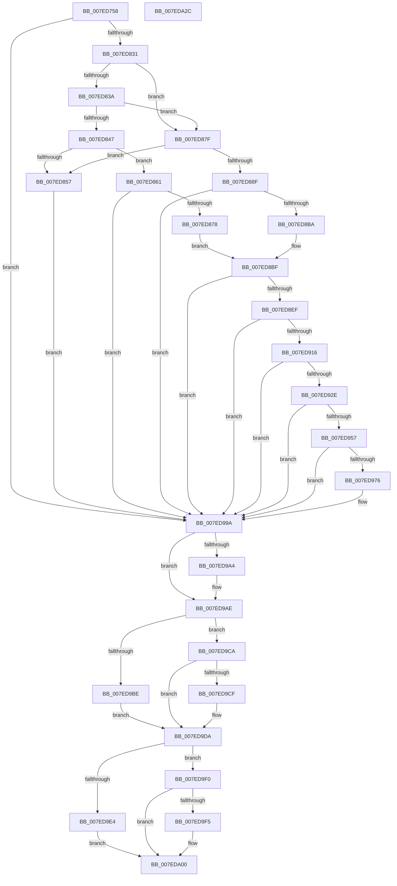

# CmpReportAuditVirtualizationEvent

- RVA: `0x007ED758`–`0x007EDA2D` (길이 `725` bytes)
- VA: `0x00000001407ED758`
- 실행 섹션: `PAGE`
- PDB 이름 있음: `예`; PDB Function 태그: `아니요`
- unwind 정보 RVA: `0x000D6F18`
- 디코드: `188`개 명령, `725/725` bytes 표시
- 미해석 바이트: `0` (있으면 어셈블리에 `.byte`로 보존)

> 이 문서는 커널 이미지의 기계어와 PDB 기호를 분석해 생성했습니다. 4번과 5번은 함수 원형과 자료형을 바이너리 사용 방식에서 추정한 C 해석이며 원본 소스 복구 결과는 아닙니다.

## 1. Dependencies

- 직접 호출 지점: **22**; 고유 호출 대상: **14**
- 직접 호출자로 확인된 함수: **2**
- RIP 상대 이미지 참조: **3**

### Outgoing calls
- `0x007ED79B` → [memset](../../text/6C/memset_function_006C6C40.md) (function, `0x006C6C40`)
- `0x007ED7CF` → [RtlInitUnicodeString](../../text/42/RtlInitUnicodeString_function_0042A780.md) (function, `0x0042A780`)
- `0x007ED7F6` → [CmpEffectiveTokenForSubject](../9C/CmpEffectiveTokenForSubject_function_009C40A0.md) (function, `0x009C40A0`)
- `0x007ED815` → [SeSetAuditParameter](../../text/44/SeSetAuditParameter_function_0044E850.md) (function, `0x0044E850`)
- `0x007ED84A` → [CmpConstructName](../85/CmpConstructName_function_00856BE0.md) (function, `0x00856BE0`)
- `0x007ED869` → [CmVirtualKCBToRealPath](../A7/CmVirtualKCBToRealPath_function_00A76BE8.md) (function, `0x00A76BE8`)
- `0x007ED882` → [CmpConstructName](../85/CmpConstructName_function_00856BE0.md) (function, `0x00856BE0`)
- `0x007ED896` → [RtlInitUnicodeString](../../text/42/RtlInitUnicodeString_function_0042A780.md) (function, `0x0042A780`)
- `0x007ED8AB` → [CmRealKCBToVirtualPath](../99/CmRealKCBToVirtualPath_function_00990130.md) (function, `0x00990130`)
- `0x007ED8D3` → [SeSetAuditParameter](../../text/44/SeSetAuditParameter_function_0044E850.md) (function, `0x0044E850`)
- `0x007ED8FA` → [SeSetAuditParameter](../../text/44/SeSetAuditParameter_function_0044E850.md) (function, `0x0044E850`)
- `0x007ED916` → [PsGetCurrentThreadProcess](../../text/47/PsGetCurrentThreadProcess_function_0047C7E0.md) (function, `0x0047C7E0`)
- `0x007ED923` → [PsGetAllocatedFullProcessImageNameEx](../91/PsGetAllocatedFullProcessImageNameEx_function_0091D6F0.md) (function, `0x0091D6F0`)
- `0x007ED93F` → [SeSetAuditParameter](../../text/44/SeSetAuditParameter_function_0044E850.md) (function, `0x0044E850`)
- `0x007ED966` → [SeSetAuditParameter](../../text/44/SeSetAuditParameter_function_0044E850.md) (function, `0x0044E850`)
- `0x007ED98D` → [SeReportSecurityEventWithSubCategory](../../text/22/SeReportSecurityEventWithSubCategory_function_002248B0.md) (function, `0x002248B0`)
- `0x007ED9A9` → [ExFreePoolWithTag](../../poolcode/B8/ExFreePoolWithTag_function_00B82870.md) (function, `0x00B82870`)
- `0x007ED9C3` → [RtlFreeAnsiString](../9C/RtlFreeAnsiString_function_009C0800.md) (function, `0x009C0800`)
- `0x007ED9D5` → [CmpFreePoolWithTag](../../text/44/CmpFreePoolWithTag_function_004489E0.md) (function, `0x004489E0`)
- `0x007ED9E9` → [RtlFreeAnsiString](../9C/RtlFreeAnsiString_function_009C0800.md) (function, `0x009C0800`)
- `0x007ED9FB` → [CmpFreePoolWithTag](../../text/44/CmpFreePoolWithTag_function_004489E0.md) (function, `0x004489E0`)
- `0x007EDA0C` → [_security_check_cookie](../../text/6A/_security_check_cookie_function_006AC640.md) (function, `0x006AC640`)

### Direct callers
- [CmKeyBodyReplicateToVirtual](../84/CmKeyBodyReplicateToVirtual_function_00843FE4.md) at `0x008441DF`
- [sub_00B37F04](../B3/Unknown_function_00B37F04.md) at `0x00B38007`

### Static image references
- `0x007ED777` → RVA `0x00E0A740` (`.data`; read)
- `0x007ED7A3` → RVA `0x00AFCD60` (` ?? ::NNGAKEGL::`string'`; read)
- `0x007ED831` → RVA `0x00E0ECA0` (`.data`; read)

## 2. Other-region calls and transfers

- 다른 실행 섹션으로 향하는 call: **14**
  - `0x007ED79B` → [memset](../../text/6C/memset_function_006C6C40.md) (`PAGE` → `.text`)
  - `0x007ED7CF` → [RtlInitUnicodeString](../../text/42/RtlInitUnicodeString_function_0042A780.md) (`PAGE` → `.text`)
  - `0x007ED815` → [SeSetAuditParameter](../../text/44/SeSetAuditParameter_function_0044E850.md) (`PAGE` → `.text`)
  - `0x007ED896` → [RtlInitUnicodeString](../../text/42/RtlInitUnicodeString_function_0042A780.md) (`PAGE` → `.text`)
  - `0x007ED8D3` → [SeSetAuditParameter](../../text/44/SeSetAuditParameter_function_0044E850.md) (`PAGE` → `.text`)
  - `0x007ED8FA` → [SeSetAuditParameter](../../text/44/SeSetAuditParameter_function_0044E850.md) (`PAGE` → `.text`)
  - `0x007ED916` → [PsGetCurrentThreadProcess](../../text/47/PsGetCurrentThreadProcess_function_0047C7E0.md) (`PAGE` → `.text`)
  - `0x007ED93F` → [SeSetAuditParameter](../../text/44/SeSetAuditParameter_function_0044E850.md) (`PAGE` → `.text`)
  - `0x007ED966` → [SeSetAuditParameter](../../text/44/SeSetAuditParameter_function_0044E850.md) (`PAGE` → `.text`)
  - `0x007ED98D` → [SeReportSecurityEventWithSubCategory](../../text/22/SeReportSecurityEventWithSubCategory_function_002248B0.md) (`PAGE` → `.text`)
  - `0x007ED9A9` → [ExFreePoolWithTag](../../poolcode/B8/ExFreePoolWithTag_function_00B82870.md) (`PAGE` → `POOLCODE`)
  - `0x007ED9D5` → [CmpFreePoolWithTag](../../text/44/CmpFreePoolWithTag_function_004489E0.md) (`PAGE` → `.text`)
  - `0x007ED9FB` → [CmpFreePoolWithTag](../../text/44/CmpFreePoolWithTag_function_004489E0.md) (`PAGE` → `.text`)
  - `0x007EDA0C` → [_security_check_cookie](../../text/6A/_security_check_cookie_function_006AC640.md) (`PAGE` → `.text`)
- 별도 외부 분기/꼬리 이동을 확인하지 못했습니다.

## 3. Assembly (complete function range)

```asm
007ED758  48 89 5C 24 18                  mov qword ptr [rsp + 0x18], rbx
007ED75D  55                              push rbp
007ED75E  56                              push rsi
007ED75F  57                              push rdi
007ED760  41 54                           push r12
007ED762  41 55                           push r13
007ED764  41 56                           push r14
007ED766  41 57                           push r15
007ED768  48 8D AC 24 60 FC FF FF         lea rbp, [rsp - 0x3a0]
007ED770  48 81 EC A0 04 00 00            sub rsp, 0x4a0
007ED777  48 8B 05 C2 CF 61 00            mov rax, qword ptr [rip + 0x61cfc2]
007ED77E  48 33 C4                        xor rax, rsp
007ED781  48 89 85 90 03 00 00            mov qword ptr [rbp + 0x390], rax
007ED788  4C 8B FA                        mov r15, rdx
007ED78B  4C 8B F1                        mov r14, rcx
007ED78E  33 D2                           xor edx, edx
007ED790  48 8D 4C 24 70                  lea rcx, [rsp + 0x70]
007ED795  41 B8 18 04 00 00               mov r8d, 0x418
007ED79B  E8 A0 94 ED FF                  call 0x1406c6c40
007ED7A0  0F 57 C0                        xorps xmm0, xmm0
007ED7A3  48 8D 15 B6 F5 30 00            lea rdx, [rip + 0x30f5b6]
007ED7AA  45 33 ED                        xor r13d, r13d
007ED7AD  48 8D 4C 24 60                  lea rcx, [rsp + 0x60]
007ED7B2  0F 57 C9                        xorps xmm1, xmm1
007ED7B5  4C 89 6C 24 40                  mov qword ptr [rsp + 0x40], r13
007ED7BA  0F 11 44 24 60                  movups xmmword ptr [rsp + 0x60], xmm0
007ED7BF  41 8B F5                        mov esi, r13d
007ED7C2  41 8B FD                        mov edi, r13d
007ED7C5  0F 11 4C 24 50                  movups xmmword ptr [rsp + 0x50], xmm1
007ED7CA  0F 11 44 24 30                  movups xmmword ptr [rsp + 0x30], xmm0
007ED7CF  E8 AC CF C3 FF                  call 0x14042a780
007ED7D4  41 8D 45 08                     lea eax, [r13 + 8]
007ED7D8  C7 44 24 74 AF 13 00 00         mov dword ptr [rsp + 0x74], 0x13af
007ED7E0  33 D2                           xor edx, edx
007ED7E2  66 89 45 82                     mov word ptr [rbp - 0x7e], ax
007ED7E6  49 8B CF                        mov rcx, r15
007ED7E9  C7 44 24 70 03 00 00 00         mov dword ptr [rsp + 0x70], 3
007ED7F1  44 89 6C 24 78                  mov dword ptr [rsp + 0x78], r13d
007ED7F6  E8 A5 68 1D 00                  call 0x1409c40a0
007ED7FB  4C 8D 4C 24 48                  lea r9, [rsp + 0x48]
007ED800  45 33 C0                        xor r8d, r8d
007ED803  41 8D 55 05                     lea edx, [r13 + 5]
007ED807  48 8B 48 18                     mov rcx, qword ptr [rax + 0x18]
007ED80B  48 89 4C 24 48                  mov qword ptr [rsp + 0x48], rcx
007ED810  48 8D 4C 24 70                  lea rcx, [rsp + 0x70]
007ED815  E8 36 10 C6 FF                  call 0x14044e850
007ED81A  44 8B 64 24 78                  mov r12d, dword ptr [rsp + 0x78]
007ED81F  8B D8                           mov ebx, eax
007ED821  41 FF C4                        inc r12d
007ED824  44 89 64 24 78                  mov dword ptr [rsp + 0x78], r12d
007ED829  85 C0                           test eax, eax
007ED82B  0F 88 69 01 00 00               js 0x1407ed99a
007ED831  44 38 2D 68 14 62 00            cmp byte ptr [rip + 0x621468], r13b
007ED838  74 45                           je 0x1407ed87f
007ED83A  41 F7 86 B8 00 00 00 00 00 00 01  test dword ptr [r14 + 0xb8], 0x1000000
007ED845  74 38                           je 0x1407ed87f
007ED847  49 8B CE                        mov rcx, r14
007ED84A  E8 91 93 06 00                  call 0x140856be0
007ED84F  48 8B F8                        mov rdi, rax
007ED852  48 85 C0                        test rax, rax
007ED855  75 0A                           jne 0x1407ed861
007ED857  BB 9A 00 00 C0                  mov ebx, 0xc000009a
007ED85C  E9 39 01 00 00                  jmp 0x1407ed99a
007ED861  48 8D 54 24 30                  lea rdx, [rsp + 0x30]
007ED866  49 8B CE                        mov rcx, r14
007ED869  E8 7A 93 28 00                  call 0x140a76be8
007ED86E  8B D8                           mov ebx, eax
007ED870  85 C0                           test eax, eax
007ED872  0F 88 22 01 00 00               js 0x1407ed99a
007ED878  48 8D 74 24 30                  lea rsi, [rsp + 0x30]
007ED87D  EB 40                           jmp 0x1407ed8bf
007ED87F  49 8B CE                        mov rcx, r14
007ED882  E8 59 93 06 00                  call 0x140856be0
007ED887  48 8B F0                        mov rsi, rax
007ED88A  48 85 C0                        test rax, rax
007ED88D  74 C8                           je 0x1407ed857
007ED88F  33 D2                           xor edx, edx
007ED891  48 8D 4C 24 50                  lea rcx, [rsp + 0x50]
007ED896  E8 E5 CE C3 FF                  call 0x14042a780
007ED89B  4C 8D 4C 24 30                  lea r9, [rsp + 0x30]
007ED8A0  4D 8B C7                        mov r8, r15
007ED8A3  48 8D 54 24 50                  lea rdx, [rsp + 0x50]
007ED8A8  49 8B CE                        mov rcx, r14
007ED8AB  E8 80 28 1A 00                  call 0x140990130
007ED8B0  8B D8                           mov ebx, eax
007ED8B2  85 C0                           test eax, eax
007ED8B4  0F 88 E0 00 00 00               js 0x1407ed99a
007ED8BA  48 8D 7C 24 30                  lea rdi, [rsp + 0x30]
007ED8BF  45 8B C4                        mov r8d, r12d
007ED8C2  48 8D 4C 24 70                  lea rcx, [rsp + 0x70]
007ED8C7  41 BC 01 00 00 00               mov r12d, 1
007ED8CD  4C 8B CE                        mov r9, rsi
007ED8D0  41 8B D4                        mov edx, r12d
007ED8D3  E8 78 0F C6 FF                  call 0x14044e850
007ED8D8  44 8B 44 24 78                  mov r8d, dword ptr [rsp + 0x78]
007ED8DD  8B D8                           mov ebx, eax
007ED8DF  41 FF C0                        inc r8d
007ED8E2  44 89 44 24 78                  mov dword ptr [rsp + 0x78], r8d
007ED8E7  85 C0                           test eax, eax
007ED8E9  0F 88 AB 00 00 00               js 0x1407ed99a
007ED8EF  4C 8B CF                        mov r9, rdi
007ED8F2  48 8D 4C 24 70                  lea rcx, [rsp + 0x70]
007ED8F7  41 8B D4                        mov edx, r12d
007ED8FA  E8 51 0F C6 FF                  call 0x14044e850
007ED8FF  44 8B 74 24 78                  mov r14d, dword ptr [rsp + 0x78]
007ED904  8B D8                           mov ebx, eax
007ED906  41 FF C6                        inc r14d
007ED909  44 89 74 24 78                  mov dword ptr [rsp + 0x78], r14d
007ED90E  85 C0                           test eax, eax
007ED910  0F 88 84 00 00 00               js 0x1407ed99a
007ED916  E8 C5 EE C8 FF                  call 0x14047c7e0
007ED91B  48 8D 54 24 40                  lea rdx, [rsp + 0x40]
007ED920  48 8B C8                        mov rcx, rax
007ED923  E8 C8 FD 12 00                  call 0x14091d6f0
007ED928  8B D8                           mov ebx, eax
007ED92A  85 C0                           test eax, eax
007ED92C  78 6C                           js 0x1407ed99a
007ED92E  4D 8B 4F 18                     mov r9, qword ptr [r15 + 0x18]
007ED932  41 8D 54 24 0A                  lea edx, [r12 + 0xa]
007ED937  45 8B C6                        mov r8d, r14d
007ED93A  48 8D 4C 24 70                  lea rcx, [rsp + 0x70]
007ED93F  E8 0C 0F C6 FF                  call 0x14044e850
007ED944  44 8B 44 24 78                  mov r8d, dword ptr [rsp + 0x78]
007ED949  8B D8                           mov ebx, eax
007ED94B  41 FF C0                        inc r8d
007ED94E  44 89 44 24 78                  mov dword ptr [rsp + 0x78], r8d
007ED953  85 C0                           test eax, eax
007ED955  78 43                           js 0x1407ed99a
007ED957  4C 8B 4C 24 40                  mov r9, qword ptr [rsp + 0x40]
007ED95C  41 8D 54 24 01                  lea edx, [r12 + 1]
007ED961  48 8D 4C 24 70                  lea rcx, [rsp + 0x70]
007ED966  E8 E5 0E C6 FF                  call 0x14044e850
007ED96B  44 01 64 24 78                  add dword ptr [rsp + 0x78], r12d
007ED970  8B D8                           mov ebx, eax
007ED972  85 C0                           test eax, eax
007ED974  78 24                           js 0x1407ed99a
007ED976  4C 8D 4C 24 70                  lea r9, [rsp + 0x70]
007ED97B  C7 44 24 20 76 00 00 00         mov dword ptr [rsp + 0x20], 0x76
007ED983  45 33 C0                        xor r8d, r8d
007ED986  48 8D 54 24 60                  lea rdx, [rsp + 0x60]
007ED98B  33 C9                           xor ecx, ecx
007ED98D  E8 1E 6F A3 FF                  call 0x1402248b0
007ED992  85 C0                           test eax, eax
007ED994  8B D8                           mov ebx, eax
007ED996  41 0F 49 DD                     cmovns ebx, r13d
007ED99A  48 8B 4C 24 40                  mov rcx, qword ptr [rsp + 0x40]
007ED99F  48 85 C9                        test rcx, rcx
007ED9A2  74 0A                           je 0x1407ed9ae
007ED9A4  BA 53 65 50 61                  mov edx, 0x61506553
007ED9A9  E8 C2 4E 39 00                  call 0x140b82870
007ED9AE  48 8D 44 24 30                  lea rax, [rsp + 0x30]
007ED9B3  41 BE 43 4D 4E 62               mov r14d, 0x624e4d43
007ED9B9  48 3B F0                        cmp rsi, rax
007ED9BC  75 0C                           jne 0x1407ed9ca
007ED9BE  48 8D 4C 24 30                  lea rcx, [rsp + 0x30]
007ED9C3  E8 38 2E 1D 00                  call 0x1409c0800
007ED9C8  EB 10                           jmp 0x1407ed9da
007ED9CA  48 85 F6                        test rsi, rsi
007ED9CD  74 0B                           je 0x1407ed9da
007ED9CF  41 8B D6                        mov edx, r14d
007ED9D2  48 8B CE                        mov rcx, rsi
007ED9D5  E8 06 B0 C5 FF                  call 0x1404489e0
007ED9DA  48 8D 44 24 30                  lea rax, [rsp + 0x30]
007ED9DF  48 3B F8                        cmp rdi, rax
007ED9E2  75 0C                           jne 0x1407ed9f0
007ED9E4  48 8D 4C 24 30                  lea rcx, [rsp + 0x30]
007ED9E9  E8 12 2E 1D 00                  call 0x1409c0800
007ED9EE  EB 10                           jmp 0x1407eda00
007ED9F0  48 85 FF                        test rdi, rdi
007ED9F3  74 0B                           je 0x1407eda00
007ED9F5  41 8B D6                        mov edx, r14d
007ED9F8  48 8B CF                        mov rcx, rdi
007ED9FB  E8 E0 AF C5 FF                  call 0x1404489e0
007EDA00  8B C3                           mov eax, ebx
007EDA02  48 8B 8D 90 03 00 00            mov rcx, qword ptr [rbp + 0x390]
007EDA09  48 33 CC                        xor rcx, rsp
007EDA0C  E8 2F EC EB FF                  call 0x1406ac640
007EDA11  48 8B 9C 24 F0 04 00 00         mov rbx, qword ptr [rsp + 0x4f0]
007EDA19  48 81 C4 A0 04 00 00            add rsp, 0x4a0
007EDA20  41 5F                           pop r15
007EDA22  41 5E                           pop r14
007EDA24  41 5D                           pop r13
007EDA26  41 5C                           pop r12
007EDA28  5F                              pop rdi
007EDA29  5E                              pop rsi
007EDA2A  5D                              pop rbp
007EDA2B  C3                              ret
007EDA2C  CC                              int3
```

## 4. C-style interpretation (structured pseudocode)

```c
__int64 __fastcall CmpReportAuditVirtualizationEvent(__int64 a1, __int64 a2)
{
    __int64 result;
    __int64 v_r12;
    __int64 v_r13;
    __int64 v_r14;
    __int64 v_rbx;
    __int64 v_rsp;
    unsigned __int64 v_stack_m3D8;
    unsigned __int16 v_stack_m456;
    unsigned int v_stack_m460;
    unsigned int v_stack_m464;
    unsigned __int64 v_stack_m468;
    unsigned __int64 v_stack_m478;
    unsigned __int64 v_stack_m48;
    unsigned __int64 v_stack_m488;
    unsigned __int64 v_stack_m490;
    unsigned __int64 v_stack_m498;
    unsigned __int64 v_stack_m4A8;
    unsigned int v_stack_m4B8;
    unsigned __int64 v_stack_p18;

    v_stack_p18 = v_rbx;
    v_rsp = (v_rsp) - (0x4A0ULL);
    result = (*(unsigned __int64 *)(v_rip + 6410178)) ^ (v_rsp);
    v_stack_m48 = result;
    a2 = 0;
    result = memset(v_stack_m468, a2, (unsigned int)(0x418ULL), a4);
    v_r13 = 0;
    v_stack_m498 = 0;
    v_stack_m478 = v_xmm0;
    v_stack_m488 = v_xmm1;
    v_stack_m4A8 = v_xmm0;
    result = RtlInitUnicodeString(v_stack_m478, v_rip + 3208630, (unsigned int)(0x418ULL), a4);
    v_stack_m464 = 0x13AFULL;
    a2 = 0;
    v_stack_m456 = (unsigned __int16)(v_r13 + 8);
    v_stack_m468 = 3;
    v_stack_m460 = 0;
    result = CmpEffectiveTokenForSubject(0, a2, (unsigned int)(0x418ULL), a4);
    a3 = 0;
    v_stack_m490 = *(unsigned __int64 *)(result + 24);
    result = SeSetAuditParameter(v_stack_m468, v_r13 + 5, a3, v_stack_m490);
    v_r12 = (unsigned int)(((unsigned int)(v_stack_m460)) + 1);
    v_stack_m460 = (unsigned int)(v_r12);
    if (sign_flag) goto loc_007ED99A;
    if ((*(unsigned __int8 *)(v_rip + 6427752)) == 0) goto loc_007ED87F;
    if (((*(unsigned int *)(a1 + 184)) & (0x1000000ULL)) == 0) goto loc_007ED87F;
    result = CmpConstructName(a1, v_r13 + 5, a3, v_stack_m490);
    if (result != 0) goto loc_007ED861;
loc_007ED857:
    goto loc_007ED99A;
loc_007ED861:
    result = CmVirtualKCBToRealPath(a1, v_stack_m4A8, a3, v_stack_m490);
    if (sign_flag) goto loc_007ED99A;
    goto loc_007ED8BF;
loc_007ED87F:
    result = CmpConstructName(a1, v_stack_m4A8, a3, v_stack_m490);
    if (result == 0) goto loc_007ED857;
    a2 = 0;
    result = RtlInitUnicodeString(v_stack_m488, a2, a3, v_stack_m490);
    result = CmRealKCBToVirtualPath(a1, v_stack_m488, 0, v_stack_m4A8);
    if (sign_flag) goto loc_007ED99A;
loc_007ED8BF:
    result = SeSetAuditParameter(v_stack_m468, 1, (unsigned int)((unsigned int)(v_r12)), result);
    a3 = (unsigned int)(((unsigned int)(v_stack_m460)) + 1);
    v_stack_m460 = (unsigned int)(a3);
    if (sign_flag) goto loc_007ED99A;
    result = SeSetAuditParameter(v_stack_m468, 1, a3, v_stack_m4A8);
    v_r14 = (unsigned int)(((unsigned int)(v_stack_m460)) + 1);
    v_stack_m460 = (unsigned int)(v_r14);
    if (sign_flag) goto loc_007ED99A;
    result = PsGetCurrentThreadProcess(v_stack_m468, 1, a3, v_stack_m4A8);
    result = PsGetAllocatedFullProcessImageNameEx(result, v_stack_m498, a3, v_stack_m4A8);
    if (sign_flag) goto loc_007ED99A;
    result = SeSetAuditParameter(v_stack_m468, 1 + 10, (unsigned int)((unsigned int)(v_r14)), *(unsigned __int64 *)(a2 + 24));
    a3 = (unsigned int)(((unsigned int)(v_stack_m460)) + 1);
    v_stack_m460 = (unsigned int)(a3);
    if (sign_flag) goto loc_007ED99A;
    result = SeSetAuditParameter(v_stack_m468, 1 + 1, a3, v_stack_m498);
    v_rbx = (unsigned int)((unsigned int)(result));
    if (!(sign_flag)) {
        a4 = v_stack_m468;
        v_stack_m4B8 = 118;
        a3 = 0;
        a2 = v_stack_m478;
        a1 = 0;
        result = SeReportSecurityEventWithSubCategory(a1, a2, a3, a4);
        v_rbx = (unsigned int)(result);
        if (!sign_flag) { v_rbx = 0; }
    }
    if (v_stack_m498 != 0) {
        a2 = 0x61506553ULL;
        result = ExFreePoolWithTag(v_stack_m498, a2, a3, a4);
    }
    if (result != v_stack_m4A8) goto loc_007ED9CA;
    result = RtlFreeAnsiString(v_stack_m4A8, a2, a3, a4);
    goto loc_007ED9DA;
loc_007ED9CA:
    if (result != 0) {
        a2 = (unsigned int)((unsigned int)(0x624E4D43ULL));
        a1 = result;
        result = CmpFreePoolWithTag(a1, a2, a3, a4);
    }
    if (v_stack_m4A8 != v_stack_m4A8) goto loc_007ED9F0;
    result = RtlFreeAnsiString(v_stack_m4A8, a2, a3, a4);
    goto loc_007EDA00;
loc_007ED9F0:
    if (v_stack_m4A8 != 0) {
        a2 = (unsigned int)((unsigned int)(0x624E4D43ULL));
        a1 = v_stack_m4A8;
        result = CmpFreePoolWithTag(a1, a2, a3, a4);
    }
    a1 = (v_stack_m48) ^ (v_rsp);
    result = _security_check_cookie(a1, a2, a3, a4);
    v_rsp = (v_rsp) + (0x4A0ULL);
    return result;
}
```

## 5. (Beta) C Style

```c
int64_t CmpReportAuditVirtualizationEvent(void *Arg1, void *Arg2)
{
    uint8_t *arg1 = (uint8_t *)Arg1;
    uint8_t *arg2 = (uint8_t *)Arg2;

    int64_t result;
    int64_t local_r12;
    int64_t local_r13;
    int64_t local_r14;
    int64_t local_rbx;
    int64_t local_rsp;
    uint64_t v_stack_m3D8;
    uint16_t v_stack_m456;
    uint32_t v_stack_m460;
    uint32_t v_stack_m464;
    uint64_t v_stack_m468;
    uint64_t v_stack_m478;
    uint64_t v_stack_m48;
    uint64_t v_stack_m488;
    uint64_t v_stack_m490;
    uint64_t v_stack_m498;
    uint64_t v_stack_m4A8;
    uint32_t v_stack_m4B8;
    uint64_t v_stack_p18;

    v_stack_p18 = local_rbx;
    local_rsp = (local_rsp) - (0x4A0ULL);
    result = (*(uint64_t *)(v_rip + 0x61CFC2)) ^ (local_rsp);
    v_stack_m48 = result;
    Arg2 = 0;
    result = memset(v_stack_m468, Arg2, (uint32_t)(0x418ULL), a4);
    local_r13 = 0;
    v_stack_m498 = 0;
    v_stack_m478 = v_xmm0;
    v_stack_m488 = v_xmm1;
    v_stack_m4A8 = v_xmm0;
    result = RtlInitUnicodeString(v_stack_m478, v_rip + 3208630, (uint32_t)(0x418ULL), a4);
    v_stack_m464 = 0x13AFULL;
    Arg2 = 0;
    v_stack_m456 = (uint16_t)(local_r13 + 8);
    v_stack_m468 = 3;
    v_stack_m460 = 0;
    result = CmpEffectiveTokenForSubject(0, Arg2, (uint32_t)(0x418ULL), a4);
    a3 = 0;
    v_stack_m490 = *(uint64_t *)(result + 0x18);
    result = SeSetAuditParameter(v_stack_m468, local_r13 + 5, a3, v_stack_m490);
    local_r12 = (uint32_t)(((uint32_t)(v_stack_m460)) + 1);
    v_stack_m460 = (uint32_t)(local_r12);
    if (sign_flag) goto loc_007ED99A;
    if ((*(uint8_t *)(v_rip + 0x621468)) == 0) goto loc_007ED87F;
    if (((*(uint32_t *)(arg1 + 0xB8)) & (0x1000000ULL)) == 0) goto loc_007ED87F;
    result = CmpConstructName(Arg1, local_r13 + 5, a3, v_stack_m490);
    if (result != 0) goto loc_007ED861;
loc_007ED857:
    goto loc_007ED99A;
loc_007ED861:
    result = CmVirtualKCBToRealPath(Arg1, v_stack_m4A8, a3, v_stack_m490);
    if (sign_flag) goto loc_007ED99A;
    goto loc_007ED8BF;
loc_007ED87F:
    result = CmpConstructName(Arg1, v_stack_m4A8, a3, v_stack_m490);
    if (result == 0) goto loc_007ED857;
    Arg2 = 0;
    result = RtlInitUnicodeString(v_stack_m488, Arg2, a3, v_stack_m490);
    result = CmRealKCBToVirtualPath(Arg1, v_stack_m488, 0, v_stack_m4A8);
    if (sign_flag) goto loc_007ED99A;
loc_007ED8BF:
    result = SeSetAuditParameter(v_stack_m468, 1, (uint32_t)((uint32_t)(local_r12)), result);
    a3 = (uint32_t)(((uint32_t)(v_stack_m460)) + 1);
    v_stack_m460 = (uint32_t)(a3);
    if (sign_flag) goto loc_007ED99A;
    result = SeSetAuditParameter(v_stack_m468, 1, a3, v_stack_m4A8);
    local_r14 = (uint32_t)(((uint32_t)(v_stack_m460)) + 1);
    v_stack_m460 = (uint32_t)(local_r14);
    if (sign_flag) goto loc_007ED99A;
    result = PsGetCurrentThreadProcess(v_stack_m468, 1, a3, v_stack_m4A8);
    result = PsGetAllocatedFullProcessImageNameEx(result, v_stack_m498, a3, v_stack_m4A8);
    if (sign_flag) goto loc_007ED99A;
    result = SeSetAuditParameter(v_stack_m468, 1 + 10, (uint32_t)((uint32_t)(local_r14)), *(uint64_t *)(arg2 + 0x18));
    a3 = (uint32_t)(((uint32_t)(v_stack_m460)) + 1);
    v_stack_m460 = (uint32_t)(a3);
    if (sign_flag) goto loc_007ED99A;
    result = SeSetAuditParameter(v_stack_m468, 1 + 1, a3, v_stack_m498);
    local_rbx = (uint32_t)((uint32_t)(result));
    if (!(sign_flag)) {
        a4 = v_stack_m468;
        v_stack_m4B8 = 118;
        a3 = 0;
        Arg2 = v_stack_m478;
        Arg1 = 0;
        result = SeReportSecurityEventWithSubCategory(Arg1, Arg2, a3, a4);
        local_rbx = (uint32_t)(result);
        if (!sign_flag) { local_rbx = 0; }
    }
    if (v_stack_m498 != 0) {
        Arg2 = 0x61506553ULL;
        result = ExFreePoolWithTag(v_stack_m498, Arg2, a3, a4);
    }
    if (result != v_stack_m4A8) goto loc_007ED9CA;
    result = RtlFreeAnsiString(v_stack_m4A8, Arg2, a3, a4);
    goto loc_007ED9DA;
loc_007ED9CA:
    if (result != 0) {
        Arg2 = (uint32_t)((uint32_t)(0x624E4D43ULL));
        Arg1 = result;
        result = CmpFreePoolWithTag(Arg1, Arg2, a3, a4);
    }
    if (v_stack_m4A8 != v_stack_m4A8) goto loc_007ED9F0;
    result = RtlFreeAnsiString(v_stack_m4A8, Arg2, a3, a4);
    goto loc_007EDA00;
loc_007ED9F0:
    if (v_stack_m4A8 != 0) {
        Arg2 = (uint32_t)((uint32_t)(0x624E4D43ULL));
        Arg1 = v_stack_m4A8;
        result = CmpFreePoolWithTag(Arg1, Arg2, a3, a4);
    }
    Arg1 = (v_stack_m48) ^ (local_rsp);
    result = _security_check_cookie(Arg1, Arg2, a3, a4);
    local_rsp = (local_rsp) + (0x4A0ULL);
    return result;
}
```

### 관측된 메모리 오프셋

구조체 형식이 확인되지 않은 접근은 인자 기준의 오프셋으로만 기록했습니다.

| 기준 인자 | 오프셋 표현 | 폭 (bit) | 접근 |
|---|---:|---:|---|
| `Arg1` | `+ 0xB8` | `32` | `R` |
| `Arg2` | `+ 0x18` | `64` | `R` |

## 6. Execution-region graph

[열기: 2D/3D 그래프와 함수 탐색 컨트롤 패널](../../../control-panel.html?section=page&rva=0x007ED758&view=graph)

- 2D 그래프는 위에서 아래로 흐르고, 3D 그래프는 빈 공간을 드래그해 회전합니다. Shift+드래그는 이동, 휠은 확대·축소, 함수 노드 선택은 대상 보고서 이동입니다.

### Static fallback


