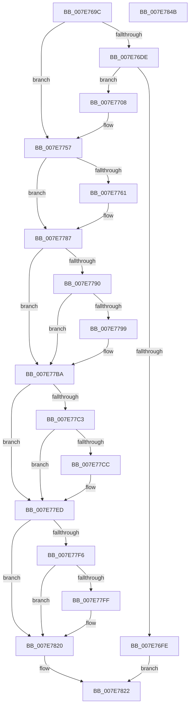

# CmpRestampVersion

- RVA: `0x007E769C`–`0x007E784C` (길이 `432` bytes)
- VA: `0x00000001407E769C`
- 실행 섹션: `PAGE`
- PDB 이름 있음: `예`; PDB Function 태그: `아니요`
- unwind 정보 RVA: `0x0006F718`
- 디코드: `108`개 명령, `432/432` bytes 표시
- 미해석 바이트: `0` (있으면 어셈블리에 `.byte`로 보존)

> 이 문서는 커널 이미지의 기계어와 PDB 기호를 분석해 생성했습니다. 4번과 5번은 함수 원형과 자료형을 바이너리 사용 방식에서 추정한 C 해석이며 원본 소스 복구 결과는 아닙니다.

## 1. Dependencies

- 직접 호출 지점: **8**; 고유 호출 대상: **3**
- 직접 호출자로 확인된 함수: **1**
- RIP 상대 이미지 참조: **9**

### Outgoing calls
- `0x007E76F4` → [swprintf_s](../../text/50/swprintf_s_function_00504B20.md) (function, `0x00504B20`)
- `0x007E772F` → [ZwSetValueKey](../../text/6A/ZwSetValueKey_function_006ADCD0.md) (function, `0x006ADCD0`)
- `0x007E7752` → [ZwSetValueKey](../../text/6A/ZwSetValueKey_function_006ADCD0.md) (function, `0x006ADCD0`)
- `0x007E7782` → [ZwSetValueKey](../../text/6A/ZwSetValueKey_function_006ADCD0.md) (function, `0x006ADCD0`)
- `0x007E77B5` → [ZwSetValueKey](../../text/6A/ZwSetValueKey_function_006ADCD0.md) (function, `0x006ADCD0`)
- `0x007E77E8` → [ZwSetValueKey](../../text/6A/ZwSetValueKey_function_006ADCD0.md) (function, `0x006ADCD0`)
- `0x007E781B` → [ZwSetValueKey](../../text/6A/ZwSetValueKey_function_006ADCD0.md) (function, `0x006ADCD0`)
- `0x007E782D` → [_security_check_cookie](../../text/6A/_security_check_cookie_function_006AC640.md) (function, `0x006AC640`)

### Direct callers
- [CmpSetVersionData](CmpSetVersionData_function_007E7854.md) at `0x007E7B62`

### Static image references
- `0x007E76B3` → RVA `0x00E0A740` (`.data`; read)
- `0x007E76C5` → RVA `0x00EF7238` (`.data`; read)
- `0x007E76E1` → RVA `0x00AFDAA0` (` ?? ::NNGAKEGL::`string'`; read)
- `0x007E770B` → RVA `0x00B4B460` (`CmpCurrentBuildNumberString`; read)
- `0x007E7748` → RVA `0x00B4B480` (`CmpCurrentBuildString`; read)
- `0x007E7770` → RVA `0x00B4B4A0` (`CmpUBRString`; read)
- `0x007E779C` → RVA `0x00B4B490` (`CmpBuildBranchString`; read)
- `0x007E77CF` → RVA `0x00B4B4C0` (`CmpBuildLabString`; read)
- `0x007E7802` → RVA `0x00B4B4B0` (`CmpBuildLabExString`; read)

## 2. Other-region calls and transfers

- 다른 실행 섹션으로 향하는 call: **8**
  - `0x007E76F4` → [swprintf_s](../../text/50/swprintf_s_function_00504B20.md) (`PAGE` → `.text`)
  - `0x007E772F` → [ZwSetValueKey](../../text/6A/ZwSetValueKey_function_006ADCD0.md) (`PAGE` → `.text`)
  - `0x007E7752` → [ZwSetValueKey](../../text/6A/ZwSetValueKey_function_006ADCD0.md) (`PAGE` → `.text`)
  - `0x007E7782` → [ZwSetValueKey](../../text/6A/ZwSetValueKey_function_006ADCD0.md) (`PAGE` → `.text`)
  - `0x007E77B5` → [ZwSetValueKey](../../text/6A/ZwSetValueKey_function_006ADCD0.md) (`PAGE` → `.text`)
  - `0x007E77E8` → [ZwSetValueKey](../../text/6A/ZwSetValueKey_function_006ADCD0.md) (`PAGE` → `.text`)
  - `0x007E781B` → [ZwSetValueKey](../../text/6A/ZwSetValueKey_function_006ADCD0.md) (`PAGE` → `.text`)
  - `0x007E782D` → [_security_check_cookie](../../text/6A/_security_check_cookie_function_006AC640.md) (`PAGE` → `.text`)
- 별도 외부 분기/꼬리 이동을 확인하지 못했습니다.

## 3. Assembly (complete function range)

```asm
007E769C  48 89 5C 24 10                  mov qword ptr [rsp + 0x10], rbx
007E76A1  48 89 6C 24 18                  mov qword ptr [rsp + 0x18], rbp
007E76A6  48 89 74 24 20                  mov qword ptr [rsp + 0x20], rsi
007E76AB  57                              push rdi
007E76AC  48 81 EC 40 01 00 00            sub rsp, 0x140
007E76B3  48 8B 05 86 30 62 00            mov rax, qword ptr [rip + 0x623086]
007E76BA  48 33 C4                        xor rax, rsp
007E76BD  48 89 84 24 30 01 00 00         mov qword ptr [rsp + 0x130], rax
007E76C5  48 8B 3D 6C FB 70 00            mov rdi, qword ptr [rip + 0x70fb6c]
007E76CC  48 8B F1                        mov rsi, rcx
007E76CF  BD 01 00 00 00                  mov ebp, 1
007E76D4  8B 87 20 03 00 00               mov eax, dword ptr [rdi + 0x320]
007E76DA  A8 20                           test al, 0x20
007E76DC  74 79                           je 0x1407e7757
007E76DE  8B 47 08                        mov eax, dword ptr [rdi + 8]
007E76E1  4C 8D 05 B8 63 31 00            lea r8, [rip + 0x3163b8]
007E76E8  44 0F B7 C8                     movzx r9d, ax
007E76EC  8D 55 7F                        lea edx, [rbp + 0x7f]
007E76EF  48 8D 4C 24 30                  lea rcx, [rsp + 0x30]
007E76F4  E8 27 D4 D1 FF                  call 0x140504b20
007E76F9  83 F8 FF                        cmp eax, -1
007E76FC  75 0A                           jne 0x1407e7708
007E76FE  B8 05 00 00 80                  mov eax, 0x80000005
007E7703  E9 1A 01 00 00                  jmp 0x1407e7822
007E7708  66 03 C0                        add ax, ax
007E770B  48 8D 15 4E 3D 36 00            lea rdx, [rip + 0x363d4e]
007E7712  0F B7 D8                        movzx ebx, ax
007E7715  44 8B CD                        mov r9d, ebp
007E7718  48 8D 44 24 30                  lea rax, [rsp + 0x30]
007E771D  83 C3 02                        add ebx, 2
007E7720  89 5C 24 28                     mov dword ptr [rsp + 0x28], ebx
007E7724  45 33 C0                        xor r8d, r8d
007E7727  48 8B CE                        mov rcx, rsi
007E772A  48 89 44 24 20                  mov qword ptr [rsp + 0x20], rax
007E772F  E8 9C 65 EC FF                  call 0x1406adcd0
007E7734  48 8D 44 24 30                  lea rax, [rsp + 0x30]
007E7739  89 5C 24 28                     mov dword ptr [rsp + 0x28], ebx
007E773D  44 8B CD                        mov r9d, ebp
007E7740  48 89 44 24 20                  mov qword ptr [rsp + 0x20], rax
007E7745  45 33 C0                        xor r8d, r8d
007E7748  48 8D 15 31 3D 36 00            lea rdx, [rip + 0x363d31]
007E774F  48 8B CE                        mov rcx, rsi
007E7752  E8 79 65 EC FF                  call 0x1406adcd0
007E7757  8B 87 20 03 00 00               mov eax, dword ptr [rdi + 0x320]
007E775D  A8 40                           test al, 0x40
007E775F  74 26                           je 0x1407e7787
007E7761  41 B9 04 00 00 00               mov r9d, 4
007E7767  48 8D 47 0C                     lea rax, [rdi + 0xc]
007E776B  44 89 4C 24 28                  mov dword ptr [rsp + 0x28], r9d
007E7770  48 8D 15 29 3D 36 00            lea rdx, [rip + 0x363d29]
007E7777  45 33 C0                        xor r8d, r8d
007E777A  48 89 44 24 20                  mov qword ptr [rsp + 0x20], rax
007E777F  48 8B CE                        mov rcx, rsi
007E7782  E8 49 65 EC FF                  call 0x1406adcd0
007E7787  48 8B 4F 48                     mov rcx, qword ptr [rdi + 0x48]
007E778B  48 85 C9                        test rcx, rcx
007E778E  74 2A                           je 0x1407e77ba
007E7790  0F B7 47 40                     movzx eax, word ptr [rdi + 0x40]
007E7794  66 85 C0                        test ax, ax
007E7797  74 21                           je 0x1407e77ba
007E7799  83 C0 02                        add eax, 2
007E779C  48 8D 15 ED 3C 36 00            lea rdx, [rip + 0x363ced]
007E77A3  89 44 24 28                     mov dword ptr [rsp + 0x28], eax
007E77A7  44 8B CD                        mov r9d, ebp
007E77AA  48 89 4C 24 20                  mov qword ptr [rsp + 0x20], rcx
007E77AF  45 33 C0                        xor r8d, r8d
007E77B2  48 8B CE                        mov rcx, rsi
007E77B5  E8 16 65 EC FF                  call 0x1406adcd0
007E77BA  48 8B 4F 58                     mov rcx, qword ptr [rdi + 0x58]
007E77BE  48 85 C9                        test rcx, rcx
007E77C1  74 2A                           je 0x1407e77ed
007E77C3  0F B7 47 50                     movzx eax, word ptr [rdi + 0x50]
007E77C7  66 85 C0                        test ax, ax
007E77CA  74 21                           je 0x1407e77ed
007E77CC  83 C0 02                        add eax, 2
007E77CF  48 8D 15 EA 3C 36 00            lea rdx, [rip + 0x363cea]
007E77D6  89 44 24 28                     mov dword ptr [rsp + 0x28], eax
007E77DA  44 8B CD                        mov r9d, ebp
007E77DD  48 89 4C 24 20                  mov qword ptr [rsp + 0x20], rcx
007E77E2  45 33 C0                        xor r8d, r8d
007E77E5  48 8B CE                        mov rcx, rsi
007E77E8  E8 E3 64 EC FF                  call 0x1406adcd0
007E77ED  48 8B 4F 68                     mov rcx, qword ptr [rdi + 0x68]
007E77F1  48 85 C9                        test rcx, rcx
007E77F4  74 2A                           je 0x1407e7820
007E77F6  0F B7 47 60                     movzx eax, word ptr [rdi + 0x60]
007E77FA  66 85 C0                        test ax, ax
007E77FD  74 21                           je 0x1407e7820
007E77FF  83 C0 02                        add eax, 2
007E7802  48 8D 15 A7 3C 36 00            lea rdx, [rip + 0x363ca7]
007E7809  89 44 24 28                     mov dword ptr [rsp + 0x28], eax
007E780D  44 8B CD                        mov r9d, ebp
007E7810  48 89 4C 24 20                  mov qword ptr [rsp + 0x20], rcx
007E7815  45 33 C0                        xor r8d, r8d
007E7818  48 8B CE                        mov rcx, rsi
007E781B  E8 B0 64 EC FF                  call 0x1406adcd0
007E7820  33 C0                           xor eax, eax
007E7822  48 8B 8C 24 30 01 00 00         mov rcx, qword ptr [rsp + 0x130]
007E782A  48 33 CC                        xor rcx, rsp
007E782D  E8 0E 4E EC FF                  call 0x1406ac640
007E7832  4C 8D 9C 24 40 01 00 00         lea r11, [rsp + 0x140]
007E783A  49 8B 5B 18                     mov rbx, qword ptr [r11 + 0x18]
007E783E  49 8B 6B 20                     mov rbp, qword ptr [r11 + 0x20]
007E7842  49 8B 73 28                     mov rsi, qword ptr [r11 + 0x28]
007E7846  49 8B E3                        mov rsp, r11
007E7849  5F                              pop rdi
007E784A  C3                              ret
007E784B  CC                              int3
```

## 4. C-style interpretation (structured pseudocode)

```c
__int64 __fastcall CmpRestampVersion(__int64 a1)
{
    __int64 result;
    __int64 v_rbx;
    __int64 v_rsp;
    unsigned __int64 v_stack_m118;
    unsigned int v_stack_m120;
    unsigned __int64 v_stack_m128;
    unsigned __int64 v_stack_m18;
    unsigned __int64 v_stack_m8;
    unsigned __int64 v_stack_p10;
    unsigned __int64 v_stack_p18;
    unsigned __int64 v_stack_p20;

    v_stack_p10 = v_rbx;
    v_stack_p18 = v_rbp;
    v_stack_p20 = v_rsi;
    v_rsp = (v_rsp) - (320);
    result = (*(unsigned __int64 *)(v_rip + 6434950)) ^ (v_rsp);
    v_stack_m18 = result;
    if ((((unsigned __int8)((unsigned int)(*(unsigned int *)(*(unsigned __int64 *)(v_rip + 7404396) + 800)))) & (32)) == 0) goto loc_007E7757;
    result = swprintf_s(v_stack_m118, 1 + 127, v_rip + 3236792, (unsigned __int16)((unsigned int)(*(unsigned int *)(*(unsigned __int64 *)(v_rip + 7404396) + 8))));
    if (((unsigned int)(result)) != -1) goto loc_007E7708;
    goto loc_007E7822;
loc_007E7708:
    result = (unsigned __int16)(((unsigned int)(0x80000005ULL)) + ((unsigned __int16)((unsigned int)(0x80000005ULL))));
    v_rbx = (unsigned int)(((unsigned __int16)(result)) + (2));
    v_stack_m120 = (unsigned int)(v_rbx);
    a3 = 0;
    v_stack_m128 = v_stack_m118;
    result = ZwSetValueKey(a1, v_rip + 3554638, a3, 1);
    v_stack_m120 = (unsigned int)(v_rbx);
    v_stack_m128 = v_stack_m118;
    a3 = 0;
    result = ZwSetValueKey(a1, v_rip + 3554609, a3, 1);
loc_007E7757:
    result = (unsigned int)(*(unsigned int *)(*(unsigned __int64 *)(v_rip + 7404396) + 800));
    if ((((unsigned __int8)((unsigned int)(*(unsigned int *)(*(unsigned __int64 *)(v_rip + 7404396) + 800)))) & (64)) != 0) {
        a4 = 4;
        result = *(unsigned __int64 *)(v_rip + 7404396) + 12;
        v_stack_m120 = (unsigned int)(a4);
        a2 = v_rip + 3554601;
        a3 = 0;
        v_stack_m128 = result;
        a1 = a1;
        result = ZwSetValueKey(a1, a2, a3, a4);
    }
    if (*(unsigned __int64 *)(*(unsigned __int64 *)(v_rip + 7404396) + 72) == 0) goto loc_007E77BA;
    result = *(unsigned __int16 *)(*(unsigned __int64 *)(v_rip + 7404396) + 64);
    if ((unsigned __int16)(*(unsigned __int16 *)(*(unsigned __int64 *)(v_rip + 7404396) + 64)) != 0) {
        result = (unsigned int)((*(unsigned __int16 *)(*(unsigned __int64 *)(v_rip + 7404396) + 64)) + (2));
        a2 = v_rip + 3554541;
        v_stack_m120 = (unsigned int)(result);
        a4 = 1;
        v_stack_m128 = *(unsigned __int64 *)(*(unsigned __int64 *)(v_rip + 7404396) + 72);
        a3 = 0;
        a1 = a1;
        result = ZwSetValueKey(a1, a2, a3, a4);
    }
    if (*(unsigned __int64 *)(*(unsigned __int64 *)(v_rip + 7404396) + 88) == 0) goto loc_007E77ED;
    result = *(unsigned __int16 *)(*(unsigned __int64 *)(v_rip + 7404396) + 80);
    if ((unsigned __int16)(*(unsigned __int16 *)(*(unsigned __int64 *)(v_rip + 7404396) + 80)) != 0) {
        result = (unsigned int)((*(unsigned __int16 *)(*(unsigned __int64 *)(v_rip + 7404396) + 80)) + (2));
        a2 = v_rip + 3554538;
        v_stack_m120 = (unsigned int)(result);
        a4 = 1;
        v_stack_m128 = *(unsigned __int64 *)(*(unsigned __int64 *)(v_rip + 7404396) + 88);
        a3 = 0;
        a1 = a1;
        result = ZwSetValueKey(a1, a2, a3, a4);
    }
    if (*(unsigned __int64 *)(*(unsigned __int64 *)(v_rip + 7404396) + 104) == 0) goto loc_007E7820;
    result = *(unsigned __int16 *)(*(unsigned __int64 *)(v_rip + 7404396) + 96);
    if ((unsigned __int16)(*(unsigned __int16 *)(*(unsigned __int64 *)(v_rip + 7404396) + 96)) != 0) {
        result = (unsigned int)((*(unsigned __int16 *)(*(unsigned __int64 *)(v_rip + 7404396) + 96)) + (2));
        a2 = v_rip + 3554471;
        v_stack_m120 = (unsigned int)(result);
        a4 = 1;
        v_stack_m128 = *(unsigned __int64 *)(*(unsigned __int64 *)(v_rip + 7404396) + 104);
        a3 = 0;
        a1 = a1;
        result = ZwSetValueKey(a1, a2, a3, a4);
    }
    result = 0;
loc_007E7822:
    a1 = (v_stack_m18) ^ (v_rsp);
    result = _security_check_cookie(a1, a2, a3, a4);
    return result;
}
```

## 5. (Beta) C Style

```c
int64_t CmpRestampVersion(int64_t Arg1)
{
    int64_t result;
    int64_t local_rbx;
    int64_t local_rsp;
    uint64_t v_stack_m118;
    uint32_t v_stack_m120;
    uint64_t v_stack_m128;
    uint64_t v_stack_m18;
    uint64_t v_stack_m8;
    uint64_t v_stack_p10;
    uint64_t v_stack_p18;
    uint64_t v_stack_p20;

    v_stack_p10 = local_rbx;
    v_stack_p18 = local_rbp;
    v_stack_p20 = local_rsi;
    local_rsp = (local_rsp) - (320);
    result = (*(uint64_t *)(v_rip + 0x623086)) ^ (local_rsp);
    v_stack_m18 = result;
    if ((((uint8_t)((uint32_t)(*(uint32_t *)(*(uint64_t *)(v_rip + 0x70FB6C) + 0x320)))) & (32)) == 0) goto loc_007E7757;
    result = swprintf_s(v_stack_m118, 1 + 127, v_rip + 3236792, (uint16_t)((uint32_t)(*(uint32_t *)(*(uint64_t *)(v_rip + 0x70FB6C) + 0x8))));
    if (((uint32_t)(result)) != -1) goto loc_007E7708;
    goto loc_007E7822;
loc_007E7708:
    result = (uint16_t)(((uint32_t)(0x80000005ULL)) + ((uint16_t)((uint32_t)(0x80000005ULL))));
    local_rbx = (uint32_t)(((uint16_t)(result)) + (2));
    v_stack_m120 = (uint32_t)(local_rbx);
    a3 = 0;
    v_stack_m128 = v_stack_m118;
    result = ZwSetValueKey(Arg1, v_rip + 3554638, a3, 1);
    v_stack_m120 = (uint32_t)(local_rbx);
    v_stack_m128 = v_stack_m118;
    a3 = 0;
    result = ZwSetValueKey(Arg1, v_rip + 3554609, a3, 1);
loc_007E7757:
    result = (uint32_t)(*(uint32_t *)(*(uint64_t *)(v_rip + 0x70FB6C) + 0x320));
    if ((((uint8_t)((uint32_t)(*(uint32_t *)(*(uint64_t *)(v_rip + 0x70FB6C) + 0x320)))) & (64)) != 0) {
        a4 = 4;
        result = *(uint64_t *)(v_rip + 0x70FB6C) + 12;
        v_stack_m120 = (uint32_t)(a4);
        a2 = v_rip + 3554601;
        a3 = 0;
        v_stack_m128 = result;
        Arg1 = Arg1;
        result = ZwSetValueKey(Arg1, a2, a3, a4);
    }
    if (*(uint64_t *)(*(uint64_t *)(v_rip + 0x70FB6C) + 0x48) == 0) goto loc_007E77BA;
    result = *(uint16_t *)(*(uint64_t *)(v_rip + 0x70FB6C) + 0x40);
    if ((uint16_t)(*(uint16_t *)(*(uint64_t *)(v_rip + 0x70FB6C) + 0x40)) != 0) {
        result = (uint32_t)((*(uint16_t *)(*(uint64_t *)(v_rip + 0x70FB6C) + 0x40)) + (2));
        a2 = v_rip + 3554541;
        v_stack_m120 = (uint32_t)(result);
        a4 = 1;
        v_stack_m128 = *(uint64_t *)(*(uint64_t *)(v_rip + 0x70FB6C) + 0x48);
        a3 = 0;
        Arg1 = Arg1;
        result = ZwSetValueKey(Arg1, a2, a3, a4);
    }
    if (*(uint64_t *)(*(uint64_t *)(v_rip + 0x70FB6C) + 0x58) == 0) goto loc_007E77ED;
    result = *(uint16_t *)(*(uint64_t *)(v_rip + 0x70FB6C) + 0x50);
    if ((uint16_t)(*(uint16_t *)(*(uint64_t *)(v_rip + 0x70FB6C) + 0x50)) != 0) {
        result = (uint32_t)((*(uint16_t *)(*(uint64_t *)(v_rip + 0x70FB6C) + 0x50)) + (2));
        a2 = v_rip + 3554538;
        v_stack_m120 = (uint32_t)(result);
        a4 = 1;
        v_stack_m128 = *(uint64_t *)(*(uint64_t *)(v_rip + 0x70FB6C) + 0x58);
        a3 = 0;
        Arg1 = Arg1;
        result = ZwSetValueKey(Arg1, a2, a3, a4);
    }
    if (*(uint64_t *)(*(uint64_t *)(v_rip + 0x70FB6C) + 0x68) == 0) goto loc_007E7820;
    result = *(uint16_t *)(*(uint64_t *)(v_rip + 0x70FB6C) + 0x60);
    if ((uint16_t)(*(uint16_t *)(*(uint64_t *)(v_rip + 0x70FB6C) + 0x60)) != 0) {
        result = (uint32_t)((*(uint16_t *)(*(uint64_t *)(v_rip + 0x70FB6C) + 0x60)) + (2));
        a2 = v_rip + 3554471;
        v_stack_m120 = (uint32_t)(result);
        a4 = 1;
        v_stack_m128 = *(uint64_t *)(*(uint64_t *)(v_rip + 0x70FB6C) + 0x68);
        a3 = 0;
        Arg1 = Arg1;
        result = ZwSetValueKey(Arg1, a2, a3, a4);
    }
    result = 0;
loc_007E7822:
    Arg1 = (v_stack_m18) ^ (local_rsp);
    result = _security_check_cookie(Arg1, a2, a3, a4);
    return result;
}
```

## 6. Execution-region graph

[열기: 2D/3D 그래프와 함수 탐색 컨트롤 패널](../../../control-panel.html?section=page&rva=0x007E769C&view=graph)

- 2D 그래프는 위에서 아래로 흐르고, 3D 그래프는 빈 공간을 드래그해 회전합니다. Shift+드래그는 이동, 휠은 확대·축소, 함수 노드 선택은 대상 보고서 이동입니다.

### Static fallback


