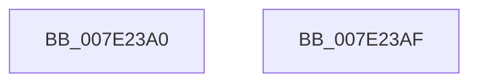

# CmpSetGlobalQuotaAllowed

- RVA: `0x007E23A0`–`0x007E23B0` (길이 `16` bytes)
- VA: `0x00000001407E23A0`
- 실행 섹션: `PAGE`
- PDB 이름 있음: `예`; PDB Function 태그: `아니요`
- unwind 정보 RVA: `0x000DB714`
- 디코드: `4`개 명령, `16/16` bytes 표시
- 미해석 바이트: `0` (있으면 어셈블리에 `.byte`로 보존)

> 이 문서는 커널 이미지의 기계어와 PDB 기호를 분석해 생성했습니다. 4번과 5번은 함수 원형과 자료형을 바이너리 사용 방식에서 추정한 C 해석이며 원본 소스 복구 결과는 아닙니다.

## 1. Dependencies

- 직접 호출 지점: **0**; 고유 호출 대상: **0**
- 직접 호출자로 확인된 함수: **1**
- RIP 상대 이미지 참조: **2**

### Outgoing calls
- 직접 디코드된 call 명령이 없습니다.

### Direct callers
- [CmpLoadKeyCommon](../../text/46/CmpLoadKeyCommon_function_0046E9F8.md) at `0x0046EE04`

### Static image references
- `0x007E23A0` → RVA `0x00FD8060` (`PAGEDATA`; read)
- `0x007E23A7` → RVA `0x00FD81C0` (`PAGEDATA`; write)

## 2. Other-region calls and transfers

- 다른 실행 섹션으로 향하는 call: **0**
- 별도 외부 분기/꼬리 이동을 확인하지 못했습니다.

## 3. Assembly (complete function range)

```asm
007E23A0  48 8B 05 B9 5C 7F 00            mov rax, qword ptr [rip + 0x7f5cb9]
007E23A7  48 89 05 12 5E 7F 00            mov qword ptr [rip + 0x7f5e12], rax
007E23AE  C3                              ret
007E23AF  CC                              int3
```

## 4. C-style interpretation (structured pseudocode)

```c
__int64 __fastcall CmpSetGlobalQuotaAllowed(void)
{
    *(unsigned __int64 *)(v_rip + 8347154) = *(unsigned __int64 *)(v_rip + 8346809);
    return *(unsigned __int64 *)(v_rip + 8346809);
}
```

## 5. (Beta) C Style

```c
void CmpSetGlobalQuotaAllowed(void)
{
    *(uint64_t *)(v_rip + 0x7F5E12) = *(uint64_t *)(v_rip + 0x7F5CB9);
    return *(uint64_t *)(v_rip + 0x7F5CB9);
}
```

## 6. Execution-region graph

[열기: 2D/3D 그래프와 함수 탐색 컨트롤 패널](../../../control-panel.html?section=page&rva=0x007E23A0&view=graph)

- 2D 그래프는 위에서 아래로 흐르고, 3D 그래프는 빈 공간을 드래그해 회전합니다. Shift+드래그는 이동, 휠은 확대·축소, 함수 노드 선택은 대상 보고서 이동입니다.

### Static fallback


