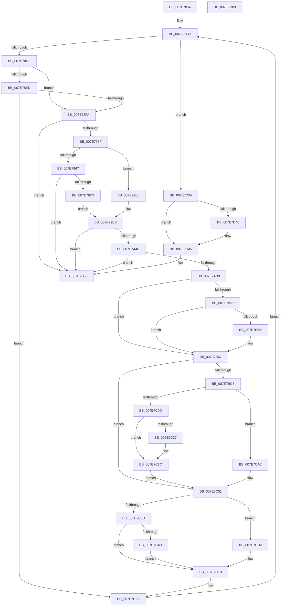

# CmpSetVersionData

- RVA: `0x007E7854`–`0x007E7D8A` (길이 `1,334` bytes)
- VA: `0x00000001407E7854`
- 실행 섹션: `PAGE`
- PDB 이름 있음: `예`; PDB Function 태그: `아니요`
- unwind 정보 RVA: `0x000D6D3C`
- 디코드: `295`개 명령, `1,334/1,334` bytes 표시
- 미해석 바이트: `0` (있으면 어셈블리에 `.byte`로 보존)

> 이 문서는 커널 이미지의 기계어와 PDB 기호를 분석해 생성했습니다. 4번과 5번은 함수 원형과 자료형을 바이너리 사용 방식에서 추정한 C 해석이며 원본 소스 복구 결과는 아닙니다.

## 1. Dependencies

- 직접 호출 지점: **36**; 고유 호출 대상: **16**
- 직접 호출자로 확인된 함수: **1**
- RIP 상대 이미지 참조: **21**

### Outgoing calls
- `0x007E78BF` → [CmpHiveRootSecurityDescriptor](CmpHiveRootSecurityDescriptor_function_007ED104.md) (function, `0x007ED104`)
- `0x007E78ED` → [PsWow64IsMachineSupported](../8D/PsWow64IsMachineSupported_function_008D20A0.md) (function, `0x008D20A0`)
- `0x007E7901` → [RtlInitUnicodeString](../../text/42/RtlInitUnicodeString_function_0042A780.md) (function, `0x0042A780`)
- `0x007E7952` → [ZwCreateKey](../../text/6A/ZwCreateKey_function_006AD470.md) (function, `0x006AD470`)
- `0x007E796B` → [RtlInitUnicodeString](../../text/42/RtlInitUnicodeString_function_0042A780.md) (function, `0x0042A780`)
- `0x007E79BA` → [ZwCreateKey](../../text/6A/ZwCreateKey_function_006AD470.md) (function, `0x006AD470`)
- `0x007E79C6` → [ZwClose](../../text/6A/ZwClose_function_006AD2B0.md) (function, `0x006AD2B0`)
- `0x007E7A33` → [ZwCreateKey](../../text/6A/ZwCreateKey_function_006AD470.md) (function, `0x006AD470`)
- `0x007E7A3F` → [ZwClose](../../text/6A/ZwClose_function_006AD2B0.md) (function, `0x006AD2B0`)
- `0x007E7AA0` → [ZwCreateKey](../../text/6A/ZwCreateKey_function_006AD470.md) (function, `0x006AD470`)
- `0x007E7AAC` → [ZwClose](../../text/6A/ZwClose_function_006AD2B0.md) (function, `0x006AD2B0`)
- `0x007E7AE5` → [ZwSetValueKey](../../text/6A/ZwSetValueKey_function_006ADCD0.md) (function, `0x006ADCD0`)
- `0x007E7B17` → [ZwSetValueKey](../../text/6A/ZwSetValueKey_function_006ADCD0.md) (function, `0x006ADCD0`)
- `0x007E7B41` → [ZwSetValueKey](../../text/6A/ZwSetValueKey_function_006ADCD0.md) (function, `0x006ADCD0`)
- `0x007E7B62` → [CmpRestampVersion](CmpRestampVersion_function_007E769C.md) (function, `0x007E769C`)
- `0x007E7B8C` → [sprintf_s](../../text/50/sprintf_s_function_00505E40.md) (function, `0x00505E40`)
- `0x007E7B99` → [RtlInitAnsiString](../../text/47/RtlInitAnsiString_function_00470F40.md) (function, `0x00470F40`)
- `0x007E7BBB` → [RtlAnsiStringToUnicodeString](../90/RtlAnsiStringToUnicodeString_function_0090BEA0.md) (function, `0x0090BEA0`)
- `0x007E7BF0` → [ZwSetValueKey](../../text/6A/ZwSetValueKey_function_006ADCD0.md) (function, `0x006ADCD0`)
- `0x007E7C26` → [ZwSetValueKey](../../text/6A/ZwSetValueKey_function_006ADCD0.md) (function, `0x006ADCD0`)
- `0x007E7C37` → [ExFreePool](../../poolcode/B8/ExFreePool_function_00B82850.md) (function, `0x00B82850`)
- `0x007E7C45` → [RtlInitUnicodeString](../../text/42/RtlInitUnicodeString_function_0042A780.md) (function, `0x0042A780`)
- `0x007E7C4C` → [ZwDeleteValueKey](../../text/6A/ZwDeleteValueKey_function_006AECB0.md) (function, `0x006AECB0`)
- `0x007E7C6B` → [sprintf_s](../../text/50/sprintf_s_function_00505E40.md) (function, `0x00505E40`)
- `0x007E7C78` → [RtlInitAnsiString](../../text/47/RtlInitAnsiString_function_00470F40.md) (function, `0x00470F40`)
- `0x007E7C9A` → [RtlAnsiStringToUnicodeString](../90/RtlAnsiStringToUnicodeString_function_0090BEA0.md) (function, `0x0090BEA0`)
- `0x007E7CCB` → [ZwSetValueKey](../../text/6A/ZwSetValueKey_function_006ADCD0.md) (function, `0x006ADCD0`)
- `0x007E7CDE` → [ZwDeleteValueKey](../../text/6A/ZwDeleteValueKey_function_006AECB0.md) (function, `0x006AECB0`)
- `0x007E7CE3` → [HalAdjustResourceList](../../text/48/HalAdjustResourceList_function_0048FDC0.md) (function, `0x0048FDC0`)
- `0x007E7CEB` → [PsGetServerSiloGlobals](../../text/22/PsGetServerSiloGlobals_function_002250A0.md) (function, `0x002250A0`)
- `0x007E7D1C` → [ZwSetValueKey](../../text/6A/ZwSetValueKey_function_006ADCD0.md) (function, `0x006ADCD0`)
- `0x007E7D26` → [ZwClose](../../text/6A/ZwClose_function_006AD2B0.md) (function, `0x006AD2B0`)
- `0x007E7D40` → [ExFreePool](../../poolcode/B8/ExFreePool_function_00B82850.md) (function, `0x00B82850`)
- `0x007E7D4E` → [RtlInitUnicodeString](../../text/42/RtlInitUnicodeString_function_0042A780.md) (function, `0x0042A780`)
- `0x007E7D58` → [ExFreePoolWithTag](../../poolcode/B8/ExFreePoolWithTag_function_00B82870.md) (function, `0x00B82870`)
- `0x007E7D67` → [_security_check_cookie](../../text/6A/_security_check_cookie_function_006AC640.md) (function, `0x006AC640`)

### Direct callers
- [CmpFinishSystemHivesLoad](../7D/CmpFinishSystemHivesLoad_function_007DA210.md) at `0x007DA70D`
- [CmpFinishSystemHivesLoad](../7D/CmpFinishSystemHivesLoad_function_007DA210.md) at `0x007DA80B`
- [CmpFinishSystemHivesLoad](../7D/CmpFinishSystemHivesLoad_function_007DA210.md) at `0x007DA81F`
- [CmpFinishSystemHivesLoad](../7D/CmpFinishSystemHivesLoad_function_007DA210.md) at `0x007DAB94`

### Static image references
- `0x007E7876` → RVA `0x00E0A740` (`.data`; read)
- `0x007E78C7` → RVA `0x00E09F98` (`.data`; read)
- `0x007E7917` → RVA `0x00B4AE90` (`nullclass`; read)
- `0x007E79F3` → RVA `0x00B4BCC8` (`CmpWindowsNtString`; read)
- `0x007E7A68` → RVA `0x00B4B430` (`CmpCurrentVersionString`; read)
- `0x007E7AB9` → RVA `0x00FC41D0` (`.data`; read)
- `0x007E7AD6` → RVA `0x00FC41D8` (`.data`; read)
- `0x007E7B05` → RVA `0x00B4BCE8` (`CmpCurrentMajorVersionString`; read)
- `0x007E7B2A` → RVA `0x00B4BCD8` (`CmpCurrentMinorVersionString`; read)
- `0x007E7B46` → RVA `0x00EF7238` (`.data`; read)
- `0x007E7B67` → RVA `0x00B09780` (` ?? ::NNGAKEGL::`string'`; read)
- `0x007E7B7A` → RVA `0x00B097A0` (` ?? ::NNGAKEGL::`string'`; read)
- `0x007E7B81` → RVA `0x00B09790` (` ?? ::NNGAKEGL::`string'`; read)
- `0x007E7BCD` → RVA `0x00B4BCF8` (`CmpCurrentTypeString`; read)
- `0x007E7BF5` → RVA `0x00FC41B0` (`.data`; read)
- `0x007E7BFC` → RVA `0x00B4B450` (`CmpCsdVersionString`; read)
- `0x007E7C1A` → RVA `0x00FC41B8` (`.data`; read)
- `0x007E7C51` → RVA `0x00FC414C` (`.data`; read)
- `0x007E7C5D` → RVA `0x00B09770` (` ?? ::NNGAKEGL::`string'`; read)
- `0x007E7CA8` → RVA `0x00B4B440` (`CmpCsdBuildNumberString`; read)
- `0x007E7CF3` → RVA `0x00B4BD08` (`CmpSystemRootString`; read)

## 2. Other-region calls and transfers

- 다른 실행 섹션으로 향하는 call: **31**
  - `0x007E7901` → [RtlInitUnicodeString](../../text/42/RtlInitUnicodeString_function_0042A780.md) (`PAGE` → `.text`)
  - `0x007E7952` → [ZwCreateKey](../../text/6A/ZwCreateKey_function_006AD470.md) (`PAGE` → `.text`)
  - `0x007E796B` → [RtlInitUnicodeString](../../text/42/RtlInitUnicodeString_function_0042A780.md) (`PAGE` → `.text`)
  - `0x007E79BA` → [ZwCreateKey](../../text/6A/ZwCreateKey_function_006AD470.md) (`PAGE` → `.text`)
  - `0x007E79C6` → [ZwClose](../../text/6A/ZwClose_function_006AD2B0.md) (`PAGE` → `.text`)
  - `0x007E7A33` → [ZwCreateKey](../../text/6A/ZwCreateKey_function_006AD470.md) (`PAGE` → `.text`)
  - `0x007E7A3F` → [ZwClose](../../text/6A/ZwClose_function_006AD2B0.md) (`PAGE` → `.text`)
  - `0x007E7AA0` → [ZwCreateKey](../../text/6A/ZwCreateKey_function_006AD470.md) (`PAGE` → `.text`)
  - `0x007E7AAC` → [ZwClose](../../text/6A/ZwClose_function_006AD2B0.md) (`PAGE` → `.text`)
  - `0x007E7AE5` → [ZwSetValueKey](../../text/6A/ZwSetValueKey_function_006ADCD0.md) (`PAGE` → `.text`)
  - `0x007E7B17` → [ZwSetValueKey](../../text/6A/ZwSetValueKey_function_006ADCD0.md) (`PAGE` → `.text`)
  - `0x007E7B41` → [ZwSetValueKey](../../text/6A/ZwSetValueKey_function_006ADCD0.md) (`PAGE` → `.text`)
  - `0x007E7B8C` → [sprintf_s](../../text/50/sprintf_s_function_00505E40.md) (`PAGE` → `.text`)
  - `0x007E7B99` → [RtlInitAnsiString](../../text/47/RtlInitAnsiString_function_00470F40.md) (`PAGE` → `.text`)
  - `0x007E7BF0` → [ZwSetValueKey](../../text/6A/ZwSetValueKey_function_006ADCD0.md) (`PAGE` → `.text`)
  - `0x007E7C26` → [ZwSetValueKey](../../text/6A/ZwSetValueKey_function_006ADCD0.md) (`PAGE` → `.text`)
  - `0x007E7C37` → [ExFreePool](../../poolcode/B8/ExFreePool_function_00B82850.md) (`PAGE` → `POOLCODE`)
  - `0x007E7C45` → [RtlInitUnicodeString](../../text/42/RtlInitUnicodeString_function_0042A780.md) (`PAGE` → `.text`)
  - `0x007E7C4C` → [ZwDeleteValueKey](../../text/6A/ZwDeleteValueKey_function_006AECB0.md) (`PAGE` → `.text`)
  - `0x007E7C6B` → [sprintf_s](../../text/50/sprintf_s_function_00505E40.md) (`PAGE` → `.text`)
  - `0x007E7C78` → [RtlInitAnsiString](../../text/47/RtlInitAnsiString_function_00470F40.md) (`PAGE` → `.text`)
  - `0x007E7CCB` → [ZwSetValueKey](../../text/6A/ZwSetValueKey_function_006ADCD0.md) (`PAGE` → `.text`)
  - `0x007E7CDE` → [ZwDeleteValueKey](../../text/6A/ZwDeleteValueKey_function_006AECB0.md) (`PAGE` → `.text`)
  - `0x007E7CE3` → [HalAdjustResourceList](../../text/48/HalAdjustResourceList_function_0048FDC0.md) (`PAGE` → `.text`)
  - `0x007E7CEB` → [PsGetServerSiloGlobals](../../text/22/PsGetServerSiloGlobals_function_002250A0.md) (`PAGE` → `.text`)
  - `0x007E7D1C` → [ZwSetValueKey](../../text/6A/ZwSetValueKey_function_006ADCD0.md) (`PAGE` → `.text`)
  - `0x007E7D26` → [ZwClose](../../text/6A/ZwClose_function_006AD2B0.md) (`PAGE` → `.text`)
  - `0x007E7D40` → [ExFreePool](../../poolcode/B8/ExFreePool_function_00B82850.md) (`PAGE` → `POOLCODE`)
  - `0x007E7D4E` → [RtlInitUnicodeString](../../text/42/RtlInitUnicodeString_function_0042A780.md) (`PAGE` → `.text`)
  - `0x007E7D58` → [ExFreePoolWithTag](../../poolcode/B8/ExFreePoolWithTag_function_00B82870.md) (`PAGE` → `POOLCODE`)
  - `0x007E7D67` → [_security_check_cookie](../../text/6A/_security_check_cookie_function_006AC640.md) (`PAGE` → `.text`)
- 별도 외부 분기/꼬리 이동을 확인하지 못했습니다.

## 3. Assembly (complete function range)

```asm
007E7854  48 8B C4                        mov rax, rsp
007E7857  48 89 58 08                     mov qword ptr [rax + 8], rbx
007E785B  48 89 70 10                     mov qword ptr [rax + 0x10], rsi
007E785F  48 89 78 18                     mov qword ptr [rax + 0x18], rdi
007E7863  55                              push rbp
007E7864  41 54                           push r12
007E7866  41 56                           push r14
007E7868  48 8D A8 98 FE FF FF            lea rbp, [rax - 0x168]
007E786F  48 81 EC 50 02 00 00            sub rsp, 0x250
007E7876  48 8B 05 C3 2E 62 00            mov rax, qword ptr [rip + 0x622ec3]
007E787D  48 33 C4                        xor rax, rsp
007E7880  48 89 85 40 01 00 00            mov qword ptr [rbp + 0x140], rax
007E7887  0F 57 C0                        xorps xmm0, xmm0
007E788A  45 33 F6                        xor r14d, r14d
007E788D  33 C0                           xor eax, eax
007E788F  4C 89 74 24 40                  mov qword ptr [rsp + 0x40], r14
007E7894  0F 57 C9                        xorps xmm1, xmm1
007E7897  4C 89 74 24 60                  mov qword ptr [rsp + 0x60], r14
007E789C  0F 11 45 A8                     movups xmmword ptr [rbp - 0x58], xmm0
007E78A0  48 89 45 88                     mov qword ptr [rbp - 0x78], rax
007E78A4  0F 11 4D 98                     movups xmmword ptr [rbp - 0x68], xmm1
007E78A8  89 45 90                        mov dword ptr [rbp - 0x70], eax
007E78AB  0F 11 44 24 50                  movups xmmword ptr [rsp + 0x50], xmm0
007E78B0  44 89 74 24 48                  mov dword ptr [rsp + 0x48], r14d
007E78B5  0F 11 44 24 68                  movups xmmword ptr [rsp + 0x68], xmm0
007E78BA  0F 11 44 24 78                  movups xmmword ptr [rsp + 0x78], xmm0
007E78BF  E8 40 58 00 00                  call 0x1407ed104
007E78C4  48 8B F0                        mov rsi, rax
007E78C7  48 8D 3D CA 26 62 00            lea rdi, [rip + 0x6226ca]
007E78CE  45 8D 66 01                     lea r12d, [r14 + 1]
007E78D2  48 8B 5F F8                     mov rbx, qword ptr [rdi - 8]
007E78D6  48 85 DB                        test rbx, rbx
007E78D9  0F 84 55 04 00 00               je 0x1407e7d34
007E78DF  0F B7 4F 08                     movzx ecx, word ptr [rdi + 8]
007E78E3  B8 64 86 00 00                  mov eax, 0x8664
007E78E8  66 3B C8                        cmp cx, ax
007E78EB  74 0D                           je 0x1407e78fa
007E78ED  E8 AE A7 0E 00                  call 0x1408d20a0
007E78F2  85 C0                           test eax, eax
007E78F4  0F 84 31 04 00 00               je 0x1407e7d2b
007E78FA  48 8B D3                        mov rdx, rbx
007E78FD  48 8D 4D 98                     lea rcx, [rbp - 0x68]
007E7901  E8 7A 2E C4 FF                  call 0x14042a780
007E7906  45 33 C9                        xor r9d, r9d
007E7909  4C 89 74 24 30                  mov qword ptr [rsp + 0x30], r14
007E790E  48 8D 45 98                     lea rax, [rbp - 0x68]
007E7912  44 89 74 24 28                  mov dword ptr [rsp + 0x28], r14d
007E7917  48 8D 1D 72 35 36 00            lea rbx, [rip + 0x363572]
007E791E  C7 44 24 68 30 00 00 00         mov dword ptr [rsp + 0x68], 0x30
007E7926  4C 8D 44 24 68                  lea r8, [rsp + 0x68]
007E792B  4C 89 74 24 70                  mov qword ptr [rsp + 0x70], r14
007E7930  41 8D 51 04                     lea edx, [r9 + 4]
007E7934  C7 45 80 40 02 00 00            mov dword ptr [rbp - 0x80], 0x240
007E793B  48 8D 4C 24 40                  lea rcx, [rsp + 0x40]
007E7940  48 89 44 24 78                  mov qword ptr [rsp + 0x78], rax
007E7945  48 89 75 88                     mov qword ptr [rbp - 0x78], rsi
007E7949  4C 89 75 90                     mov qword ptr [rbp - 0x70], r14
007E794D  48 89 5C 24 20                  mov qword ptr [rsp + 0x20], rbx
007E7952  E8 19 5B EC FF                  call 0x1406ad470
007E7957  85 C0                           test eax, eax
007E7959  0F 88 F4 03 00 00               js 0x1407e7d53
007E795F  48 8B 17                        mov rdx, qword ptr [rdi]
007E7962  48 85 D2                        test rdx, rdx
007E7965  74 7F                           je 0x1407e79e6
007E7967  48 8D 4D 98                     lea rcx, [rbp - 0x68]
007E796B  E8 10 2E C4 FF                  call 0x14042a780
007E7970  48 8B 44 24 40                  mov rax, qword ptr [rsp + 0x40]
007E7975  4C 8D 44 24 68                  lea r8, [rsp + 0x68]
007E797A  45 33 C9                        xor r9d, r9d
007E797D  48 89 44 24 70                  mov qword ptr [rsp + 0x70], rax
007E7982  48 8D 45 98                     lea rax, [rbp - 0x68]
007E7986  4C 89 74 24 30                  mov qword ptr [rsp + 0x30], r14
007E798B  44 89 74 24 28                  mov dword ptr [rsp + 0x28], r14d
007E7990  48 8D 4C 24 60                  lea rcx, [rsp + 0x60]
007E7995  C7 44 24 68 30 00 00 00         mov dword ptr [rsp + 0x68], 0x30
007E799D  41 8D 51 02                     lea edx, [r9 + 2]
007E79A1  C7 45 80 40 02 00 00            mov dword ptr [rbp - 0x80], 0x240
007E79A8  48 89 44 24 78                  mov qword ptr [rsp + 0x78], rax
007E79AD  48 89 75 88                     mov qword ptr [rbp - 0x78], rsi
007E79B1  4C 89 75 90                     mov qword ptr [rbp - 0x70], r14
007E79B5  48 89 5C 24 20                  mov qword ptr [rsp + 0x20], rbx
007E79BA  E8 B1 5A EC FF                  call 0x1406ad470
007E79BF  48 8B 4C 24 40                  mov rcx, qword ptr [rsp + 0x40]
007E79C4  8B D8                           mov ebx, eax
007E79C6  E8 E5 58 EC FF                  call 0x1406ad2b0
007E79CB  85 DB                           test ebx, ebx
007E79CD  0F 88 80 03 00 00               js 0x1407e7d53
007E79D3  48 8B 44 24 60                  mov rax, qword ptr [rsp + 0x60]
007E79D8  48 8D 1D B1 34 36 00            lea rbx, [rip + 0x3634b1]
007E79DF  48 89 44 24 40                  mov qword ptr [rsp + 0x40], rax
007E79E4  EB 05                           jmp 0x1407e79eb
007E79E6  48 8B 44 24 40                  mov rax, qword ptr [rsp + 0x40]
007E79EB  45 33 C9                        xor r9d, r9d
007E79EE  48 89 44 24 70                  mov qword ptr [rsp + 0x70], rax
007E79F3  48 8D 05 CE 42 36 00            lea rax, [rip + 0x3642ce]
007E79FA  4C 89 74 24 30                  mov qword ptr [rsp + 0x30], r14
007E79FF  44 89 74 24 28                  mov dword ptr [rsp + 0x28], r14d
007E7A04  4C 8D 44 24 68                  lea r8, [rsp + 0x68]
007E7A09  48 8D 4C 24 60                  lea rcx, [rsp + 0x60]
007E7A0E  C7 44 24 68 30 00 00 00         mov dword ptr [rsp + 0x68], 0x30
007E7A16  41 8D 51 02                     lea edx, [r9 + 2]
007E7A1A  C7 45 80 40 02 00 00            mov dword ptr [rbp - 0x80], 0x240
007E7A21  48 89 44 24 78                  mov qword ptr [rsp + 0x78], rax
007E7A26  48 89 75 88                     mov qword ptr [rbp - 0x78], rsi
007E7A2A  4C 89 75 90                     mov qword ptr [rbp - 0x70], r14
007E7A2E  48 89 5C 24 20                  mov qword ptr [rsp + 0x20], rbx
007E7A33  E8 38 5A EC FF                  call 0x1406ad470
007E7A38  48 8B 4C 24 40                  mov rcx, qword ptr [rsp + 0x40]
007E7A3D  8B D8                           mov ebx, eax
007E7A3F  E8 6C 58 EC FF                  call 0x1406ad2b0
007E7A44  85 DB                           test ebx, ebx
007E7A46  0F 88 07 03 00 00               js 0x1407e7d53
007E7A4C  48 8B 44 24 60                  mov rax, qword ptr [rsp + 0x60]
007E7A51  4C 8D 44 24 68                  lea r8, [rsp + 0x68]
007E7A56  48 89 44 24 70                  mov qword ptr [rsp + 0x70], rax
007E7A5B  48 8D 4C 24 40                  lea rcx, [rsp + 0x40]
007E7A60  45 33 C9                        xor r9d, r9d
007E7A63  4C 89 74 24 30                  mov qword ptr [rsp + 0x30], r14
007E7A68  48 8D 05 C1 39 36 00            lea rax, [rip + 0x3639c1]
007E7A6F  44 89 74 24 28                  mov dword ptr [rsp + 0x28], r14d
007E7A74  48 89 44 24 78                  mov qword ptr [rsp + 0x78], rax
007E7A79  48 8D 05 10 34 36 00            lea rax, [rip + 0x363410]
007E7A80  48 89 44 24 20                  mov qword ptr [rsp + 0x20], rax
007E7A85  41 8D 51 03                     lea edx, [r9 + 3]
007E7A89  C7 44 24 68 30 00 00 00         mov dword ptr [rsp + 0x68], 0x30
007E7A91  C7 45 80 40 02 00 00            mov dword ptr [rbp - 0x80], 0x240
007E7A98  48 89 75 88                     mov qword ptr [rbp - 0x78], rsi
007E7A9C  4C 89 75 90                     mov qword ptr [rbp - 0x70], r14
007E7AA0  E8 CB 59 EC FF                  call 0x1406ad470
007E7AA5  48 8B 4C 24 60                  mov rcx, qword ptr [rsp + 0x60]
007E7AAA  8B D8                           mov ebx, eax
007E7AAC  E8 FF 57 EC FF                  call 0x1406ad2b0
007E7AB1  85 DB                           test ebx, ebx
007E7AB3  0F 88 9A 02 00 00               js 0x1407e7d53
007E7AB9  0F B7 05 10 C7 7D 00            movzx eax, word ptr [rip + 0x7dc710]
007E7AC0  48 8D 15 69 39 36 00            lea rdx, [rip + 0x363969]
007E7AC7  48 8B 4C 24 40                  mov rcx, qword ptr [rsp + 0x40]
007E7ACC  83 C0 02                        add eax, 2
007E7ACF  89 44 24 28                     mov dword ptr [rsp + 0x28], eax
007E7AD3  45 8B CC                        mov r9d, r12d
007E7AD6  48 8B 05 FB C6 7D 00            mov rax, qword ptr [rip + 0x7dc6fb]
007E7ADD  45 33 C0                        xor r8d, r8d
007E7AE0  48 89 44 24 20                  mov qword ptr [rsp + 0x20], rax
007E7AE5  E8 E6 61 EC FF                  call 0x1406adcd0
007E7AEA  48 8B 4C 24 40                  mov rcx, qword ptr [rsp + 0x40]
007E7AEF  48 8D 44 24 48                  lea rax, [rsp + 0x48]
007E7AF4  BB 04 00 00 00                  mov ebx, 4
007E7AF9  C7 44 24 48 0A 00 00 00         mov dword ptr [rsp + 0x48], 0xa
007E7B01  89 5C 24 28                     mov dword ptr [rsp + 0x28], ebx
007E7B05  48 8D 15 DC 41 36 00            lea rdx, [rip + 0x3641dc]
007E7B0C  44 8B CB                        mov r9d, ebx
007E7B0F  48 89 44 24 20                  mov qword ptr [rsp + 0x20], rax
007E7B14  45 33 C0                        xor r8d, r8d
007E7B17  E8 B4 61 EC FF                  call 0x1406adcd0
007E7B1C  48 8B 4C 24 40                  mov rcx, qword ptr [rsp + 0x40]
007E7B21  48 8D 44 24 48                  lea rax, [rsp + 0x48]
007E7B26  89 5C 24 28                     mov dword ptr [rsp + 0x28], ebx
007E7B2A  48 8D 15 A7 41 36 00            lea rdx, [rip + 0x3641a7]
007E7B31  44 8B CB                        mov r9d, ebx
007E7B34  48 89 44 24 20                  mov qword ptr [rsp + 0x20], rax
007E7B39  45 33 C0                        xor r8d, r8d
007E7B3C  44 89 74 24 48                  mov dword ptr [rsp + 0x48], r14d
007E7B41  E8 8A 61 EC FF                  call 0x1406adcd0
007E7B46  48 8B 05 EB F6 70 00            mov rax, qword ptr [rip + 0x70f6eb]
007E7B4D  44 89 74 24 48                  mov dword ptr [rsp + 0x48], r14d
007E7B52  48 85 C0                        test rax, rax
007E7B55  74 10                           je 0x1407e7b67
007E7B57  44 39 70 08                     cmp dword ptr [rax + 8], r14d
007E7B5B  74 0A                           je 0x1407e7b67
007E7B5D  48 8B 4C 24 40                  mov rcx, qword ptr [rsp + 0x40]
007E7B62  E8 35 FB FF FF                  call 0x1407e769c
007E7B67  48 8D 05 12 1C 32 00            lea rax, [rip + 0x321c12]
007E7B6E  BB 80 00 00 00                  mov ebx, 0x80
007E7B73  8B D3                           mov edx, ebx
007E7B75  48 89 44 24 20                  mov qword ptr [rsp + 0x20], rax
007E7B7A  4C 8D 0D 1F 1C 32 00            lea r9, [rip + 0x321c1f]
007E7B81  4C 8D 05 08 1C 32 00            lea r8, [rip + 0x321c08]
007E7B88  48 8D 4D C0                     lea rcx, [rbp - 0x40]
007E7B8C  E8 AF E2 D1 FF                  call 0x140505e40
007E7B91  48 8D 55 C0                     lea rdx, [rbp - 0x40]
007E7B95  48 8D 4D A8                     lea rcx, [rbp - 0x58]
007E7B99  E8 A2 93 C8 FF                  call 0x140470f40
007E7B9E  48 8D 45 40                     lea rax, [rbp + 0x40]
007E7BA2  C7 44 24 50 00 00 00 01         mov dword ptr [rsp + 0x50], 0x1000000
007E7BAA  45 33 C0                        xor r8d, r8d
007E7BAD  48 89 44 24 58                  mov qword ptr [rsp + 0x58], rax
007E7BB2  48 8D 55 A8                     lea rdx, [rbp - 0x58]
007E7BB6  48 8D 4C 24 50                  lea rcx, [rsp + 0x50]
007E7BBB  E8 E0 42 12 00                  call 0x14090bea0
007E7BC0  85 C0                           test eax, eax
007E7BC2  0F 88 89 00 00 00               js 0x1407e7c51
007E7BC8  0F B7 44 24 50                  movzx eax, word ptr [rsp + 0x50]
007E7BCD  48 8D 15 24 41 36 00            lea rdx, [rip + 0x364124]
007E7BD4  48 8B 4C 24 40                  mov rcx, qword ptr [rsp + 0x40]
007E7BD9  83 C0 02                        add eax, 2
007E7BDC  89 44 24 28                     mov dword ptr [rsp + 0x28], eax
007E7BE0  45 8B CC                        mov r9d, r12d
007E7BE3  48 8B 44 24 58                  mov rax, qword ptr [rsp + 0x58]
007E7BE8  45 33 C0                        xor r8d, r8d
007E7BEB  48 89 44 24 20                  mov qword ptr [rsp + 0x20], rax
007E7BF0  E8 DB 60 EC FF                  call 0x1406adcd0
007E7BF5  0F B7 05 B4 C5 7D 00            movzx eax, word ptr [rip + 0x7dc5b4]
007E7BFC  48 8D 15 4D 38 36 00            lea rdx, [rip + 0x36384d]
007E7C03  48 8B 4C 24 40                  mov rcx, qword ptr [rsp + 0x40]
007E7C08  66 85 C0                        test ax, ax
007E7C0B  74 3F                           je 0x1407e7c4c
007E7C0D  83 C0 02                        add eax, 2
007E7C10  45 8B CC                        mov r9d, r12d
007E7C13  89 44 24 28                     mov dword ptr [rsp + 0x28], eax
007E7C17  45 33 C0                        xor r8d, r8d
007E7C1A  48 8B 05 97 C5 7D 00            mov rax, qword ptr [rip + 0x7dc597]
007E7C21  48 89 44 24 20                  mov qword ptr [rsp + 0x20], rax
007E7C26  E8 A5 60 EC FF                  call 0x1406adcd0
007E7C2B  48 8B 0D 86 C5 7D 00            mov rcx, qword ptr [rip + 0x7dc586]
007E7C32  48 85 C9                        test rcx, rcx
007E7C35  74 05                           je 0x1407e7c3c
007E7C37  E8 14 AC 39 00                  call 0x140b82850
007E7C3C  33 D2                           xor edx, edx
007E7C3E  48 8D 0D 6B C5 7D 00            lea rcx, [rip + 0x7dc56b]
007E7C45  E8 36 2B C4 FF                  call 0x14042a780
007E7C4A  EB 05                           jmp 0x1407e7c51
007E7C4C  E8 5F 70 EC FF                  call 0x1406aecb0
007E7C51  44 8B 0D F4 C4 7D 00            mov r9d, dword ptr [rip + 0x7dc4f4]
007E7C58  45 85 C9                        test r9d, r9d
007E7C5B  74 75                           je 0x1407e7cd2
007E7C5D  4C 8D 05 0C 1B 32 00            lea r8, [rip + 0x321b0c]
007E7C64  48 8B D3                        mov rdx, rbx
007E7C67  48 8D 4D C0                     lea rcx, [rbp - 0x40]
007E7C6B  E8 D0 E1 D1 FF                  call 0x140505e40
007E7C70  48 8D 55 C0                     lea rdx, [rbp - 0x40]
007E7C74  48 8D 4D A8                     lea rcx, [rbp - 0x58]
007E7C78  E8 C3 92 C8 FF                  call 0x140470f40
007E7C7D  48 8D 45 40                     lea rax, [rbp + 0x40]
007E7C81  C7 44 24 50 00 00 00 01         mov dword ptr [rsp + 0x50], 0x1000000
007E7C89  45 33 C0                        xor r8d, r8d
007E7C8C  48 89 44 24 58                  mov qword ptr [rsp + 0x58], rax
007E7C91  48 8D 55 A8                     lea rdx, [rbp - 0x58]
007E7C95  48 8D 4C 24 50                  lea rcx, [rsp + 0x50]
007E7C9A  E8 01 42 12 00                  call 0x14090bea0
007E7C9F  85 C0                           test eax, eax
007E7CA1  79 40                           jns 0x1407e7ce3
007E7CA3  0F B7 44 24 50                  movzx eax, word ptr [rsp + 0x50]
007E7CA8  48 8D 15 91 37 36 00            lea rdx, [rip + 0x363791]
007E7CAF  48 8B 4C 24 40                  mov rcx, qword ptr [rsp + 0x40]
007E7CB4  83 C0 02                        add eax, 2
007E7CB7  89 44 24 28                     mov dword ptr [rsp + 0x28], eax
007E7CBB  45 8B CC                        mov r9d, r12d
007E7CBE  48 8B 44 24 58                  mov rax, qword ptr [rsp + 0x58]
007E7CC3  45 33 C0                        xor r8d, r8d
007E7CC6  48 89 44 24 20                  mov qword ptr [rsp + 0x20], rax
007E7CCB  E8 00 60 EC FF                  call 0x1406adcd0
007E7CD0  EB 11                           jmp 0x1407e7ce3
007E7CD2  48 8B 4C 24 40                  mov rcx, qword ptr [rsp + 0x40]
007E7CD7  48 8D 15 62 37 36 00            lea rdx, [rip + 0x363762]
007E7CDE  E8 CD 6F EC FF                  call 0x1406aecb0
007E7CE3  E8 D8 80 CA FF                  call 0x14048fdc0
007E7CE8  48 8B C8                        mov rcx, rax
007E7CEB  E8 B0 D3 A3 FF                  call 0x1402250a0
007E7CF0  45 8B CC                        mov r9d, r12d
007E7CF3  48 8D 15 0E 40 36 00            lea rdx, [rip + 0x36400e]
007E7CFA  45 33 C0                        xor r8d, r8d
007E7CFD  0F B7 88 D0 04 00 00            movzx ecx, word ptr [rax + 0x4d0]
007E7D04  48 8B 80 D8 04 00 00            mov rax, qword ptr [rax + 0x4d8]
007E7D0B  83 C1 02                        add ecx, 2
007E7D0E  89 4C 24 28                     mov dword ptr [rsp + 0x28], ecx
007E7D12  48 8B 4C 24 40                  mov rcx, qword ptr [rsp + 0x40]
007E7D17  48 89 44 24 20                  mov qword ptr [rsp + 0x20], rax
007E7D1C  E8 AF 5F EC FF                  call 0x1406adcd0
007E7D21  48 8B 4C 24 40                  mov rcx, qword ptr [rsp + 0x40]
007E7D26  E8 85 55 EC FF                  call 0x1406ad2b0
007E7D2B  48 83 C7 18                     add rdi, 0x18
007E7D2F  E9 9E FB FF FF                  jmp 0x1407e78d2
007E7D34  48 8B 0D 7D C4 7D 00            mov rcx, qword ptr [rip + 0x7dc47d]
007E7D3B  48 85 C9                        test rcx, rcx
007E7D3E  74 05                           je 0x1407e7d45
007E7D40  E8 0B AB 39 00                  call 0x140b82850
007E7D45  33 D2                           xor edx, edx
007E7D47  48 8D 0D 62 C4 7D 00            lea rcx, [rip + 0x7dc462]
007E7D4E  E8 2D 2A C4 FF                  call 0x14042a780
007E7D53  33 D2                           xor edx, edx
007E7D55  48 8B CE                        mov rcx, rsi
007E7D58  E8 13 AB 39 00                  call 0x140b82870
007E7D5D  48 8B 8D 40 01 00 00            mov rcx, qword ptr [rbp + 0x140]
007E7D64  48 33 CC                        xor rcx, rsp
007E7D67  E8 D4 48 EC FF                  call 0x1406ac640
007E7D6C  4C 8D 9C 24 50 02 00 00         lea r11, [rsp + 0x250]
007E7D74  49 8B 5B 20                     mov rbx, qword ptr [r11 + 0x20]
007E7D78  49 8B 73 28                     mov rsi, qword ptr [r11 + 0x28]
007E7D7C  49 8B 7B 30                     mov rdi, qword ptr [r11 + 0x30]
007E7D80  49 8B E3                        mov rsp, r11
007E7D83  41 5E                           pop r14
007E7D85  41 5C                           pop r12
007E7D87  5D                              pop rbp
007E7D88  C3                              ret
007E7D89  CC                              int3
```

## 4. C-style interpretation (structured pseudocode)

```c
__int64 __fastcall CmpSetVersionData(__int64 a1, __int64 a2, __int64 a3, int a4)
{
    __int64 result;
    __int64 v_r14;
    __int64 v_rdi;
    __int64 v_rsp;
    unsigned __int64 v_stack_m18;
    unsigned __int64 v_stack_m1F0;
    unsigned __int64 v_stack_m1F8;
    unsigned __int64 v_stack_m200;
    unsigned __int64 v_stack_m208;
    unsigned __int64 v_stack_m210;
    unsigned __int64 v_stack_m218;
    unsigned int v_stack_m220;
    unsigned __int64 v_stack_m228;
    unsigned __int64 v_stack_m238;
    unsigned int v_stack_m240;
    unsigned __int64 v_stack_m248;

    *(unsigned __int64 *)(v_rsp + 8) = v_rbx;
    *(unsigned __int64 *)(v_rsp + 16) = v_rsi;
    *(unsigned __int64 *)(v_rsp + 24) = v_rdi;
    v_rsp = (v_rsp) - (592);
    result = (*(unsigned __int64 *)(v_rip + 6434499)) ^ (v_rsp);
    *(unsigned __int64 *)(v_rsp - 360 + 320) = result;
    v_r14 = 0;
    result = 0;
    v_stack_m228 = 0;
    v_stack_m208 = 0;
    *(unsigned __int64 *)(v_rsp - 360 - 88) = v_xmm0;
    *(unsigned __int64 *)(v_rsp - 360 - 120) = 0;
    *(unsigned __int64 *)(v_rsp - 360 - 104) = v_xmm1;
    *(unsigned int *)(v_rsp - 360 - 112) = 0;
    v_stack_m218 = v_xmm0;
    v_stack_m220 = 0;
    v_stack_m200 = v_xmm0;
    v_stack_m1F0 = v_xmm0;
    result = CmpHiveRootSecurityDescriptor(a1, a2, a3, a4);
loc_007E78D2:
    if (*(unsigned __int64 *)(v_rip + 6432458 - 8) == 0) goto loc_007E7D34;
    if (((unsigned __int16)(*(unsigned __int16 *)(v_rip + 6432458 + 8))) == ((unsigned __int16)((unsigned int)(0x8664ULL)))) goto loc_007E78FA;
    result = PsWow64IsMachineSupported(*(unsigned __int16 *)(v_rip + 6432458 + 8), a2, a3, a4);
    if ((unsigned int)(result) == 0) goto loc_007E7D2B;
loc_007E78FA:
    result = RtlInitUnicodeString(v_rsp - 360 - 104, *(unsigned __int64 *)(v_rip + 6432458 - 8), a3, a4);
    a4 = 0;
    v_stack_m238 = 0;
    v_stack_m240 = 0;
    v_stack_m200 = 48;
    v_stack_m1F8 = 0;
    *(unsigned int *)(v_rsp - 360 - 128) = 576;
    v_stack_m1F0 = v_rsp - 360 - 104;
    *(unsigned __int64 *)(v_rsp - 360 - 120) = result;
    *(unsigned __int64 *)(v_rsp - 360 - 112) = 0;
    v_stack_m248 = v_rip + 3552626;
    result = ZwCreateKey(v_stack_m228, a4 + 4, v_stack_m200, a4);
    if (sign_flag) goto loc_007E7D53;
    if (*(unsigned __int64 *)(v_rip + 6432458) == 0) goto loc_007E79E6;
    result = RtlInitUnicodeString(v_rsp - 360 - 104, *(unsigned __int64 *)(v_rip + 6432458), v_stack_m200, a4);
    a4 = 0;
    v_stack_m1F8 = v_stack_m228;
    v_stack_m238 = 0;
    v_stack_m240 = 0;
    v_stack_m200 = 48;
    *(unsigned int *)(v_rsp - 360 - 128) = 576;
    v_stack_m1F0 = v_rsp - 360 - 104;
    *(unsigned __int64 *)(v_rsp - 360 - 120) = result;
    *(unsigned __int64 *)(v_rsp - 360 - 112) = 0;
    v_stack_m248 = v_rip + 3552626;
    result = ZwCreateKey(v_stack_m208, a4 + 2, v_stack_m200, a4);
    result = ZwClose(v_stack_m228, a4 + 2, v_stack_m200, a4);
    if (sign_flag) goto loc_007E7D53;
    v_stack_m228 = v_stack_m208;
    goto loc_007E79EB;
loc_007E79E6:
loc_007E79EB:
    a4 = 0;
    v_stack_m1F8 = v_stack_m228;
    v_stack_m238 = 0;
    v_stack_m240 = 0;
    v_stack_m200 = 48;
    *(unsigned int *)(v_rsp - 360 - 128) = 576;
    v_stack_m1F0 = v_rip + 3556046;
    *(unsigned __int64 *)(v_rsp - 360 - 120) = result;
    *(unsigned __int64 *)(v_rsp - 360 - 112) = 0;
    v_stack_m248 = v_rip + 3552433;
    result = ZwCreateKey(v_stack_m208, a4 + 2, v_stack_m200, a4);
    result = ZwClose(v_stack_m228, a4 + 2, v_stack_m200, a4);
    if (sign_flag) goto loc_007E7D53;
    v_stack_m1F8 = v_stack_m208;
    a4 = 0;
    v_stack_m238 = 0;
    v_stack_m240 = 0;
    v_stack_m1F0 = v_rip + 3553729;
    v_stack_m248 = v_rip + 3552272;
    v_stack_m200 = 48;
    *(unsigned int *)(v_rsp - 360 - 128) = 576;
    *(unsigned __int64 *)(v_rsp - 360 - 120) = result;
    *(unsigned __int64 *)(v_rsp - 360 - 112) = 0;
    result = ZwCreateKey(v_stack_m228, a4 + 3, v_stack_m200, a4);
    result = ZwClose(v_stack_m208, a4 + 3, v_stack_m200, a4);
    if (sign_flag) goto loc_007E7D53;
    result = (unsigned int)((*(unsigned __int16 *)(v_rip + 8242960)) + (2));
    v_stack_m240 = (unsigned int)(result);
    a3 = 0;
    v_stack_m248 = *(unsigned __int64 *)(v_rip + 8242939);
    result = ZwSetValueKey(v_stack_m228, v_rip + 3553641, a3, (unsigned int)((unsigned int)(v_r14 + 1)));
    v_stack_m220 = 10;
    v_stack_m240 = 4;
    v_stack_m248 = v_stack_m220;
    a3 = 0;
    result = ZwSetValueKey(v_stack_m228, v_rip + 3555804, a3, 4);
    v_stack_m240 = 4;
    v_stack_m248 = v_stack_m220;
    a3 = 0;
    v_stack_m220 = 0;
    result = ZwSetValueKey(v_stack_m228, v_rip + 3555751, a3, 4);
    v_stack_m220 = 0;
    if (*(unsigned __int64 *)(v_rip + 7403243) == 0) goto loc_007E7B67;
    result = *(unsigned __int64 *)(v_rip + 7403243);
    if ((*(unsigned int *)(*(unsigned __int64 *)(v_rip + 7403243) + 8)) != 0) {
        a1 = v_stack_m228;
        result = CmpRestampVersion(a1, v_rip + 3555751, a3, 4);
    }
    v_stack_m248 = v_rip + 3283986;
    result = sprintf_s(v_rsp - 360 - 64, 128, v_rip + 3283976, v_rip + 3283999);
    result = RtlInitAnsiString(v_rsp - 360 - 88, v_rsp - 360 - 64, v_rip + 3283976, v_rip + 3283999);
    v_stack_m218 = 0x1000000ULL;
    a3 = 0;
    v_stack_m210 = v_rsp - 360 + 64;
    result = RtlAnsiStringToUnicodeString(v_stack_m218, v_rsp - 360 - 88, a3, v_rip + 3283999);
    if (sign_flag) goto loc_007E7C51;
    result = (unsigned int)((v_stack_m218) + (2));
    v_stack_m240 = (unsigned int)(result);
    a3 = 0;
    v_stack_m248 = v_stack_m210;
    result = ZwSetValueKey(v_stack_m228, v_rip + 3555620, a3, (unsigned int)((unsigned int)(v_r14 + 1)));
    if ((unsigned __int16)(*(unsigned __int16 *)(v_rip + 8242612)) == 0) goto loc_007E7C4C;
    result = (unsigned int)((*(unsigned __int16 *)(v_rip + 8242612)) + (2));
    v_stack_m240 = (unsigned int)(result);
    a3 = 0;
    v_stack_m248 = *(unsigned __int64 *)(v_rip + 8242583);
    result = ZwSetValueKey(v_stack_m228, v_rip + 3553357, a3, (unsigned int)((unsigned int)(v_r14 + 1)));
    if (*(unsigned __int64 *)(v_rip + 8242566) != 0) {
        result = ExFreePool(*(unsigned __int64 *)(v_rip + 8242566), v_rip + 3553357, a3, (unsigned int)((unsigned int)(v_r14 + 1)));
    }
    a2 = 0;
    result = RtlInitUnicodeString(v_rip + 8242539, a2, a3, (unsigned int)((unsigned int)(v_r14 + 1)));
    goto loc_007E7C51;
loc_007E7C4C:
    result = ZwDeleteValueKey(v_rip + 8242539, a2, a3, (unsigned int)((unsigned int)(v_r14 + 1)));
loc_007E7C51:
    if ((unsigned int)((unsigned int)(*(unsigned int *)(v_rip + 8242420))) == 0) goto loc_007E7CD2;
    result = sprintf_s(v_rsp - 360 - 64, 128, v_rip + 3283724, (unsigned int)(*(unsigned int *)(v_rip + 8242420)));
    result = RtlInitAnsiString(v_rsp - 360 - 88, v_rsp - 360 - 64, v_rip + 3283724, (unsigned int)(*(unsigned int *)(v_rip + 8242420)));
    v_stack_m218 = 0x1000000ULL;
    a3 = 0;
    v_stack_m210 = v_rsp - 360 + 64;
    result = RtlAnsiStringToUnicodeString(v_stack_m218, v_rsp - 360 - 88, a3, (unsigned int)(*(unsigned int *)(v_rip + 8242420)));
    if (!sign_flag) goto loc_007E7CE3;
    result = (unsigned int)((v_stack_m218) + (2));
    v_stack_m240 = (unsigned int)(result);
    a3 = 0;
    v_stack_m248 = v_stack_m210;
    result = ZwSetValueKey(v_stack_m228, v_rip + 3553169, a3, (unsigned int)((unsigned int)(v_r14 + 1)));
    goto loc_007E7CE3;
loc_007E7CD2:
    result = ZwDeleteValueKey(v_stack_m228, v_rip + 3553122, a3, (unsigned int)((unsigned int)(v_r14 + 1)));
loc_007E7CE3:
    result = HalAdjustResourceList(v_stack_m228, v_rip + 3553122, a3, (unsigned int)((unsigned int)(v_r14 + 1)));
    result = PsGetServerSiloGlobals(result, v_rip + 3553122, a3, (unsigned int)((unsigned int)(v_r14 + 1)));
    a3 = 0;
    a1 = (unsigned int)((*(unsigned __int16 *)(result + 1232)) + (2));
    v_stack_m240 = (unsigned int)(a1);
    v_stack_m248 = *(unsigned __int64 *)(result + 1240);
    result = ZwSetValueKey(v_stack_m228, v_rip + 3555342, a3, (unsigned int)((unsigned int)(v_r14 + 1)));
    result = ZwClose(v_stack_m228, v_rip + 3555342, a3, (unsigned int)((unsigned int)(v_r14 + 1)));
loc_007E7D2B:
    v_rdi = (v_rip + 6432458) + (24);
    goto loc_007E78D2;
loc_007E7D34:
    if (*(unsigned __int64 *)(v_rip + 8242301) != 0) {
        result = ExFreePool(*(unsigned __int64 *)(v_rip + 8242301), v_rip + 3555342, a3, (unsigned int)((unsigned int)(v_r14 + 1)));
    }
    a2 = 0;
    result = RtlInitUnicodeString(v_rip + 8242274, a2, a3, (unsigned int)((unsigned int)(v_r14 + 1)));
loc_007E7D53:
    a2 = 0;
    result = ExFreePoolWithTag(result, a2, a3, (unsigned int)((unsigned int)(v_r14 + 1)));
    a1 = (*(unsigned __int64 *)(v_rsp - 360 + 320)) ^ (v_rsp);
    result = _security_check_cookie(a1, a2, a3, (unsigned int)((unsigned int)(v_r14 + 1)));
    return result;
}
```

## 5. (Beta) C Style

```c
int64_t CmpSetVersionData(int64_t Arg1, int64_t Arg2, int64_t Arg3, int32_t Arg4)
{
    int64_t result;
    int64_t local_r14;
    int64_t local_rdi;
    int64_t local_rsp;
    uint64_t v_stack_m18;
    uint64_t v_stack_m1F0;
    uint64_t v_stack_m1F8;
    uint64_t v_stack_m200;
    uint64_t v_stack_m208;
    uint64_t v_stack_m210;
    uint64_t v_stack_m218;
    uint32_t v_stack_m220;
    uint64_t v_stack_m228;
    uint64_t v_stack_m238;
    uint32_t v_stack_m240;
    uint64_t v_stack_m248;

    *(uint64_t *)(local_rsp + 0x8) = local_rbx;
    *(uint64_t *)(local_rsp + 0x10) = local_rsi;
    *(uint64_t *)(local_rsp + 0x18) = local_rdi;
    local_rsp = (local_rsp) - (592);
    result = (*(uint64_t *)(v_rip + 0x622EC3)) ^ (local_rsp);
    *(uint64_t *)(local_rsp - 0x168 + 0x140) = result;
    local_r14 = 0;
    result = 0;
    v_stack_m228 = 0;
    v_stack_m208 = 0;
    *(uint64_t *)(local_rsp - 0x168 - 0x58) = v_xmm0;
    *(uint64_t *)(local_rsp - 0x168 - 0x78) = 0;
    *(uint64_t *)(local_rsp - 0x168 - 0x68) = v_xmm1;
    *(uint32_t *)(local_rsp - 0x168 - 0x70) = 0;
    v_stack_m218 = v_xmm0;
    v_stack_m220 = 0;
    v_stack_m200 = v_xmm0;
    v_stack_m1F0 = v_xmm0;
    result = CmpHiveRootSecurityDescriptor(Arg1, Arg2, Arg3, Arg4);
loc_007E78D2:
    if (*(uint64_t *)(v_rip + 0x6226CA - 0x8) == 0) goto loc_007E7D34;
    if (((uint16_t)(*(uint16_t *)(v_rip + 0x6226CA + 0x8))) == ((uint16_t)((uint32_t)(0x8664ULL)))) goto loc_007E78FA;
    result = PsWow64IsMachineSupported(*(uint16_t *)(v_rip + 0x6226CA + 0x8), Arg2, Arg3, Arg4);
    if ((uint32_t)(result) == 0) goto loc_007E7D2B;
loc_007E78FA:
    result = RtlInitUnicodeString(local_rsp - 360 - 104, *(uint64_t *)(v_rip + 0x6226CA - 0x8), Arg3, Arg4);
    Arg4 = 0;
    v_stack_m238 = 0;
    v_stack_m240 = 0;
    v_stack_m200 = 48;
    v_stack_m1F8 = 0;
    *(uint32_t *)(local_rsp - 0x168 - 0x80) = 576;
    v_stack_m1F0 = local_rsp - 360 - 104;
    *(uint64_t *)(local_rsp - 0x168 - 0x78) = result;
    *(uint64_t *)(local_rsp - 0x168 - 0x70) = 0;
    v_stack_m248 = v_rip + 3552626;
    result = ZwCreateKey(v_stack_m228, Arg4 + 4, v_stack_m200, Arg4);
    if (sign_flag) goto loc_007E7D53;
    if (*(uint64_t *)(v_rip + 0x6226CA) == 0) goto loc_007E79E6;
    result = RtlInitUnicodeString(local_rsp - 360 - 104, *(uint64_t *)(v_rip + 0x6226CA), v_stack_m200, Arg4);
    Arg4 = 0;
    v_stack_m1F8 = v_stack_m228;
    v_stack_m238 = 0;
    v_stack_m240 = 0;
    v_stack_m200 = 48;
    *(uint32_t *)(local_rsp - 0x168 - 0x80) = 576;
    v_stack_m1F0 = local_rsp - 360 - 104;
    *(uint64_t *)(local_rsp - 0x168 - 0x78) = result;
    *(uint64_t *)(local_rsp - 0x168 - 0x70) = 0;
    v_stack_m248 = v_rip + 3552626;
    result = ZwCreateKey(v_stack_m208, Arg4 + 2, v_stack_m200, Arg4);
    result = ZwClose(v_stack_m228, Arg4 + 2, v_stack_m200, Arg4);
    if (sign_flag) goto loc_007E7D53;
    v_stack_m228 = v_stack_m208;
    goto loc_007E79EB;
loc_007E79E6:
loc_007E79EB:
    Arg4 = 0;
    v_stack_m1F8 = v_stack_m228;
    v_stack_m238 = 0;
    v_stack_m240 = 0;
    v_stack_m200 = 48;
    *(uint32_t *)(local_rsp - 0x168 - 0x80) = 576;
    v_stack_m1F0 = v_rip + 3556046;
    *(uint64_t *)(local_rsp - 0x168 - 0x78) = result;
    *(uint64_t *)(local_rsp - 0x168 - 0x70) = 0;
    v_stack_m248 = v_rip + 3552433;
    result = ZwCreateKey(v_stack_m208, Arg4 + 2, v_stack_m200, Arg4);
    result = ZwClose(v_stack_m228, Arg4 + 2, v_stack_m200, Arg4);
    if (sign_flag) goto loc_007E7D53;
    v_stack_m1F8 = v_stack_m208;
    Arg4 = 0;
    v_stack_m238 = 0;
    v_stack_m240 = 0;
    v_stack_m1F0 = v_rip + 3553729;
    v_stack_m248 = v_rip + 3552272;
    v_stack_m200 = 48;
    *(uint32_t *)(local_rsp - 0x168 - 0x80) = 576;
    *(uint64_t *)(local_rsp - 0x168 - 0x78) = result;
    *(uint64_t *)(local_rsp - 0x168 - 0x70) = 0;
    result = ZwCreateKey(v_stack_m228, Arg4 + 3, v_stack_m200, Arg4);
    result = ZwClose(v_stack_m208, Arg4 + 3, v_stack_m200, Arg4);
    if (sign_flag) goto loc_007E7D53;
    result = (uint32_t)((*(uint16_t *)(v_rip + 0x7DC710)) + (2));
    v_stack_m240 = (uint32_t)(result);
    Arg3 = 0;
    v_stack_m248 = *(uint64_t *)(v_rip + 0x7DC6FB);
    result = ZwSetValueKey(v_stack_m228, v_rip + 3553641, Arg3, (uint32_t)((uint32_t)(local_r14 + 1)));
    v_stack_m220 = 10;
    v_stack_m240 = 4;
    v_stack_m248 = v_stack_m220;
    Arg3 = 0;
    result = ZwSetValueKey(v_stack_m228, v_rip + 3555804, Arg3, 4);
    v_stack_m240 = 4;
    v_stack_m248 = v_stack_m220;
    Arg3 = 0;
    v_stack_m220 = 0;
    result = ZwSetValueKey(v_stack_m228, v_rip + 3555751, Arg3, 4);
    v_stack_m220 = 0;
    if (*(uint64_t *)(v_rip + 0x70F6EB) == 0) goto loc_007E7B67;
    result = *(uint64_t *)(v_rip + 0x70F6EB);
    if ((*(uint32_t *)(*(uint64_t *)(v_rip + 0x70F6EB) + 0x8)) != 0) {
        Arg1 = v_stack_m228;
        result = CmpRestampVersion(Arg1, v_rip + 3555751, Arg3, 4);
    }
    v_stack_m248 = v_rip + 3283986;
    result = sprintf_s(local_rsp - 360 - 64, 128, v_rip + 3283976, v_rip + 3283999);
    result = RtlInitAnsiString(local_rsp - 360 - 88, local_rsp - 360 - 64, v_rip + 3283976, v_rip + 3283999);
    v_stack_m218 = 0x1000000ULL;
    Arg3 = 0;
    v_stack_m210 = local_rsp - 360 + 64;
    result = RtlAnsiStringToUnicodeString(v_stack_m218, local_rsp - 360 - 88, Arg3, v_rip + 3283999);
    if (sign_flag) goto loc_007E7C51;
    result = (uint32_t)((v_stack_m218) + (2));
    v_stack_m240 = (uint32_t)(result);
    Arg3 = 0;
    v_stack_m248 = v_stack_m210;
    result = ZwSetValueKey(v_stack_m228, v_rip + 3555620, Arg3, (uint32_t)((uint32_t)(local_r14 + 1)));
    if ((uint16_t)(*(uint16_t *)(v_rip + 0x7DC5B4)) == 0) goto loc_007E7C4C;
    result = (uint32_t)((*(uint16_t *)(v_rip + 0x7DC5B4)) + (2));
    v_stack_m240 = (uint32_t)(result);
    Arg3 = 0;
    v_stack_m248 = *(uint64_t *)(v_rip + 0x7DC597);
    result = ZwSetValueKey(v_stack_m228, v_rip + 3553357, Arg3, (uint32_t)((uint32_t)(local_r14 + 1)));
    if (*(uint64_t *)(v_rip + 0x7DC586) != 0) {
        result = ExFreePool(*(uint64_t *)(v_rip + 0x7DC586), v_rip + 3553357, Arg3, (uint32_t)((uint32_t)(local_r14 + 1)));
    }
    Arg2 = 0;
    result = RtlInitUnicodeString(v_rip + 8242539, Arg2, Arg3, (uint32_t)((uint32_t)(local_r14 + 1)));
    goto loc_007E7C51;
loc_007E7C4C:
    result = ZwDeleteValueKey(v_rip + 8242539, Arg2, Arg3, (uint32_t)((uint32_t)(local_r14 + 1)));
loc_007E7C51:
    if ((uint32_t)((uint32_t)(*(uint32_t *)(v_rip + 0x7DC4F4))) == 0) goto loc_007E7CD2;
    result = sprintf_s(local_rsp - 360 - 64, 128, v_rip + 3283724, (uint32_t)(*(uint32_t *)(v_rip + 0x7DC4F4)));
    result = RtlInitAnsiString(local_rsp - 360 - 88, local_rsp - 360 - 64, v_rip + 3283724, (uint32_t)(*(uint32_t *)(v_rip + 0x7DC4F4)));
    v_stack_m218 = 0x1000000ULL;
    Arg3 = 0;
    v_stack_m210 = local_rsp - 360 + 64;
    result = RtlAnsiStringToUnicodeString(v_stack_m218, local_rsp - 360 - 88, Arg3, (uint32_t)(*(uint32_t *)(v_rip + 0x7DC4F4)));
    if (!sign_flag) goto loc_007E7CE3;
    result = (uint32_t)((v_stack_m218) + (2));
    v_stack_m240 = (uint32_t)(result);
    Arg3 = 0;
    v_stack_m248 = v_stack_m210;
    result = ZwSetValueKey(v_stack_m228, v_rip + 3553169, Arg3, (uint32_t)((uint32_t)(local_r14 + 1)));
    goto loc_007E7CE3;
loc_007E7CD2:
    result = ZwDeleteValueKey(v_stack_m228, v_rip + 3553122, Arg3, (uint32_t)((uint32_t)(local_r14 + 1)));
loc_007E7CE3:
    result = HalAdjustResourceList(v_stack_m228, v_rip + 3553122, Arg3, (uint32_t)((uint32_t)(local_r14 + 1)));
    result = PsGetServerSiloGlobals(result, v_rip + 3553122, Arg3, (uint32_t)((uint32_t)(local_r14 + 1)));
    Arg3 = 0;
    Arg1 = (uint32_t)((*(uint16_t *)(result + 0x4D0)) + (2));
    v_stack_m240 = (uint32_t)(Arg1);
    v_stack_m248 = *(uint64_t *)(result + 0x4D8);
    result = ZwSetValueKey(v_stack_m228, v_rip + 3555342, Arg3, (uint32_t)((uint32_t)(local_r14 + 1)));
    result = ZwClose(v_stack_m228, v_rip + 3555342, Arg3, (uint32_t)((uint32_t)(local_r14 + 1)));
loc_007E7D2B:
    local_rdi = (v_rip + 6432458) + (24);
    goto loc_007E78D2;
loc_007E7D34:
    if (*(uint64_t *)(v_rip + 0x7DC47D) != 0) {
        result = ExFreePool(*(uint64_t *)(v_rip + 0x7DC47D), v_rip + 3555342, Arg3, (uint32_t)((uint32_t)(local_r14 + 1)));
    }
    Arg2 = 0;
    result = RtlInitUnicodeString(v_rip + 8242274, Arg2, Arg3, (uint32_t)((uint32_t)(local_r14 + 1)));
loc_007E7D53:
    Arg2 = 0;
    result = ExFreePoolWithTag(result, Arg2, Arg3, (uint32_t)((uint32_t)(local_r14 + 1)));
    Arg1 = (*(uint64_t *)(local_rsp - 0x168 + 0x140)) ^ (local_rsp);
    result = _security_check_cookie(Arg1, Arg2, Arg3, (uint32_t)((uint32_t)(local_r14 + 1)));
    return result;
}
```

## 6. Execution-region graph

[열기: 2D/3D 그래프와 함수 탐색 컨트롤 패널](../../../control-panel.html?section=page&rva=0x007E7854&view=graph)

- 2D 그래프는 위에서 아래로 흐르고, 3D 그래프는 빈 공간을 드래그해 회전합니다. Shift+드래그는 이동, 휠은 확대·축소, 함수 노드 선택은 대상 보고서 이동입니다.

### Static fallback


