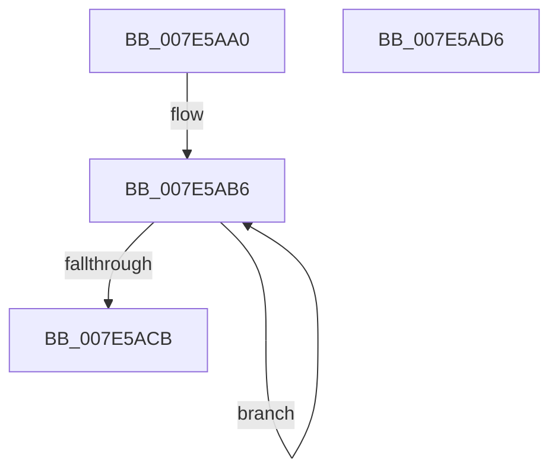

# CmpShutdownWorkers

- RVA: `0x007E5AA0`–`0x007E5AD7` (길이 `55` bytes)
- VA: `0x00000001407E5AA0`
- 실행 섹션: `PAGE`
- PDB 이름 있음: `예`; PDB Function 태그: `아니요`
- unwind 정보 RVA: `0x0005CAAC`
- 디코드: `15`개 명령, `55/55` bytes 표시
- 미해석 바이트: `0` (있으면 어셈블리에 `.byte`로 보존)

> 이 문서는 커널 이미지의 기계어와 PDB 기호를 분석해 생성했습니다. 4번과 5번은 함수 원형과 자료형을 바이너리 사용 방식에서 추정한 C 해석이며 원본 소스 복구 결과는 아닙니다.

## 1. Dependencies

- 직접 호출 지점: **1**; 고유 호출 대상: **1**
- 직접 호출자로 확인된 함수: **1**
- RIP 상대 이미지 참조: **1**

### Outgoing calls
- `0x007E5AB9` → [KeCancelTimer](../../text/23/KeCancelTimer_function_002327E0.md) (function, `0x002327E0`)

### Direct callers
- [CmShutdownSystem1](../../text/66/CmShutdownSystem1_function_0066A5B0.md) at `0x0066A70D`

### Static image references
- `0x007E5AAA` → RVA `0x00E03710` (`.data`; read)

## 2. Other-region calls and transfers

- 다른 실행 섹션으로 향하는 call: **1**
  - `0x007E5AB9` → [KeCancelTimer](../../text/23/KeCancelTimer_function_002327E0.md) (`PAGE` → `.text`)
- 별도 외부 분기/꼬리 이동을 확인하지 못했습니다.

## 3. Assembly (complete function range)

```asm
007E5AA0  48 89 5C 24 08                  mov qword ptr [rsp + 8], rbx
007E5AA5  57                              push rdi
007E5AA6  48 83 EC 20                     sub rsp, 0x20
007E5AAA  48 8D 1D 5F DC 61 00            lea rbx, [rip + 0x61dc5f]
007E5AB1  BF 03 00 00 00                  mov edi, 3
007E5AB6  48 8B CB                        mov rcx, rbx
007E5AB9  E8 22 CD A4 FF                  call 0x1402327e0
007E5ABE  48 81 C3 C0 00 00 00            add rbx, 0xc0
007E5AC5  48 83 EF 01                     sub rdi, 1
007E5AC9  75 EB                           jne 0x1407e5ab6
007E5ACB  48 8B 5C 24 30                  mov rbx, qword ptr [rsp + 0x30]
007E5AD0  48 83 C4 20                     add rsp, 0x20
007E5AD4  5F                              pop rdi
007E5AD5  C3                              ret
007E5AD6  CC                              int3
```

## 4. C-style interpretation (structured pseudocode)

```c
__int64 __fastcall CmpShutdownWorkers(void)
{
    __int64 result;
    __int64 v_rbx;
    __int64 v_rdi;
    __int64 v_rsp;
    unsigned __int64 v_stack_p8;

    v_stack_p8 = v_rbx;
    v_rsp = (v_rsp) - (32);
loc_007E5AB6:
    result = KeCancelTimer(v_rip + 6413407, a2, a3, a4);
    v_rbx = (v_rip + 6413407) + (192);
    v_rdi = (3) - (1);
    if (condition_is_not_equal) goto loc_007E5AB6;
    v_rsp = (v_rsp) + (32);
    return result;
}
```

## 5. (Beta) C Style

```c
void CmpShutdownWorkers(void)
{
    int64_t result;
    int64_t local_rbx;
    int64_t local_rdi;
    int64_t local_rsp;
    uint64_t v_stack_p8;

    v_stack_p8 = local_rbx;
    local_rsp = (local_rsp) - (32);
loc_007E5AB6:
    result = KeCancelTimer(v_rip + 6413407, a2, a3, a4);
    local_rbx = (v_rip + 6413407) + (192);
    local_rdi = (3) - (1);
    if (condition_is_not_equal) goto loc_007E5AB6;
    local_rsp = (local_rsp) + (32);
    return result;
}
```

## 6. Execution-region graph

[열기: 2D/3D 그래프와 함수 탐색 컨트롤 패널](../../../control-panel.html?section=page&rva=0x007E5AA0&view=graph)

- 2D 그래프는 위에서 아래로 흐르고, 3D 그래프는 빈 공간을 드래그해 회전합니다. Shift+드래그는 이동, 휠은 확대·축소, 함수 노드 선택은 대상 보고서 이동입니다.

### Static fallback


