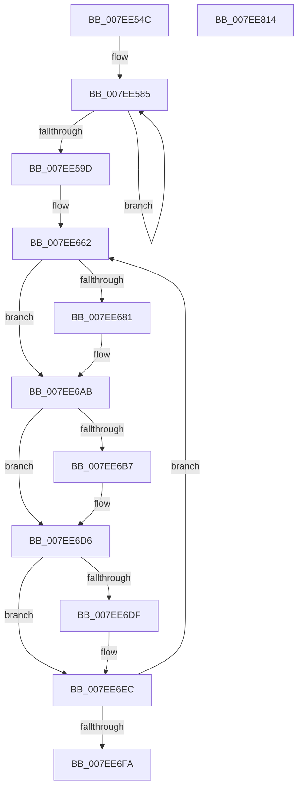

# CmpSwapHiveStorage

- RVA: `0x007EE54C`–`0x007EE815` (길이 `713` bytes)
- VA: `0x00000001407EE54C`
- 실행 섹션: `PAGE`
- PDB 이름 있음: `예`; PDB Function 태그: `아니요`
- unwind 정보 RVA: `0x000D6FC4`
- 디코드: `145`개 명령, `713/713` bytes 표시
- 미해석 바이트: `0` (있으면 어셈블리에 `.byte`로 보존)

> 이 문서는 커널 이미지의 기계어와 PDB 기호를 분석해 생성했습니다. 4번과 5번은 함수 원형과 자료형을 바이너리 사용 방식에서 추정한 C 해석이며 원본 소스 복구 결과는 아닙니다.

## 1. Dependencies

- 직접 호출 지점: **1**; 고유 호출 대상: **1**
- 직접 호출자로 확인된 함수: **2**
- RIP 상대 이미지 참조: **0**

### Outgoing calls
- `0x007EE56D` → [HvSwapHiveStorage](HvSwapHiveStorage_function_007EF528.md) (function, `0x007EF528`)

### Direct callers
- [CmpRefreshHive](../7D/CmpRefreshHive_function_007DEAD0.md) at `0x007DEEE8`
- [sub_00B1845C](../B1/Unknown_function_00B1845C.md) at `0x00B1881F`

### Static image references
- 디코드된 RIP-relative 메모리 참조가 없습니다.

## 2. Other-region calls and transfers

- 다른 실행 섹션으로 향하는 call: **0**
- 별도 외부 분기/꼬리 이동을 확인하지 못했습니다.

## 3. Assembly (complete function range)

```asm
007EE54C  48 8B C4                        mov rax, rsp
007EE54F  48 89 58 08                     mov qword ptr [rax + 8], rbx
007EE553  48 89 70 10                     mov qword ptr [rax + 0x10], rsi
007EE557  48 89 78 18                     mov qword ptr [rax + 0x18], rdi
007EE55B  4C 89 70 20                     mov qword ptr [rax + 0x20], r14
007EE55F  55                              push rbp
007EE560  48 8B EC                        mov rbp, rsp
007EE563  48 83 EC 30                     sub rsp, 0x30
007EE567  48 8B DA                        mov rbx, rdx
007EE56A  48 8B F9                        mov rdi, rcx
007EE56D  E8 B6 0F 00 00                  call 0x1407ef528
007EE572  4C 8B C7                        mov r8, rdi
007EE575  48 8D 93 08 06 00 00            lea rdx, [rbx + 0x608]
007EE57C  4C 2B C3                        sub r8, rbx
007EE57F  41 B9 06 00 00 00               mov r9d, 6
007EE585  48 8B 02                        mov rax, qword ptr [rdx]
007EE588  49 8B 0C 10                     mov rcx, qword ptr [r8 + rdx]
007EE58C  49 89 04 10                     mov qword ptr [r8 + rdx], rax
007EE590  48 89 0A                        mov qword ptr [rdx], rcx
007EE593  48 8D 52 08                     lea rdx, [rdx + 8]
007EE597  49 83 E9 01                     sub r9, 1
007EE59B  75 E8                           jne 0x1407ee585
007EE59D  8B 8F 00 07 00 00               mov ecx, dword ptr [rdi + 0x700]
007EE5A3  45 8D 71 40                     lea r14d, [r9 + 0x40]
007EE5A7  8B 83 00 07 00 00               mov eax, dword ptr [rbx + 0x700]
007EE5AD  48 8B F3                        mov rsi, rbx
007EE5B0  89 87 00 07 00 00               mov dword ptr [rdi + 0x700], eax
007EE5B6  48 2B F7                        sub rsi, rdi
007EE5B9  89 8B 00 07 00 00               mov dword ptr [rbx + 0x700], ecx
007EE5BF  48 8B 8B 10 07 00 00            mov rcx, qword ptr [rbx + 0x710]
007EE5C6  48 8B 87 10 07 00 00            mov rax, qword ptr [rdi + 0x710]
007EE5CD  48 89 8F 10 07 00 00            mov qword ptr [rdi + 0x710], rcx
007EE5D4  48 89 83 10 07 00 00            mov qword ptr [rbx + 0x710], rax
007EE5DB  48 8B 8B 18 07 00 00            mov rcx, qword ptr [rbx + 0x718]
007EE5E2  48 8B 87 18 07 00 00            mov rax, qword ptr [rdi + 0x718]
007EE5E9  48 89 8F 18 07 00 00            mov qword ptr [rdi + 0x718], rcx
007EE5F0  48 89 83 18 07 00 00            mov qword ptr [rbx + 0x718], rax
007EE5F7  8B 8F 50 07 00 00               mov ecx, dword ptr [rdi + 0x750]
007EE5FD  8B 83 50 07 00 00               mov eax, dword ptr [rbx + 0x750]
007EE603  89 87 50 07 00 00               mov dword ptr [rdi + 0x750], eax
007EE609  89 8B 50 07 00 00               mov dword ptr [rbx + 0x750], ecx
007EE60F  8B 8F 54 07 00 00               mov ecx, dword ptr [rdi + 0x754]
007EE615  8B 83 54 07 00 00               mov eax, dword ptr [rbx + 0x754]
007EE61B  89 87 54 07 00 00               mov dword ptr [rdi + 0x754], eax
007EE621  89 8B 54 07 00 00               mov dword ptr [rbx + 0x754], ecx
007EE627  8B 8F 58 07 00 00               mov ecx, dword ptr [rdi + 0x758]
007EE62D  8B 83 58 07 00 00               mov eax, dword ptr [rbx + 0x758]
007EE633  89 87 58 07 00 00               mov dword ptr [rdi + 0x758], eax
007EE639  89 8B 58 07 00 00               mov dword ptr [rbx + 0x758], ecx
007EE63F  48 8B 8F 60 07 00 00            mov rcx, qword ptr [rdi + 0x760]
007EE646  48 8B 83 60 07 00 00            mov rax, qword ptr [rbx + 0x760]
007EE64D  48 89 87 60 07 00 00            mov qword ptr [rdi + 0x760], rax
007EE654  48 89 8B 60 07 00 00            mov qword ptr [rbx + 0x760], rcx
007EE65B  48 8D 8F 68 07 00 00            lea rcx, [rdi + 0x768]
007EE662  48 8B 11                        mov rdx, qword ptr [rcx]
007EE665  4C 8D 4E 08                     lea r9, [rsi + 8]
007EE669  4C 03 C9                        add r9, rcx
007EE66C  4C 8D 55 F0                     lea r10, [rbp - 0x10]
007EE670  4C 89 55 F8                     mov qword ptr [rbp - 8], r10
007EE674  48 8D 45 F0                     lea rax, [rbp - 0x10]
007EE678  48 89 45 F0                     mov qword ptr [rbp - 0x10], rax
007EE67C  48 3B D1                        cmp rdx, rcx
007EE67F  74 2A                           je 0x1407ee6ab
007EE681  4B 8B 04 01                     mov rax, qword ptr [r9 + r8]
007EE685  4C 8D 55 F0                     lea r10, [rbp - 0x10]
007EE689  48 89 45 F8                     mov qword ptr [rbp - 8], rax
007EE68D  48 89 55 F0                     mov qword ptr [rbp - 0x10], rdx
007EE691  4C 89 52 08                     mov qword ptr [rdx + 8], r10
007EE695  48 8D 55 F0                     lea rdx, [rbp - 0x10]
007EE699  48 89 10                        mov qword ptr [rax], rdx
007EE69C  4C 8B 55 F8                     mov r10, qword ptr [rbp - 8]
007EE6A0  48 8B 45 F0                     mov rax, qword ptr [rbp - 0x10]
007EE6A4  4B 89 0C 01                     mov qword ptr [r9 + r8], rcx
007EE6A8  48 89 09                        mov qword ptr [rcx], rcx
007EE6AB  48 8D 14 31                     lea rdx, [rcx + rsi]
007EE6AF  4C 8B 1A                        mov r11, qword ptr [rdx]
007EE6B2  4C 3B DA                        cmp r11, rdx
007EE6B5  74 1F                           je 0x1407ee6d6
007EE6B7  49 8B 01                        mov rax, qword ptr [r9]
007EE6BA  4C 89 19                        mov qword ptr [rcx], r11
007EE6BD  4B 89 04 01                     mov qword ptr [r9 + r8], rax
007EE6C1  49 89 4B 08                     mov qword ptr [r11 + 8], rcx
007EE6C5  48 89 08                        mov qword ptr [rax], rcx
007EE6C8  4C 8B 55 F8                     mov r10, qword ptr [rbp - 8]
007EE6CC  48 8B 45 F0                     mov rax, qword ptr [rbp - 0x10]
007EE6D0  49 89 11                        mov qword ptr [r9], rdx
007EE6D3  48 89 12                        mov qword ptr [rdx], rdx
007EE6D6  4C 8D 5D F0                     lea r11, [rbp - 0x10]
007EE6DA  49 3B C3                        cmp rax, r11
007EE6DD  74 0D                           je 0x1407ee6ec
007EE6DF  48 89 02                        mov qword ptr [rdx], rax
007EE6E2  4D 89 11                        mov qword ptr [r9], r10
007EE6E5  48 89 50 08                     mov qword ptr [rax + 8], rdx
007EE6E9  49 89 12                        mov qword ptr [r10], rdx
007EE6EC  48 83 C1 10                     add rcx, 0x10
007EE6F0  49 83 EE 01                     sub r14, 1
007EE6F4  0F 85 68 FF FF FF               jne 0x1407ee662
007EE6FA  48 8B 83 28 10 00 00            mov rax, qword ptr [rbx + 0x1028]
007EE701  48 8B 8F 28 10 00 00            mov rcx, qword ptr [rdi + 0x1028]
007EE708  48 89 87 28 10 00 00            mov qword ptr [rdi + 0x1028], rax
007EE70F  48 8B 83 30 10 00 00            mov rax, qword ptr [rbx + 0x1030]
007EE716  48 89 8B 28 10 00 00            mov qword ptr [rbx + 0x1028], rcx
007EE71D  48 8B 8F 30 10 00 00            mov rcx, qword ptr [rdi + 0x1030]
007EE724  48 89 87 30 10 00 00            mov qword ptr [rdi + 0x1030], rax
007EE72B  48 89 8B 30 10 00 00            mov qword ptr [rbx + 0x1030], rcx
007EE732  48 8B 8B 58 10 00 00            mov rcx, qword ptr [rbx + 0x1058]
007EE739  48 8B 87 58 10 00 00            mov rax, qword ptr [rdi + 0x1058]
007EE740  48 8B 74 24 48                  mov rsi, qword ptr [rsp + 0x48]
007EE745  4C 8B 74 24 58                  mov r14, qword ptr [rsp + 0x58]
007EE74A  48 89 8F 58 10 00 00            mov qword ptr [rdi + 0x1058], rcx
007EE751  48 89 83 58 10 00 00            mov qword ptr [rbx + 0x1058], rax
007EE758  8B 8F 80 10 00 00               mov ecx, dword ptr [rdi + 0x1080]
007EE75E  8B 83 80 10 00 00               mov eax, dword ptr [rbx + 0x1080]
007EE764  89 87 80 10 00 00               mov dword ptr [rdi + 0x1080], eax
007EE76A  89 8B 80 10 00 00               mov dword ptr [rbx + 0x1080], ecx
007EE770  8B 8F 84 10 00 00               mov ecx, dword ptr [rdi + 0x1084]
007EE776  8B 83 84 10 00 00               mov eax, dword ptr [rbx + 0x1084]
007EE77C  89 87 84 10 00 00               mov dword ptr [rdi + 0x1084], eax
007EE782  89 8B 84 10 00 00               mov dword ptr [rbx + 0x1084], ecx
007EE788  8B 8F 90 12 00 00               mov ecx, dword ptr [rdi + 0x1290]
007EE78E  8B 83 90 12 00 00               mov eax, dword ptr [rbx + 0x1290]
007EE794  89 87 90 12 00 00               mov dword ptr [rdi + 0x1290], eax
007EE79A  89 8B 90 12 00 00               mov dword ptr [rbx + 0x1290], ecx
007EE7A0  8B 8F 94 12 00 00               mov ecx, dword ptr [rdi + 0x1294]
007EE7A6  8B 83 94 12 00 00               mov eax, dword ptr [rbx + 0x1294]
007EE7AC  89 87 94 12 00 00               mov dword ptr [rdi + 0x1294], eax
007EE7B2  89 8B 94 12 00 00               mov dword ptr [rbx + 0x1294], ecx
007EE7B8  8B 8F 98 12 00 00               mov ecx, dword ptr [rdi + 0x1298]
007EE7BE  8B 83 98 12 00 00               mov eax, dword ptr [rbx + 0x1298]
007EE7C4  89 87 98 12 00 00               mov dword ptr [rdi + 0x1298], eax
007EE7CA  89 8B 98 12 00 00               mov dword ptr [rbx + 0x1298], ecx
007EE7D0  8B 8F 9C 12 00 00               mov ecx, dword ptr [rdi + 0x129c]
007EE7D6  8B 83 9C 12 00 00               mov eax, dword ptr [rbx + 0x129c]
007EE7DC  89 87 9C 12 00 00               mov dword ptr [rdi + 0x129c], eax
007EE7E2  89 8B 9C 12 00 00               mov dword ptr [rbx + 0x129c], ecx
007EE7E8  48 8B 83 B8 12 00 00            mov rax, qword ptr [rbx + 0x12b8]
007EE7EF  48 8B 8F B8 12 00 00            mov rcx, qword ptr [rdi + 0x12b8]
007EE7F6  48 89 87 B8 12 00 00            mov qword ptr [rdi + 0x12b8], rax
007EE7FD  48 8B 7C 24 50                  mov rdi, qword ptr [rsp + 0x50]
007EE802  48 89 8B B8 12 00 00            mov qword ptr [rbx + 0x12b8], rcx
007EE809  48 8B 5C 24 40                  mov rbx, qword ptr [rsp + 0x40]
007EE80E  48 83 C4 30                     add rsp, 0x30
007EE812  5D                              pop rbp
007EE813  C3                              ret
007EE814  CC                              int3
```

## 4. C-style interpretation (structured pseudocode)

```c
__int64 __fastcall CmpSwapHiveStorage(__int64 a1, __int64 a2)
{
    __int64 result;
    __int64 v_r10;
    __int64 v_r14;
    __int64 v_rsi;
    __int64 v_rsp;
    unsigned __int64 v_stack_m10;
    unsigned __int64 v_stack_m18;
    unsigned __int64 v_stack_p10;
    unsigned __int64 v_stack_p18;
    unsigned __int64 v_stack_p20;
    unsigned __int64 v_stack_p8;

    *(unsigned __int64 *)(v_rsp + 8) = v_rbx;
    *(unsigned __int64 *)(v_rsp + 16) = v_rsi;
    *(unsigned __int64 *)(v_rsp + 24) = v_rdi;
    *(unsigned __int64 *)(v_rsp + 32) = v_r14;
    v_rsp = (v_rsp) - (48);
    result = HvSwapHiveStorage(a1, a2, a3, a4);
    a3 = (a1) - (a2);
loc_007EE585:
    *(unsigned __int64 *)(a3 + a2 + 1544 * 1) = *(unsigned __int64 *)(a2 + 1544);
    *(unsigned __int64 *)(a2 + 1544) = *(unsigned __int64 *)(a3 + a2 + 1544 * 1);
    a4 = (6) - (1);
    if (condition_is_not_equal) goto loc_007EE585;
    *(unsigned int *)(a1 + 1792) = (unsigned int)((unsigned int)(*(unsigned int *)(a2 + 1792)));
    v_rsi = (a2) - (a1);
    *(unsigned int *)(a2 + 1792) = (unsigned int)((unsigned int)(*(unsigned int *)(a1 + 1792)));
    *(unsigned __int64 *)(a1 + 1808) = *(unsigned __int64 *)(a2 + 1808);
    *(unsigned __int64 *)(a2 + 1808) = *(unsigned __int64 *)(a1 + 1808);
    *(unsigned __int64 *)(a1 + 1816) = *(unsigned __int64 *)(a2 + 1816);
    *(unsigned __int64 *)(a2 + 1816) = *(unsigned __int64 *)(a1 + 1816);
    *(unsigned int *)(a1 + 1872) = (unsigned int)((unsigned int)(*(unsigned int *)(a2 + 1872)));
    *(unsigned int *)(a2 + 1872) = (unsigned int)((unsigned int)(*(unsigned int *)(a1 + 1872)));
    *(unsigned int *)(a1 + 1876) = (unsigned int)((unsigned int)(*(unsigned int *)(a2 + 1876)));
    *(unsigned int *)(a2 + 1876) = (unsigned int)((unsigned int)(*(unsigned int *)(a1 + 1876)));
    *(unsigned int *)(a1 + 1880) = (unsigned int)((unsigned int)(*(unsigned int *)(a2 + 1880)));
    *(unsigned int *)(a2 + 1880) = (unsigned int)((unsigned int)(*(unsigned int *)(a1 + 1880)));
    *(unsigned __int64 *)(a1 + 1888) = *(unsigned __int64 *)(a2 + 1888);
    *(unsigned __int64 *)(a2 + 1888) = *(unsigned __int64 *)(a1 + 1888);
loc_007EE662:
    a4 = (v_rsi + 8) + (a1 + 1896);
    v_stack_m10 = v_stack_m18;
    v_stack_m18 = v_stack_m18;
    result = v_stack_m18;
    v_r10 = v_stack_m18;
    if ((*(unsigned __int64 *)(a1 + 1896)) != (a1 + 1896)) {
        result = *(unsigned __int64 *)(a4 + a3 * 1);
        v_r10 = v_stack_m18;
        v_stack_m10 = result;
        v_stack_m18 = *(unsigned __int64 *)(a1 + 1896);
        *(unsigned __int64 *)(*(unsigned __int64 *)(a1 + 1896) + 8) = v_r10;
        a2 = v_stack_m18;
        *(unsigned __int64 *)(result) = a2;
        v_r10 = v_stack_m10;
        result = v_stack_m18;
        *(unsigned __int64 *)(a4 + a3 * 1) = a1 + 1896;
        *(unsigned __int64 *)(a1 + 1896) = a1 + 1896;
    }
    if ((*(unsigned __int64 *)(a1 + 1896 + v_rsi * 1)) != (a1 + 1896 + v_rsi * 1)) {
        result = *(unsigned __int64 *)(a4);
        *(unsigned __int64 *)(a1 + 1896) = *(unsigned __int64 *)(a1 + 1896 + v_rsi * 1);
        *(unsigned __int64 *)(a4 + a3 * 1) = result;
        *(unsigned __int64 *)(*(unsigned __int64 *)(a1 + 1896 + v_rsi * 1) + 8) = a1 + 1896;
        *(unsigned __int64 *)(result) = a1 + 1896;
        v_r10 = v_stack_m10;
        result = v_stack_m18;
        *(unsigned __int64 *)(a4) = a1 + 1896 + v_rsi * 1;
        *(unsigned __int64 *)(a1 + 1896 + v_rsi * 1) = a1 + 1896 + v_rsi * 1;
    }
    if (result != v_stack_m18) {
        *(unsigned __int64 *)(a1 + 1896 + v_rsi * 1) = result;
        *(unsigned __int64 *)(a4) = v_r10;
        *(unsigned __int64 *)(result + 8) = a1 + 1896 + v_rsi * 1;
        *(unsigned __int64 *)(v_r10) = a1 + 1896 + v_rsi * 1;
    }
    a1 = (a1 + 1896) + (16);
    v_r14 = (a4 + 64) - (1);
    if (condition_is_not_equal) goto loc_007EE662;
    *(unsigned __int64 *)(a1 + 4136) = *(unsigned __int64 *)(a2 + 4136);
    *(unsigned __int64 *)(a2 + 4136) = *(unsigned __int64 *)(a1 + 4136);
    *(unsigned __int64 *)(a1 + 4144) = *(unsigned __int64 *)(a2 + 4144);
    *(unsigned __int64 *)(a2 + 4144) = *(unsigned __int64 *)(a1 + 4144);
    *(unsigned __int64 *)(a1 + 4184) = *(unsigned __int64 *)(a2 + 4184);
    *(unsigned __int64 *)(a2 + 4184) = *(unsigned __int64 *)(a1 + 4184);
    *(unsigned int *)(a1 + 4224) = (unsigned int)((unsigned int)(*(unsigned int *)(a2 + 4224)));
    *(unsigned int *)(a2 + 4224) = (unsigned int)((unsigned int)(*(unsigned int *)(a1 + 4224)));
    *(unsigned int *)(a1 + 4228) = (unsigned int)((unsigned int)(*(unsigned int *)(a2 + 4228)));
    *(unsigned int *)(a2 + 4228) = (unsigned int)((unsigned int)(*(unsigned int *)(a1 + 4228)));
    *(unsigned int *)(a1 + 4752) = (unsigned int)((unsigned int)(*(unsigned int *)(a2 + 4752)));
    *(unsigned int *)(a2 + 4752) = (unsigned int)((unsigned int)(*(unsigned int *)(a1 + 4752)));
    *(unsigned int *)(a1 + 4756) = (unsigned int)((unsigned int)(*(unsigned int *)(a2 + 4756)));
    *(unsigned int *)(a2 + 4756) = (unsigned int)((unsigned int)(*(unsigned int *)(a1 + 4756)));
    *(unsigned int *)(a1 + 4760) = (unsigned int)((unsigned int)(*(unsigned int *)(a2 + 4760)));
    *(unsigned int *)(a2 + 4760) = (unsigned int)((unsigned int)(*(unsigned int *)(a1 + 4760)));
    *(unsigned int *)(a1 + 4764) = (unsigned int)((unsigned int)(*(unsigned int *)(a2 + 4764)));
    *(unsigned int *)(a2 + 4764) = (unsigned int)((unsigned int)(*(unsigned int *)(a1 + 4764)));
    *(unsigned __int64 *)(a1 + 4792) = *(unsigned __int64 *)(a2 + 4792);
    *(unsigned __int64 *)(a2 + 4792) = *(unsigned __int64 *)(a1 + 4792);
    v_rsp = (v_rsp) + (48);
    return *(unsigned __int64 *)(a2 + 4792);
}
```

## 5. (Beta) C Style

```c
int64_t CmpSwapHiveStorage(void *Arg1, void *Arg2)
{
    uint8_t *arg1 = (uint8_t *)Arg1;
    uint8_t *arg2 = (uint8_t *)Arg2;

    int64_t result;
    int64_t local_r10;
    int64_t local_r14;
    int64_t local_rsi;
    int64_t local_rsp;
    uint64_t v_stack_m10;
    uint64_t v_stack_m18;
    uint64_t v_stack_p10;
    uint64_t v_stack_p18;
    uint64_t v_stack_p20;
    uint64_t v_stack_p8;

    *(uint64_t *)(local_rsp + 0x8) = local_rbx;
    *(uint64_t *)(local_rsp + 0x10) = local_rsi;
    *(uint64_t *)(local_rsp + 0x18) = local_rdi;
    *(uint64_t *)(local_rsp + 0x20) = local_r14;
    local_rsp = (local_rsp) - (48);
    result = HvSwapHiveStorage(Arg1, Arg2, a3, a4);
    a3 = (Arg1) - (Arg2);
loc_007EE585:
    *(uint64_t *)(a3 + arg2 + 0x608 * 1) = *(uint64_t *)(arg2 + 0x608);
    *(uint64_t *)(arg2 + 0x608) = *(uint64_t *)(a3 + arg2 + 0x608 * 1);
    a4 = (6) - (1);
    if (condition_is_not_equal) goto loc_007EE585;
    *(uint32_t *)(arg1 + 0x700) = (uint32_t)((uint32_t)(*(uint32_t *)(arg2 + 0x700)));
    local_rsi = (Arg2) - (Arg1);
    *(uint32_t *)(arg2 + 0x700) = (uint32_t)((uint32_t)(*(uint32_t *)(arg1 + 0x700)));
    *(uint64_t *)(arg1 + 0x710) = *(uint64_t *)(arg2 + 0x710);
    *(uint64_t *)(arg2 + 0x710) = *(uint64_t *)(arg1 + 0x710);
    *(uint64_t *)(arg1 + 0x718) = *(uint64_t *)(arg2 + 0x718);
    *(uint64_t *)(arg2 + 0x718) = *(uint64_t *)(arg1 + 0x718);
    *(uint32_t *)(arg1 + 0x750) = (uint32_t)((uint32_t)(*(uint32_t *)(arg2 + 0x750)));
    *(uint32_t *)(arg2 + 0x750) = (uint32_t)((uint32_t)(*(uint32_t *)(arg1 + 0x750)));
    *(uint32_t *)(arg1 + 0x754) = (uint32_t)((uint32_t)(*(uint32_t *)(arg2 + 0x754)));
    *(uint32_t *)(arg2 + 0x754) = (uint32_t)((uint32_t)(*(uint32_t *)(arg1 + 0x754)));
    *(uint32_t *)(arg1 + 0x758) = (uint32_t)((uint32_t)(*(uint32_t *)(arg2 + 0x758)));
    *(uint32_t *)(arg2 + 0x758) = (uint32_t)((uint32_t)(*(uint32_t *)(arg1 + 0x758)));
    *(uint64_t *)(arg1 + 0x760) = *(uint64_t *)(arg2 + 0x760);
    *(uint64_t *)(arg2 + 0x760) = *(uint64_t *)(arg1 + 0x760);
loc_007EE662:
    a4 = (local_rsi + 8) + (Arg1 + 1896);
    v_stack_m10 = v_stack_m18;
    v_stack_m18 = v_stack_m18;
    result = v_stack_m18;
    local_r10 = v_stack_m18;
    if ((*(uint64_t *)(arg1 + 0x768)) != (Arg1 + 1896)) {
        result = *(uint64_t *)(a4 + a3 * 1);
        local_r10 = v_stack_m18;
        v_stack_m10 = result;
        v_stack_m18 = *(uint64_t *)(arg1 + 0x768);
        *(uint64_t *)(*(uint64_t *)(arg1 + 0x768) + 0x8) = local_r10;
        Arg2 = v_stack_m18;
        *(void **)(result) = Arg2;
        local_r10 = v_stack_m10;
        result = v_stack_m18;
        *(void **)(a4 + a3 * 1) = Arg1 + 1896;
        *(void **)(arg1 + 0x768) = Arg1 + 1896;
    }
    if ((*(uint64_t *)(arg1 + 0x768 + local_rsi * 1)) != (Arg1 + 1896 + local_rsi * 1)) {
        result = *(uint64_t *)(a4);
        *(uint64_t *)(arg1 + 0x768) = *(uint64_t *)(arg1 + 0x768 + local_rsi * 1);
        *(uint64_t *)(a4 + a3 * 1) = result;
        *(void **)(*(uint64_t *)(arg1 + 0x768 + local_rsi * 1) + 0x8) = Arg1 + 1896;
        *(void **)(result) = Arg1 + 1896;
        local_r10 = v_stack_m10;
        result = v_stack_m18;
        *(void **)(a4) = Arg1 + 1896 + local_rsi * 1;
        *(void **)(arg1 + 0x768 + local_rsi * 1) = Arg1 + 1896 + local_rsi * 1;
    }
    if (result != v_stack_m18) {
        *(uint64_t *)(arg1 + 0x768 + local_rsi * 1) = result;
        *(uint64_t *)(a4) = local_r10;
        *(void **)(result + 0x8) = Arg1 + 1896 + local_rsi * 1;
        *(void **)(local_r10) = Arg1 + 1896 + local_rsi * 1;
    }
    Arg1 = (Arg1 + 1896) + (16);
    local_r14 = (a4 + 64) - (1);
    if (condition_is_not_equal) goto loc_007EE662;
    *(uint64_t *)(arg1 + 0x1028) = *(uint64_t *)(arg2 + 0x1028);
    *(uint64_t *)(arg2 + 0x1028) = *(uint64_t *)(arg1 + 0x1028);
    *(uint64_t *)(arg1 + 0x1030) = *(uint64_t *)(arg2 + 0x1030);
    *(uint64_t *)(arg2 + 0x1030) = *(uint64_t *)(arg1 + 0x1030);
    *(uint64_t *)(arg1 + 0x1058) = *(uint64_t *)(arg2 + 0x1058);
    *(uint64_t *)(arg2 + 0x1058) = *(uint64_t *)(arg1 + 0x1058);
    *(uint32_t *)(arg1 + 0x1080) = (uint32_t)((uint32_t)(*(uint32_t *)(arg2 + 0x1080)));
    *(uint32_t *)(arg2 + 0x1080) = (uint32_t)((uint32_t)(*(uint32_t *)(arg1 + 0x1080)));
    *(uint32_t *)(arg1 + 0x1084) = (uint32_t)((uint32_t)(*(uint32_t *)(arg2 + 0x1084)));
    *(uint32_t *)(arg2 + 0x1084) = (uint32_t)((uint32_t)(*(uint32_t *)(arg1 + 0x1084)));
    *(uint32_t *)(arg1 + 0x1290) = (uint32_t)((uint32_t)(*(uint32_t *)(arg2 + 0x1290)));
    *(uint32_t *)(arg2 + 0x1290) = (uint32_t)((uint32_t)(*(uint32_t *)(arg1 + 0x1290)));
    *(uint32_t *)(arg1 + 0x1294) = (uint32_t)((uint32_t)(*(uint32_t *)(arg2 + 0x1294)));
    *(uint32_t *)(arg2 + 0x1294) = (uint32_t)((uint32_t)(*(uint32_t *)(arg1 + 0x1294)));
    *(uint32_t *)(arg1 + 0x1298) = (uint32_t)((uint32_t)(*(uint32_t *)(arg2 + 0x1298)));
    *(uint32_t *)(arg2 + 0x1298) = (uint32_t)((uint32_t)(*(uint32_t *)(arg1 + 0x1298)));
    *(uint32_t *)(arg1 + 0x129C) = (uint32_t)((uint32_t)(*(uint32_t *)(arg2 + 0x129C)));
    *(uint32_t *)(arg2 + 0x129C) = (uint32_t)((uint32_t)(*(uint32_t *)(arg1 + 0x129C)));
    *(uint64_t *)(arg1 + 0x12B8) = *(uint64_t *)(arg2 + 0x12B8);
    *(uint64_t *)(arg2 + 0x12B8) = *(uint64_t *)(arg1 + 0x12B8);
    local_rsp = (local_rsp) + (48);
    return *(uint64_t *)(arg2 + 0x12B8);
}
```

### 관측된 메모리 오프셋

구조체 형식이 확인되지 않은 접근은 인자 기준의 오프셋으로만 기록했습니다.

| 기준 인자 | 오프셋 표현 | 폭 (bit) | 접근 |
|---|---:|---:|---|
| `Arg1` | `+ 0x0` | `64` | `R` |
| `Arg1` | `+ 0x0` | `64` | `W` |
| `Arg1` | `+ 0x0 + rdx*1` | `64` | `R` |
| `Arg1` | `+ 0x0 + rdx*1` | `64` | `W` |
| `Arg1` | `+ 0x0 + rsi*1` | `64` | `R` |
| `Arg1` | `+ 0x700` | `32` | `R` |
| `Arg1` | `+ 0x700` | `32` | `W` |
| `Arg1` | `+ 0x710` | `64` | `R` |
| `Arg1` | `+ 0x710` | `64` | `W` |
| `Arg1` | `+ 0x718` | `64` | `R` |
| `Arg1` | `+ 0x718` | `64` | `W` |
| `Arg1` | `+ 0x750` | `32` | `R` |
| `Arg1` | `+ 0x750` | `32` | `W` |
| `Arg1` | `+ 0x754` | `32` | `R` |
| `Arg1` | `+ 0x754` | `32` | `W` |
| `Arg1` | `+ 0x758` | `32` | `R` |
| `Arg1` | `+ 0x758` | `32` | `W` |
| `Arg1` | `+ 0x760` | `64` | `R` |
| `Arg1` | `+ 0x760` | `64` | `W` |
| `Arg1` | `+ 0x768` | `64` | `R` |
| `Arg1` | `+ 0x1028` | `64` | `R` |
| `Arg1` | `+ 0x1028` | `64` | `W` |
| `Arg1` | `+ 0x1030` | `64` | `R` |
| `Arg1` | `+ 0x1030` | `64` | `W` |
| `Arg1` | `+ 0x1058` | `64` | `R` |
| `Arg1` | `+ 0x1058` | `64` | `W` |
| `Arg1` | `+ 0x1080` | `32` | `R` |
| `Arg1` | `+ 0x1080` | `32` | `W` |
| `Arg1` | `+ 0x1084` | `32` | `R` |
| `Arg1` | `+ 0x1084` | `32` | `W` |
| `Arg1` | `+ 0x1290` | `32` | `R` |
| `Arg1` | `+ 0x1290` | `32` | `W` |

추가 오프셋 48개는 표에서 생략했습니다.

## 6. Execution-region graph

[열기: 2D/3D 그래프와 함수 탐색 컨트롤 패널](../../../control-panel.html?section=page&rva=0x007EE54C&view=graph)

- 2D 그래프는 위에서 아래로 흐르고, 3D 그래프는 빈 공간을 드래그해 회전합니다. Shift+드래그는 이동, 휠은 확대·축소, 함수 노드 선택은 대상 보고서 이동입니다.

### Static fallback


