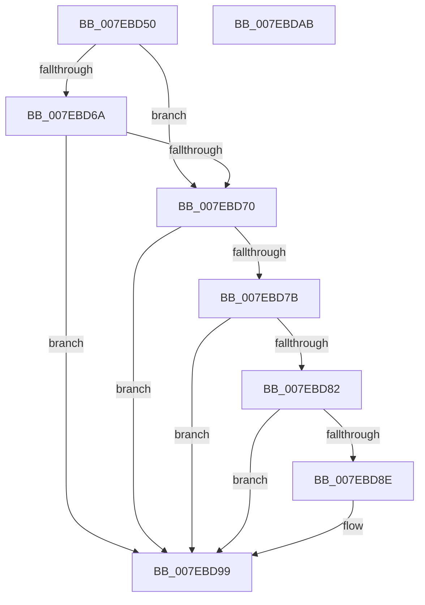

# CmpSyncKcbCacheForHive

- RVA: `0x007EBD50`–`0x007EBDAC` (길이 `92` bytes)
- VA: `0x00000001407EBD50`
- 실행 섹션: `PAGE`
- PDB 이름 있음: `예`; PDB Function 태그: `아니요`
- unwind 정보 RVA: `0x00060BC4`
- 디코드: `28`개 명령, `92/92` bytes 표시
- 미해석 바이트: `0` (있으면 어셈블리에 `.byte`로 보존)

> 이 문서는 커널 이미지의 기계어와 PDB 기호를 분석해 생성했습니다. 4번과 5번은 함수 원형과 자료형을 바이너리 사용 방식에서 추정한 C 해석이며 원본 소스 복구 결과는 아닙니다.

## 1. Dependencies

- 직접 호출 지점: **2**; 고유 호출 대상: **2**
- 직접 호출자로 확인된 함수: **1**
- RIP 상대 이미지 참조: **0**

### Outgoing calls
- `0x007EBD72` → [CmpIsKeyDeleted](../84/CmpIsKeyDeleted_function_0084BDB0.md) (function, `0x0084BDB0`)
- `0x007EBD94` → [CmpRebuildKcbCache](../87/CmpRebuildKcbCache_function_00874DF8.md) (function, `0x00874DF8`)

### Direct callers
- [CmpDoParseKey](../85/CmpDoParseKey_function_0085F750.md) at `0x0086059D`

### Static image references
- 디코드된 RIP-relative 메모리 참조가 없습니다.

## 2. Other-region calls and transfers

- 다른 실행 섹션으로 향하는 call: **0**
- 별도 외부 분기/꼬리 이동을 확인하지 못했습니다.

## 3. Assembly (complete function range)

```asm
007EBD50  48 89 5C 24 08                  mov qword ptr [rsp + 8], rbx
007EBD55  48 89 74 24 10                  mov qword ptr [rsp + 0x10], rsi
007EBD5A  57                              push rdi
007EBD5B  48 83 EC 20                     sub rsp, 0x20
007EBD5F  49 8B F0                        mov rsi, r8
007EBD62  48 8B F9                        mov rdi, rcx
007EBD65  48 85 D2                        test rdx, rdx
007EBD68  74 06                           je 0x1407ebd70
007EBD6A  48 39 51 20                     cmp qword ptr [rcx + 0x20], rdx
007EBD6E  75 29                           jne 0x1407ebd99
007EBD70  33 D2                           xor edx, edx
007EBD72  E8 39 00 06 00                  call 0x14084bdb0
007EBD77  84 C0                           test al, al
007EBD79  75 1E                           jne 0x1407ebd99
007EBD7B  48 83 7F 20 00                  cmp qword ptr [rdi + 0x20], 0
007EBD80  74 17                           je 0x1407ebd99
007EBD82  F7 87 B8 00 00 00 00 00 10 00   test dword ptr [rdi + 0xb8], 0x100000
007EBD8C  75 0B                           jne 0x1407ebd99
007EBD8E  48 8B D6                        mov rdx, rsi
007EBD91  48 8B CF                        mov rcx, rdi
007EBD94  E8 5F 90 08 00                  call 0x140874df8
007EBD99  48 8B 5C 24 30                  mov rbx, qword ptr [rsp + 0x30]
007EBD9E  33 C0                           xor eax, eax
007EBDA0  48 8B 74 24 38                  mov rsi, qword ptr [rsp + 0x38]
007EBDA5  48 83 C4 20                     add rsp, 0x20
007EBDA9  5F                              pop rdi
007EBDAA  C3                              ret
007EBDAB  CC                              int3
```

## 4. C-style interpretation (structured pseudocode)

```c
__int64 __fastcall CmpSyncKcbCacheForHive(__int64 a1, __int64 a2, __int64 a3)
{
    __int64 result;
    __int64 v_rsp;
    unsigned __int64 v_stack_p10;
    unsigned __int64 v_stack_p8;

    v_stack_p8 = v_rbx;
    v_stack_p10 = v_rsi;
    v_rsp = (v_rsp) - (32);
    if (a2 == 0) goto loc_007EBD70;
    if ((*(unsigned __int64 *)(a1 + 32)) != a2) goto loc_007EBD99;
loc_007EBD70:
    a2 = 0;
    result = CmpIsKeyDeleted(a1, a2, a3, a4);
    if ((unsigned __int8)(result) != 0) goto loc_007EBD99;
    if ((*(unsigned __int64 *)(a1 + 32)) == 0) goto loc_007EBD99;
    if (((*(unsigned int *)(a1 + 184)) & (0x100000ULL)) == 0) {
        a2 = a3;
        a1 = a1;
        result = CmpRebuildKcbCache(a1, a2, a3, a4);
    }
    result = 0;
    v_rsp = (v_rsp) + (32);
    return result;
}
```

## 5. (Beta) C Style

```c
int64_t CmpSyncKcbCacheForHive(void *Arg1, int64_t Arg2, int64_t Arg3)
{
    uint8_t *arg1 = (uint8_t *)Arg1;

    int64_t result;
    int64_t local_rsp;
    uint64_t v_stack_p10;
    uint64_t v_stack_p8;

    v_stack_p8 = local_rbx;
    v_stack_p10 = local_rsi;
    local_rsp = (local_rsp) - (32);
    if (Arg2 == 0) goto loc_007EBD70;
    if ((*(uint64_t *)(arg1 + 0x20)) != Arg2) goto loc_007EBD99;
loc_007EBD70:
    Arg2 = 0;
    result = CmpIsKeyDeleted(Arg1, Arg2, Arg3, a4);
    if ((uint8_t)(result) != 0) goto loc_007EBD99;
    if ((*(uint64_t *)(arg1 + 0x20)) == 0) goto loc_007EBD99;
    if (((*(uint32_t *)(arg1 + 0xB8)) & (0x100000ULL)) == 0) {
        Arg2 = Arg3;
        Arg1 = Arg1;
        result = CmpRebuildKcbCache(Arg1, Arg2, Arg3, a4);
    }
    result = 0;
    local_rsp = (local_rsp) + (32);
    return result;
}
```

### 관측된 메모리 오프셋

구조체 형식이 확인되지 않은 접근은 인자 기준의 오프셋으로만 기록했습니다.

| 기준 인자 | 오프셋 표현 | 폭 (bit) | 접근 |
|---|---:|---:|---|
| `Arg1` | `+ 0x20` | `64` | `R` |
| `Arg1` | `+ 0xB8` | `32` | `R` |

## 6. Execution-region graph

[열기: 2D/3D 그래프와 함수 탐색 컨트롤 패널](../../../control-panel.html?section=page&rva=0x007EBD50&view=graph)

- 2D 그래프는 위에서 아래로 흐르고, 3D 그래프는 빈 공간을 드래그해 회전합니다. Shift+드래그는 이동, 휠은 확대·축소, 함수 노드 선택은 대상 보고서 이동입니다.

### Static fallback


