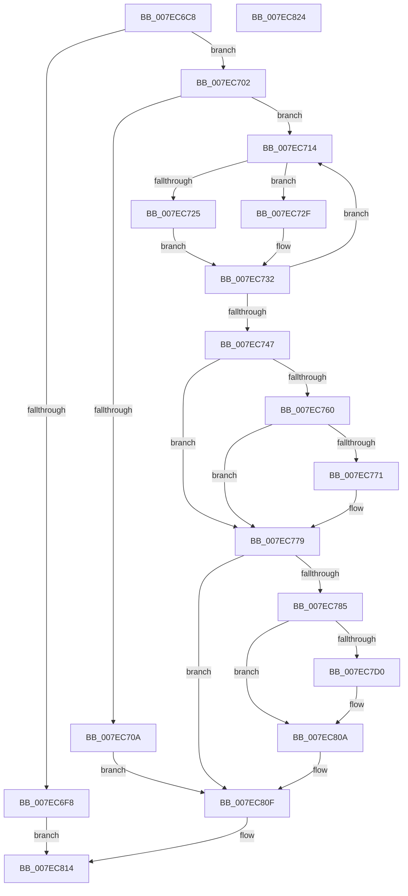

# CmpSyncNextBackupHive

- RVA: `0x007EC6C8`–`0x007EC825` (길이 `349` bytes)
- VA: `0x00000001407EC6C8`
- 실행 섹션: `PAGE`
- PDB 이름 있음: `예`; PDB Function 태그: `아니요`
- unwind 정보 RVA: `0x000D6EA4`
- 디코드: `88`개 명령, `349/349` bytes 표시
- 미해석 바이트: `0` (있으면 어셈블리에 `.byte`로 보존)

> 이 문서는 커널 이미지의 기계어와 PDB 기호를 분석해 생성했습니다. 4번과 5번은 함수 원형과 자료형을 바이너리 사용 방식에서 추정한 C 해석이며 원본 소스 복구 결과는 아닙니다.

## 1. Dependencies

- 직접 호출 지점: **6**; 고유 호출 대상: **6**
- 직접 호출자로 확인된 함수: **1**
- RIP 상대 이미지 참조: **7**

### Outgoing calls
- `0x007EC6EF` → [CmpAcquireHiveLoadUnloadRundown](../../pagecmrc/BC/CmpAcquireHiveLoadUnloadRundown_function_00BC9C6C.md) (function, `0x00BC9C6C`)
- `0x007EC774` → [CmpFlushBackupHive](CmpFlushBackupHive_function_007EC1A8.md) (function, `0x007EC1A8`)
- `0x007EC7C7` → [ZwCreateKey](../../text/6A/ZwCreateKey_function_006AD470.md) (function, `0x006AD470`)
- `0x007EC7FC` → [ZwSetValueKey](../../text/6A/ZwSetValueKey_function_006ADCD0.md) (function, `0x006ADCD0`)
- `0x007EC805` → [ZwClose](../../text/6A/ZwClose_function_006AD2B0.md) (function, `0x006AD2B0`)
- `0x007EC80F` → [CmpReleaseHiveLoadUnloadRundown](../../pagecmrc/BC/CmpReleaseHiveLoadUnloadRundown_function_00BC9CAC.md) (function, `0x00BC9CAC`)

### Direct callers
- [NtInitializeRegistry](../7D/NtInitializeRegistry_function_007DFC90.md) at `0x007DFCF3`

### Static image references
- `0x007EC702` → RVA `0x00EEFC20` (`.data`; read)
- `0x007EC714` → RVA `0x00E0ECA4` (`.data`; read)
- `0x007EC74A` → RVA `0x00E098A0` (`.data`; read)
- `0x007EC78D` → RVA `0x00E0A010` (`.data`; read)
- `0x007EC7D0` → RVA `0x00EEFC1C` (`.data`; read/write)
- `0x007EC7DB` → RVA `0x00EEFC1C` (`.data`; read)
- `0x007EC7E8` → RVA `0x00E0A000` (`.data`; read)

## 2. Other-region calls and transfers

- 다른 실행 섹션으로 향하는 call: **5**
  - `0x007EC6EF` → [CmpAcquireHiveLoadUnloadRundown](../../pagecmrc/BC/CmpAcquireHiveLoadUnloadRundown_function_00BC9C6C.md) (`PAGE` → `PAGECMRC`)
  - `0x007EC7C7` → [ZwCreateKey](../../text/6A/ZwCreateKey_function_006AD470.md) (`PAGE` → `.text`)
  - `0x007EC7FC` → [ZwSetValueKey](../../text/6A/ZwSetValueKey_function_006ADCD0.md) (`PAGE` → `.text`)
  - `0x007EC805` → [ZwClose](../../text/6A/ZwClose_function_006AD2B0.md) (`PAGE` → `.text`)
  - `0x007EC80F` → [CmpReleaseHiveLoadUnloadRundown](../../pagecmrc/BC/CmpReleaseHiveLoadUnloadRundown_function_00BC9CAC.md) (`PAGE` → `PAGECMRC`)
- 별도 외부 분기/꼬리 이동을 확인하지 못했습니다.

## 3. Assembly (complete function range)

```asm
007EC6C8  48 89 5C 24 20                  mov qword ptr [rsp + 0x20], rbx
007EC6CD  55                              push rbp
007EC6CE  48 8B EC                        mov rbp, rsp
007EC6D1  48 83 EC 70                     sub rsp, 0x70
007EC6D5  33 C0                           xor eax, eax
007EC6D7  0F 57 C0                        xorps xmm0, xmm0
007EC6DA  33 DB                           xor ebx, ebx
007EC6DC  48 89 45 F0                     mov qword ptr [rbp - 0x10], rax
007EC6E0  48 89 5D 20                     mov qword ptr [rbp + 0x20], rbx
007EC6E4  0F 11 45 D0                     movups xmmword ptr [rbp - 0x30], xmm0
007EC6E8  89 45 F8                        mov dword ptr [rbp - 8], eax
007EC6EB  0F 11 45 E0                     movups xmmword ptr [rbp - 0x20], xmm0
007EC6EF  E8 78 D5 3D 00                  call 0x140bc9c6c
007EC6F4  84 C0                           test al, al
007EC6F6  75 0A                           jne 0x1407ec702
007EC6F8  BB 89 01 00 C0                  mov ebx, 0xc0000189
007EC6FD  E9 12 01 00 00                  jmp 0x1407ec814
007EC702  39 1D 18 35 70 00               cmp dword ptr [rip + 0x703518], ebx
007EC708  75 0A                           jne 0x1407ec714
007EC70A  BB 89 01 00 C0                  mov ebx, 0xc0000189
007EC70F  E9 FB 00 00 00                  jmp 0x1407ec80f
007EC714  8B 05 8A 25 62 00               mov eax, dword ptr [rip + 0x62258a]
007EC71A  89 45 18                        mov dword ptr [rbp + 0x18], eax
007EC71D  8B 45 18                        mov eax, dword ptr [rbp + 0x18]
007EC720  83 F8 06                        cmp eax, 6
007EC723  73 0A                           jae 0x1407ec72f
007EC725  8B 45 18                        mov eax, dword ptr [rbp + 0x18]
007EC728  FF C0                           inc eax
007EC72A  89 45 10                        mov dword ptr [rbp + 0x10], eax
007EC72D  EB 03                           jmp 0x1407ec732
007EC72F  89 5D 10                        mov dword ptr [rbp + 0x10], ebx
007EC732  8B 45 18                        mov eax, dword ptr [rbp + 0x18]
007EC735  8B 4D 10                        mov ecx, dword ptr [rbp + 0x10]
007EC738  F0 0F B1 0D 64 25 62 00         lock cmpxchg dword ptr [rip + 0x622564], ecx
007EC740  8B 4D 18                        mov ecx, dword ptr [rbp + 0x18]
007EC743  3B C1                           cmp eax, ecx
007EC745  75 CD                           jne 0x1407ec714
007EC747  8B 45 10                        mov eax, dword ptr [rbp + 0x10]
007EC74A  48 8D 15 4F D1 61 00            lea rdx, [rip + 0x61d14f]
007EC751  48 69 C0 B8 00 00 00            imul rax, rax, 0xb8
007EC758  8B 44 10 20                     mov eax, dword ptr [rax + rdx + 0x20]
007EC75C  A8 01                           test al, 1
007EC75E  75 19                           jne 0x1407ec779
007EC760  8B 45 10                        mov eax, dword ptr [rbp + 0x10]
007EC763  48 69 C8 B8 00 00 00            imul rcx, rax, 0xb8
007EC76A  48 39 5C 11 30                  cmp qword ptr [rcx + rdx + 0x30], rbx
007EC76F  74 08                           je 0x1407ec779
007EC771  8B 4D 10                        mov ecx, dword ptr [rbp + 0x10]
007EC774  E8 2F FA FF FF                  call 0x1407ec1a8
007EC779  8B 45 10                        mov eax, dword ptr [rbp + 0x10]
007EC77C  83 F8 06                        cmp eax, 6
007EC77F  0F 85 8A 00 00 00               jne 0x1407ec80f
007EC785  45 33 C9                        xor r9d, r9d
007EC788  48 89 5C 24 30                  mov qword ptr [rsp + 0x30], rbx
007EC78D  48 8D 05 7C D8 61 00            lea rax, [rip + 0x61d87c]
007EC794  89 5C 24 28                     mov dword ptr [rsp + 0x28], ebx
007EC798  0F 57 C0                        xorps xmm0, xmm0
007EC79B  C7 45 D0 30 00 00 00            mov dword ptr [rbp - 0x30], 0x30
007EC7A2  4C 8D 45 D0                     lea r8, [rbp - 0x30]
007EC7A6  48 89 5D D8                     mov qword ptr [rbp - 0x28], rbx
007EC7AA  41 8D 51 02                     lea edx, [r9 + 2]
007EC7AE  C7 45 E8 40 02 00 00            mov dword ptr [rbp - 0x18], 0x240
007EC7B5  48 8D 4D 20                     lea rcx, [rbp + 0x20]
007EC7B9  48 89 45 E0                     mov qword ptr [rbp - 0x20], rax
007EC7BD  F3 0F 7F 45 F0                  movdqu xmmword ptr [rbp - 0x10], xmm0
007EC7C2  48 89 5C 24 20                  mov qword ptr [rsp + 0x20], rbx
007EC7C7  E8 A4 0C EC FF                  call 0x1406ad470
007EC7CC  85 C0                           test eax, eax
007EC7CE  78 3A                           js 0x1407ec80a
007EC7D0  F0 FF 05 45 34 70 00            lock inc dword ptr [rip + 0x703445]
007EC7D7  48 8B 4D 20                     mov rcx, qword ptr [rbp + 0x20]
007EC7DB  48 8D 05 3A 34 70 00            lea rax, [rip + 0x70343a]
007EC7E2  41 B9 04 00 00 00               mov r9d, 4
007EC7E8  48 8D 15 11 D8 61 00            lea rdx, [rip + 0x61d811]
007EC7EF  44 89 4C 24 28                  mov dword ptr [rsp + 0x28], r9d
007EC7F4  45 33 C0                        xor r8d, r8d
007EC7F7  48 89 44 24 20                  mov qword ptr [rsp + 0x20], rax
007EC7FC  E8 CF 14 EC FF                  call 0x1406adcd0
007EC801  48 8B 4D 20                     mov rcx, qword ptr [rbp + 0x20]
007EC805  E8 A6 0A EC FF                  call 0x1406ad2b0
007EC80A  BB 1A 00 00 80                  mov ebx, 0x8000001a
007EC80F  E8 98 D4 3D 00                  call 0x140bc9cac
007EC814  8B C3                           mov eax, ebx
007EC816  48 8B 9C 24 98 00 00 00         mov rbx, qword ptr [rsp + 0x98]
007EC81E  48 83 C4 70                     add rsp, 0x70
007EC822  5D                              pop rbp
007EC823  C3                              ret
007EC824  CC                              int3
```

## 4. C-style interpretation (structured pseudocode)

```c
__int64 __fastcall CmpSyncNextBackupHive(__int64 a1, __int64 a2, __int64 a3, int a4)
{
    __int64 result;
    __int64 v_rbx;
    __int64 v_rsp;
    unsigned int v_stack_m10;
    unsigned __int64 v_stack_m18;
    unsigned int v_stack_m20;
    unsigned __int64 v_stack_m28;
    unsigned __int64 v_stack_m30;
    unsigned __int64 v_stack_m38;
    unsigned __int64 v_stack_m48;
    unsigned int v_stack_m50;
    unsigned __int64 v_stack_m58;
    unsigned int v_stack_p10;
    unsigned __int64 v_stack_p18;
    unsigned __int64 v_stack_p20;
    unsigned int v_stack_p8;

    v_stack_p20 = v_rbx;
    v_rsp = (v_rsp) - (112);
    result = 0;
    v_rbx = 0;
    v_stack_m18 = 0;
    v_stack_p18 = 0;
    v_stack_m38 = v_xmm0;
    v_stack_m10 = 0;
    v_stack_m28 = v_xmm0;
    result = CmpAcquireHiveLoadUnloadRundown(a1, a2, a3, a4);
    if ((unsigned __int8)(result) != 0) goto loc_007EC702;
    goto loc_007EC814;
loc_007EC702:
    if ((*(unsigned int *)(v_rip + 7353624)) != ((unsigned int)((unsigned int)(0xC0000189ULL)))) goto loc_007EC714;
    goto loc_007EC80F;
loc_007EC714:
    v_stack_p10 = (unsigned int)((unsigned int)(*(unsigned int *)(v_rip + 6432138)));
    if (((unsigned int)((unsigned int)(v_stack_p10))) >= 6) goto loc_007EC72F;
    result = (unsigned int)(((unsigned int)(v_stack_p10)) + 1);
    v_stack_p8 = (unsigned int)(result);
    goto loc_007EC732;
loc_007EC72F:
    v_stack_p8 = (unsigned int)((unsigned int)(0xC0000189ULL));
loc_007EC732:
    if (((unsigned int)((unsigned int)(v_stack_p10))) != ((unsigned int)((unsigned int)(v_stack_p10)))) goto loc_007EC714;
    result = ((unsigned int)(v_stack_p8)) * ((unsigned int)(v_stack_p8));
    if ((((unsigned __int8)((unsigned int)(*(unsigned int *)(result + v_rip + 6410575 * 1 + 32)))) & (1)) != 0) goto loc_007EC779;
    a1 = ((unsigned int)(v_stack_p10)) * ((unsigned int)(v_stack_p8));
    result = (unsigned int)(v_stack_p8);
    if ((*(unsigned __int64 *)(a1 + v_rip + 6410575 * 1 + 48)) != ((unsigned int)(0xC0000189ULL))) {
        a1 = v_stack_p8;
        result = CmpFlushBackupHive(a1, v_rip + 6410575, a3, a4);
    }
    if (((unsigned int)((unsigned int)(v_stack_p8))) != 6) goto loc_007EC80F;
    a4 = 0;
    v_stack_m48 = (unsigned int)(0xC0000189ULL);
    v_stack_m50 = (unsigned int)((unsigned int)(0xC0000189ULL));
    v_stack_m38 = 48;
    v_stack_m30 = (unsigned int)(0xC0000189ULL);
    v_stack_m20 = 576;
    v_stack_m28 = v_rip + 6412412;
    v_stack_m18 = v_xmm0;
    v_stack_m58 = (unsigned int)(0xC0000189ULL);
    result = ZwCreateKey(v_stack_p18, a4 + 2, v_stack_m38, a4);
    if (!(sign_flag)) {
        a1 = v_stack_p18;
        result = v_rip + 7353402;
        a4 = 4;
        a2 = v_rip + 6412305;
        v_stack_m50 = a4;
        a3 = 0;
        v_stack_m58 = result;
        result = ZwSetValueKey(a1, a2, a3, a4);
        a1 = v_stack_p18;
        result = ZwClose(a1, a2, a3, a4);
    }
loc_007EC80F:
    result = CmpReleaseHiveLoadUnloadRundown(a1, a2, a3, a4);
loc_007EC814:
    v_rsp = (v_rsp) + (112);
    return (unsigned int)((unsigned int)((unsigned int)(0x8000001AULL)));
}
```

## 5. (Beta) C Style

```c
int64_t CmpSyncNextBackupHive(int64_t Arg1, int64_t Arg2, int64_t Arg3, int32_t Arg4)
{
    int64_t result;
    int64_t local_rbx;
    int64_t local_rsp;
    uint32_t v_stack_m10;
    uint64_t v_stack_m18;
    uint32_t v_stack_m20;
    uint64_t v_stack_m28;
    uint64_t v_stack_m30;
    uint64_t v_stack_m38;
    uint64_t v_stack_m48;
    uint32_t v_stack_m50;
    uint64_t v_stack_m58;
    uint32_t v_stack_p10;
    uint64_t v_stack_p18;
    uint64_t v_stack_p20;
    uint32_t v_stack_p8;

    v_stack_p20 = local_rbx;
    local_rsp = (local_rsp) - (112);
    result = 0;
    local_rbx = 0;
    v_stack_m18 = 0;
    v_stack_p18 = 0;
    v_stack_m38 = v_xmm0;
    v_stack_m10 = 0;
    v_stack_m28 = v_xmm0;
    result = CmpAcquireHiveLoadUnloadRundown(Arg1, Arg2, Arg3, Arg4);
    if ((uint8_t)(result) != 0) goto loc_007EC702;
    goto loc_007EC814;
loc_007EC702:
    if ((*(uint32_t *)(v_rip + 0x703518)) != ((uint32_t)((uint32_t)(0xC0000189ULL)))) goto loc_007EC714;
    goto loc_007EC80F;
loc_007EC714:
    v_stack_p10 = (uint32_t)((uint32_t)(*(uint32_t *)(v_rip + 0x62258A)));
    if (((uint32_t)((uint32_t)(v_stack_p10))) >= 6) goto loc_007EC72F;
    result = (uint32_t)(((uint32_t)(v_stack_p10)) + 1);
    v_stack_p8 = (uint32_t)(result);
    goto loc_007EC732;
loc_007EC72F:
    v_stack_p8 = (uint32_t)((uint32_t)(0xC0000189ULL));
loc_007EC732:
    if (((uint32_t)((uint32_t)(v_stack_p10))) != ((uint32_t)((uint32_t)(v_stack_p10)))) goto loc_007EC714;
    result = ((uint32_t)(v_stack_p8)) * ((uint32_t)(v_stack_p8));
    if ((((uint8_t)((uint32_t)(*(uint32_t *)(result + v_rip + 0x61D14F * 1 + 0x20)))) & (1)) != 0) goto loc_007EC779;
    Arg1 = ((uint32_t)(v_stack_p10)) * ((uint32_t)(v_stack_p8));
    result = (uint32_t)(v_stack_p8);
    if ((*(uint64_t *)(Arg1 + v_rip + 0x61D14F * 1 + 0x30)) != ((uint32_t)(0xC0000189ULL))) {
        Arg1 = v_stack_p8;
        result = CmpFlushBackupHive(Arg1, v_rip + 6410575, Arg3, Arg4);
    }
    if (((uint32_t)((uint32_t)(v_stack_p8))) != 6) goto loc_007EC80F;
    Arg4 = 0;
    v_stack_m48 = (uint32_t)(0xC0000189ULL);
    v_stack_m50 = (uint32_t)((uint32_t)(0xC0000189ULL));
    v_stack_m38 = 48;
    v_stack_m30 = (uint32_t)(0xC0000189ULL);
    v_stack_m20 = 576;
    v_stack_m28 = v_rip + 6412412;
    v_stack_m18 = v_xmm0;
    v_stack_m58 = (uint32_t)(0xC0000189ULL);
    result = ZwCreateKey(v_stack_p18, Arg4 + 2, v_stack_m38, Arg4);
    if (!(sign_flag)) {
        Arg1 = v_stack_p18;
        result = v_rip + 7353402;
        Arg4 = 4;
        Arg2 = v_rip + 6412305;
        v_stack_m50 = Arg4;
        Arg3 = 0;
        v_stack_m58 = result;
        result = ZwSetValueKey(Arg1, Arg2, Arg3, Arg4);
        Arg1 = v_stack_p18;
        result = ZwClose(Arg1, Arg2, Arg3, Arg4);
    }
loc_007EC80F:
    result = CmpReleaseHiveLoadUnloadRundown(Arg1, Arg2, Arg3, Arg4);
loc_007EC814:
    local_rsp = (local_rsp) + (112);
    return (uint32_t)((uint32_t)((uint32_t)(0x8000001AULL)));
}
```

## 6. Execution-region graph

[열기: 2D/3D 그래프와 함수 탐색 컨트롤 패널](../../../control-panel.html?section=page&rva=0x007EC6C8&view=graph)

- 2D 그래프는 위에서 아래로 흐르고, 3D 그래프는 빈 공간을 드래그해 회전합니다. Shift+드래그는 이동, 휠은 확대·축소, 함수 노드 선택은 대상 보고서 이동입니다.

### Static fallback


