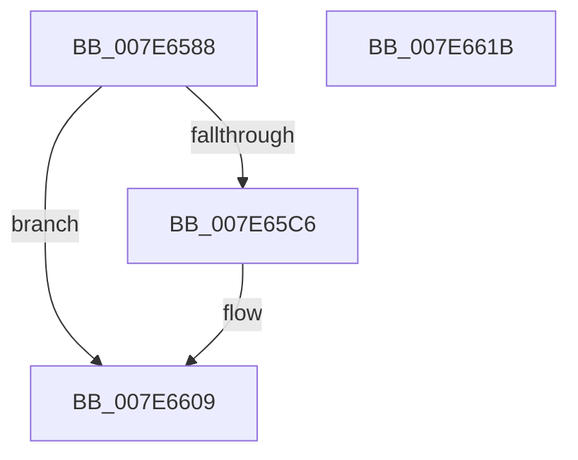

# CmpTraceHiveMountLogEntryApplied

- RVA: `0x007E6588`–`0x007E661C` (길이 `148` bytes)
- VA: `0x00000001407E6588`
- 실행 섹션: `PAGE`
- PDB 이름 있음: `예`; PDB Function 태그: `아니요`
- unwind 정보 RVA: `0x000D6C68`
- 디코드: `38`개 명령, `148/148` bytes 표시
- 미해석 바이트: `0` (있으면 어셈블리에 `.byte`로 보존)

> 이 문서는 커널 이미지의 기계어와 PDB 기호를 분석해 생성했습니다. 4번과 5번은 함수 원형과 자료형을 바이너리 사용 방식에서 추정한 C 해석이며 원본 소스 복구 결과는 아닙니다.

## 1. Dependencies

- 직접 호출 지점: **3**; 고유 호출 대상: **3**
- 직접 호출자로 확인된 함수: **1**
- RIP 상대 이미지 참조: **3**

### Outgoing calls
- `0x007E65BD` → [EtwEventEnabled](../../text/39/EtwEventEnabled_function_00392450.md) (function, `0x00392450`)
- `0x007E6604` → [EtwWrite](../../text/41/EtwWrite_function_0041C720.md) (function, `0x0041C720`)
- `0x007E6610` → [_security_check_cookie](../../text/6A/_security_check_cookie_function_006AC640.md) (function, `0x006AC640`)

### Direct callers
- [HvpApplyIncrementalLogFile](../AA/HvpApplyIncrementalLogFile_function_00AA06A8.md) at `0x00AA0764`

### Static image references
- `0x007E6598` → RVA `0x00E0A740` (`.data`; read)
- `0x007E65A6` → RVA `0x00023348` (`.rdata`; read)
- `0x007E65AD` → RVA `0x00FD8018` (`PAGEDATA`; read)

## 2. Other-region calls and transfers

- 다른 실행 섹션으로 향하는 call: **3**
  - `0x007E65BD` → [EtwEventEnabled](../../text/39/EtwEventEnabled_function_00392450.md) (`PAGE` → `.text`)
  - `0x007E6604` → [EtwWrite](../../text/41/EtwWrite_function_0041C720.md) (`PAGE` → `.text`)
  - `0x007E6610` → [_security_check_cookie](../../text/6A/_security_check_cookie_function_006AC640.md) (`PAGE` → `.text`)
- 별도 외부 분기/꼬리 이동을 확인하지 못했습니다.

## 3. Assembly (complete function range)

```asm
007E6588  89 54 24 10                     mov dword ptr [rsp + 0x10], edx
007E658C  89 4C 24 08                     mov dword ptr [rsp + 8], ecx
007E6590  55                              push rbp
007E6591  48 8B EC                        mov rbp, rsp
007E6594  48 83 EC 70                     sub rsp, 0x70
007E6598  48 8B 05 A1 41 62 00            mov rax, qword ptr [rip + 0x6241a1]
007E659F  48 33 C4                        xor rax, rsp
007E65A2  48 89 45 F0                     mov qword ptr [rbp - 0x10], rax
007E65A6  0F 10 05 9B CD 83 FF            movups xmm0, xmmword ptr [rip - 0x7c3265]
007E65AD  48 8B 0D 64 1A 7F 00            mov rcx, qword ptr [rip + 0x7f1a64]
007E65B4  48 8D 55 C0                     lea rdx, [rbp - 0x40]
007E65B8  F3 0F 7F 45 C0                  movdqu xmmword ptr [rbp - 0x40], xmm0
007E65BD  E8 8E BE BA FF                  call 0x140392450
007E65C2  84 C0                           test al, al
007E65C4  74 43                           je 0x1407e6609
007E65C6  83 65 DC 00                     and dword ptr [rbp - 0x24], 0
007E65CA  48 8D 45 10                     lea rax, [rbp + 0x10]
007E65CE  83 65 EC 00                     and dword ptr [rbp - 0x14], 0
007E65D2  48 8D 55 C0                     lea rdx, [rbp - 0x40]
007E65D6  B9 04 00 00 00                  mov ecx, 4
007E65DB  48 89 45 D0                     mov qword ptr [rbp - 0x30], rax
007E65DF  48 8D 45 18                     lea rax, [rbp + 0x18]
007E65E3  89 4D D8                        mov dword ptr [rbp - 0x28], ecx
007E65E6  48 89 45 E0                     mov qword ptr [rbp - 0x20], rax
007E65EA  45 33 C0                        xor r8d, r8d
007E65ED  48 8D 45 D0                     lea rax, [rbp - 0x30]
007E65F1  89 4D E8                        mov dword ptr [rbp - 0x18], ecx
007E65F4  44 8D 49 FE                     lea r9d, [rcx - 2]
007E65F8  48 89 44 24 20                  mov qword ptr [rsp + 0x20], rax
007E65FD  48 8B 0D 14 1A 7F 00            mov rcx, qword ptr [rip + 0x7f1a14]
007E6604  E8 17 61 C3 FF                  call 0x14041c720
007E6609  48 8B 4D F0                     mov rcx, qword ptr [rbp - 0x10]
007E660D  48 33 CC                        xor rcx, rsp
007E6610  E8 2B 60 EC FF                  call 0x1406ac640
007E6615  48 83 C4 70                     add rsp, 0x70
007E6619  5D                              pop rbp
007E661A  C3                              ret
007E661B  CC                              int3
```

## 4. C-style interpretation (structured pseudocode)

```c
__int64 __fastcall CmpTraceHiveMountLogEntryApplied(int a1, int a2, int a3)
{
    __int64 result;
    __int64 v_rsp;
    unsigned __int64 v_stack_m18;
    unsigned int v_stack_m1C;
    unsigned int v_stack_m20;
    unsigned __int64 v_stack_m28;
    unsigned int v_stack_m2C;
    unsigned int v_stack_m30;
    unsigned __int64 v_stack_m38;
    unsigned __int64 v_stack_m48;
    unsigned __int64 v_stack_m58;
    unsigned int v_stack_p10;
    unsigned int v_stack_p8;

    v_stack_p10 = a2;
    v_stack_p8 = a1;
    v_rsp = (v_rsp) - (112);
    result = (*(unsigned __int64 *)(v_rip + 6439329)) ^ (v_rsp);
    v_stack_m18 = result;
    v_stack_m48 = v_xmm0;
    result = EtwEventEnabled(*(unsigned __int64 *)(v_rip + 8329828), v_stack_m48, a3, a4);
    if ((unsigned __int8)(result) != 0) {
        result = v_stack_p8;
        a2 = v_stack_m48;
        a1 = 4;
        v_stack_m38 = result;
        result = v_stack_p10;
        v_stack_m30 = a1;
        v_stack_m28 = result;
        a3 = 0;
        result = v_stack_m38;
        v_stack_m20 = a1;
        a4 = a1 - 2;
        v_stack_m58 = result;
        a1 = *(unsigned __int64 *)(v_rip + 8329748);
        result = EtwWrite(a1, a2, a3, a4);
    }
    a1 = (v_stack_m18) ^ (v_rsp);
    result = _security_check_cookie(a1, a2, a3, a4);
    v_rsp = (v_rsp) + (112);
    return result;
}
```

## 5. (Beta) C Style

```c
int64_t CmpTraceHiveMountLogEntryApplied(int32_t Arg1, int32_t Arg2, int32_t Arg3)
{
    int64_t result;
    int64_t local_rsp;
    uint64_t v_stack_m18;
    uint32_t v_stack_m1C;
    uint32_t v_stack_m20;
    uint64_t v_stack_m28;
    uint32_t v_stack_m2C;
    uint32_t v_stack_m30;
    uint64_t v_stack_m38;
    uint64_t v_stack_m48;
    uint64_t v_stack_m58;
    uint32_t v_stack_p10;
    uint32_t v_stack_p8;

    v_stack_p10 = Arg2;
    v_stack_p8 = Arg1;
    local_rsp = (local_rsp) - (112);
    result = (*(uint64_t *)(v_rip + 0x6241A1)) ^ (local_rsp);
    v_stack_m18 = result;
    v_stack_m48 = v_xmm0;
    result = EtwEventEnabled(*(uint64_t *)(v_rip + 0x7F1A64), v_stack_m48, Arg3, a4);
    if ((uint8_t)(result) != 0) {
        result = v_stack_p8;
        Arg2 = v_stack_m48;
        Arg1 = 4;
        v_stack_m38 = result;
        result = v_stack_p10;
        v_stack_m30 = Arg1;
        v_stack_m28 = result;
        Arg3 = 0;
        result = v_stack_m38;
        v_stack_m20 = Arg1;
        a4 = Arg1 - 2;
        v_stack_m58 = result;
        Arg1 = *(uint64_t *)(v_rip + 0x7F1A14);
        result = EtwWrite(Arg1, Arg2, Arg3, a4);
    }
    Arg1 = (v_stack_m18) ^ (local_rsp);
    result = _security_check_cookie(Arg1, Arg2, Arg3, a4);
    local_rsp = (local_rsp) + (112);
    return result;
}
```

## 6. Execution-region graph

[열기: 2D/3D 그래프와 함수 탐색 컨트롤 패널](../../../control-panel.html?section=page&rva=0x007E6588&view=graph)

- 2D 그래프는 위에서 아래로 흐르고, 3D 그래프는 빈 공간을 드래그해 회전합니다. Shift+드래그는 이동, 휠은 확대·축소, 함수 노드 선택은 대상 보고서 이동입니다.

### Static fallback


