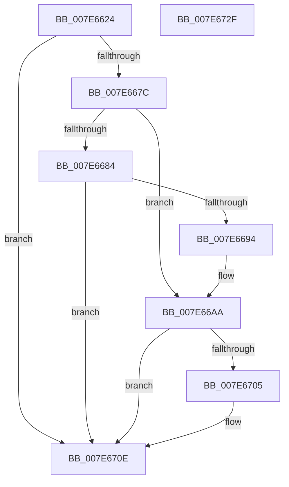

# CmpTraceHiveRestoreStart

- RVA: `0x007E6624`–`0x007E6730` (길이 `268` bytes)
- VA: `0x00000001407E6624`
- 실행 섹션: `PAGE`
- PDB 이름 있음: `예`; PDB Function 태그: `아니요`
- unwind 정보 RVA: `0x000D6CB0`
- 디코드: `68`개 명령, `268/268` bytes 표시
- 미해석 바이트: `0` (있으면 어셈블리에 `.byte`로 보존)

> 이 문서는 커널 이미지의 기계어와 PDB 기호를 분석해 생성했습니다. 4번과 5번은 함수 원형과 자료형을 바이너리 사용 방식에서 추정한 C 해석이며 원본 소스 복구 결과는 아닙니다.

## 1. Dependencies

- 직접 호출 지점: **5**; 고유 호출 대상: **5**
- 직접 호출자로 확인된 함수: **1**
- RIP 상대 이미지 참조: **3**

### Outgoing calls
- `0x007E666D` → [EtwEventEnabled](../../text/39/EtwEventEnabled_function_00392450.md) (function, `0x00392450`)
- `0x007E668B` → [CmpQueryNameString](../9B/CmpQueryNameString_function_009BA2AC.md) (function, `0x009BA2AC`)
- `0x007E66FB` → [EtwWrite](../../text/41/EtwWrite_function_0041C720.md) (function, `0x0041C720`)
- `0x007E6709` → [RtlFreeAnsiString](../9C/RtlFreeAnsiString_function_009C0800.md) (function, `0x009C0800`)
- `0x007E6715` → [_security_check_cookie](../../text/6A/_security_check_cookie_function_006AC640.md) (function, `0x006AC640`)

### Direct callers
- [CmRestoreKey](../7D/CmRestoreKey_function_007DCF04.md) at `0x007DCFF1`

### Static image references
- `0x007E663E` → RVA `0x00E0A740` (`.data`; read)
- `0x007E664C` → RVA `0x00022718` (`.rdata`; read)
- `0x007E665A` → RVA `0x00FD8018` (`PAGEDATA`; read)

## 2. Other-region calls and transfers

- 다른 실행 섹션으로 향하는 call: **3**
  - `0x007E666D` → [EtwEventEnabled](../../text/39/EtwEventEnabled_function_00392450.md) (`PAGE` → `.text`)
  - `0x007E66FB` → [EtwWrite](../../text/41/EtwWrite_function_0041C720.md) (`PAGE` → `.text`)
  - `0x007E6715` → [_security_check_cookie](../../text/6A/_security_check_cookie_function_006AC640.md) (`PAGE` → `.text`)
- 별도 외부 분기/꼬리 이동을 확인하지 못했습니다.

## 3. Assembly (complete function range)

```asm
007E6624  48 8B C4                        mov rax, rsp
007E6627  48 89 58 18                     mov qword ptr [rax + 0x18], rbx
007E662B  48 89 78 20                     mov qword ptr [rax + 0x20], rdi
007E662F  89 50 10                        mov dword ptr [rax + 0x10], edx
007E6632  55                              push rbp
007E6633  48 8D 68 A1                     lea rbp, [rax - 0x5f]
007E6637  48 81 EC 90 00 00 00            sub rsp, 0x90
007E663E  48 8B 05 FB 40 62 00            mov rax, qword ptr [rip + 0x6240fb]
007E6645  48 33 C4                        xor rax, rsp
007E6648  48 89 45 4F                     mov qword ptr [rbp + 0x4f], rax
007E664C  0F 10 0D C5 C0 83 FF            movups xmm1, xmmword ptr [rip - 0x7c3f3b]
007E6653  48 8B D9                        mov rbx, rcx
007E6656  48 8D 55 0F                     lea rdx, [rbp + 0xf]
007E665A  48 8B 0D B7 19 7F 00            mov rcx, qword ptr [rip + 0x7f19b7]
007E6661  0F 57 C0                        xorps xmm0, xmm0
007E6664  F3 0F 7F 4D 0F                  movdqu xmmword ptr [rbp + 0xf], xmm1
007E6669  0F 11 45 FF                     movups xmmword ptr [rbp - 1], xmm0
007E666D  E8 DE BD BA FF                  call 0x140392450
007E6672  33 FF                           xor edi, edi
007E6674  84 C0                           test al, al
007E6676  0F 84 92 00 00 00               je 0x1407e670e
007E667C  44 8B CF                        mov r9d, edi
007E667F  48 85 DB                        test rbx, rbx
007E6682  74 26                           je 0x1407e66aa
007E6684  48 8D 55 FF                     lea rdx, [rbp - 1]
007E6688  48 8B CB                        mov rcx, rbx
007E668B  E8 1C 3C 1D 00                  call 0x1409ba2ac
007E6690  85 C0                           test eax, eax
007E6692  78 7A                           js 0x1407e670e
007E6694  48 8B 45 07                     mov rax, qword ptr [rbp + 7]
007E6698  44 8D 4F 01                     lea r9d, [rdi + 1]
007E669C  48 89 45 1F                     mov qword ptr [rbp + 0x1f], rax
007E66A0  0F B7 45 FF                     movzx eax, word ptr [rbp - 1]
007E66A4  89 45 27                        mov dword ptr [rbp + 0x27], eax
007E66A7  89 7D 2B                        mov dword ptr [rbp + 0x2b], edi
007E66AA  41 8B C1                        mov eax, r9d
007E66AD  48 8D 4D F7                     lea rcx, [rbp - 9]
007E66B1  48 03 C0                        add rax, rax
007E66B4  66 89 7D F7                     mov word ptr [rbp - 9], di
007E66B8  41 FF C1                        inc r9d
007E66BB  48 8D 55 0F                     lea rdx, [rbp + 0xf]
007E66BF  45 33 C0                        xor r8d, r8d
007E66C2  48 89 4C C5 1F                  mov qword ptr [rbp + rax*8 + 0x1f], rcx
007E66C7  48 8D 4D 6F                     lea rcx, [rbp + 0x6f]
007E66CB  48 C7 44 C5 27 02 00 00 00      mov qword ptr [rbp + rax*8 + 0x27], 2
007E66D4  41 8B C1                        mov eax, r9d
007E66D7  48 03 C0                        add rax, rax
007E66DA  41 FF C1                        inc r9d
007E66DD  48 89 4C C5 1F                  mov qword ptr [rbp + rax*8 + 0x1f], rcx
007E66E2  48 8B 0D 2F 19 7F 00            mov rcx, qword ptr [rip + 0x7f192f]
007E66E9  48 C7 44 C5 27 04 00 00 00      mov qword ptr [rbp + rax*8 + 0x27], 4
007E66F2  48 8D 45 1F                     lea rax, [rbp + 0x1f]
007E66F6  48 89 44 24 20                  mov qword ptr [rsp + 0x20], rax
007E66FB  E8 20 60 C3 FF                  call 0x14041c720
007E6700  48 85 DB                        test rbx, rbx
007E6703  74 09                           je 0x1407e670e
007E6705  48 8D 4D FF                     lea rcx, [rbp - 1]
007E6709  E8 F2 A0 1D 00                  call 0x1409c0800
007E670E  48 8B 4D 4F                     mov rcx, qword ptr [rbp + 0x4f]
007E6712  48 33 CC                        xor rcx, rsp
007E6715  E8 26 5F EC FF                  call 0x1406ac640
007E671A  4C 8D 9C 24 90 00 00 00         lea r11, [rsp + 0x90]
007E6722  49 8B 5B 20                     mov rbx, qword ptr [r11 + 0x20]
007E6726  49 8B 7B 28                     mov rdi, qword ptr [r11 + 0x28]
007E672A  49 8B E3                        mov rsp, r11
007E672D  5D                              pop rbp
007E672E  C3                              ret
007E672F  CC                              int3
```

## 4. C-style interpretation (structured pseudocode)

```c
__int64 __fastcall CmpTraceHiveRestoreStart(__int64 a1, int a2, int a3)
{
    __int64 result;
    __int64 v_rdi;
    __int64 v_rsp;
    unsigned __int64 v_stack_m78;
    unsigned __int64 v_stack_m8;

    *(unsigned __int64 *)(v_rsp + 24) = v_rbx;
    *(unsigned __int64 *)(v_rsp + 32) = v_rdi;
    *(unsigned int *)(v_rsp + 16) = a2;
    v_rsp = (v_rsp) - (144);
    result = (*(unsigned __int64 *)(v_rip + 6439163)) ^ (v_rsp);
    *(unsigned __int64 *)(v_rsp - 95 + 79) = result;
    *(unsigned __int64 *)(v_rsp - 95 + 15) = v_xmm1;
    *(unsigned __int64 *)(v_rsp - 95 - 1) = v_xmm0;
    result = EtwEventEnabled(*(unsigned __int64 *)(v_rip + 8329655), v_rsp - 95 + 15, a3, a4);
    v_rdi = 0;
    if ((unsigned __int8)(result) == 0) goto loc_007E670E;
    if (a1 == 0) goto loc_007E66AA;
    result = CmpQueryNameString(a1, v_rsp - 95 - 1, a3, 0);
    if (sign_flag) goto loc_007E670E;
    *(unsigned __int64 *)(v_rsp - 95 + 31) = *(unsigned __int64 *)(v_rsp - 95 + 7);
    *(unsigned int *)(v_rsp - 95 + 39) = (unsigned int)(*(unsigned __int16 *)(v_rsp - 95 - 1));
    *(unsigned int *)(v_rsp - 95 + 43) = 0;
loc_007E66AA:
    result = ((unsigned int)((unsigned int)(v_rdi + 1))) + ((unsigned int)((unsigned int)(v_rdi + 1)));
    *(unsigned __int16 *)(v_rsp - 95 - 9) = 0;
    a4 = (unsigned int)((v_rdi + 1) + 1);
    a3 = 0;
    *(unsigned __int64 *)(v_rsp - 95 + result * 8 + 31) = v_rsp - 95 - 9;
    *(unsigned __int64 *)(v_rsp - 95 + result * 8 + 39) = 2;
    result = ((unsigned int)((unsigned int)(a4))) + ((unsigned int)((unsigned int)(a4)));
    a4 = (unsigned int)((a4) + 1);
    *(unsigned __int64 *)(v_rsp - 95 + result * 8 + 31) = v_rsp - 95 + 111;
    *(unsigned __int64 *)(v_rsp - 95 + result * 8 + 39) = 4;
    v_stack_m78 = v_rsp - 95 + 31;
    result = EtwWrite(*(unsigned __int64 *)(v_rip + 8329519), v_rsp - 95 + 15, a3, a4);
    if (a1 != 0) {
        a1 = v_rsp - 95 - 1;
        result = RtlFreeAnsiString(a1, v_rsp - 95 + 15, a3, a4);
    }
    a1 = (*(unsigned __int64 *)(v_rsp - 95 + 79)) ^ (v_rsp);
    result = _security_check_cookie(a1, v_rsp - 95 + 15, a3, a4);
    return result;
}
```

## 5. (Beta) C Style

```c
int64_t CmpTraceHiveRestoreStart(int64_t Arg1, int32_t Arg2, int32_t Arg3)
{
    int64_t result;
    int64_t local_rdi;
    int64_t local_rsp;
    uint64_t v_stack_m78;
    uint64_t v_stack_m8;

    *(uint64_t *)(local_rsp + 0x18) = local_rbx;
    *(uint64_t *)(local_rsp + 0x20) = local_rdi;
    *(uint32_t *)(local_rsp + 0x10) = Arg2;
    local_rsp = (local_rsp) - (144);
    result = (*(uint64_t *)(v_rip + 0x6240FB)) ^ (local_rsp);
    *(uint64_t *)(local_rsp - 0x5F + 0x4F) = result;
    *(uint64_t *)(local_rsp - 0x5F + 0xF) = v_xmm1;
    *(uint64_t *)(local_rsp - 0x5F - 0x1) = v_xmm0;
    result = EtwEventEnabled(*(uint64_t *)(v_rip + 0x7F19B7), local_rsp - 95 + 15, Arg3, a4);
    local_rdi = 0;
    if ((uint8_t)(result) == 0) goto loc_007E670E;
    if (Arg1 == 0) goto loc_007E66AA;
    result = CmpQueryNameString(Arg1, local_rsp - 95 - 1, Arg3, 0);
    if (sign_flag) goto loc_007E670E;
    *(uint64_t *)(local_rsp - 0x5F + 0x1F) = *(uint64_t *)(local_rsp - 0x5F + 0x7);
    *(uint32_t *)(local_rsp - 0x5F + 0x27) = (uint32_t)(*(uint16_t *)(local_rsp - 0x5F - 0x1));
    *(uint32_t *)(local_rsp - 0x5F + 0x2B) = 0;
loc_007E66AA:
    result = ((uint32_t)((uint32_t)(local_rdi + 1))) + ((uint32_t)((uint32_t)(local_rdi + 1)));
    *(uint16_t *)(local_rsp - 0x5F - 0x9) = 0;
    a4 = (uint32_t)((local_rdi + 1) + 1);
    Arg3 = 0;
    *(uint64_t *)(local_rsp - 0x5F + result * 8 + 0x1F) = local_rsp - 95 - 9;
    *(uint64_t *)(local_rsp - 0x5F + result * 8 + 0x27) = 2;
    result = ((uint32_t)((uint32_t)(a4))) + ((uint32_t)((uint32_t)(a4)));
    a4 = (uint32_t)((a4) + 1);
    *(uint64_t *)(local_rsp - 0x5F + result * 8 + 0x1F) = local_rsp - 95 + 111;
    *(uint64_t *)(local_rsp - 0x5F + result * 8 + 0x27) = 4;
    v_stack_m78 = local_rsp - 95 + 31;
    result = EtwWrite(*(uint64_t *)(v_rip + 0x7F192F), local_rsp - 95 + 15, Arg3, a4);
    if (Arg1 != 0) {
        Arg1 = local_rsp - 95 - 1;
        result = RtlFreeAnsiString(Arg1, local_rsp - 95 + 15, Arg3, a4);
    }
    Arg1 = (*(uint64_t *)(local_rsp - 0x5F + 0x4F)) ^ (local_rsp);
    result = _security_check_cookie(Arg1, local_rsp - 95 + 15, Arg3, a4);
    return result;
}
```

## 6. Execution-region graph

[열기: 2D/3D 그래프와 함수 탐색 컨트롤 패널](../../../control-panel.html?section=page&rva=0x007E6624&view=graph)

- 2D 그래프는 위에서 아래로 흐르고, 3D 그래프는 빈 공간을 드래그해 회전합니다. Shift+드래그는 이동, 휠은 확대·축소, 함수 노드 선택은 대상 보고서 이동입니다.

### Static fallback


