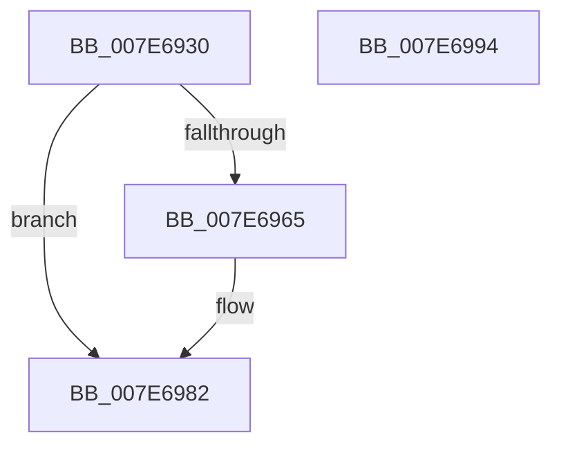

# CmpTraceShutdownRundownComplete

- RVA: `0x007E6930`–`0x007E6995` (길이 `101` bytes)
- VA: `0x00000001407E6930`
- 실행 섹션: `PAGE`
- PDB 이름 있음: `예`; PDB Function 태그: `아니요`
- unwind 정보 RVA: `0x00060904`
- 디코드: `23`개 명령, `101/101` bytes 표시
- 미해석 바이트: `0` (있으면 어셈블리에 `.byte`로 보존)

> 이 문서는 커널 이미지의 기계어와 PDB 기호를 분석해 생성했습니다. 4번과 5번은 함수 원형과 자료형을 바이너리 사용 방식에서 추정한 C 해석이며 원본 소스 복구 결과는 아닙니다.

## 1. Dependencies

- 직접 호출 지점: **3**; 고유 호출 대상: **3**
- 직접 호출자로 확인된 함수: **1**
- RIP 상대 이미지 참조: **3**

### Outgoing calls
- `0x007E695C` → [EtwEventEnabled](../../text/39/EtwEventEnabled_function_00392450.md) (function, `0x00392450`)
- `0x007E697D` → [EtwWrite](../../text/41/EtwWrite_function_0041C720.md) (function, `0x0041C720`)
- `0x007E698A` → [_security_check_cookie](../../text/6A/_security_check_cookie_function_006AC640.md) (function, `0x006AC640`)

### Direct callers
- [CmShutdownSystem2](../../text/66/CmShutdownSystem2_function_0066A7FC.md) at `0x0066A836`

### Static image references
- `0x007E6934` → RVA `0x00E0A740` (`.data`; read)
- `0x007E6943` → RVA `0x00023090` (`.rdata`; read)
- `0x007E694A` → RVA `0x00FD8018` (`PAGEDATA`; read)

## 2. Other-region calls and transfers

- 다른 실행 섹션으로 향하는 call: **3**
  - `0x007E695C` → [EtwEventEnabled](../../text/39/EtwEventEnabled_function_00392450.md) (`PAGE` → `.text`)
  - `0x007E697D` → [EtwWrite](../../text/41/EtwWrite_function_0041C720.md) (`PAGE` → `.text`)
  - `0x007E698A` → [_security_check_cookie](../../text/6A/_security_check_cookie_function_006AC640.md) (`PAGE` → `.text`)
- 별도 외부 분기/꼬리 이동을 확인하지 못했습니다.

## 3. Assembly (complete function range)

```asm
007E6930  48 83 EC 58                     sub rsp, 0x58
007E6934  48 8B 05 05 3E 62 00            mov rax, qword ptr [rip + 0x623e05]
007E693B  48 33 C4                        xor rax, rsp
007E693E  48 89 44 24 40                  mov qword ptr [rsp + 0x40], rax
007E6943  0F 10 05 46 C7 83 FF            movups xmm0, xmmword ptr [rip - 0x7c38ba]
007E694A  48 8B 0D C7 16 7F 00            mov rcx, qword ptr [rip + 0x7f16c7]
007E6951  48 8D 54 24 30                  lea rdx, [rsp + 0x30]
007E6956  F3 0F 7F 44 24 30               movdqu xmmword ptr [rsp + 0x30], xmm0
007E695C  E8 EF BA BA FF                  call 0x140392450
007E6961  84 C0                           test al, al
007E6963  74 1D                           je 0x1407e6982
007E6965  48 83 64 24 20 00               and qword ptr [rsp + 0x20], 0
007E696B  48 8D 54 24 30                  lea rdx, [rsp + 0x30]
007E6970  48 8B 0D A1 16 7F 00            mov rcx, qword ptr [rip + 0x7f16a1]
007E6977  45 33 C9                        xor r9d, r9d
007E697A  45 33 C0                        xor r8d, r8d
007E697D  E8 9E 5D C3 FF                  call 0x14041c720
007E6982  48 8B 4C 24 40                  mov rcx, qword ptr [rsp + 0x40]
007E6987  48 33 CC                        xor rcx, rsp
007E698A  E8 B1 5C EC FF                  call 0x1406ac640
007E698F  48 83 C4 58                     add rsp, 0x58
007E6993  C3                              ret
007E6994  CC                              int3
```

## 4. C-style interpretation (structured pseudocode)

```c
__int64 __fastcall CmpTraceShutdownRundownComplete(__int64 a1, __int64 a2, int a3, int a4)
{
    __int64 result;
    __int64 v_rsp;
    unsigned __int64 v_stack_m18;
    unsigned __int64 v_stack_m28;
    unsigned __int64 v_stack_m38;

    v_rsp = (v_rsp) - (88);
    result = (*(unsigned __int64 *)(v_rip + 6438405)) ^ (v_rsp);
    v_stack_m18 = result;
    v_stack_m28 = v_xmm0;
    result = EtwEventEnabled(*(unsigned __int64 *)(v_rip + 8328903), v_stack_m28, a3, a4);
    if ((unsigned __int8)(result) != 0) {
        a2 = v_stack_m28;
        a1 = *(unsigned __int64 *)(v_rip + 8328865);
        a4 = 0;
        a3 = 0;
        result = EtwWrite(a1, a2, a3, a4);
    }
    a1 = (v_stack_m18) ^ (v_rsp);
    result = _security_check_cookie(a1, a2, a3, a4);
    v_rsp = (v_rsp) + (88);
    return result;
}
```

## 5. (Beta) C Style

```c
int64_t CmpTraceShutdownRundownComplete(int64_t Arg1, int64_t Arg2, int32_t Arg3, int32_t Arg4)
{
    int64_t result;
    int64_t local_rsp;
    uint64_t v_stack_m18;
    uint64_t v_stack_m28;
    uint64_t v_stack_m38;

    local_rsp = (local_rsp) - (88);
    result = (*(uint64_t *)(v_rip + 0x623E05)) ^ (local_rsp);
    v_stack_m18 = result;
    v_stack_m28 = v_xmm0;
    result = EtwEventEnabled(*(uint64_t *)(v_rip + 0x7F16C7), v_stack_m28, Arg3, Arg4);
    if ((uint8_t)(result) != 0) {
        Arg2 = v_stack_m28;
        Arg1 = *(uint64_t *)(v_rip + 0x7F16A1);
        Arg4 = 0;
        Arg3 = 0;
        result = EtwWrite(Arg1, Arg2, Arg3, Arg4);
    }
    Arg1 = (v_stack_m18) ^ (local_rsp);
    result = _security_check_cookie(Arg1, Arg2, Arg3, Arg4);
    local_rsp = (local_rsp) + (88);
    return result;
}
```

## 6. Execution-region graph

[열기: 2D/3D 그래프와 함수 탐색 컨트롤 패널](../../../control-panel.html?section=page&rva=0x007E6930&view=graph)

- 2D 그래프는 위에서 아래로 흐르고, 3D 그래프는 빈 공간을 드래그해 회전합니다. Shift+드래그는 이동, 휠은 확대·축소, 함수 노드 선택은 대상 보고서 이동입니다.

### Static fallback


