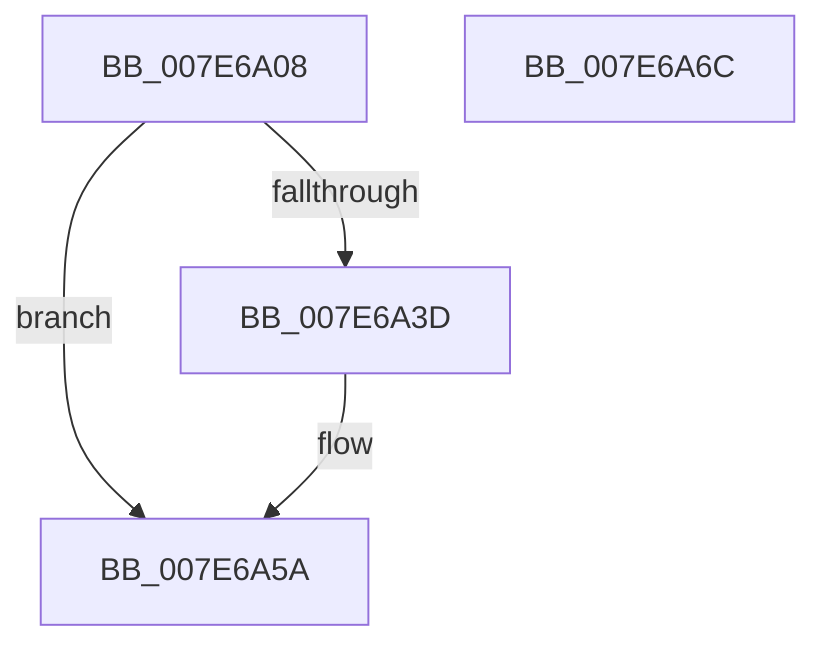

# CmpTraceShutdownStop

- RVA: `0x007E6A08`–`0x007E6A6D` (길이 `101` bytes)
- VA: `0x00000001407E6A08`
- 실행 섹션: `PAGE`
- PDB 이름 있음: `예`; PDB Function 태그: `아니요`
- unwind 정보 RVA: `0x00060904`
- 디코드: `23`개 명령, `101/101` bytes 표시
- 미해석 바이트: `0` (있으면 어셈블리에 `.byte`로 보존)

> 이 문서는 커널 이미지의 기계어와 PDB 기호를 분석해 생성했습니다. 4번과 5번은 함수 원형과 자료형을 바이너리 사용 방식에서 추정한 C 해석이며 원본 소스 복구 결과는 아닙니다.

## 1. Dependencies

- 직접 호출 지점: **3**; 고유 호출 대상: **3**
- 직접 호출자로 확인된 함수: **1**
- RIP 상대 이미지 참조: **3**

### Outgoing calls
- `0x007E6A34` → [EtwEventEnabled](../../text/39/EtwEventEnabled_function_00392450.md) (function, `0x00392450`)
- `0x007E6A55` → [EtwWrite](../../text/41/EtwWrite_function_0041C720.md) (function, `0x0041C720`)
- `0x007E6A62` → [_security_check_cookie](../../text/6A/_security_check_cookie_function_006AC640.md) (function, `0x006AC640`)

### Direct callers
- [CmShutdownSystem2](../../text/66/CmShutdownSystem2_function_0066A7FC.md) at `0x0066A960`

### Static image references
- `0x007E6A0C` → RVA `0x00E0A740` (`.data`; read)
- `0x007E6A1B` → RVA `0x00022DA0` (`.rdata`; read)
- `0x007E6A22` → RVA `0x00FD8018` (`PAGEDATA`; read)

## 2. Other-region calls and transfers

- 다른 실행 섹션으로 향하는 call: **3**
  - `0x007E6A34` → [EtwEventEnabled](../../text/39/EtwEventEnabled_function_00392450.md) (`PAGE` → `.text`)
  - `0x007E6A55` → [EtwWrite](../../text/41/EtwWrite_function_0041C720.md) (`PAGE` → `.text`)
  - `0x007E6A62` → [_security_check_cookie](../../text/6A/_security_check_cookie_function_006AC640.md) (`PAGE` → `.text`)
- 별도 외부 분기/꼬리 이동을 확인하지 못했습니다.

## 3. Assembly (complete function range)

```asm
007E6A08  48 83 EC 58                     sub rsp, 0x58
007E6A0C  48 8B 05 2D 3D 62 00            mov rax, qword ptr [rip + 0x623d2d]
007E6A13  48 33 C4                        xor rax, rsp
007E6A16  48 89 44 24 40                  mov qword ptr [rsp + 0x40], rax
007E6A1B  0F 10 05 7E C3 83 FF            movups xmm0, xmmword ptr [rip - 0x7c3c82]
007E6A22  48 8B 0D EF 15 7F 00            mov rcx, qword ptr [rip + 0x7f15ef]
007E6A29  48 8D 54 24 30                  lea rdx, [rsp + 0x30]
007E6A2E  F3 0F 7F 44 24 30               movdqu xmmword ptr [rsp + 0x30], xmm0
007E6A34  E8 17 BA BA FF                  call 0x140392450
007E6A39  84 C0                           test al, al
007E6A3B  74 1D                           je 0x1407e6a5a
007E6A3D  48 83 64 24 20 00               and qword ptr [rsp + 0x20], 0
007E6A43  48 8D 54 24 30                  lea rdx, [rsp + 0x30]
007E6A48  48 8B 0D C9 15 7F 00            mov rcx, qword ptr [rip + 0x7f15c9]
007E6A4F  45 33 C9                        xor r9d, r9d
007E6A52  45 33 C0                        xor r8d, r8d
007E6A55  E8 C6 5C C3 FF                  call 0x14041c720
007E6A5A  48 8B 4C 24 40                  mov rcx, qword ptr [rsp + 0x40]
007E6A5F  48 33 CC                        xor rcx, rsp
007E6A62  E8 D9 5B EC FF                  call 0x1406ac640
007E6A67  48 83 C4 58                     add rsp, 0x58
007E6A6B  C3                              ret
007E6A6C  CC                              int3
```

## 4. C-style interpretation (structured pseudocode)

```c
__int64 __fastcall CmpTraceShutdownStop(__int64 a1, __int64 a2, int a3, int a4)
{
    __int64 result;
    __int64 v_rsp;
    unsigned __int64 v_stack_m18;
    unsigned __int64 v_stack_m28;
    unsigned __int64 v_stack_m38;

    v_rsp = (v_rsp) - (88);
    result = (*(unsigned __int64 *)(v_rip + 6438189)) ^ (v_rsp);
    v_stack_m18 = result;
    v_stack_m28 = v_xmm0;
    result = EtwEventEnabled(*(unsigned __int64 *)(v_rip + 8328687), v_stack_m28, a3, a4);
    if ((unsigned __int8)(result) != 0) {
        a2 = v_stack_m28;
        a1 = *(unsigned __int64 *)(v_rip + 8328649);
        a4 = 0;
        a3 = 0;
        result = EtwWrite(a1, a2, a3, a4);
    }
    a1 = (v_stack_m18) ^ (v_rsp);
    result = _security_check_cookie(a1, a2, a3, a4);
    v_rsp = (v_rsp) + (88);
    return result;
}
```

## 5. (Beta) C Style

```c
int64_t CmpTraceShutdownStop(int64_t Arg1, int64_t Arg2, int32_t Arg3, int32_t Arg4)
{
    int64_t result;
    int64_t local_rsp;
    uint64_t v_stack_m18;
    uint64_t v_stack_m28;
    uint64_t v_stack_m38;

    local_rsp = (local_rsp) - (88);
    result = (*(uint64_t *)(v_rip + 0x623D2D)) ^ (local_rsp);
    v_stack_m18 = result;
    v_stack_m28 = v_xmm0;
    result = EtwEventEnabled(*(uint64_t *)(v_rip + 0x7F15EF), v_stack_m28, Arg3, Arg4);
    if ((uint8_t)(result) != 0) {
        Arg2 = v_stack_m28;
        Arg1 = *(uint64_t *)(v_rip + 0x7F15C9);
        Arg4 = 0;
        Arg3 = 0;
        result = EtwWrite(Arg1, Arg2, Arg3, Arg4);
    }
    Arg1 = (v_stack_m18) ^ (local_rsp);
    result = _security_check_cookie(Arg1, Arg2, Arg3, Arg4);
    local_rsp = (local_rsp) + (88);
    return result;
}
```

## 6. Execution-region graph

[열기: 2D/3D 그래프와 함수 탐색 컨트롤 패널](../../../control-panel.html?section=page&rva=0x007E6A08&view=graph)

- 2D 그래프는 위에서 아래로 흐르고, 3D 그래프는 빈 공간을 드래그해 회전합니다. Shift+드래그는 이동, 휠은 확대·축소, 함수 노드 선택은 대상 보고서 이동입니다.

### Static fallback


