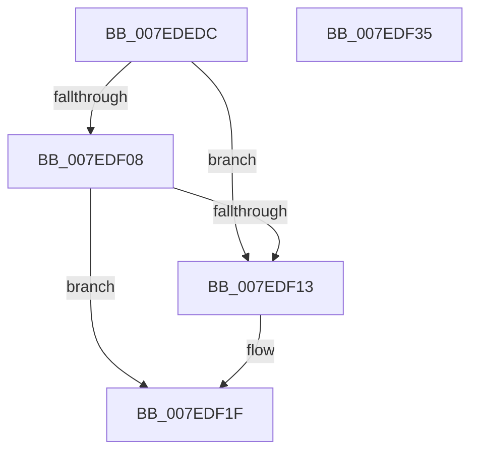

# CmpUnlockGlobalKeyLockTracker

- RVA: `0x007EDEDC`–`0x007EDF36` (길이 `90` bytes)
- VA: `0x00000001407EDEDC`
- 실행 섹션: `PAGE`
- PDB 이름 있음: `예`; PDB Function 태그: `아니요`
- unwind 정보 RVA: `0x0005C788`
- 디코드: `21`개 명령, `90/90` bytes 표시
- 미해석 바이트: `0` (있으면 어셈블리에 `.byte`로 보존)

> 이 문서는 커널 이미지의 기계어와 PDB 기호를 분석해 생성했습니다. 4번과 5번은 함수 원형과 자료형을 바이너리 사용 방식에서 추정한 C 해석이며 원본 소스 복구 결과는 아닙니다.

## 1. Dependencies

- 직접 호출 지점: **3**; 고유 호출 대상: **3**
- 직접 호출자로 확인된 함수: **2**
- RIP 상대 이미지 참조: **1**

### Outgoing calls
- `0x007EDF1A` → [ExfReleasePushLock](../../text/26/ExfReleasePushLock_function_002638D0.md) (function, `0x002638D0`)
- `0x007EDF26` → [KeAbPostRelease](../../text/2E/KeAbPostRelease_function_002E1600.md) (function, `0x002E1600`)
- `0x007EDF2B` → [KeLeaveCriticalRegion](../../text/25/KeLeaveCriticalRegion_function_0025D8B0.md) (function, `0x0025D8B0`)

### Direct callers
- [CmpGlobalUnlockKeyForWrite](CmpGlobalUnlockKeyForWrite_function_007EDD80.md) at `0x007EDDF2`
- [CmpGlobalUnlockKeyForWrite](CmpGlobalUnlockKeyForWrite_function_007EDD80.md) at `0x007EDE2E`
- [CmpGlobalLockKeyForWrite](../A7/CmpGlobalLockKeyForWrite_function_00A7CD88.md) at `0x00A7CDED`
- [CmpGlobalLockKeyForWrite](../A7/CmpGlobalLockKeyForWrite_function_00A7CD88.md) at `0x00A7CE19`

### Static image references
- `0x007EDEE0` → RVA `0x00EF5860` (`.data`; read)

## 2. Other-region calls and transfers

- 다른 실행 섹션으로 향하는 call: **3**
  - `0x007EDF1A` → [ExfReleasePushLock](../../text/26/ExfReleasePushLock_function_002638D0.md) (`PAGE` → `.text`)
  - `0x007EDF26` → [KeAbPostRelease](../../text/2E/KeAbPostRelease_function_002E1600.md) (`PAGE` → `.text`)
  - `0x007EDF2B` → [KeLeaveCriticalRegion](../../text/25/KeLeaveCriticalRegion_function_0025D8B0.md) (`PAGE` → `.text`)
- 별도 외부 분기/꼬리 이동을 확인하지 못했습니다.

## 3. Assembly (complete function range)

```asm
007EDEDC  48 83 EC 28                     sub rsp, 0x28
007EDEE0  0F 0D 0D 79 79 70 00            prefetchw byte ptr [rip + 0x707979]
007EDEE7  48 8B 05 72 79 70 00            mov rax, qword ptr [rip + 0x707972]
007EDEEE  45 33 C0                        xor r8d, r8d
007EDEF1  48 8B C8                        mov rcx, rax
007EDEF4  48 83 E1 F0                     and rcx, 0xfffffffffffffff0
007EDEF8  48 83 F9 10                     cmp rcx, 0x10
007EDEFC  48 8D 50 F0                     lea rdx, [rax - 0x10]
007EDF00  49 0F 46 D0                     cmovbe rdx, r8
007EDF04  A8 02                           test al, 2
007EDF06  75 0B                           jne 0x1407edf13
007EDF08  F0 48 0F B1 15 4F 79 70 00      lock cmpxchg qword ptr [rip + 0x70794f], rdx
007EDF11  74 0C                           je 0x1407edf1f
007EDF13  48 8D 0D 46 79 70 00            lea rcx, [rip + 0x707946]
007EDF1A  E8 B1 59 A7 FF                  call 0x1402638d0
007EDF1F  48 8D 0D 3A 79 70 00            lea rcx, [rip + 0x70793a]
007EDF26  E8 D5 36 AF FF                  call 0x1402e1600
007EDF2B  E8 80 F9 A6 FF                  call 0x14025d8b0
007EDF30  48 83 C4 28                     add rsp, 0x28
007EDF34  C3                              ret
007EDF35  CC                              int3
```

## 4. C-style interpretation (structured pseudocode)

```c
__int64 __fastcall CmpUnlockGlobalKeyLockTracker(__int64 a1, __int64 a2, int a3)
{
    __int64 result;
    __int64 v_rsp;

    v_rsp = (v_rsp) - (40);
    a3 = 0;
    a1 = (*(unsigned __int64 *)(v_rip + 7371122)) & (-16);
    a2 = *(unsigned __int64 *)(v_rip + 7371122) - 16;
    if (a1 <= 16) { a2 = 0; }
    if ((((unsigned __int8)(*(unsigned __int64 *)(v_rip + 7371122))) & (2)) != 0) goto loc_007EDF13;
    result = *(unsigned __int64 *)(v_rip + 7371122);
    if ((((unsigned __int8)(*(unsigned __int64 *)(v_rip + 7371122))) & (2)) != 0) {
        a1 = v_rip + 7371078;
        result = ExfReleasePushLock(a1, a2, a3, a4);
    }
    result = KeAbPostRelease(v_rip + 7371066, a2, a3, a4);
    result = KeLeaveCriticalRegion(v_rip + 7371066, a2, a3, a4);
    v_rsp = (v_rsp) + (40);
    return result;
}
```

## 5. (Beta) C Style

```c
int64_t CmpUnlockGlobalKeyLockTracker(int64_t Arg1, int64_t Arg2, int32_t Arg3)
{
    int64_t result;
    int64_t local_rsp;

    local_rsp = (local_rsp) - (40);
    Arg3 = 0;
    Arg1 = (*(uint64_t *)(v_rip + 0x707972)) & (-16);
    Arg2 = *(uint64_t *)(v_rip + 0x707972) - 16;
    if (Arg1 <= 16) { Arg2 = 0; }
    if ((((uint8_t)(*(uint64_t *)(v_rip + 0x707972))) & (2)) != 0) goto loc_007EDF13;
    result = *(uint64_t *)(v_rip + 0x707972);
    if ((((uint8_t)(*(uint64_t *)(v_rip + 0x707972))) & (2)) != 0) {
        Arg1 = v_rip + 7371078;
        result = ExfReleasePushLock(Arg1, Arg2, Arg3, a4);
    }
    result = KeAbPostRelease(v_rip + 7371066, Arg2, Arg3, a4);
    result = KeLeaveCriticalRegion(v_rip + 7371066, Arg2, Arg3, a4);
    local_rsp = (local_rsp) + (40);
    return result;
}
```

## 6. Execution-region graph

[열기: 2D/3D 그래프와 함수 탐색 컨트롤 패널](../../../control-panel.html?section=page&rva=0x007EDEDC&view=graph)

- 2D 그래프는 위에서 아래로 흐르고, 3D 그래프는 빈 공간을 드래그해 회전합니다. Shift+드래그는 이동, 휠은 확대·축소, 함수 노드 선택은 대상 보고서 이동입니다.

### Static fallback


