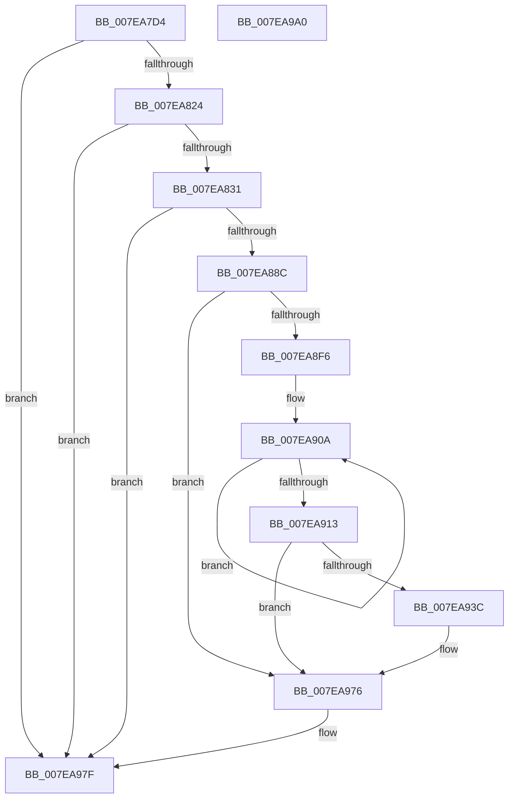

# CmpUpdateReorganizeRegistryValues

- RVA: `0x007EA7D4`–`0x007EA9A1` (길이 `461` bytes)
- VA: `0x00000001407EA7D4`
- 실행 섹션: `PAGE`
- PDB 이름 있음: `예`; PDB Function 태그: `아니요`
- unwind 정보 RVA: `0x000CDE88`
- 디코드: `108`개 명령, `461/461` bytes 표시
- 미해석 바이트: `0` (있으면 어셈블리에 `.byte`로 보존)

> 이 문서는 커널 이미지의 기계어와 PDB 기호를 분석해 생성했습니다. 4번과 5번은 함수 원형과 자료형을 바이너리 사용 방식에서 추정한 C 해석이며 원본 소스 복구 결과는 아닙니다.

## 1. Dependencies

- 직접 호출 지점: **11**; 고유 호출 대상: **8**
- 직접 호출자로 확인된 함수: **2**
- RIP 상대 이미지 참조: **8**

### Outgoing calls
- `0x007EA83C` → [RtlInitUnicodeString](../../text/42/RtlInitUnicodeString_function_0042A780.md) (function, `0x0042A780`)
- `0x007EA87F` → [ZwCreateKey](../../text/6A/ZwCreateKey_function_006AD470.md) (function, `0x006AD470`)
- `0x007EA897` → [ExSystemTimeToLocalTime](../../text/2F/ExSystemTimeToLocalTime_function_002FE1C0.md) (function, `0x002FE1C0`)
- `0x007EA8A4` → [RtlTimeToTimeFields](../../text/42/RtlTimeToTimeFields_function_0042E0F0.md) (function, `0x0042E0F0`)
- `0x007EA8E5` → [swprintf_s](../../text/50/swprintf_s_function_00504B20.md) (function, `0x00504B20`)
- `0x007EA901` → [RtlInitUnicodeString](../../text/42/RtlInitUnicodeString_function_0042A780.md) (function, `0x0042A780`)
- `0x007EA933` → [ZwSetValueKey](../../text/6A/ZwSetValueKey_function_006ADCD0.md) (function, `0x006ADCD0`)
- `0x007EA947` → [RtlInitUnicodeString](../../text/42/RtlInitUnicodeString_function_0042A780.md) (function, `0x0042A780`)
- `0x007EA971` → [ZwSetValueKey](../../text/6A/ZwSetValueKey_function_006ADCD0.md) (function, `0x006ADCD0`)
- `0x007EA97A` → [ZwClose](../../text/6A/ZwClose_function_006AD2B0.md) (function, `0x006AD2B0`)
- `0x007EA986` → [_security_check_cookie](../../text/6A/_security_check_cookie_function_006AC640.md) (function, `0x006AC640`)

### Direct callers
- [CmpAcceptBoot](../7D/CmpAcceptBoot_function_007DF574.md) at `0x007DF620`
- [sub_00B1845C](../B1/Unknown_function_00B1845C.md) at `0x00B18958`

### Static image references
- `0x007EA7EB` → RVA `0x00E0A740` (`.data`; read)
- `0x007EA7FE` → RVA `0x00EEFC48` (`.data`; read)
- `0x007EA824` → RVA `0x00E0EC94` (`.data`; read)
- `0x007EA831` → RVA `0x00B09820` (` ?? ::NNGAKEGL::`string'`; read)
- `0x007EA890` → RVA `0x00EEFC40` (`.data`; read)
- `0x007EA8AD` → RVA `0x00B098E0` (` ?? ::NNGAKEGL::`string'`; read)
- `0x007EA8F6` → RVA `0x00B097F0` (` ?? ::NNGAKEGL::`string'`; read)
- `0x007EA93C` → RVA `0x00B09800` (` ?? ::NNGAKEGL::`string'`; read)

## 2. Other-region calls and transfers

- 다른 실행 섹션으로 향하는 call: **11**
  - `0x007EA83C` → [RtlInitUnicodeString](../../text/42/RtlInitUnicodeString_function_0042A780.md) (`PAGE` → `.text`)
  - `0x007EA87F` → [ZwCreateKey](../../text/6A/ZwCreateKey_function_006AD470.md) (`PAGE` → `.text`)
  - `0x007EA897` → [ExSystemTimeToLocalTime](../../text/2F/ExSystemTimeToLocalTime_function_002FE1C0.md) (`PAGE` → `.text`)
  - `0x007EA8A4` → [RtlTimeToTimeFields](../../text/42/RtlTimeToTimeFields_function_0042E0F0.md) (`PAGE` → `.text`)
  - `0x007EA8E5` → [swprintf_s](../../text/50/swprintf_s_function_00504B20.md) (`PAGE` → `.text`)
  - `0x007EA901` → [RtlInitUnicodeString](../../text/42/RtlInitUnicodeString_function_0042A780.md) (`PAGE` → `.text`)
  - `0x007EA933` → [ZwSetValueKey](../../text/6A/ZwSetValueKey_function_006ADCD0.md) (`PAGE` → `.text`)
  - `0x007EA947` → [RtlInitUnicodeString](../../text/42/RtlInitUnicodeString_function_0042A780.md) (`PAGE` → `.text`)
  - `0x007EA971` → [ZwSetValueKey](../../text/6A/ZwSetValueKey_function_006ADCD0.md) (`PAGE` → `.text`)
  - `0x007EA97A` → [ZwClose](../../text/6A/ZwClose_function_006AD2B0.md) (`PAGE` → `.text`)
  - `0x007EA986` → [_security_check_cookie](../../text/6A/_security_check_cookie_function_006AC640.md) (`PAGE` → `.text`)
- 별도 외부 분기/꼬리 이동을 확인하지 못했습니다.

## 3. Assembly (complete function range)

```asm
007EA7D4  48 89 5C 24 08                  mov qword ptr [rsp + 8], rbx
007EA7D9  48 89 7C 24 10                  mov qword ptr [rsp + 0x10], rdi
007EA7DE  55                              push rbp
007EA7DF  48 8D 6C 24 A9                  lea rbp, [rsp - 0x57]
007EA7E4  48 81 EC D0 00 00 00            sub rsp, 0xd0
007EA7EB  48 8B 05 4E FF 61 00            mov rax, qword ptr [rip + 0x61ff4e]
007EA7F2  48 33 C4                        xor rax, rsp
007EA7F5  48 89 45 47                     mov qword ptr [rbp + 0x47], rax
007EA7F9  33 FF                           xor edi, edi
007EA7FB  0F 57 C0                        xorps xmm0, xmm0
007EA7FE  48 39 3D 43 54 70 00            cmp qword ptr [rip + 0x705443], rdi
007EA805  0F 57 C9                        xorps xmm1, xmm1
007EA808  89 7D FB                        mov dword ptr [rbp - 5], edi
007EA80B  89 7D 13                        mov dword ptr [rbp + 0x13], edi
007EA80E  0F 11 45 CF                     movups xmmword ptr [rbp - 0x31], xmm0
007EA812  48 89 7D C7                     mov qword ptr [rbp - 0x39], rdi
007EA816  0F 11 4D E7                     movups xmmword ptr [rbp - 0x19], xmm1
007EA81A  48 89 7D DF                     mov qword ptr [rbp - 0x21], rdi
007EA81E  0F 84 5B 01 00 00               je 0x1407ea97f
007EA824  80 3D 69 44 62 00 02            cmp byte ptr [rip + 0x624469], 2
007EA82B  0F 85 4E 01 00 00               jne 0x1407ea97f
007EA831  48 8D 15 E8 EF 31 00            lea rdx, [rip + 0x31efe8]
007EA838  48 8D 4D CF                     lea rcx, [rbp - 0x31]
007EA83C  E8 3F FF C3 FF                  call 0x14042a780
007EA841  48 8D 45 CF                     lea rax, [rbp - 0x31]
007EA845  48 89 7C 24 30                  mov qword ptr [rsp + 0x30], rdi
007EA84A  0F 57 C0                        xorps xmm0, xmm0
007EA84D  89 7C 24 28                     mov dword ptr [rsp + 0x28], edi
007EA851  45 33 C9                        xor r9d, r9d
007EA854  48 89 45 07                     mov qword ptr [rbp + 7], rax
007EA858  4C 8D 45 F7                     lea r8, [rbp - 9]
007EA85C  C7 45 F7 30 00 00 00            mov dword ptr [rbp - 9], 0x30
007EA863  8D 57 02                        lea edx, [rdi + 2]
007EA866  48 89 7D FF                     mov qword ptr [rbp - 1], rdi
007EA86A  48 8D 4D C7                     lea rcx, [rbp - 0x39]
007EA86E  C7 45 0F C0 02 00 00            mov dword ptr [rbp + 0xf], 0x2c0
007EA875  F3 0F 7F 45 17                  movdqu xmmword ptr [rbp + 0x17], xmm0
007EA87A  48 89 7C 24 20                  mov qword ptr [rsp + 0x20], rdi
007EA87F  E8 EC 2B EC FF                  call 0x1406ad470
007EA884  85 C0                           test eax, eax
007EA886  0F 88 F3 00 00 00               js 0x1407ea97f
007EA88C  48 8D 55 DF                     lea rdx, [rbp - 0x21]
007EA890  48 8D 0D A9 53 70 00            lea rcx, [rip + 0x7053a9]
007EA897  E8 24 39 B1 FF                  call 0x1402fe1c0
007EA89C  48 8D 55 E7                     lea rdx, [rbp - 0x19]
007EA8A0  48 8D 4D DF                     lea rcx, [rbp - 0x21]
007EA8A4  E8 47 38 C4 FF                  call 0x14042e0f0
007EA8A9  0F BF 4D E7                     movsx ecx, word ptr [rbp - 0x19]
007EA8AD  4C 8D 05 2C F0 31 00            lea r8, [rip + 0x31f02c]
007EA8B4  44 0F BF 4D E9                  movsx r9d, word ptr [rbp - 0x17]
007EA8B9  B8 AD 8B DB 68                  mov eax, 0x68db8bad
007EA8BE  F7 E9                           imul ecx
007EA8C0  C1 FA 0C                        sar edx, 0xc
007EA8C3  8B C2                           mov eax, edx
007EA8C5  C1 E8 1F                        shr eax, 0x1f
007EA8C8  03 D0                           add edx, eax
007EA8CA  69 C2 10 27 00 00               imul eax, edx, 0x2710
007EA8D0  8D 57 10                        lea edx, [rdi + 0x10]
007EA8D3  2B C8                           sub ecx, eax
007EA8D5  0F BF 45 EB                     movsx eax, word ptr [rbp - 0x15]
007EA8D9  89 4C 24 28                     mov dword ptr [rsp + 0x28], ecx
007EA8DD  48 8D 4D 27                     lea rcx, [rbp + 0x27]
007EA8E1  89 44 24 20                     mov dword ptr [rsp + 0x20], eax
007EA8E5  E8 36 A2 D1 FF                  call 0x140504b20
007EA8EA  48 83 CB FF                     or rbx, 0xffffffffffffffff
007EA8EE  3B C3                           cmp eax, ebx
007EA8F0  0F 84 80 00 00 00               je 0x1407ea976
007EA8F6  48 8D 15 F3 EE 31 00            lea rdx, [rip + 0x31eef3]
007EA8FD  48 8D 4D CF                     lea rcx, [rbp - 0x31]
007EA901  E8 7A FE C3 FF                  call 0x14042a780
007EA906  48 8D 45 27                     lea rax, [rbp + 0x27]
007EA90A  48 FF C3                        inc rbx
007EA90D  66 39 3C 58                     cmp word ptr [rax + rbx*2], di
007EA911  75 F7                           jne 0x1407ea90a
007EA913  48 8B 4D C7                     mov rcx, qword ptr [rbp - 0x39]
007EA917  48 8D 45 27                     lea rax, [rbp + 0x27]
007EA91B  03 DB                           add ebx, ebx
007EA91D  48 8D 55 CF                     lea rdx, [rbp - 0x31]
007EA921  89 5C 24 28                     mov dword ptr [rsp + 0x28], ebx
007EA925  41 B9 01 00 00 00               mov r9d, 1
007EA92B  45 33 C0                        xor r8d, r8d
007EA92E  48 89 44 24 20                  mov qword ptr [rsp + 0x20], rax
007EA933  E8 98 33 EC FF                  call 0x1406adcd0
007EA938  85 C0                           test eax, eax
007EA93A  78 3A                           js 0x1407ea976
007EA93C  48 8D 15 BD EE 31 00            lea rdx, [rip + 0x31eebd]
007EA943  48 8D 4D CF                     lea rcx, [rbp - 0x31]
007EA947  E8 34 FE C3 FF                  call 0x14042a780
007EA94C  48 8B 4D C7                     mov rcx, qword ptr [rbp - 0x39]
007EA950  48 8D 05 F1 52 70 00            lea rax, [rip + 0x7052f1]
007EA957  C7 44 24 28 08 00 00 00         mov dword ptr [rsp + 0x28], 8
007EA95F  48 8D 55 CF                     lea rdx, [rbp - 0x31]
007EA963  41 B9 0B 00 00 00               mov r9d, 0xb
007EA969  48 89 44 24 20                  mov qword ptr [rsp + 0x20], rax
007EA96E  45 33 C0                        xor r8d, r8d
007EA971  E8 5A 33 EC FF                  call 0x1406adcd0
007EA976  48 8B 4D C7                     mov rcx, qword ptr [rbp - 0x39]
007EA97A  E8 31 29 EC FF                  call 0x1406ad2b0
007EA97F  48 8B 4D 47                     mov rcx, qword ptr [rbp + 0x47]
007EA983  48 33 CC                        xor rcx, rsp
007EA986  E8 B5 1C EC FF                  call 0x1406ac640
007EA98B  4C 8D 9C 24 D0 00 00 00         lea r11, [rsp + 0xd0]
007EA993  49 8B 5B 10                     mov rbx, qword ptr [r11 + 0x10]
007EA997  49 8B 7B 18                     mov rdi, qword ptr [r11 + 0x18]
007EA99B  49 8B E3                        mov rsp, r11
007EA99E  5D                              pop rbp
007EA99F  C3                              ret
007EA9A0  CC                              int3
```

## 4. C-style interpretation (structured pseudocode)

```c
__int64 __fastcall CmpUpdateReorganizeRegistryValues(__int64 a1, __int64 a2, __int64 a3, int a4)
{
    __int64 result;
    __int64 v_rbx;
    __int64 v_rdi;
    __int64 v_rsp;
    unsigned __int64 v_stack_m18;
    unsigned __int64 v_stack_m38;
    unsigned __int64 v_stack_m48;
    unsigned int v_stack_m4C;
    unsigned int v_stack_m50;
    unsigned __int64 v_stack_m58;
    unsigned __int64 v_stack_m5F;
    unsigned __int64 v_stack_m60;
    unsigned int v_stack_m64;
    unsigned __int64 v_stack_m68;
    unsigned __int16 v_stack_m74;
    unsigned __int16 v_stack_m76;
    unsigned __int64 v_stack_m78;
    unsigned __int64 v_stack_m8;
    unsigned __int64 v_stack_m80;
    unsigned __int64 v_stack_m90;
    unsigned __int64 v_stack_m98;
    unsigned __int64 v_stack_mA8;
    unsigned int v_stack_mB0;
    unsigned __int64 v_stack_mB8;
    unsigned __int64 v_stack_p10;
    unsigned __int64 v_stack_p8;

    v_stack_p8 = v_rbx;
    v_stack_p10 = v_rdi;
    v_rsp = (v_rsp) - (208);
    result = (*(unsigned __int64 *)(v_rip + 6422350)) ^ (v_rsp);
    v_stack_m18 = result;
    v_rdi = 0;
    v_stack_m64 = 0;
    v_stack_m4C = 0;
    v_stack_m90 = v_xmm0;
    v_stack_m98 = 0;
    v_stack_m78 = v_xmm1;
    v_stack_m80 = 0;
    if ((*(unsigned __int64 *)(v_rip + 7361603)) == 0) goto loc_007EA97F;
    if ((*(unsigned __int8 *)(v_rip + 6440041)) != 2) goto loc_007EA97F;
    result = RtlInitUnicodeString(v_stack_m90, v_rip + 3272680, a3, a4);
    v_stack_mA8 = 0;
    v_stack_mB0 = 0;
    a4 = 0;
    v_stack_m58 = v_stack_m90;
    v_stack_m68 = 48;
    v_stack_m60 = 0;
    v_stack_m50 = 704;
    v_stack_m48 = v_xmm0;
    v_stack_mB8 = 0;
    result = ZwCreateKey(v_stack_m98, v_rdi + 2, v_stack_m68, a4);
    if (sign_flag) goto loc_007EA97F;
    result = ExSystemTimeToLocalTime(v_rip + 7361449, v_stack_m80, v_stack_m68, a4);
    result = RtlTimeToTimeFields(v_stack_m80, v_stack_m78, v_stack_m68, a4);
    a2 = (unsigned int)((v_stack_m78) >> (12));
    result = (unsigned int)(((unsigned int)((unsigned int)(a2))) >> (31));
    a2 = (unsigned int)((a2) + ((unsigned int)(result)));
    result = (unsigned int)((result) * ((unsigned int)(a2)));
    a1 = (unsigned int)(((__int16)(v_stack_m78)) - ((unsigned int)(result)));
    v_stack_mB0 = (unsigned int)(a1);
    v_stack_mB8 = (unsigned int)((__int16)(v_stack_m74));
    result = swprintf_s(v_stack_m38, v_rdi + 16, v_rip + 3272748, (__int16)(v_stack_m76));
    v_rbx = (v_rbx) | (-1);
    if (((unsigned int)(result)) == ((unsigned int)(v_rbx))) goto loc_007EA976;
    result = RtlInitUnicodeString(v_stack_m90, v_rip + 3272435, v_rip + 3272748, (__int16)(v_stack_m76));
loc_007EA90A:
    v_rbx = (v_rbx) + 1;
    if ((*(unsigned __int16 *)(v_stack_m38 + v_rbx * 2)) != 0) goto loc_007EA90A;
    v_rbx = (unsigned int)((v_rbx) + ((unsigned int)(v_rbx)));
    v_stack_mB0 = (unsigned int)(v_rbx);
    a3 = 0;
    v_stack_mB8 = v_stack_m38;
    result = ZwSetValueKey(v_stack_m98, v_stack_m90, a3, 1);
    if (!(sign_flag)) {
        a2 = v_rip + 3272381;
        a1 = v_stack_m90;
        result = RtlInitUnicodeString(a1, a2, a3, 1);
        a1 = v_stack_m98;
        result = v_rip + 7361265;
        v_stack_mB0 = 8;
        a2 = v_stack_m90;
        a4 = 11;
        v_stack_mB8 = result;
        a3 = 0;
        result = ZwSetValueKey(a1, a2, a3, a4);
    }
    result = ZwClose(v_stack_m98, a2, a3, a4);
loc_007EA97F:
    a1 = (v_stack_m18) ^ (v_rsp);
    result = _security_check_cookie(a1, a2, a3, a4);
    return result;
}
```

## 5. (Beta) C Style

```c
int64_t CmpUpdateReorganizeRegistryValues(int64_t Arg1, int64_t Arg2, int64_t Arg3, int32_t Arg4)
{
    int64_t result;
    int64_t local_rbx;
    int64_t local_rdi;
    int64_t local_rsp;
    uint64_t v_stack_m18;
    uint64_t v_stack_m38;
    uint64_t v_stack_m48;
    uint32_t v_stack_m4C;
    uint32_t v_stack_m50;
    uint64_t v_stack_m58;
    uint64_t v_stack_m5F;
    uint64_t v_stack_m60;
    uint32_t v_stack_m64;
    uint64_t v_stack_m68;
    uint16_t v_stack_m74;
    uint16_t v_stack_m76;
    uint64_t v_stack_m78;
    uint64_t v_stack_m8;
    uint64_t v_stack_m80;
    uint64_t v_stack_m90;
    uint64_t v_stack_m98;
    uint64_t v_stack_mA8;
    uint32_t v_stack_mB0;
    uint64_t v_stack_mB8;
    uint64_t v_stack_p10;
    uint64_t v_stack_p8;

    v_stack_p8 = local_rbx;
    v_stack_p10 = local_rdi;
    local_rsp = (local_rsp) - (208);
    result = (*(uint64_t *)(v_rip + 0x61FF4E)) ^ (local_rsp);
    v_stack_m18 = result;
    local_rdi = 0;
    v_stack_m64 = 0;
    v_stack_m4C = 0;
    v_stack_m90 = v_xmm0;
    v_stack_m98 = 0;
    v_stack_m78 = v_xmm1;
    v_stack_m80 = 0;
    if ((*(uint64_t *)(v_rip + 0x705443)) == 0) goto loc_007EA97F;
    if ((*(uint8_t *)(v_rip + 0x624469)) != 2) goto loc_007EA97F;
    result = RtlInitUnicodeString(v_stack_m90, v_rip + 3272680, Arg3, Arg4);
    v_stack_mA8 = 0;
    v_stack_mB0 = 0;
    Arg4 = 0;
    v_stack_m58 = v_stack_m90;
    v_stack_m68 = 48;
    v_stack_m60 = 0;
    v_stack_m50 = 704;
    v_stack_m48 = v_xmm0;
    v_stack_mB8 = 0;
    result = ZwCreateKey(v_stack_m98, local_rdi + 2, v_stack_m68, Arg4);
    if (sign_flag) goto loc_007EA97F;
    result = ExSystemTimeToLocalTime(v_rip + 7361449, v_stack_m80, v_stack_m68, Arg4);
    result = RtlTimeToTimeFields(v_stack_m80, v_stack_m78, v_stack_m68, Arg4);
    Arg2 = (uint32_t)((v_stack_m78) >> (12));
    result = (uint32_t)(((uint32_t)((uint32_t)(Arg2))) >> (31));
    Arg2 = (uint32_t)((Arg2) + ((uint32_t)(result)));
    result = (uint32_t)((result) * ((uint32_t)(Arg2)));
    Arg1 = (uint32_t)(((int16_t)(v_stack_m78)) - ((uint32_t)(result)));
    v_stack_mB0 = (uint32_t)(Arg1);
    v_stack_mB8 = (uint32_t)((int16_t)(v_stack_m74));
    result = swprintf_s(v_stack_m38, local_rdi + 16, v_rip + 3272748, (int16_t)(v_stack_m76));
    local_rbx = (local_rbx) | (-1);
    if (((uint32_t)(result)) == ((uint32_t)(local_rbx))) goto loc_007EA976;
    result = RtlInitUnicodeString(v_stack_m90, v_rip + 3272435, v_rip + 3272748, (int16_t)(v_stack_m76));
loc_007EA90A:
    local_rbx = (local_rbx) + 1;
    if ((*(uint16_t *)(v_stack_m38 + local_rbx * 2)) != 0) goto loc_007EA90A;
    local_rbx = (uint32_t)((local_rbx) + ((uint32_t)(local_rbx)));
    v_stack_mB0 = (uint32_t)(local_rbx);
    Arg3 = 0;
    v_stack_mB8 = v_stack_m38;
    result = ZwSetValueKey(v_stack_m98, v_stack_m90, Arg3, 1);
    if (!(sign_flag)) {
        Arg2 = v_rip + 3272381;
        Arg1 = v_stack_m90;
        result = RtlInitUnicodeString(Arg1, Arg2, Arg3, 1);
        Arg1 = v_stack_m98;
        result = v_rip + 7361265;
        v_stack_mB0 = 8;
        Arg2 = v_stack_m90;
        Arg4 = 11;
        v_stack_mB8 = result;
        Arg3 = 0;
        result = ZwSetValueKey(Arg1, Arg2, Arg3, Arg4);
    }
    result = ZwClose(v_stack_m98, Arg2, Arg3, Arg4);
loc_007EA97F:
    Arg1 = (v_stack_m18) ^ (local_rsp);
    result = _security_check_cookie(Arg1, Arg2, Arg3, Arg4);
    return result;
}
```

## 6. Execution-region graph

[열기: 2D/3D 그래프와 함수 탐색 컨트롤 패널](../../../control-panel.html?section=page&rva=0x007EA7D4&view=graph)

- 2D 그래프는 위에서 아래로 흐르고, 3D 그래프는 빈 공간을 드래그해 회전합니다. Shift+드래그는 이동, 휠은 확대·축소, 함수 노드 선택은 대상 보고서 이동입니다.

### Static fallback


