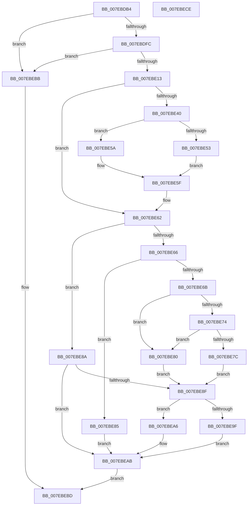

# CmpVirtualPathPresent

- RVA: `0x007EBDB4`–`0x007EBECF` (길이 `283` bytes)
- VA: `0x00000001407EBDB4`
- 실행 섹션: `PAGE`
- PDB 이름 있음: `예`; PDB Function 태그: `아니요`
- unwind 정보 RVA: `0x000C8B34`
- 디코드: `87`개 명령, `283/283` bytes 표시
- 미해석 바이트: `0` (있으면 어셈블리에 `.byte`로 보존)

> 이 문서는 커널 이미지의 기계어와 PDB 기호를 분석해 생성했습니다. 4번과 5번은 함수 원형과 자료형을 바이너리 사용 방식에서 추정한 C 해석이며 원본 소스 복구 결과는 아닙니다.

## 1. Dependencies

- 직접 호출 지점: **8**; 고유 호출 대상: **8**
- 직접 호출자로 확인된 함수: **1**
- RIP 상대 이미지 참조: **2**

### Outgoing calls
- `0x007EBDEF` → [CmpGetCmHiveFromVirtualPath](../84/CmpGetCmHiveFromVirtualPath_function_00849E08.md) (function, `0x00849E08`)
- `0x007EBE06` → [CmpBlockTwoHiveWrites](../84/CmpBlockTwoHiveWrites_function_0084DE64.md) (function, `0x0084DE64`)
- `0x007EBE30` → [CmpFindPathByNameEx](../84/CmpFindPathByNameEx_function_0084BAAC.md) (function, `0x0084BAAC`)
- `0x007EBE53` → [HvpGetCellFlat](../85/HvpGetCellFlat_function_00854C60.md) (function, `0x00854C60`)
- `0x007EBE5A` → [HvpGetCellPaged](../85/HvpGetCellPaged_function_00854CB0.md) (function, `0x00854CB0`)
- `0x007EBE9F` → [HvpReleaseCellFlat](../85/HvpReleaseCellFlat_function_0085CC20.md) (function, `0x0085CC20`)
- `0x007EBEA6` → [HvpReleaseCellPaged](../85/HvpReleaseCellPaged_function_00855F40.md) (function, `0x00855F40`)
- `0x007EBEB2` → [CmpUnblockTwoHiveWrites](../84/CmpUnblockTwoHiveWrites_function_0084A38C.md) (function, `0x0084A38C`)

### Direct callers
- [CmpReparseToVirtualPath](CmpReparseToVirtualPath_function_007EBA48.md) at `0x007EBA9E`

### Static image references
- `0x007EBDCF` → RVA `0x00FD9A90` (`PAGEDATA`; read)
- `0x007EBE6B` → RVA `0x00E0ECA0` (`.data`; read)

## 2. Other-region calls and transfers

- 다른 실행 섹션으로 향하는 call: **0**
- 별도 외부 분기/꼬리 이동을 확인하지 못했습니다.

## 3. Assembly (complete function range)

```asm
007EBDB4  48 89 5C 24 08                  mov qword ptr [rsp + 8], rbx
007EBDB9  55                              push rbp
007EBDBA  56                              push rsi
007EBDBB  57                              push rdi
007EBDBC  41 56                           push r14
007EBDBE  41 57                           push r15
007EBDC0  48 8B EC                        mov rbp, rsp
007EBDC3  48 83 EC 40                     sub rsp, 0x40
007EBDC7  83 4D 40 FF                     or dword ptr [rbp + 0x40], 0xffffffff
007EBDCB  48 8D 55 48                     lea rdx, [rbp + 0x48]
007EBDCF  4C 8B 35 BA DC 7E 00            mov r14, qword ptr [rip + 0x7edcba]
007EBDD6  45 33 FF                        xor r15d, r15d
007EBDD9  41 8B F7                        mov esi, r15d
007EBDDC  44 89 7D 44                     mov dword ptr [rbp + 0x44], r15d
007EBDE0  4C 89 7D F0                     mov qword ptr [rbp - 0x10], r15
007EBDE4  48 8B D9                        mov rbx, rcx
007EBDE7  44 89 7D 38                     mov dword ptr [rbp + 0x38], r15d
007EBDEB  4C 89 7D 48                     mov qword ptr [rbp + 0x48], r15
007EBDEF  E8 14 E0 05 00                  call 0x140849e08
007EBDF4  85 C0                           test eax, eax
007EBDF6  0F 88 BF 00 00 00               js 0x1407ebebb
007EBDFC  48 8B 55 48                     mov rdx, qword ptr [rbp + 0x48]
007EBE00  41 B0 01                        mov r8b, 1
007EBE03  49 8B CE                        mov rcx, r14
007EBE06  E8 59 20 06 00                  call 0x14084de64
007EBE0B  85 C0                           test eax, eax
007EBE0D  0F 88 A8 00 00 00               js 0x1407ebebb
007EBE13  48 8D 45 F0                     lea rax, [rbp - 0x10]
007EBE17  45 33 C9                        xor r9d, r9d
007EBE1A  48 89 44 24 28                  mov qword ptr [rsp + 0x28], rax
007EBE1F  45 33 C0                        xor r8d, r8d
007EBE22  48 8D 45 38                     lea rax, [rbp + 0x38]
007EBE26  48 8B D3                        mov rdx, rbx
007EBE29  33 C9                           xor ecx, ecx
007EBE2B  48 89 44 24 20                  mov qword ptr [rsp + 0x20], rax
007EBE30  E8 77 FC 05 00                  call 0x14084baac
007EBE35  48 8B 7D F0                     mov rdi, qword ptr [rbp - 0x10]
007EBE39  8A D8                           mov bl, al
007EBE3B  48 85 FF                        test rdi, rdi
007EBE3E  74 22                           je 0x1407ebe62
007EBE40  F6 87 8C 00 00 00 01            test byte ptr [rdi + 0x8c], 1
007EBE47  4C 8D 45 40                     lea r8, [rbp + 0x40]
007EBE4B  8B 55 38                        mov edx, dword ptr [rbp + 0x38]
007EBE4E  48 8B CF                        mov rcx, rdi
007EBE51  74 07                           je 0x1407ebe5a
007EBE53  E8 08 8E 06 00                  call 0x140854c60
007EBE58  EB 05                           jmp 0x1407ebe5f
007EBE5A  E8 51 8E 06 00                  call 0x140854cb0
007EBE5F  48 8B F0                        mov rsi, rax
007EBE62  84 DB                           test bl, bl
007EBE64  74 24                           je 0x1407ebe8a
007EBE66  48 85 F6                        test rsi, rsi
007EBE69  74 1A                           je 0x1407ebe85
007EBE6B  44 38 3D 2E 2E 62 00            cmp byte ptr [rip + 0x622e2e], r15b
007EBE72  74 0C                           je 0x1407ebe80
007EBE74  66 0F BA 66 02 08               bt word ptr [rsi + 2], 8
007EBE7A  73 04                           jae 0x1407ebe80
007EBE7C  B3 01                           mov bl, 1
007EBE7E  EB 0F                           jmp 0x1407ebe8f
007EBE80  41 8A DF                        mov bl, r15b
007EBE83  EB 0A                           jmp 0x1407ebe8f
007EBE85  41 8A DF                        mov bl, r15b
007EBE88  EB 21                           jmp 0x1407ebeab
007EBE8A  48 85 F6                        test rsi, rsi
007EBE8D  74 1C                           je 0x1407ebeab
007EBE8F  F6 87 8C 00 00 00 01            test byte ptr [rdi + 0x8c], 1
007EBE96  48 8D 55 40                     lea rdx, [rbp + 0x40]
007EBE9A  48 8B CF                        mov rcx, rdi
007EBE9D  74 07                           je 0x1407ebea6
007EBE9F  E8 7C 0D 07 00                  call 0x14085cc20
007EBEA4  EB 05                           jmp 0x1407ebeab
007EBEA6  E8 95 A0 06 00                  call 0x140855f40
007EBEAB  48 8B 55 48                     mov rdx, qword ptr [rbp + 0x48]
007EBEAF  49 8B CE                        mov rcx, r14
007EBEB2  E8 D5 E4 05 00                  call 0x14084a38c
007EBEB7  8A C3                           mov al, bl
007EBEB9  EB 02                           jmp 0x1407ebebd
007EBEBB  32 C0                           xor al, al
007EBEBD  48 8B 5C 24 70                  mov rbx, qword ptr [rsp + 0x70]
007EBEC2  48 83 C4 40                     add rsp, 0x40
007EBEC6  41 5F                           pop r15
007EBEC8  41 5E                           pop r14
007EBECA  5F                              pop rdi
007EBECB  5E                              pop rsi
007EBECC  5D                              pop rbp
007EBECD  C3                              ret
007EBECE  CC                              int3
```

## 4. C-style interpretation (structured pseudocode)

```c
__int64 __fastcall CmpVirtualPathPresent(__int64 a1, __int64 a2, __int64 a3, int a4)
{
    __int64 result;
    __int64 v_r15;
    __int64 v_rsp;
    unsigned __int64 v_stack_m38;
    unsigned __int64 v_stack_m40;
    unsigned __int64 v_stack_m48;
    unsigned int v_stack_p10;
    unsigned int v_stack_p18;
    unsigned int v_stack_p1C;
    unsigned __int64 v_stack_p20;
    unsigned __int64 v_stack_p8;

    v_stack_p8 = v_rbx;
    v_rsp = (v_rsp) - (64);
    v_r15 = 0;
    v_stack_p1C = 0;
    v_stack_m38 = 0;
    v_stack_p10 = 0;
    v_stack_p20 = 0;
    result = CmpGetCmHiveFromVirtualPath(a1, v_stack_p20, a3, a4);
    if (sign_flag) goto loc_007EBEBB;
    result = CmpBlockTwoHiveWrites(*(unsigned __int64 *)(v_rip + 8314042), v_stack_p20, 1, a4);
    if (sign_flag) goto loc_007EBEBB;
    a4 = 0;
    v_stack_m40 = v_stack_m38;
    a3 = 0;
    a1 = 0;
    v_stack_m48 = v_stack_p10;
    result = CmpFindPathByNameEx(a1, a1, a3, a4);
    if (v_stack_m38 == 0) goto loc_007EBE62;
    if (((*(unsigned __int8 *)(v_stack_m38 + 140)) & (1)) == 0) goto loc_007EBE5A;
    result = HvpGetCellFlat(v_stack_m38, (unsigned int)(v_stack_p10), v_stack_p18, a4);
    goto loc_007EBE5F;
loc_007EBE5A:
    result = HvpGetCellPaged(v_stack_m38, (unsigned int)(v_stack_p10), v_stack_p18, a4);
loc_007EBE5F:
loc_007EBE62:
    if ((unsigned __int8)((unsigned __int8)(result)) == 0) goto loc_007EBE8A;
    if (result == 0) goto loc_007EBE85;
    if ((*(unsigned __int8 *)(v_rip + 6434350)) == 0) goto loc_007EBE80;
    if ((*(unsigned __int8 *)(v_rip + 6434350)) >= 0) goto loc_007EBE80;
    goto loc_007EBE8F;
loc_007EBE80:
    goto loc_007EBE8F;
loc_007EBE85:
    goto loc_007EBEAB;
loc_007EBE8A:
    if (result == 0) goto loc_007EBEAB;
loc_007EBE8F:
    if (((*(unsigned __int8 *)(v_stack_m38 + 140)) & (1)) == 0) goto loc_007EBEA6;
    result = HvpReleaseCellFlat(v_stack_m38, v_stack_p18, v_stack_p18, a4);
    goto loc_007EBEAB;
loc_007EBEA6:
    result = HvpReleaseCellPaged(v_stack_m38, v_stack_p18, v_stack_p18, a4);
loc_007EBEAB:
    result = CmpUnblockTwoHiveWrites(*(unsigned __int64 *)(v_rip + 8314042), v_stack_p20, v_stack_p18, a4);
    goto loc_007EBEBD;
loc_007EBEBB:
    result = 0;
loc_007EBEBD:
    v_rsp = (v_rsp) + (64);
    return result;
}
```

## 5. (Beta) C Style

```c
int64_t CmpVirtualPathPresent(int64_t Arg1, int64_t Arg2, int64_t Arg3, int32_t Arg4)
{
    int64_t result;
    int64_t local_r15;
    int64_t local_rsp;
    uint64_t v_stack_m38;
    uint64_t v_stack_m40;
    uint64_t v_stack_m48;
    uint32_t v_stack_p10;
    uint32_t v_stack_p18;
    uint32_t v_stack_p1C;
    uint64_t v_stack_p20;
    uint64_t v_stack_p8;

    v_stack_p8 = local_rbx;
    local_rsp = (local_rsp) - (64);
    local_r15 = 0;
    v_stack_p1C = 0;
    v_stack_m38 = 0;
    v_stack_p10 = 0;
    v_stack_p20 = 0;
    result = CmpGetCmHiveFromVirtualPath(Arg1, v_stack_p20, Arg3, Arg4);
    if (sign_flag) goto loc_007EBEBB;
    result = CmpBlockTwoHiveWrites(*(uint64_t *)(v_rip + 0x7EDCBA), v_stack_p20, 1, Arg4);
    if (sign_flag) goto loc_007EBEBB;
    Arg4 = 0;
    v_stack_m40 = v_stack_m38;
    Arg3 = 0;
    Arg1 = 0;
    v_stack_m48 = v_stack_p10;
    result = CmpFindPathByNameEx(Arg1, Arg1, Arg3, Arg4);
    if (v_stack_m38 == 0) goto loc_007EBE62;
    if (((*(uint8_t *)(v_stack_m38 + 0x8C)) & (1)) == 0) goto loc_007EBE5A;
    result = HvpGetCellFlat(v_stack_m38, (uint32_t)(v_stack_p10), v_stack_p18, Arg4);
    goto loc_007EBE5F;
loc_007EBE5A:
    result = HvpGetCellPaged(v_stack_m38, (uint32_t)(v_stack_p10), v_stack_p18, Arg4);
loc_007EBE5F:
loc_007EBE62:
    if ((uint8_t)((uint8_t)(result)) == 0) goto loc_007EBE8A;
    if (result == 0) goto loc_007EBE85;
    if ((*(uint8_t *)(v_rip + 0x622E2E)) == 0) goto loc_007EBE80;
    if ((*(uint8_t *)(v_rip + 0x622E2E)) >= 0) goto loc_007EBE80;
    goto loc_007EBE8F;
loc_007EBE80:
    goto loc_007EBE8F;
loc_007EBE85:
    goto loc_007EBEAB;
loc_007EBE8A:
    if (result == 0) goto loc_007EBEAB;
loc_007EBE8F:
    if (((*(uint8_t *)(v_stack_m38 + 0x8C)) & (1)) == 0) goto loc_007EBEA6;
    result = HvpReleaseCellFlat(v_stack_m38, v_stack_p18, v_stack_p18, Arg4);
    goto loc_007EBEAB;
loc_007EBEA6:
    result = HvpReleaseCellPaged(v_stack_m38, v_stack_p18, v_stack_p18, Arg4);
loc_007EBEAB:
    result = CmpUnblockTwoHiveWrites(*(uint64_t *)(v_rip + 0x7EDCBA), v_stack_p20, v_stack_p18, Arg4);
    goto loc_007EBEBD;
loc_007EBEBB:
    result = 0;
loc_007EBEBD:
    local_rsp = (local_rsp) + (64);
    return result;
}
```

## 6. Execution-region graph

[열기: 2D/3D 그래프와 함수 탐색 컨트롤 패널](../../../control-panel.html?section=page&rva=0x007EBDB4&view=graph)

- 2D 그래프는 위에서 아래로 흐르고, 3D 그래프는 빈 공간을 드래그해 회전합니다. Shift+드래그는 이동, 휠은 확대·축소, 함수 노드 선택은 대상 보고서 이동입니다.

### Static fallback


