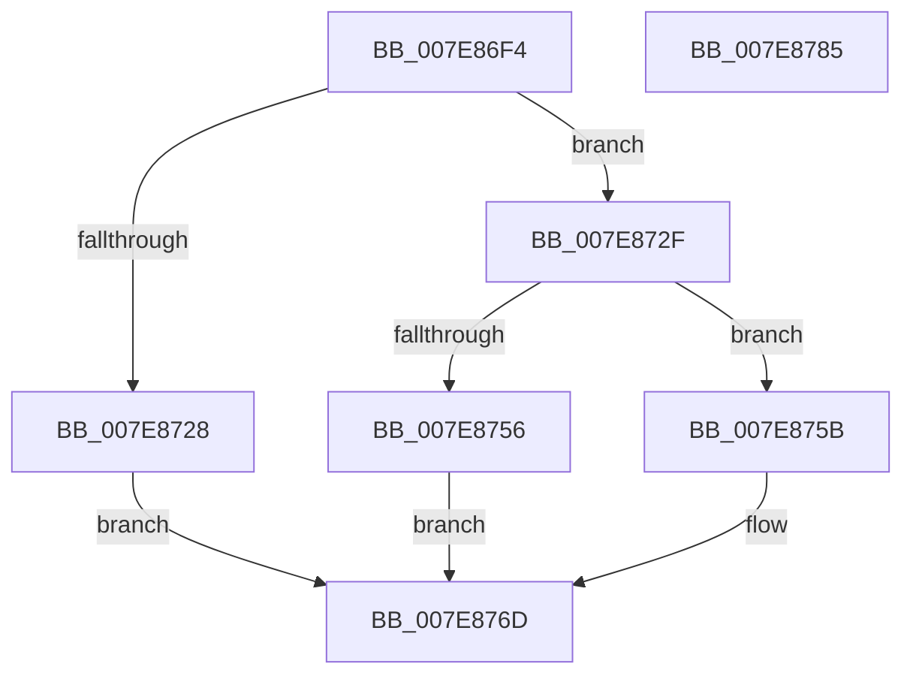

# CmpVolumeContextCreate

- RVA: `0x007E86F4`–`0x007E8786` (길이 `146` bytes)
- VA: `0x00000001407E86F4`
- 실행 섹션: `PAGE`
- PDB 이름 있음: `예`; PDB Function 태그: `아니요`
- unwind 정보 RVA: `0x0006F978`
- 디코드: `42`개 명령, `146/146` bytes 표시
- 미해석 바이트: `0` (있으면 어셈블리에 `.byte`로 보존)

> 이 문서는 커널 이미지의 기계어와 PDB 기호를 분석해 생성했습니다. 4번과 5번은 함수 원형과 자료형을 바이너리 사용 방식에서 추정한 C 해석이며 원본 소스 복구 결과는 아닙니다.

## 1. Dependencies

- 직접 호출 지점: **5**; 고유 호출 대상: **5**
- 직접 호출자로 확인된 함수: **1**
- RIP 상대 이미지 참조: **0**

### Outgoing calls
- `0x007E8719` → [CmSiAllocateMemory](../../text/49/CmSiAllocateMemory_function_00490C18.md) (function, `0x00490C18`)
- `0x007E8738` → [memset](../../text/6C/memset_function_006C6C40.md) (function, `0x006C6C40`)
- `0x007E874B` → [CmpVolumeContextStart](CmpVolumeContextStart_function_007E88A4.md) (function, `0x007E88A4`)
- `0x007E875E` → [CmpVolumeContextCleanup](../AB/CmpVolumeContextCleanup_function_00AB1D14.md) (function, `0x00AB1D14`)
- `0x007E8766` → [CmSiFreeMemory](../../text/47/CmSiFreeMemory_function_00475D80.md) (function, `0x00475D80`)

### Direct callers
- [CmpVolumeManagerGetContextForFile](../95/CmpVolumeManagerGetContextForFile_function_009525A8.md) at `0x009526F9`
- [CmpVolumeManagerGetContextForFile](../95/CmpVolumeManagerGetContextForFile_function_009525A8.md) at `0x00952738`

### Static image references
- 디코드된 RIP-relative 메모리 참조가 없습니다.

## 2. Other-region calls and transfers

- 다른 실행 섹션으로 향하는 call: **3**
  - `0x007E8719` → [CmSiAllocateMemory](../../text/49/CmSiAllocateMemory_function_00490C18.md) (`PAGE` → `.text`)
  - `0x007E8738` → [memset](../../text/6C/memset_function_006C6C40.md) (`PAGE` → `.text`)
  - `0x007E8766` → [CmSiFreeMemory](../../text/47/CmSiFreeMemory_function_00475D80.md) (`PAGE` → `.text`)
- 별도 외부 분기/꼬리 이동을 확인하지 못했습니다.

## 3. Assembly (complete function range)

```asm
007E86F4  48 89 5C 24 08                  mov qword ptr [rsp + 8], rbx
007E86F9  48 89 74 24 10                  mov qword ptr [rsp + 0x10], rsi
007E86FE  48 89 7C 24 18                  mov qword ptr [rsp + 0x18], rdi
007E8703  41 56                           push r14
007E8705  48 83 EC 20                     sub rsp, 0x20
007E8709  48 8B F2                        mov rsi, rdx
007E870C  B9 48 00 00 00                  mov ecx, 0x48
007E8711  BA 43 4D 38 39                  mov edx, 0x39384d43
007E8716  4D 8B F0                        mov r14, r8
007E8719  E8 FA 84 CA FF                  call 0x140490c18
007E871E  33 FF                           xor edi, edi
007E8720  48 8B D8                        mov rbx, rax
007E8723  48 85 C0                        test rax, rax
007E8726  75 07                           jne 0x1407e872f
007E8728  BF 9A 00 00 C0                  mov edi, 0xc000009a
007E872D  EB 3E                           jmp 0x1407e876d
007E872F  33 D2                           xor edx, edx
007E8731  48 8B CB                        mov rcx, rbx
007E8734  44 8D 42 48                     lea r8d, [rdx + 0x48]
007E8738  E8 03 E5 ED FF                  call 0x1406c6c40
007E873D  4C 8B C6                        mov r8, rsi
007E8740  48 C7 43 18 01 00 00 00         mov qword ptr [rbx + 0x18], 1
007E8748  48 8B CB                        mov rcx, rbx
007E874B  E8 54 01 00 00                  call 0x1407e88a4
007E8750  8B F0                           mov esi, eax
007E8752  85 C0                           test eax, eax
007E8754  78 05                           js 0x1407e875b
007E8756  49 89 1E                        mov qword ptr [r14], rbx
007E8759  EB 12                           jmp 0x1407e876d
007E875B  48 8B CB                        mov rcx, rbx
007E875E  E8 B1 95 2C 00                  call 0x140ab1d14
007E8763  48 8B CB                        mov rcx, rbx
007E8766  E8 15 D6 C8 FF                  call 0x140475d80
007E876B  8B FE                           mov edi, esi
007E876D  48 8B 5C 24 30                  mov rbx, qword ptr [rsp + 0x30]
007E8772  8B C7                           mov eax, edi
007E8774  48 8B 7C 24 40                  mov rdi, qword ptr [rsp + 0x40]
007E8779  48 8B 74 24 38                  mov rsi, qword ptr [rsp + 0x38]
007E877E  48 83 C4 20                     add rsp, 0x20
007E8782  41 5E                           pop r14
007E8784  C3                              ret
007E8785  CC                              int3
```

## 4. C-style interpretation (structured pseudocode)

```c
__int64 __fastcall CmpVolumeContextCreate(__int64 a1, __int64 a2, __int64 a3)
{
    __int64 result;
    __int64 v_rdi;
    __int64 v_rsp;
    unsigned __int64 v_stack_p10;
    unsigned __int64 v_stack_p18;
    unsigned __int64 v_stack_p8;

    v_stack_p8 = v_rbx;
    v_stack_p10 = v_rsi;
    v_stack_p18 = v_rdi;
    v_rsp = (v_rsp) - (32);
    result = CmSiAllocateMemory(72, (unsigned int)(0x39384D43ULL), a3, a4);
    v_rdi = 0;
    if (result != 0) goto loc_007E872F;
    goto loc_007E876D;
loc_007E872F:
    a2 = 0;
    result = memset(result, a2, a2 + 72, a4);
    *(unsigned __int64 *)(result + 24) = 1;
    result = CmpVolumeContextStart(result, a2, 0, a4);
    if (sign_flag) goto loc_007E875B;
    *(unsigned __int64 *)(a3) = result;
    goto loc_007E876D;
loc_007E875B:
    result = CmpVolumeContextCleanup(result, a2, 0, a4);
    result = CmSiFreeMemory(result, a2, 0, a4);
loc_007E876D:
    v_rsp = (v_rsp) + (32);
    return (unsigned int)((unsigned int)((unsigned int)((unsigned int)((unsigned int)((unsigned int)(result))))));
}
```

## 5. (Beta) C Style

```c
int64_t CmpVolumeContextCreate(int64_t Arg1, int64_t Arg2, void *Arg3)
{
    uint8_t *arg3 = (uint8_t *)Arg3;

    int64_t result;
    int64_t local_rdi;
    int64_t local_rsp;
    uint64_t v_stack_p10;
    uint64_t v_stack_p18;
    uint64_t v_stack_p8;

    v_stack_p8 = local_rbx;
    v_stack_p10 = local_rsi;
    v_stack_p18 = local_rdi;
    local_rsp = (local_rsp) - (32);
    result = CmSiAllocateMemory(72, (uint32_t)(0x39384D43ULL), Arg3, a4);
    local_rdi = 0;
    if (result != 0) goto loc_007E872F;
    goto loc_007E876D;
loc_007E872F:
    Arg2 = 0;
    result = memset(result, Arg2, Arg2 + 72, a4);
    *(uint64_t *)(result + 0x18) = 1;
    result = CmpVolumeContextStart(result, Arg2, 0, a4);
    if (sign_flag) goto loc_007E875B;
    *(uint64_t *)(arg3) = result;
    goto loc_007E876D;
loc_007E875B:
    result = CmpVolumeContextCleanup(result, Arg2, 0, a4);
    result = CmSiFreeMemory(result, Arg2, 0, a4);
loc_007E876D:
    local_rsp = (local_rsp) + (32);
    return (uint32_t)((uint32_t)((uint32_t)((uint32_t)((uint32_t)((uint32_t)(result))))));
}
```

### 관측된 메모리 오프셋

구조체 형식이 확인되지 않은 접근은 인자 기준의 오프셋으로만 기록했습니다.

| 기준 인자 | 오프셋 표현 | 폭 (bit) | 접근 |
|---|---:|---:|---|
| `Arg3` | `+ 0x0` | `64` | `W` |

## 6. Execution-region graph

[열기: 2D/3D 그래프와 함수 탐색 컨트롤 패널](../../../control-panel.html?section=page&rva=0x007E86F4&view=graph)

- 2D 그래프는 위에서 아래로 흐르고, 3D 그래프는 빈 공간을 드래그해 회전합니다. Shift+드래그는 이동, 휠은 확대·축소, 함수 노드 선택은 대상 보고서 이동입니다.

### Static fallback


