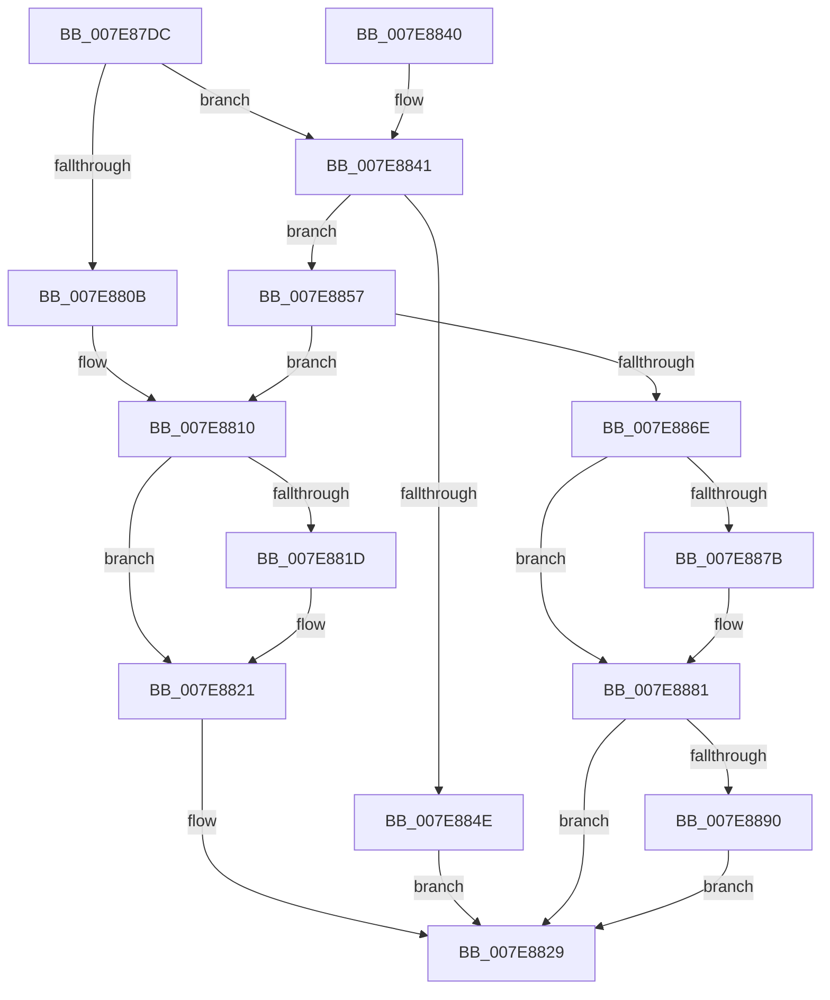

# CmpVolumeContextSendDeviceUsageNotification

- RVA: `0x007E87DC`–`0x007E889D` (길이 `193` bytes)
- VA: `0x00000001407E87DC`
- 실행 섹션: `PAGE`
- PDB 이름 있음: `예`; PDB Function 태그: `아니요`
- unwind 정보 RVA: `0x0009CC80`
- 디코드: `56`개 명령, `193/193` bytes 표시
- 미해석 바이트: `0` (있으면 어셈블리에 `.byte`로 보존)

> 이 문서는 커널 이미지의 기계어와 PDB 기호를 분석해 생성했습니다. 4번과 5번은 함수 원형과 자료형을 바이너리 사용 방식에서 추정한 C 해석이며 원본 소스 복구 결과는 아닙니다.

## 1. Dependencies

- 직접 호출 지점: **10**; 고유 호출 대상: **6**
- 직접 호출자로 확인된 함수: **1**
- RIP 상대 이미지 참조: **0**

### Outgoing calls
- `0x007E8813` → [CmpVolumeContextLockExclusive](CmpVolumeContextLockExclusive_function_007E878C.md) (function, `0x007E878C`)
- `0x007E8824` → [CmpVolumeContextUnlockExclusive](CmpVolumeContextUnlockExclusive_function_007E8A34.md) (function, `0x007E8A34`)
- `0x007E8829` → [KeLeaveCriticalRegion](../../text/25/KeLeaveCriticalRegion_function_0025D8B0.md) (function, `0x0025D8B0`)
- `0x007E8841` → [CmpVolumeContextLockShared](../87/CmpVolumeContextLockShared_function_0087BE04.md) (function, `0x0087BE04`)
- `0x007E8850` → [CmpVolumeContextUnlockShared](../87/CmpVolumeContextUnlockShared_function_0087BE5C.md) (function, `0x0087BE5C`)
- `0x007E8857` → [CmpVolumeContextUnlockShared](../87/CmpVolumeContextUnlockShared_function_0087BE5C.md) (function, `0x0087BE5C`)
- `0x007E8863` → [PiPagePathSetState](../72/PiPagePathSetState_function_0072BDE0.md) (function, `0x0072BDE0`)
- `0x007E8871` → [CmpVolumeContextLockExclusive](CmpVolumeContextLockExclusive_function_007E878C.md) (function, `0x007E878C`)
- `0x007E8884` → [CmpVolumeContextUnlockExclusive](CmpVolumeContextUnlockExclusive_function_007E8A34.md) (function, `0x007E8A34`)
- `0x007E8896` → [PiPagePathSetState](../72/PiPagePathSetState_function_0072BDE0.md) (function, `0x0072BDE0`)

### Direct callers
- [CmpHandlePageFileOpenNotification](../7D/CmpHandlePageFileOpenNotification_function_007DF640.md) at `0x007DF6B7`

### Static image references
- 디코드된 RIP-relative 메모리 참조가 없습니다.

## 2. Other-region calls and transfers

- 다른 실행 섹션으로 향하는 call: **1**
  - `0x007E8829` → [KeLeaveCriticalRegion](../../text/25/KeLeaveCriticalRegion_function_0025D8B0.md) (`PAGE` → `.text`)
- 별도 외부 분기/꼬리 이동을 확인하지 못했습니다.

## 3. Assembly (complete function range)

```asm
007E87DC  48 89 5C 24 08                  mov qword ptr [rsp + 8], rbx
007E87E1  48 89 74 24 10                  mov qword ptr [rsp + 0x10], rsi
007E87E6  57                              push rdi
007E87E7  48 83 EC 20                     sub rsp, 0x20
007E87EB  65 48 8B 04 25 88 01 00 00      mov rax, qword ptr gs:[0x188]
007E87F4  48 8B D9                        mov rbx, rcx
007E87F7  BF 01 00 00 00                  mov edi, 1
007E87FC  66 FF 88 E4 01 00 00            dec word ptr [rax + 0x1e4]
007E8803  90                              nop
007E8804  48 83 79 30 00                  cmp qword ptr [rcx + 0x30], 0
007E8809  75 36                           jne 0x1407e8841
007E880B  BE BB 00 00 C0                  mov esi, 0xc00000bb
007E8810  48 8B CB                        mov rcx, rbx
007E8813  E8 74 FF FF FF                  call 0x1407e878c
007E8818  39 7B 40                        cmp dword ptr [rbx + 0x40], edi
007E881B  74 04                           je 0x1407e8821
007E881D  83 63 40 00                     and dword ptr [rbx + 0x40], 0
007E8821  48 8B CB                        mov rcx, rbx
007E8824  E8 0B 02 00 00                  call 0x1407e8a34
007E8829  E8 82 50 A7 FF                  call 0x14025d8b0
007E882E  48 8B 5C 24 30                  mov rbx, qword ptr [rsp + 0x30]
007E8833  8B C6                           mov eax, esi
007E8835  48 8B 74 24 38                  mov rsi, qword ptr [rsp + 0x38]
007E883A  48 83 C4 20                     add rsp, 0x20
007E883E  5F                              pop rdi
007E883F  C3                              ret
007E8840  CC                              int3
007E8841  E8 BE 35 09 00                  call 0x14087be04
007E8846  48 8B CB                        mov rcx, rbx
007E8849  39 7B 40                        cmp dword ptr [rbx + 0x40], edi
007E884C  75 09                           jne 0x1407e8857
007E884E  33 F6                           xor esi, esi
007E8850  E8 07 36 09 00                  call 0x14087be5c
007E8855  EB D2                           jmp 0x1407e8829
007E8857  E8 00 36 09 00                  call 0x14087be5c
007E885C  48 8B 4B 30                     mov rcx, qword ptr [rbx + 0x30]
007E8860  40 8A D7                        mov dl, dil
007E8863  E8 78 35 F4 FF                  call 0x14072bde0
007E8868  8B F0                           mov esi, eax
007E886A  85 C0                           test eax, eax
007E886C  78 A2                           js 0x1407e8810
007E886E  48 8B CB                        mov rcx, rbx
007E8871  E8 16 FF FF FF                  call 0x1407e878c
007E8876  39 7B 40                        cmp dword ptr [rbx + 0x40], edi
007E8879  74 06                           je 0x1407e8881
007E887B  89 7B 40                        mov dword ptr [rbx + 0x40], edi
007E887E  40 32 FF                        xor dil, dil
007E8881  48 8B CB                        mov rcx, rbx
007E8884  E8 AB 01 00 00                  call 0x1407e8a34
007E8889  33 F6                           xor esi, esi
007E888B  40 84 FF                        test dil, dil
007E888E  74 99                           je 0x1407e8829
007E8890  48 8B 4B 30                     mov rcx, qword ptr [rbx + 0x30]
007E8894  33 D2                           xor edx, edx
007E8896  E8 45 35 F4 FF                  call 0x14072bde0
007E889B  EB 8C                           jmp 0x1407e8829
```

## 4. C-style interpretation (structured pseudocode)

```c
__int64 __fastcall CmpVolumeContextSendDeviceUsageNotification(__int64 a1)
{
    __int64 result;
    __int64 v_rdi;
    __int64 v_rsi;
    __int64 v_rsp;
    unsigned __int64 v_stack_p10;
    unsigned __int64 v_stack_p8;

    v_stack_p8 = v_rbx;
    v_stack_p10 = v_rsi;
    v_rsp = (v_rsp) - (32);
    if ((*(unsigned __int64 *)(a1 + 48)) != 0) goto loc_007E8841;
loc_007E8810:
    result = CmpVolumeContextLockExclusive(a1, a2, a3, a4);
    if ((*(unsigned int *)(a1 + 64)) != 1) {
    }
    result = CmpVolumeContextUnlockExclusive(a1, a2, a3, a4);
loc_007E8829:
    result = KeLeaveCriticalRegion(a1, a2, a3, a4);
    v_rsp = (v_rsp) + (32);
    return (unsigned int)((unsigned int)((unsigned int)(0xC00000BBULL)));
loc_007E8841:
    result = CmpVolumeContextLockShared(a1, a2, a3, a4);
    if ((*(unsigned int *)(v_stack_p8 + 64)) != 1) goto loc_007E8857;
    v_rsi = 0;
    result = CmpVolumeContextUnlockShared(v_stack_p8, a2, a3, a4);
    goto loc_007E8829;
loc_007E8857:
    result = CmpVolumeContextUnlockShared(v_stack_p8, a2, a3, a4);
    result = PiPagePathSetState(*(unsigned __int64 *)(v_stack_p8 + 48), 1, a3, a4);
    if (sign_flag) goto loc_007E8810;
    result = CmpVolumeContextLockExclusive(v_stack_p8, 1, a3, a4);
    v_rdi = 1;
    if ((*(unsigned int *)(v_stack_p8 + 64)) != 1) {
        *(unsigned int *)(v_stack_p8 + 64) = 1;
        v_rdi = 0;
    }
    result = CmpVolumeContextUnlockExclusive(v_stack_p8, 1, a3, a4);
    v_rsi = 0;
    if (0 == 0) goto loc_007E8829;
    a2 = 0;
    result = PiPagePathSetState(*(unsigned __int64 *)(v_stack_p8 + 48), a2, a3, a4);
    goto loc_007E8829;
}
```

## 5. (Beta) C Style

```c
int64_t CmpVolumeContextSendDeviceUsageNotification(void *Arg1)
{
    uint8_t *arg1 = (uint8_t *)Arg1;

    int64_t result;
    int64_t local_rdi;
    int64_t local_rsi;
    int64_t local_rsp;
    uint64_t v_stack_p10;
    uint64_t v_stack_p8;

    v_stack_p8 = local_rbx;
    v_stack_p10 = local_rsi;
    local_rsp = (local_rsp) - (32);
    if ((*(uint64_t *)(arg1 + 0x30)) != 0) goto loc_007E8841;
loc_007E8810:
    result = CmpVolumeContextLockExclusive(Arg1, a2, a3, a4);
    if ((*(uint32_t *)(arg1 + 0x40)) != 1) {
    }
    result = CmpVolumeContextUnlockExclusive(Arg1, a2, a3, a4);
loc_007E8829:
    result = KeLeaveCriticalRegion(Arg1, a2, a3, a4);
    local_rsp = (local_rsp) + (32);
    return (uint32_t)((uint32_t)((uint32_t)(0xC00000BBULL)));
loc_007E8841:
    result = CmpVolumeContextLockShared(Arg1, a2, a3, a4);
    if ((*(uint32_t *)(v_stack_p8 + 0x40)) != 1) goto loc_007E8857;
    local_rsi = 0;
    result = CmpVolumeContextUnlockShared(v_stack_p8, a2, a3, a4);
    goto loc_007E8829;
loc_007E8857:
    result = CmpVolumeContextUnlockShared(v_stack_p8, a2, a3, a4);
    result = PiPagePathSetState(*(uint64_t *)(v_stack_p8 + 0x30), 1, a3, a4);
    if (sign_flag) goto loc_007E8810;
    result = CmpVolumeContextLockExclusive(v_stack_p8, 1, a3, a4);
    local_rdi = 1;
    if ((*(uint32_t *)(v_stack_p8 + 0x40)) != 1) {
        *(uint32_t *)(v_stack_p8 + 0x40) = 1;
        local_rdi = 0;
    }
    result = CmpVolumeContextUnlockExclusive(v_stack_p8, 1, a3, a4);
    local_rsi = 0;
    if (0 == 0) goto loc_007E8829;
    a2 = 0;
    result = PiPagePathSetState(*(uint64_t *)(v_stack_p8 + 0x30), a2, a3, a4);
    goto loc_007E8829;
}
```

### 관측된 메모리 오프셋

구조체 형식이 확인되지 않은 접근은 인자 기준의 오프셋으로만 기록했습니다.

| 기준 인자 | 오프셋 표현 | 폭 (bit) | 접근 |
|---|---:|---:|---|
| `Arg1` | `+ 0x30` | `64` | `R` |
| `Arg1` | `+ 0x40` | `32` | `R` |
| `Arg1` | `+ 0x40` | `32` | `R/W` |
| `Arg1` | `+ 0x40` | `32` | `W` |

## 6. Execution-region graph

[열기: 2D/3D 그래프와 함수 탐색 컨트롤 패널](../../../control-panel.html?section=page&rva=0x007E87DC&view=graph)

- 2D 그래프는 위에서 아래로 흐르고, 3D 그래프는 빈 공간을 드래그해 회전합니다. Shift+드래그는 이동, 휠은 확대·축소, 함수 노드 선택은 대상 보고서 이동입니다.

### Static fallback


