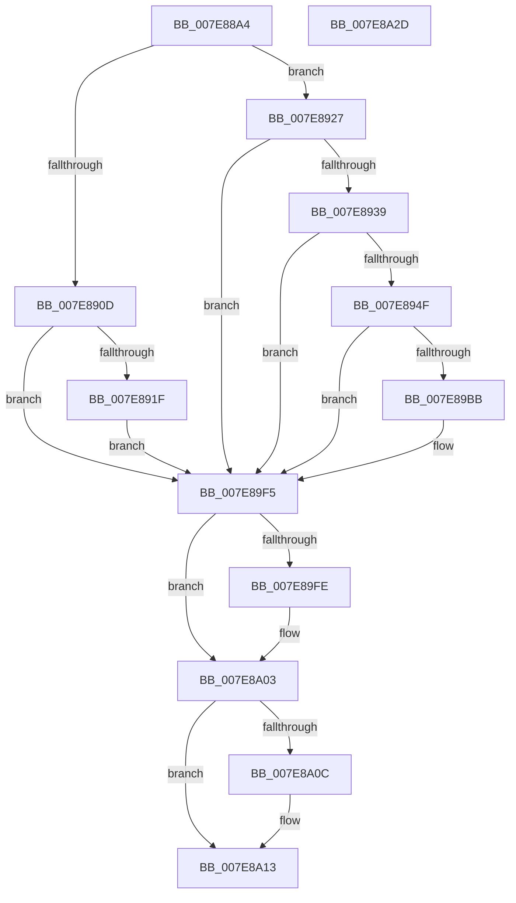

# CmpVolumeContextStart

- RVA: `0x007E88A4`–`0x007E8A2E` (길이 `394` bytes)
- VA: `0x00000001407E88A4`
- 실행 섹션: `PAGE`
- PDB 이름 있음: `예`; PDB Function 태그: `아니요`
- unwind 정보 RVA: `0x000D6D90`
- 디코드: `105`개 명령, `394/394` bytes 표시
- 미해석 바이트: `0` (있으면 어셈블리에 `.byte`로 보존)

> 이 문서는 커널 이미지의 기계어와 PDB 기호를 분석해 생성했습니다. 4번과 5번은 함수 원형과 자료형을 바이너리 사용 방식에서 추정한 C 해석이며 원본 소스 복구 결과는 아닙니다.

## 1. Dependencies

- 직접 호출 지점: **8**; 고유 호출 대상: **8**
- 직접 호출자로 확인된 함수: **1**
- RIP 상대 이미지 참조: **2**

### Outgoing calls
- `0x007E88F4` → [RtlInitUnicodeString](../../text/42/RtlInitUnicodeString_function_0042A780.md) (function, `0x0042A780`)
- `0x007E8910` → [CmpUuidCreate](../AB/CmpUuidCreate_function_00AB81F8.md) (function, `0x00AB81F8`)
- `0x007E892A` → [IoVolumeDeviceToGuid](../95/IoVolumeDeviceToGuid_function_00952A90.md) (function, `0x00952A90`)
- `0x007E8940` → [IoVolumeDeviceToGuidPath](../95/IoVolumeDeviceToGuidPath_function_00952B20.md) (function, `0x00952B20`)
- `0x007E89B0` → [ZwCreateFile](../../text/6A/ZwCreateFile_function_006ADB70.md) (function, `0x006ADB70`)
- `0x007E89E0` → [ObReferenceObjectByHandle](../86/ObReferenceObjectByHandle_function_00868DB0.md) (function, `0x00868DB0`)
- `0x007E89FE` → [ZwClose](../../text/6A/ZwClose_function_006AD2B0.md) (function, `0x006AD2B0`)
- `0x007E8A0E` → [ExFreePoolWithTag](../../poolcode/B8/ExFreePoolWithTag_function_00B82870.md) (function, `0x00B82870`)

### Direct callers
- [CmpVolumeContextCreate](CmpVolumeContextCreate_function_007E86F4.md) at `0x007E874B`

### Static image references
- `0x007E88F9` → RVA `0x00FDA418` (`PAGEDATA`; read)
- `0x007E89BB` → RVA `0x00EF7C68` (`.data`; read)

## 2. Other-region calls and transfers

- 다른 실행 섹션으로 향하는 call: **4**
  - `0x007E88F4` → [RtlInitUnicodeString](../../text/42/RtlInitUnicodeString_function_0042A780.md) (`PAGE` → `.text`)
  - `0x007E89B0` → [ZwCreateFile](../../text/6A/ZwCreateFile_function_006ADB70.md) (`PAGE` → `.text`)
  - `0x007E89FE` → [ZwClose](../../text/6A/ZwClose_function_006AD2B0.md) (`PAGE` → `.text`)
  - `0x007E8A0E` → [ExFreePoolWithTag](../../poolcode/B8/ExFreePoolWithTag_function_00B82870.md) (`PAGE` → `POOLCODE`)
- 별도 외부 분기/꼬리 이동을 확인하지 못했습니다.

## 3. Assembly (complete function range)

```asm
007E88A4  48 8B C4                        mov rax, rsp
007E88A7  48 89 58 18                     mov qword ptr [rax + 0x18], rbx
007E88AB  48 89 70 20                     mov qword ptr [rax + 0x20], rsi
007E88AF  48 89 50 10                     mov qword ptr [rax + 0x10], rdx
007E88B3  55                              push rbp
007E88B4  57                              push rdi
007E88B5  41 56                           push r14
007E88B7  48 8D 68 A1                     lea rbp, [rax - 0x5f]
007E88BB  48 81 EC B0 00 00 00            sub rsp, 0xb0
007E88C2  0F 57 C0                        xorps xmm0, xmm0
007E88C5  33 C0                           xor eax, eax
007E88C7  48 8B F1                        mov rsi, rcx
007E88CA  48 89 45 37                     mov qword ptr [rbp + 0x37], rax
007E88CE  0F 57 C9                        xorps xmm1, xmm1
007E88D1  89 45 3F                        mov dword ptr [rbp + 0x3f], eax
007E88D4  45 33 F6                        xor r14d, r14d
007E88D7  48 8D 4D F7                     lea rcx, [rbp - 9]
007E88DB  33 D2                           xor edx, edx
007E88DD  4C 89 75 6F                     mov qword ptr [rbp + 0x6f], r14
007E88E1  0F 11 45 F7                     movups xmmword ptr [rbp - 9], xmm0
007E88E5  49 8B F8                        mov rdi, r8
007E88E8  0F 11 4D 07                     movups xmmword ptr [rbp + 7], xmm1
007E88EC  0F 11 45 17                     movups xmmword ptr [rbp + 0x17], xmm0
007E88F0  0F 11 45 27                     movups xmmword ptr [rbp + 0x27], xmm0
007E88F4  E8 87 1E C4 FF                  call 0x14042a780
007E88F9  48 8D 05 18 1B 7F 00            lea rax, [rip + 0x7f1b18]
007E8900  48 89 46 10                     mov qword ptr [rsi + 0x10], rax
007E8904  48 8D 56 20                     lea rdx, [rsi + 0x20]
007E8908  48 85 FF                        test rdi, rdi
007E890B  75 1A                           jne 0x1407e8927
007E890D  48 8B CA                        mov rcx, rdx
007E8910  E8 E3 F8 2C 00                  call 0x140ab81f8
007E8915  8B D8                           mov ebx, eax
007E8917  85 C0                           test eax, eax
007E8919  0F 88 D6 00 00 00               js 0x1407e89f5
007E891F  41 8B DE                        mov ebx, r14d
007E8922  E9 CE 00 00 00                  jmp 0x1407e89f5
007E8927  48 8B CF                        mov rcx, rdi
007E892A  E8 61 A1 16 00                  call 0x140952a90
007E892F  8B D8                           mov ebx, eax
007E8931  85 C0                           test eax, eax
007E8933  0F 88 BC 00 00 00               js 0x1407e89f5
007E8939  48 8D 55 F7                     lea rdx, [rbp - 9]
007E893D  48 8B CF                        mov rcx, rdi
007E8940  E8 DB A1 16 00                  call 0x140952b20
007E8945  8B D8                           mov ebx, eax
007E8947  85 C0                           test eax, eax
007E8949  0F 88 A6 00 00 00               js 0x1407e89f5
007E894F  44 89 74 24 50                  mov dword ptr [rsp + 0x50], r14d
007E8954  48 8D 45 F7                     lea rax, [rbp - 9]
007E8958  4C 89 74 24 48                  mov qword ptr [rsp + 0x48], r14
007E895D  4C 8D 4D 07                     lea r9, [rbp + 7]
007E8961  C7 44 24 40 40 00 00 00         mov dword ptr [rsp + 0x40], 0x40
007E8969  4C 8D 45 17                     lea r8, [rbp + 0x17]
007E896D  C7 44 24 38 01 00 00 00         mov dword ptr [rsp + 0x38], 1
007E8975  48 8D 4D 6F                     lea rcx, [rbp + 0x6f]
007E8979  C7 44 24 30 07 00 00 00         mov dword ptr [rsp + 0x30], 7
007E8981  0F 57 C0                        xorps xmm0, xmm0
007E8984  BF 80 01 00 00                  mov edi, 0x180
007E8989  44 89 74 24 28                  mov dword ptr [rsp + 0x28], r14d
007E898E  8B D7                           mov edx, edi
007E8990  4C 89 74 24 20                  mov qword ptr [rsp + 0x20], r14
007E8995  C7 45 17 30 00 00 00            mov dword ptr [rbp + 0x17], 0x30
007E899C  4C 89 75 1F                     mov qword ptr [rbp + 0x1f], r14
007E89A0  C7 45 2F 00 02 00 00            mov dword ptr [rbp + 0x2f], 0x200
007E89A7  48 89 45 27                     mov qword ptr [rbp + 0x27], rax
007E89AB  F3 0F 7F 45 37                  movdqu xmmword ptr [rbp + 0x37], xmm0
007E89B0  E8 BB 51 EC FF                  call 0x1406adb70
007E89B5  8B D8                           mov ebx, eax
007E89B7  85 C0                           test eax, eax
007E89B9  78 3A                           js 0x1407e89f5
007E89BB  48 8B 05 A6 F2 70 00            mov rax, qword ptr [rip + 0x70f2a6]
007E89C2  45 33 C9                        xor r9d, r9d
007E89C5  48 8B 4D 6F                     mov rcx, qword ptr [rbp + 0x6f]
007E89C9  8B D7                           mov edx, edi
007E89CB  4C 89 74 24 28                  mov qword ptr [rsp + 0x28], r14
007E89D0  4C 89 75 67                     mov qword ptr [rbp + 0x67], r14
007E89D4  4C 8B 00                        mov r8, qword ptr [rax]
007E89D7  48 8D 45 67                     lea rax, [rbp + 0x67]
007E89DB  48 89 44 24 20                  mov qword ptr [rsp + 0x20], rax
007E89E0  E8 CB 03 08 00                  call 0x140868db0
007E89E5  8B D8                           mov ebx, eax
007E89E7  48 8B 45 67                     mov rax, qword ptr [rbp + 0x67]
007E89EB  85 DB                           test ebx, ebx
007E89ED  48 89 46 30                     mov qword ptr [rsi + 0x30], rax
007E89F1  41 0F 49 DE                     cmovns ebx, r14d
007E89F5  48 8B 4D 6F                     mov rcx, qword ptr [rbp + 0x6f]
007E89F9  48 85 C9                        test rcx, rcx
007E89FC  74 05                           je 0x1407e8a03
007E89FE  E8 AD 48 EC FF                  call 0x1406ad2b0
007E8A03  48 8B 4D FF                     mov rcx, qword ptr [rbp - 1]
007E8A07  48 85 C9                        test rcx, rcx
007E8A0A  74 07                           je 0x1407e8a13
007E8A0C  33 D2                           xor edx, edx
007E8A0E  E8 5D 9E 39 00                  call 0x140b82870
007E8A13  4C 8D 9C 24 B0 00 00 00         lea r11, [rsp + 0xb0]
007E8A1B  8B C3                           mov eax, ebx
007E8A1D  49 8B 5B 30                     mov rbx, qword ptr [r11 + 0x30]
007E8A21  49 8B 73 38                     mov rsi, qword ptr [r11 + 0x38]
007E8A25  49 8B E3                        mov rsp, r11
007E8A28  41 5E                           pop r14
007E8A2A  5F                              pop rdi
007E8A2B  5D                              pop rbp
007E8A2C  C3                              ret
007E8A2D  CC                              int3
```

## 4. C-style interpretation (structured pseudocode)

```c
__int64 __fastcall CmpVolumeContextStart(__int64 a1, __int64 a2, __int64 a3)
{
    __int64 result;
    __int64 v_r14;
    __int64 v_rbx;
    __int64 v_rsp;
    unsigned __int64 v_stack_m18;
    unsigned int v_stack_m78;
    unsigned __int64 v_stack_m80;
    unsigned int v_stack_m88;
    unsigned int v_stack_m90;
    unsigned int v_stack_m98;
    unsigned int v_stack_mA0;
    unsigned __int64 v_stack_mA8;

    *(unsigned __int64 *)(v_rsp + 24) = v_rbx;
    *(unsigned __int64 *)(v_rsp + 32) = v_rsi;
    *(unsigned __int64 *)(v_rsp + 16) = a2;
    v_rsp = (v_rsp) - (176);
    result = 0;
    *(unsigned __int64 *)(v_rsp - 95 + 55) = 0;
    *(unsigned int *)(v_rsp - 95 + 63) = 0;
    v_r14 = 0;
    a2 = 0;
    *(unsigned __int64 *)(v_rsp - 95 + 111) = 0;
    *(unsigned __int64 *)(v_rsp - 95 - 9) = v_xmm0;
    *(unsigned __int64 *)(v_rsp - 95 + 7) = v_xmm1;
    *(unsigned __int64 *)(v_rsp - 95 + 23) = v_xmm0;
    *(unsigned __int64 *)(v_rsp - 95 + 39) = v_xmm0;
    result = RtlInitUnicodeString(v_rsp - 95 - 9, a2, a3, a4);
    *(unsigned __int64 *)(a1 + 16) = v_rip + 8330008;
    if (a3 != 0) goto loc_007E8927;
    result = CmpUuidCreate(a1 + 32, a1 + 32, a3, a4);
    if (sign_flag) goto loc_007E89F5;
    goto loc_007E89F5;
loc_007E8927:
    result = IoVolumeDeviceToGuid(a3, a1 + 32, a3, a4);
    if (sign_flag) goto loc_007E89F5;
    result = IoVolumeDeviceToGuidPath(a3, v_rsp - 95 - 9, a3, a4);
    if (sign_flag) goto loc_007E89F5;
    v_stack_m78 = 0;
    v_stack_m80 = 0;
    v_stack_m88 = 64;
    v_stack_m90 = 1;
    v_stack_m98 = 7;
    v_stack_mA0 = 0;
    v_stack_mA8 = 0;
    *(unsigned int *)(v_rsp - 95 + 23) = 48;
    *(unsigned __int64 *)(v_rsp - 95 + 31) = 0;
    *(unsigned int *)(v_rsp - 95 + 47) = 512;
    *(unsigned __int64 *)(v_rsp - 95 + 39) = v_rsp - 95 - 9;
    *(unsigned __int64 *)(v_rsp - 95 + 55) = v_xmm0;
    result = ZwCreateFile(v_rsp - 95 + 111, 384, v_rsp - 95 + 23, v_rsp - 95 + 7);
    v_rbx = (unsigned int)((unsigned int)(result));
    if (!(sign_flag)) {
        result = *(unsigned __int64 *)(v_rip + 7402150);
        a4 = 0;
        a1 = *(unsigned __int64 *)(v_rsp - 95 + 111);
        a2 = 384;
        v_stack_mA0 = 0;
        *(unsigned __int64 *)(v_rsp - 95 + 103) = 0;
        a3 = *(unsigned __int64 *)(result);
        result = v_rsp - 95 + 103;
        v_stack_mA8 = result;
        result = ObReferenceObjectByHandle(a1, a2, a3, a4);
        v_rbx = (unsigned int)(result);
        result = *(unsigned __int64 *)(v_rsp - 95 + 103);
        *(unsigned __int64 *)(a1 + 48) = result;
        if (!sign_flag) { v_rbx = 0; }
    }
    if (*(unsigned __int64 *)(v_rsp - 95 + 111) != 0) {
        result = ZwClose(*(unsigned __int64 *)(v_rsp - 95 + 111), a2, a3, a4);
    }
    if (*(unsigned __int64 *)(v_rsp - 95 - 1) != 0) {
        a2 = 0;
        result = ExFreePoolWithTag(*(unsigned __int64 *)(v_rsp - 95 - 1), a2, a3, a4);
    }
    return (unsigned int)((unsigned int)(v_rbx));
}
```

## 5. (Beta) C Style

```c
int64_t CmpVolumeContextStart(void *Arg1, int64_t Arg2, int64_t Arg3)
{
    uint8_t *arg1 = (uint8_t *)Arg1;

    int64_t result;
    int64_t local_r14;
    int64_t local_rbx;
    int64_t local_rsp;
    uint64_t v_stack_m18;
    uint32_t v_stack_m78;
    uint64_t v_stack_m80;
    uint32_t v_stack_m88;
    uint32_t v_stack_m90;
    uint32_t v_stack_m98;
    uint32_t v_stack_mA0;
    uint64_t v_stack_mA8;

    *(uint64_t *)(local_rsp + 0x18) = local_rbx;
    *(uint64_t *)(local_rsp + 0x20) = local_rsi;
    *(uint64_t *)(local_rsp + 0x10) = Arg2;
    local_rsp = (local_rsp) - (176);
    result = 0;
    *(uint64_t *)(local_rsp - 0x5F + 0x37) = 0;
    *(uint32_t *)(local_rsp - 0x5F + 0x3F) = 0;
    local_r14 = 0;
    Arg2 = 0;
    *(uint64_t *)(local_rsp - 0x5F + 0x6F) = 0;
    *(uint64_t *)(local_rsp - 0x5F - 0x9) = v_xmm0;
    *(uint64_t *)(local_rsp - 0x5F + 0x7) = v_xmm1;
    *(uint64_t *)(local_rsp - 0x5F + 0x17) = v_xmm0;
    *(uint64_t *)(local_rsp - 0x5F + 0x27) = v_xmm0;
    result = RtlInitUnicodeString(local_rsp - 95 - 9, Arg2, Arg3, a4);
    *(uint64_t *)(arg1 + 0x10) = v_rip + 8330008;
    if (Arg3 != 0) goto loc_007E8927;
    result = CmpUuidCreate(Arg1 + 32, Arg1 + 32, Arg3, a4);
    if (sign_flag) goto loc_007E89F5;
    goto loc_007E89F5;
loc_007E8927:
    result = IoVolumeDeviceToGuid(Arg3, Arg1 + 32, Arg3, a4);
    if (sign_flag) goto loc_007E89F5;
    result = IoVolumeDeviceToGuidPath(Arg3, local_rsp - 95 - 9, Arg3, a4);
    if (sign_flag) goto loc_007E89F5;
    v_stack_m78 = 0;
    v_stack_m80 = 0;
    v_stack_m88 = 64;
    v_stack_m90 = 1;
    v_stack_m98 = 7;
    v_stack_mA0 = 0;
    v_stack_mA8 = 0;
    *(uint32_t *)(local_rsp - 0x5F + 0x17) = 48;
    *(uint64_t *)(local_rsp - 0x5F + 0x1F) = 0;
    *(uint32_t *)(local_rsp - 0x5F + 0x2F) = 512;
    *(uint64_t *)(local_rsp - 0x5F + 0x27) = local_rsp - 95 - 9;
    *(uint64_t *)(local_rsp - 0x5F + 0x37) = v_xmm0;
    result = ZwCreateFile(local_rsp - 95 + 111, 384, local_rsp - 95 + 23, local_rsp - 95 + 7);
    local_rbx = (uint32_t)((uint32_t)(result));
    if (!(sign_flag)) {
        result = *(uint64_t *)(v_rip + 0x70F2A6);
        a4 = 0;
        Arg1 = *(uint64_t *)(local_rsp - 0x5F + 0x6F);
        Arg2 = 384;
        v_stack_mA0 = 0;
        *(uint64_t *)(local_rsp - 0x5F + 0x67) = 0;
        Arg3 = *(uint64_t *)(result);
        result = local_rsp - 95 + 103;
        v_stack_mA8 = result;
        result = ObReferenceObjectByHandle(Arg1, Arg2, Arg3, a4);
        local_rbx = (uint32_t)(result);
        result = *(uint64_t *)(local_rsp - 0x5F + 0x67);
        *(uint64_t *)(arg1 + 0x30) = result;
        if (!sign_flag) { local_rbx = 0; }
    }
    if (*(uint64_t *)(local_rsp - 0x5F + 0x6F) != 0) {
        result = ZwClose(*(uint64_t *)(local_rsp - 0x5F + 0x6F), Arg2, Arg3, a4);
    }
    if (*(uint64_t *)(local_rsp - 0x5F - 0x1) != 0) {
        Arg2 = 0;
        result = ExFreePoolWithTag(*(uint64_t *)(local_rsp - 0x5F - 0x1), Arg2, Arg3, a4);
    }
    return (uint32_t)((uint32_t)(local_rbx));
}
```

### 관측된 메모리 오프셋

구조체 형식이 확인되지 않은 접근은 인자 기준의 오프셋으로만 기록했습니다.

| 기준 인자 | 오프셋 표현 | 폭 (bit) | 접근 |
|---|---:|---:|---|
| `Arg1` | `+ 0x10` | `64` | `W` |
| `Arg1` | `+ 0x20` | `64` | `R` |
| `Arg1` | `+ 0x30` | `64` | `W` |

## 6. Execution-region graph

[열기: 2D/3D 그래프와 함수 탐색 컨트롤 패널](../../../control-panel.html?section=page&rva=0x007E88A4&view=graph)

- 2D 그래프는 위에서 아래로 흐르고, 3D 그래프는 빈 공간을 드래그해 회전합니다. Shift+드래그는 이동, 휠은 확대·축소, 함수 노드 선택은 대상 보고서 이동입니다.

### Static fallback


