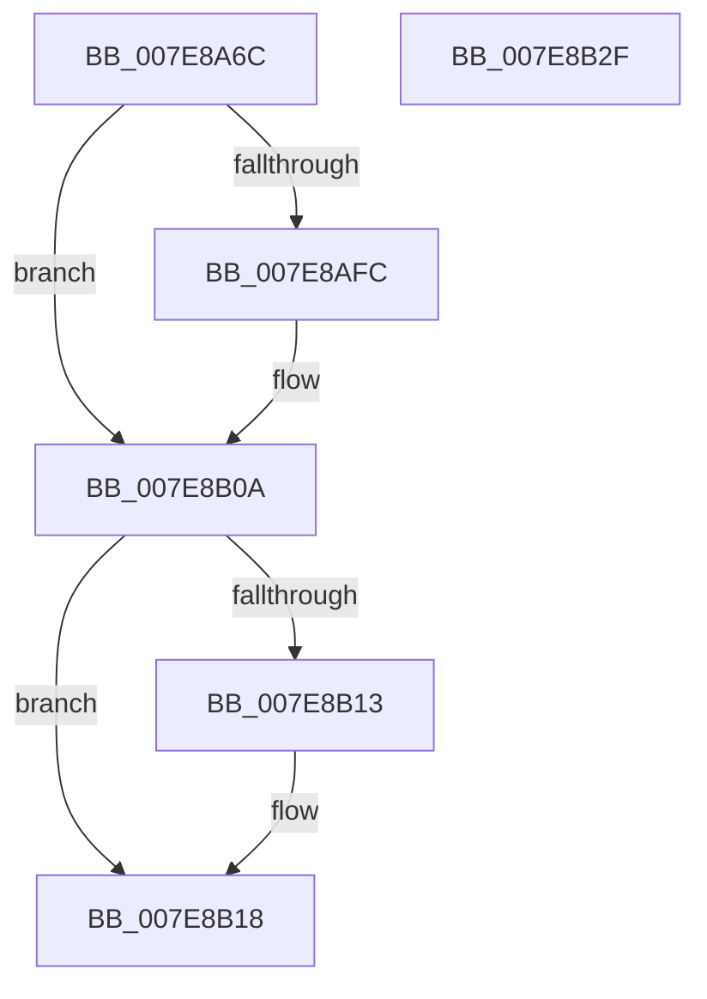

# CmpVolumeManagerGetContextForFilePath

- RVA: `0x007E8A6C`–`0x007E8B30` (길이 `196` bytes)
- VA: `0x00000001407E8A6C`
- 실행 섹션: `PAGE`
- PDB 이름 있음: `예`; PDB Function 태그: `아니요`
- unwind 정보 RVA: `0x000D6D78`
- 디코드: `49`개 명령, `196/196` bytes 표시
- 미해석 바이트: `0` (있으면 어셈블리에 `.byte`로 보존)

> 이 문서는 커널 이미지의 기계어와 PDB 기호를 분석해 생성했습니다. 4번과 5번은 함수 원형과 자료형을 바이너리 사용 방식에서 추정한 C 해석이며 원본 소스 복구 결과는 아닙니다.

## 1. Dependencies

- 직접 호출 지점: **3**; 고유 호출 대상: **3**
- 직접 호출자로 확인된 함수: **1**
- RIP 상대 이미지 참조: **0**

### Outgoing calls
- `0x007E8AF1` → [ZwCreateFile](../../text/6A/ZwCreateFile_function_006ADB70.md) (function, `0x006ADB70`)
- `0x007E8B03` → [CmpVolumeManagerGetContextForFile](../95/CmpVolumeManagerGetContextForFile_function_009525A8.md) (function, `0x009525A8`)
- `0x007E8B13` → [ZwClose](../../text/6A/ZwClose_function_006AD2B0.md) (function, `0x006AD2B0`)

### Direct callers
- [CmpVolumeManagerCreateContextsForWellKnownVolumes](../70/CmpVolumeManagerCreateContextsForWellKnownVolumes_function_007023B0.md) at `0x007023F6`

### Static image references
- 디코드된 RIP-relative 메모리 참조가 없습니다.

## 2. Other-region calls and transfers

- 다른 실행 섹션으로 향하는 call: **2**
  - `0x007E8AF1` → [ZwCreateFile](../../text/6A/ZwCreateFile_function_006ADB70.md) (`PAGE` → `.text`)
  - `0x007E8B13` → [ZwClose](../../text/6A/ZwClose_function_006AD2B0.md) (`PAGE` → `.text`)
- 별도 외부 분기/꼬리 이동을 확인하지 못했습니다.

## 3. Assembly (complete function range)

```asm
007E8A6C  48 8B C4                        mov rax, rsp
007E8A6F  48 89 58 10                     mov qword ptr [rax + 0x10], rbx
007E8A73  48 89 78 18                     mov qword ptr [rax + 0x18], rdi
007E8A77  48 89 48 08                     mov qword ptr [rax + 8], rcx
007E8A7B  55                              push rbp
007E8A7C  48 8D 68 A1                     lea rbp, [rax - 0x5f]
007E8A80  48 81 EC A0 00 00 00            sub rsp, 0xa0
007E8A87  83 60 A8 00                     and dword ptr [rax - 0x58], 0
007E8A8B  4C 8D 45 27                     lea r8, [rbp + 0x27]
007E8A8F  48 83 60 A0 00                  and qword ptr [rax - 0x60], 0
007E8A94  48 8D 4D 67                     lea rcx, [rbp + 0x67]
007E8A98  83 60 98 00                     and dword ptr [rax - 0x68], 0
007E8A9C  0F 57 C0                        xorps xmm0, xmm0
007E8A9F  83 65 43 00                     and dword ptr [rbp + 0x43], 0
007E8AA3  49 8B F9                        mov rdi, r9
007E8AA6  48 83 65 67 00                  and qword ptr [rbp + 0x67], 0
007E8AAB  4C 8D 4D 17                     lea r9, [rbp + 0x17]
007E8AAF  48 83 65 2F 00                  and qword ptr [rbp + 0x2f], 0
007E8AB4  C7 40 90 01 00 00 00            mov dword ptr [rax - 0x70], 1
007E8ABB  C7 40 88 07 00 00 00            mov dword ptr [rax - 0x78], 7
007E8AC2  83 60 80 00                     and dword ptr [rax - 0x80], 0
007E8AC6  48 83 64 24 20 00               and qword ptr [rsp + 0x20], 0
007E8ACC  48 89 55 37                     mov qword ptr [rbp + 0x37], rdx
007E8AD0  BA 80 00 00 00                  mov edx, 0x80
007E8AD5  48 C7 45 27 30 00 00 00         mov qword ptr [rbp + 0x27], 0x30
007E8ADD  83 65 2B 00                     and dword ptr [rbp + 0x2b], 0
007E8AE1  0F 11 45 17                     movups xmmword ptr [rbp + 0x17], xmm0
007E8AE5  C7 45 3F 40 02 00 00            mov dword ptr [rbp + 0x3f], 0x240
007E8AEC  F3 0F 7F 45 47                  movdqu xmmword ptr [rbp + 0x47], xmm0
007E8AF1  E8 7A 50 EC FF                  call 0x1406adb70
007E8AF6  8B D8                           mov ebx, eax
007E8AF8  85 C0                           test eax, eax
007E8AFA  78 0E                           js 0x1407e8b0a
007E8AFC  48 8B 55 67                     mov rdx, qword ptr [rbp + 0x67]
007E8B00  4C 8B CF                        mov r9, rdi
007E8B03  E8 A0 9A 16 00                  call 0x1409525a8
007E8B08  8B D8                           mov ebx, eax
007E8B0A  48 8B 4D 67                     mov rcx, qword ptr [rbp + 0x67]
007E8B0E  48 85 C9                        test rcx, rcx
007E8B11  74 05                           je 0x1407e8b18
007E8B13  E8 98 47 EC FF                  call 0x1406ad2b0
007E8B18  4C 8D 9C 24 A0 00 00 00         lea r11, [rsp + 0xa0]
007E8B20  8B C3                           mov eax, ebx
007E8B22  49 8B 5B 18                     mov rbx, qword ptr [r11 + 0x18]
007E8B26  49 8B 7B 20                     mov rdi, qword ptr [r11 + 0x20]
007E8B2A  49 8B E3                        mov rsp, r11
007E8B2D  5D                              pop rbp
007E8B2E  C3                              ret
007E8B2F  CC                              int3
```

## 4. C-style interpretation (structured pseudocode)

```c
__int64 __fastcall CmpVolumeManagerGetContextForFilePath(__int64 a1, __int64 a2, __int64 a3, __int64 a4)
{
    __int64 result;
    __int64 v_rbx;
    __int64 v_rsp;
    unsigned __int64 v_stack_m8;
    unsigned __int64 v_stack_m88;

    *(unsigned __int64 *)(v_rsp + 16) = v_rbx;
    *(unsigned __int64 *)(v_rsp + 24) = v_rdi;
    *(unsigned __int64 *)(v_rsp + 8) = a1;
    v_rsp = (v_rsp) - (160);
    *(unsigned int *)(v_rsp - 112) = 1;
    *(unsigned int *)(v_rsp - 120) = 7;
    *(unsigned __int64 *)(v_rsp - 95 + 55) = a2;
    *(unsigned __int64 *)(v_rsp - 95 + 39) = 48;
    *(unsigned __int64 *)(v_rsp - 95 + 23) = v_xmm0;
    *(unsigned int *)(v_rsp - 95 + 63) = 576;
    *(unsigned __int64 *)(v_rsp - 95 + 71) = v_xmm0;
    result = ZwCreateFile(v_rsp - 95 + 103, 128, v_rsp - 95 + 39, v_rsp - 95 + 23);
    v_rbx = (unsigned int)((unsigned int)(result));
    if (!(sign_flag)) {
        a2 = *(unsigned __int64 *)(v_rsp - 95 + 103);
        a4 = a4;
        result = CmpVolumeManagerGetContextForFile(v_rsp - 95 + 103, a2, v_rsp - 95 + 39, a4);
        v_rbx = (unsigned int)(result);
    }
    if (*(unsigned __int64 *)(v_rsp - 95 + 103) != 0) {
        result = ZwClose(*(unsigned __int64 *)(v_rsp - 95 + 103), a2, v_rsp - 95 + 39, a4);
    }
    return (unsigned int)((unsigned int)(v_rbx));
}
```

## 5. (Beta) C Style

```c
int64_t CmpVolumeManagerGetContextForFilePath(int64_t Arg1, int64_t Arg2, int64_t Arg3, int64_t Arg4)
{
    int64_t result;
    int64_t local_rbx;
    int64_t local_rsp;
    uint64_t v_stack_m8;
    uint64_t v_stack_m88;

    *(uint64_t *)(local_rsp + 0x10) = local_rbx;
    *(uint64_t *)(local_rsp + 0x18) = local_rdi;
    *(uint64_t *)(local_rsp + 0x8) = Arg1;
    local_rsp = (local_rsp) - (160);
    *(uint32_t *)(local_rsp - 0x70) = 1;
    *(uint32_t *)(local_rsp - 0x78) = 7;
    *(uint64_t *)(local_rsp - 0x5F + 0x37) = Arg2;
    *(uint64_t *)(local_rsp - 0x5F + 0x27) = 48;
    *(uint64_t *)(local_rsp - 0x5F + 0x17) = v_xmm0;
    *(uint32_t *)(local_rsp - 0x5F + 0x3F) = 576;
    *(uint64_t *)(local_rsp - 0x5F + 0x47) = v_xmm0;
    result = ZwCreateFile(local_rsp - 95 + 103, 128, local_rsp - 95 + 39, local_rsp - 95 + 23);
    local_rbx = (uint32_t)((uint32_t)(result));
    if (!(sign_flag)) {
        Arg2 = *(uint64_t *)(local_rsp - 0x5F + 0x67);
        Arg4 = Arg4;
        result = CmpVolumeManagerGetContextForFile(local_rsp - 95 + 103, Arg2, local_rsp - 95 + 39, Arg4);
        local_rbx = (uint32_t)(result);
    }
    if (*(uint64_t *)(local_rsp - 0x5F + 0x67) != 0) {
        result = ZwClose(*(uint64_t *)(local_rsp - 0x5F + 0x67), Arg2, local_rsp - 95 + 39, Arg4);
    }
    return (uint32_t)((uint32_t)(local_rbx));
}
```

## 6. Execution-region graph

[열기: 2D/3D 그래프와 함수 탐색 컨트롤 패널](../../../control-panel.html?section=page&rva=0x007E8A6C&view=graph)

- 2D 그래프는 위에서 아래로 흐르고, 3D 그래프는 빈 공간을 드래그해 회전합니다. Shift+드래그는 이동, 휠은 확대·축소, 함수 노드 선택은 대상 보고서 이동입니다.

### Static fallback


