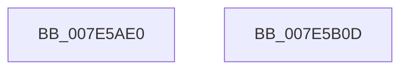

# CmpWorkItemInitialize

- RVA: `0x007E5AE0`–`0x007E5B0E` (길이 `46` bytes)
- VA: `0x00000001407E5AE0`
- 실행 섹션: `PAGE`
- PDB 이름 있음: `예`; PDB Function 태그: `아니요`
- unwind 정보 RVA: `0x000DB714`
- 디코드: `13`개 명령, `46/46` bytes 표시
- 미해석 바이트: `0` (있으면 어셈블리에 `.byte`로 보존)

> 이 문서는 커널 이미지의 기계어와 PDB 기호를 분석해 생성했습니다. 4번과 5번은 함수 원형과 자료형을 바이너리 사용 방식에서 추정한 C 해석이며 원본 소스 복구 결과는 아닙니다.

## 1. Dependencies

- 직접 호출 지점: **0**; 고유 호출 대상: **0**
- 직접 호출자로 확인된 함수: **1**
- RIP 상대 이미지 참조: **1**

### Outgoing calls
- 직접 디코드된 call 명령이 없습니다.

### Direct callers
- [CmFcManagerInitialize](../../init/C5/CmFcManagerInitialize_function_00C5D93C.md) at `0x00C5DA2F`
- [CmFcManagerInitialize](../../init/C5/CmFcManagerInitialize_function_00C5D93C.md) at `0x00C5DA42`
- [CmFcManagerInitialize](../../init/C5/CmFcManagerInitialize_function_00C5D93C.md) at `0x00C5DB14`
- [CmFcManagerInitialize](../../init/C5/CmFcManagerInitialize_function_00C5D93C.md) at `0x00C5DB27`
- [CmFcManagerInitialize](../../init/C5/CmFcManagerInitialize_function_00C5D93C.md) at `0x00C5DB3A`

### Static image references
- `0x007E5AE3` → RVA `0x0049F4E0` (`CmpWorkItemWrapper`; read)

## 2. Other-region calls and transfers

- 다른 실행 섹션으로 향하는 call: **0**
- 별도 외부 분기/꼬리 이동을 확인하지 못했습니다.

## 3. Assembly (complete function range)

```asm
007E5AE0  45 33 D2                        xor r10d, r10d
007E5AE3  48 8D 05 F6 99 CB FF            lea rax, [rip - 0x34660a]
007E5AEA  4C 89 51 08                     mov qword ptr [rcx + 8], r10
007E5AEE  48 89 41 10                     mov qword ptr [rcx + 0x10], rax
007E5AF2  48 89 49 18                     mov qword ptr [rcx + 0x18], rcx
007E5AF6  4C 89 11                        mov qword ptr [rcx], r10
007E5AF9  44 89 51 28                     mov dword ptr [rcx + 0x28], r10d
007E5AFD  4C 89 51 20                     mov qword ptr [rcx + 0x20], r10
007E5B01  89 51 2C                        mov dword ptr [rcx + 0x2c], edx
007E5B04  4C 89 41 30                     mov qword ptr [rcx + 0x30], r8
007E5B08  4C 89 49 38                     mov qword ptr [rcx + 0x38], r9
007E5B0C  C3                              ret
007E5B0D  CC                              int3
```

## 4. C-style interpretation (structured pseudocode)

```c
__int64 __fastcall CmpWorkItemInitialize(__int64 a1, int a2, __int64 a3, __int64 a4)
{
    __int64 v_r10;

    v_r10 = 0;
    *(unsigned __int64 *)(a1 + 8) = 0;
    *(unsigned __int64 *)(a1 + 16) = v_rip - 3433994;
    *(unsigned __int64 *)(a1 + 24) = a1;
    *(unsigned __int64 *)(a1) = 0;
    *(unsigned int *)(a1 + 40) = 0;
    *(unsigned __int64 *)(a1 + 32) = 0;
    *(unsigned int *)(a1 + 44) = a2;
    *(unsigned __int64 *)(a1 + 48) = a3;
    *(unsigned __int64 *)(a1 + 56) = a4;
    return v_rip - 3433994;
}
```

## 5. (Beta) C Style

```c
int64_t CmpWorkItemInitialize(void *Arg1, int32_t Arg2, int64_t Arg3, int64_t Arg4)
{
    uint8_t *arg1 = (uint8_t *)Arg1;

    int64_t local_r10;

    local_r10 = 0;
    *(uint64_t *)(arg1 + 0x8) = 0;
    *(uint64_t *)(arg1 + 0x10) = v_rip - 3433994;
    *(void **)(arg1 + 0x18) = Arg1;
    *(uint64_t *)(arg1) = 0;
    *(uint32_t *)(arg1 + 0x28) = 0;
    *(uint64_t *)(arg1 + 0x20) = 0;
    *(uint32_t *)(arg1 + 0x2C) = Arg2;
    *(uint64_t *)(arg1 + 0x30) = Arg3;
    *(uint64_t *)(arg1 + 0x38) = Arg4;
    return v_rip - 3433994;
}
```

### 관측된 메모리 오프셋

구조체 형식이 확인되지 않은 접근은 인자 기준의 오프셋으로만 기록했습니다.

| 기준 인자 | 오프셋 표현 | 폭 (bit) | 접근 |
|---|---:|---:|---|
| `Arg1` | `+ 0x0` | `64` | `W` |
| `Arg1` | `+ 0x8` | `64` | `W` |
| `Arg1` | `+ 0x10` | `64` | `W` |
| `Arg1` | `+ 0x18` | `64` | `W` |
| `Arg1` | `+ 0x20` | `64` | `W` |
| `Arg1` | `+ 0x28` | `32` | `W` |
| `Arg1` | `+ 0x2C` | `32` | `W` |
| `Arg1` | `+ 0x30` | `64` | `W` |
| `Arg1` | `+ 0x38` | `64` | `W` |

## 6. Execution-region graph

[열기: 2D/3D 그래프와 함수 탐색 컨트롤 패널](../../../control-panel.html?section=page&rva=0x007E5AE0&view=graph)

- 2D 그래프는 위에서 아래로 흐르고, 3D 그래프는 빈 공간을 드래그해 회전합니다. Shift+드래그는 이동, 휠은 확대·축소, 함수 노드 선택은 대상 보고서 이동입니다.

### Static fallback


