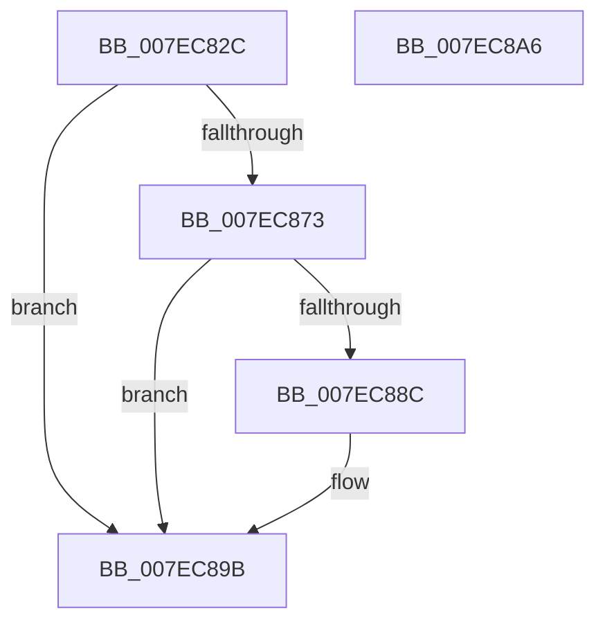

# CmpWriteOffsetArrayToFile

- RVA: `0x007EC82C`–`0x007EC8A7` (길이 `123` bytes)
- VA: `0x00000001407EC82C`
- 실행 섹션: `PAGE`
- PDB 이름 있음: `예`; PDB Function 태그: `아니요`
- unwind 정보 RVA: `0x000D6EB4`
- 디코드: `34`개 명령, `123/123` bytes 표시
- 미해석 바이트: `0` (있으면 어셈블리에 `.byte`로 보존)

> 이 문서는 커널 이미지의 기계어와 PDB 기호를 분석해 생성했습니다. 4번과 5번은 함수 원형과 자료형을 바이너리 사용 방식에서 추정한 C 해석이며 원본 소스 복구 결과는 아닙니다.

## 1. Dependencies

- 직접 호출 지점: **3**; 고유 호출 대상: **3**
- 직접 호출자로 확인된 함수: **2**
- RIP 상대 이미지 참조: **0**

### Outgoing calls
- `0x007EC86A` → [ZwSetInformationFile](../../text/6A/ZwSetInformationFile_function_006AD5B0.md) (function, `0x006AD5B0`)
- `0x007EC883` → [CmpDoFileWrite](../A6/CmpDoFileWrite_function_00A65880.md) (function, `0x00A65880`)
- `0x007EC896` → [ZwFlushBuffersFile](../../text/6A/ZwFlushBuffersFile_function_006ADA30.md) (function, `0x006ADA30`)

### Direct callers
- [CmDumpKeyToFile](../7D/CmDumpKeyToFile_function_007DCD64.md) at `0x007DCE9E`
- [CmpFlushBackupHive](CmpFlushBackupHive_function_007EC1A8.md) at `0x007EC398`

### Static image references
- 디코드된 RIP-relative 메모리 참조가 없습니다.

## 2. Other-region calls and transfers

- 다른 실행 섹션으로 향하는 call: **2**
  - `0x007EC86A` → [ZwSetInformationFile](../../text/6A/ZwSetInformationFile_function_006AD5B0.md) (`PAGE` → `.text`)
  - `0x007EC896` → [ZwFlushBuffersFile](../../text/6A/ZwFlushBuffersFile_function_006ADA30.md) (`PAGE` → `.text`)
- 별도 외부 분기/꼬리 이동을 확인하지 못했습니다.

## 3. Assembly (complete function range)

```asm
007EC82C  48 8B C4                        mov rax, rsp
007EC82F  48 89 70 10                     mov qword ptr [rax + 0x10], rsi
007EC833  48 89 48 08                     mov qword ptr [rax + 8], rcx
007EC837  57                              push rdi
007EC838  48 83 EC 40                     sub rsp, 0x40
007EC83C  48 8B 4C 24 70                  mov rcx, qword ptr [rsp + 0x70]
007EC841  49 8B F8                        mov rdi, r8
007EC844  83 60 0C 00                     and dword ptr [rax + 0xc], 0
007EC848  4C 8D 40 08                     lea r8, [rax + 8]
007EC84C  8B F2                           mov esi, edx
007EC84E  44 89 48 08                     mov dword ptr [rax + 8], r9d
007EC852  0F 57 C0                        xorps xmm0, xmm0
007EC855  C7 40 D8 14 00 00 00            mov dword ptr [rax - 0x28], 0x14
007EC85C  41 B9 08 00 00 00               mov r9d, 8
007EC862  48 8D 50 E8                     lea rdx, [rax - 0x18]
007EC866  0F 11 40 E8                     movups xmmword ptr [rax - 0x18], xmm0
007EC86A  E8 41 0D EC FF                  call 0x1406ad5b0
007EC86F  85 C0                           test eax, eax
007EC871  78 28                           js 0x1407ec89b
007EC873  48 8B 4C 24 70                  mov rcx, qword ptr [rsp + 0x70]
007EC878  44 8B CE                        mov r9d, esi
007EC87B  83 64 24 20 00                  and dword ptr [rsp + 0x20], 0
007EC880  4C 8B C7                        mov r8, rdi
007EC883  E8 F8 8F 27 00                  call 0x140a65880
007EC888  85 C0                           test eax, eax
007EC88A  78 0F                           js 0x1407ec89b
007EC88C  48 8B 4C 24 70                  mov rcx, qword ptr [rsp + 0x70]
007EC891  48 8D 54 24 30                  lea rdx, [rsp + 0x30]
007EC896  E8 95 11 EC FF                  call 0x1406ada30
007EC89B  48 8B 74 24 58                  mov rsi, qword ptr [rsp + 0x58]
007EC8A0  48 83 C4 40                     add rsp, 0x40
007EC8A4  5F                              pop rdi
007EC8A5  C3                              ret
007EC8A6  CC                              int3
```

## 4. C-style interpretation (structured pseudocode)

```c
__int64 __fastcall CmpWriteOffsetArrayToFile(__int64 a1, int a2, __int64 a3, int a4, __int64 a5)
{
    __int64 result;
    __int64 v_rsp;
    unsigned __int64 v_stack_m18;
    unsigned int v_stack_m28;
    unsigned __int64 v_stack_p10;

    *(unsigned __int64 *)(v_rsp + 16) = v_rsi;
    *(unsigned __int64 *)(v_rsp + 8) = a1;
    v_rsp = (v_rsp) - (64);
    *(unsigned int *)(v_rsp + 8) = a4;
    *(unsigned int *)(v_rsp - 40) = 20;
    *(unsigned __int64 *)(v_rsp - 24) = v_xmm0;
    result = ZwSetInformationFile(a5, v_rsp - 24, v_rsp + 8, 8);
    if (sign_flag) goto loc_007EC89B;
    result = CmpDoFileWrite(a5, v_rsp - 24, a3, (unsigned int)((unsigned int)((unsigned int)(a2))));
    if (!(sign_flag)) {
        a1 = a5;
        a2 = v_stack_m18;
        result = ZwFlushBuffersFile(a1, a2, a3, (unsigned int)((unsigned int)((unsigned int)(a2))));
    }
    v_rsp = (v_rsp) + (64);
    return result;
}
```

## 5. (Beta) C Style

```c
int64_t CmpWriteOffsetArrayToFile(int64_t Arg1, int32_t Arg2, int64_t Arg3, int32_t Arg4, int64_t Arg5)
{
    int64_t result;
    int64_t local_rsp;
    uint64_t v_stack_m18;
    uint32_t v_stack_m28;
    uint64_t v_stack_p10;

    *(uint64_t *)(local_rsp + 0x10) = local_rsi;
    *(uint64_t *)(local_rsp + 0x8) = Arg1;
    local_rsp = (local_rsp) - (64);
    *(uint32_t *)(local_rsp + 0x8) = Arg4;
    *(uint32_t *)(local_rsp - 0x28) = 20;
    *(uint64_t *)(local_rsp - 0x18) = v_xmm0;
    result = ZwSetInformationFile(Arg5, local_rsp - 24, local_rsp + 8, 8);
    if (sign_flag) goto loc_007EC89B;
    result = CmpDoFileWrite(Arg5, local_rsp - 24, Arg3, (uint32_t)((uint32_t)((uint32_t)(Arg2))));
    if (!(sign_flag)) {
        Arg1 = Arg5;
        Arg2 = v_stack_m18;
        result = ZwFlushBuffersFile(Arg1, Arg2, Arg3, (uint32_t)((uint32_t)((uint32_t)(Arg2))));
    }
    local_rsp = (local_rsp) + (64);
    return result;
}
```

## 6. Execution-region graph

[열기: 2D/3D 그래프와 함수 탐색 컨트롤 패널](../../../control-panel.html?section=page&rva=0x007EC82C&view=graph)

- 2D 그래프는 위에서 아래로 흐르고, 3D 그래프는 빈 공간을 드래그해 회전합니다. Shift+드래그는 이동, 휠은 확대·축소, 함수 노드 선택은 대상 보고서 이동입니다.

### Static fallback


