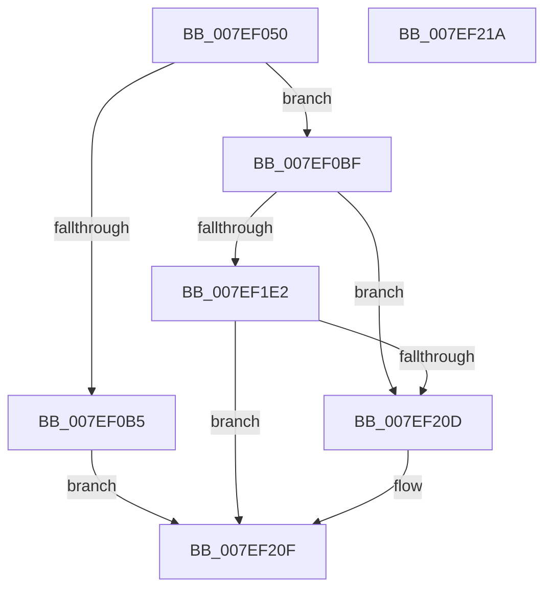

# HvHiveStartEmptyClone

- RVA: `0x007EF050`–`0x007EF21B` (길이 `459` bytes)
- VA: `0x00000001407EF050`
- 실행 섹션: `PAGE`
- PDB 이름 있음: `예`; PDB Function 태그: `아니요`
- unwind 정보 RVA: `0x0006E5F8`
- 디코드: `97`개 명령, `459/459` bytes 표시
- 미해석 바이트: `0` (있으면 어셈블리에 `.byte`로 보존)

> 이 문서는 커널 이미지의 기계어와 PDB 기호를 분석해 생성했습니다. 4번과 5번은 함수 원형과 자료형을 바이너리 사용 방식에서 추정한 C 해석이며 원본 소스 복구 결과는 아닙니다.

## 1. Dependencies

- 직접 호출 지점: **3**; 고유 호출 대상: **3**
- 직접 호출자로 확인된 함수: **1**
- RIP 상대 이미지 참조: **0**

### Outgoing calls
- `0x007EF0A7` → [guard_dispatch_icall](../../text/6B/guard_dispatch_icall_function_006BAAD0.md) (function, `0x006BAAD0`)
- `0x007EF0CD` → [memcpy](../../text/6C/memcpy_function_006C6840.md) (function, `0x006C6840`)
- `0x007EF204` → [HvpViewMapStart](../9B/HvpViewMapStart_function_009B98E0.md) (function, `0x009B98E0`)

### Direct callers
- [CmpCreateEmptyHiveClone](CmpCreateEmptyHiveClone_function_007EE2E0.md) at `0x007EE472`

### Static image references
- 디코드된 RIP-relative 메모리 참조가 없습니다.

## 2. Other-region calls and transfers

- 다른 실행 섹션으로 향하는 call: **2**
  - `0x007EF0A7` → [guard_dispatch_icall](../../text/6B/guard_dispatch_icall_function_006BAAD0.md) (`PAGE` → `.text`)
  - `0x007EF0CD` → [memcpy](../../text/6C/memcpy_function_006C6840.md) (`PAGE` → `.text`)
- 별도 외부 분기/꼬리 이동을 확인하지 못했습니다.

## 3. Assembly (complete function range)

```asm
007EF050  48 89 5C 24 08                  mov qword ptr [rsp + 8], rbx
007EF055  57                              push rdi
007EF056  48 83 EC 30                     sub rsp, 0x30
007EF05A  48 8B 42 08                     mov rax, qword ptr [rdx + 8]
007EF05E  48 8B D9                        mov rbx, rcx
007EF061  48 89 41 08                     mov qword ptr [rcx + 8], rax
007EF065  48 8B FA                        mov rdi, rdx
007EF068  48 8B 42 10                     mov rax, qword ptr [rdx + 0x10]
007EF06C  48 89 41 10                     mov qword ptr [rcx + 0x10], rax
007EF070  4C 8B 4A 18                     mov r9, qword ptr [rdx + 0x18]
007EF074  4C 89 49 18                     mov qword ptr [rcx + 0x18], r9
007EF078  48 8B 42 20                     mov rax, qword ptr [rdx + 0x20]
007EF07C  48 89 41 20                     mov qword ptr [rcx + 0x20], rax
007EF080  49 8B C1                        mov rax, r9
007EF083  4C 8B 42 28                     mov r8, qword ptr [rdx + 0x28]
007EF087  4C 89 41 28                     mov qword ptr [rcx + 0x28], r8
007EF08B  4C 8B 42 30                     mov r8, qword ptr [rdx + 0x30]
007EF08F  4C 89 41 30                     mov qword ptr [rcx + 0x30], r8
007EF093  41 B8 43 4D 33 32               mov r8d, 0x32334d43
007EF099  8B 8A 84 00 00 00               mov ecx, dword ptr [rdx + 0x84]
007EF09F  B2 01                           mov dl, 1
007EF0A1  89 8B 84 00 00 00               mov dword ptr [rbx + 0x84], ecx
007EF0A7  E8 24 BA EC FF                  call 0x1406baad0
007EF0AC  48 89 43 40                     mov qword ptr [rbx + 0x40], rax
007EF0B0  48 85 C0                        test rax, rax
007EF0B3  75 0A                           jne 0x1407ef0bf
007EF0B5  B8 9A 00 00 C0                  mov eax, 0xc000009a
007EF0BA  E9 50 01 00 00                  jmp 0x1407ef20f
007EF0BF  44 8B 83 84 00 00 00            mov r8d, dword ptr [rbx + 0x84]
007EF0C6  48 8B C8                        mov rcx, rax
007EF0C9  48 8B 57 40                     mov rdx, qword ptr [rdi + 0x40]
007EF0CD  E8 6E 77 ED FF                  call 0x1406c6840
007EF0D2  48 8B 43 40                     mov rax, qword ptr [rbx + 0x40]
007EF0D6  83 60 28 00                     and dword ptr [rax + 0x28], 0
007EF0DA  48 8B 43 40                     mov rax, qword ptr [rbx + 0x40]
007EF0DE  83 48 24 FF                     or dword ptr [rax + 0x24], 0xffffffff
007EF0E2  8B 87 88 00 00 00               mov eax, dword ptr [rdi + 0x88]
007EF0E8  89 83 88 00 00 00               mov dword ptr [rbx + 0x88], eax
007EF0EE  8A 83 8C 00 00 00               mov al, byte ptr [rbx + 0x8c]
007EF0F4  8A C8                           mov cl, al
007EF0F6  32 8F 8C 00 00 00               xor cl, byte ptr [rdi + 0x8c]
007EF0FC  80 E1 01                        and cl, 1
007EF0FF  32 C8                           xor cl, al
007EF101  88 8B 8C 00 00 00               mov byte ptr [rbx + 0x8c], cl
007EF107  8A C1                           mov al, cl
007EF109  32 87 8C 00 00 00               xor al, byte ptr [rdi + 0x8c]
007EF10F  24 02                           and al, 2
007EF111  32 C1                           xor al, cl
007EF113  88 83 8C 00 00 00               mov byte ptr [rbx + 0x8c], al
007EF119  8B 87 A0 00 00 00               mov eax, dword ptr [rdi + 0xa0]
007EF11F  83 E0 EF                        and eax, 0xffffffef
007EF122  89 83 A0 00 00 00               mov dword ptr [rbx + 0xa0], eax
007EF128  8B 87 A8 00 00 00               mov eax, dword ptr [rdi + 0xa8]
007EF12E  89 83 A8 00 00 00               mov dword ptr [rbx + 0xa8], eax
007EF134  8B 87 AC 00 00 00               mov eax, dword ptr [rdi + 0xac]
007EF13A  89 83 AC 00 00 00               mov dword ptr [rbx + 0xac], eax
007EF140  8B 87 B0 00 00 00               mov eax, dword ptr [rdi + 0xb0]
007EF146  89 83 B0 00 00 00               mov dword ptr [rbx + 0xb0], eax
007EF14C  8B 87 B4 00 00 00               mov eax, dword ptr [rdi + 0xb4]
007EF152  89 83 B4 00 00 00               mov dword ptr [rbx + 0xb4], eax
007EF158  8B 87 B8 00 00 00               mov eax, dword ptr [rdi + 0xb8]
007EF15E  89 83 B8 00 00 00               mov dword ptr [rbx + 0xb8], eax
007EF164  8B 87 BC 00 00 00               mov eax, dword ptr [rdi + 0xbc]
007EF16A  89 83 BC 00 00 00               mov dword ptr [rbx + 0xbc], eax
007EF170  0F B7 87 C0 00 00 00            movzx eax, word ptr [rdi + 0xc0]
007EF177  66 89 83 C0 00 00 00            mov word ptr [rbx + 0xc0], ax
007EF17E  8A 87 C2 00 00 00               mov al, byte ptr [rdi + 0xc2]
007EF184  88 83 C2 00 00 00               mov byte ptr [rbx + 0xc2], al
007EF18A  8A 87 C3 00 00 00               mov al, byte ptr [rdi + 0xc3]
007EF190  88 83 C3 00 00 00               mov byte ptr [rbx + 0xc3], al
007EF196  48 8B 87 C8 00 00 00            mov rax, qword ptr [rdi + 0xc8]
007EF19D  48 89 83 C8 00 00 00            mov qword ptr [rbx + 0xc8], rax
007EF1A4  0F B7 87 D0 00 00 00            movzx eax, word ptr [rdi + 0xd0]
007EF1AB  66 89 83 D0 00 00 00            mov word ptr [rbx + 0xd0], ax
007EF1B2  8B 87 D4 00 00 00               mov eax, dword ptr [rdi + 0xd4]
007EF1B8  89 83 D4 00 00 00               mov dword ptr [rbx + 0xd4], eax
007EF1BE  8B 87 D8 00 00 00               mov eax, dword ptr [rdi + 0xd8]
007EF1C4  89 83 D8 00 00 00               mov dword ptr [rbx + 0xd8], eax
007EF1CA  8B 87 DC 00 00 00               mov eax, dword ptr [rdi + 0xdc]
007EF1D0  89 83 DC 00 00 00               mov dword ptr [rbx + 0xdc], eax
007EF1D6  F7 87 A0 00 00 00 00 00 02 00   test dword ptr [rdi + 0xa0], 0x20000
007EF1E0  74 2B                           je 0x1407ef20d
007EF1E2  8B 87 00 01 00 00               mov eax, dword ptr [rdi + 0x100]
007EF1E8  48 8D 8B E0 00 00 00            lea rcx, [rbx + 0xe0]
007EF1EF  4C 8B 8F F8 00 00 00            mov r9, qword ptr [rdi + 0xf8]
007EF1F6  45 33 C0                        xor r8d, r8d
007EF1F9  48 8B 93 08 06 00 00            mov rdx, qword ptr [rbx + 0x608]
007EF200  89 44 24 20                     mov dword ptr [rsp + 0x20], eax
007EF204  E8 D7 A6 1C 00                  call 0x1409b98e0
007EF209  85 C0                           test eax, eax
007EF20B  78 02                           js 0x1407ef20f
007EF20D  33 C0                           xor eax, eax
007EF20F  48 8B 5C 24 40                  mov rbx, qword ptr [rsp + 0x40]
007EF214  48 83 C4 30                     add rsp, 0x30
007EF218  5F                              pop rdi
007EF219  C3                              ret
007EF21A  CC                              int3
```

## 4. C-style interpretation (structured pseudocode)

```c
__int64 __fastcall HvHiveStartEmptyClone(__int64 a1, __int64 a2)
{
    __int64 result;
    __int64 v_rsp;
    unsigned int v_stack_m18;
    unsigned __int64 v_stack_p8;

    v_stack_p8 = v_rbx;
    v_rsp = (v_rsp) - (48);
    *(unsigned __int64 *)(a1 + 8) = *(unsigned __int64 *)(a2 + 8);
    *(unsigned __int64 *)(a1 + 16) = *(unsigned __int64 *)(a2 + 16);
    *(unsigned __int64 *)(a1 + 24) = *(unsigned __int64 *)(a2 + 24);
    *(unsigned __int64 *)(a1 + 32) = *(unsigned __int64 *)(a2 + 32);
    *(unsigned __int64 *)(a1 + 40) = *(unsigned __int64 *)(a2 + 40);
    *(unsigned __int64 *)(a1 + 48) = *(unsigned __int64 *)(a2 + 48);
    *(unsigned int *)(a1 + 132) = (unsigned int)((unsigned int)(*(unsigned int *)(a2 + 132)));
    result = guard_dispatch_icall((unsigned int)(*(unsigned int *)(a2 + 132)), 1, (unsigned int)(0x32334D43ULL), *(unsigned __int64 *)(a2 + 24));
    *(unsigned __int64 *)(a1 + 64) = result;
    if (result != 0) goto loc_007EF0BF;
    goto loc_007EF20F;
loc_007EF0BF:
    result = memcpy((unsigned int)(0xC000009AULL), *(unsigned __int64 *)(a2 + 64), (unsigned int)(*(unsigned int *)(a1 + 132)), *(unsigned __int64 *)(a2 + 24));
    *(unsigned int *)(a1 + 136) = (unsigned int)((unsigned int)(*(unsigned int *)(a2 + 136)));
    a1 = (unsigned __int8)(((unsigned __int8)(*(unsigned __int8 *)(a1 + 140))) ^ (*(unsigned __int8 *)(a2 + 140)));
    a1 = (unsigned __int8)((a1) & (1));
    a1 = (unsigned __int8)((a1) ^ ((unsigned __int8)(*(unsigned __int8 *)(a1 + 140))));
    *(unsigned __int8 *)(a1 + 140) = (unsigned __int8)(a1);
    result = (unsigned __int8)(((unsigned __int8)(a1)) ^ (*(unsigned __int8 *)(a2 + 140)));
    result = (unsigned __int8)((result) & (2));
    result = (unsigned __int8)((result) ^ ((unsigned __int8)(a1)));
    *(unsigned __int8 *)(a1 + 140) = (unsigned __int8)(result);
    result = (unsigned int)(((unsigned int)(*(unsigned int *)(a2 + 160))) & (0xFFFFFFEFULL));
    *(unsigned int *)(a1 + 160) = (unsigned int)(result);
    *(unsigned int *)(a1 + 168) = (unsigned int)((unsigned int)(*(unsigned int *)(a2 + 168)));
    *(unsigned int *)(a1 + 172) = (unsigned int)((unsigned int)(*(unsigned int *)(a2 + 172)));
    *(unsigned int *)(a1 + 176) = (unsigned int)((unsigned int)(*(unsigned int *)(a2 + 176)));
    *(unsigned int *)(a1 + 180) = (unsigned int)((unsigned int)(*(unsigned int *)(a2 + 180)));
    *(unsigned int *)(a1 + 184) = (unsigned int)((unsigned int)(*(unsigned int *)(a2 + 184)));
    *(unsigned int *)(a1 + 188) = (unsigned int)((unsigned int)(*(unsigned int *)(a2 + 188)));
    *(unsigned __int16 *)(a1 + 192) = (unsigned __int16)(*(unsigned __int16 *)(a2 + 192));
    *(unsigned __int8 *)(a1 + 194) = (unsigned __int8)(*(unsigned __int8 *)(a2 + 194));
    *(unsigned __int8 *)(a1 + 195) = (unsigned __int8)(*(unsigned __int8 *)(a2 + 195));
    *(unsigned __int64 *)(a1 + 200) = *(unsigned __int64 *)(a2 + 200);
    *(unsigned __int16 *)(a1 + 208) = (unsigned __int16)(*(unsigned __int16 *)(a2 + 208));
    *(unsigned int *)(a1 + 212) = (unsigned int)((unsigned int)(*(unsigned int *)(a2 + 212)));
    *(unsigned int *)(a1 + 216) = (unsigned int)((unsigned int)(*(unsigned int *)(a2 + 216)));
    *(unsigned int *)(a1 + 220) = (unsigned int)((unsigned int)(*(unsigned int *)(a2 + 220)));
    if (((*(unsigned int *)(a2 + 160)) & (0x20000ULL)) == 0) goto loc_007EF20D;
    a3 = 0;
    v_stack_m18 = (unsigned int)((unsigned int)(*(unsigned int *)(a2 + 256)));
    result = HvpViewMapStart(a1 + 224, *(unsigned __int64 *)(a1 + 1544), a3, *(unsigned __int64 *)(a2 + 248));
    if (!(sign_flag)) {
        result = 0;
    }
    v_rsp = (v_rsp) + (48);
    return result;
}
```

## 5. (Beta) C Style

```c
int64_t HvHiveStartEmptyClone(void *Arg1, void *Arg2)
{
    uint8_t *arg1 = (uint8_t *)Arg1;
    uint8_t *arg2 = (uint8_t *)Arg2;

    int64_t result;
    int64_t local_rsp;
    uint32_t v_stack_m18;
    uint64_t v_stack_p8;

    v_stack_p8 = local_rbx;
    local_rsp = (local_rsp) - (48);
    *(uint64_t *)(arg1 + 0x8) = *(uint64_t *)(arg2 + 0x8);
    *(uint64_t *)(arg1 + 0x10) = *(uint64_t *)(arg2 + 0x10);
    *(uint64_t *)(arg1 + 0x18) = *(uint64_t *)(arg2 + 0x18);
    *(uint64_t *)(arg1 + 0x20) = *(uint64_t *)(arg2 + 0x20);
    *(uint64_t *)(arg1 + 0x28) = *(uint64_t *)(arg2 + 0x28);
    *(uint64_t *)(arg1 + 0x30) = *(uint64_t *)(arg2 + 0x30);
    *(uint32_t *)(arg1 + 0x84) = (uint32_t)((uint32_t)(*(uint32_t *)(arg2 + 0x84)));
    result = guard_dispatch_icall((uint32_t)(*(uint32_t *)(arg2 + 0x84)), 1, (uint32_t)(0x32334D43ULL), *(uint64_t *)(arg2 + 0x18));
    *(uint64_t *)(arg1 + 0x40) = result;
    if (result != 0) goto loc_007EF0BF;
    goto loc_007EF20F;
loc_007EF0BF:
    result = memcpy((uint32_t)(0xC000009AULL), *(uint64_t *)(arg2 + 0x40), (uint32_t)(*(uint32_t *)(arg1 + 0x84)), *(uint64_t *)(arg2 + 0x18));
    *(uint32_t *)(arg1 + 0x88) = (uint32_t)((uint32_t)(*(uint32_t *)(arg2 + 0x88)));
    Arg1 = (uint8_t)(((uint8_t)(*(uint8_t *)(arg1 + 0x8C))) ^ (*(uint8_t *)(arg2 + 0x8C)));
    Arg1 = (uint8_t)((Arg1) & (1));
    Arg1 = (uint8_t)((Arg1) ^ ((uint8_t)(*(uint8_t *)(arg1 + 0x8C))));
    *(uint8_t *)(arg1 + 0x8C) = (uint8_t)(Arg1);
    result = (uint8_t)(((uint8_t)(Arg1)) ^ (*(uint8_t *)(arg2 + 0x8C)));
    result = (uint8_t)((result) & (2));
    result = (uint8_t)((result) ^ ((uint8_t)(Arg1)));
    *(uint8_t *)(arg1 + 0x8C) = (uint8_t)(result);
    result = (uint32_t)(((uint32_t)(*(uint32_t *)(arg2 + 0xA0))) & (0xFFFFFFEFULL));
    *(uint32_t *)(arg1 + 0xA0) = (uint32_t)(result);
    *(uint32_t *)(arg1 + 0xA8) = (uint32_t)((uint32_t)(*(uint32_t *)(arg2 + 0xA8)));
    *(uint32_t *)(arg1 + 0xAC) = (uint32_t)((uint32_t)(*(uint32_t *)(arg2 + 0xAC)));
    *(uint32_t *)(arg1 + 0xB0) = (uint32_t)((uint32_t)(*(uint32_t *)(arg2 + 0xB0)));
    *(uint32_t *)(arg1 + 0xB4) = (uint32_t)((uint32_t)(*(uint32_t *)(arg2 + 0xB4)));
    *(uint32_t *)(arg1 + 0xB8) = (uint32_t)((uint32_t)(*(uint32_t *)(arg2 + 0xB8)));
    *(uint32_t *)(arg1 + 0xBC) = (uint32_t)((uint32_t)(*(uint32_t *)(arg2 + 0xBC)));
    *(uint16_t *)(arg1 + 0xC0) = (uint16_t)(*(uint16_t *)(arg2 + 0xC0));
    *(uint8_t *)(arg1 + 0xC2) = (uint8_t)(*(uint8_t *)(arg2 + 0xC2));
    *(uint8_t *)(arg1 + 0xC3) = (uint8_t)(*(uint8_t *)(arg2 + 0xC3));
    *(uint64_t *)(arg1 + 0xC8) = *(uint64_t *)(arg2 + 0xC8);
    *(uint16_t *)(arg1 + 0xD0) = (uint16_t)(*(uint16_t *)(arg2 + 0xD0));
    *(uint32_t *)(arg1 + 0xD4) = (uint32_t)((uint32_t)(*(uint32_t *)(arg2 + 0xD4)));
    *(uint32_t *)(arg1 + 0xD8) = (uint32_t)((uint32_t)(*(uint32_t *)(arg2 + 0xD8)));
    *(uint32_t *)(arg1 + 0xDC) = (uint32_t)((uint32_t)(*(uint32_t *)(arg2 + 0xDC)));
    if (((*(uint32_t *)(arg2 + 0xA0)) & (0x20000ULL)) == 0) goto loc_007EF20D;
    a3 = 0;
    v_stack_m18 = (uint32_t)((uint32_t)(*(uint32_t *)(arg2 + 0x100)));
    result = HvpViewMapStart(Arg1 + 224, *(uint64_t *)(arg1 + 0x608), a3, *(uint64_t *)(arg2 + 0xF8));
    if (!(sign_flag)) {
        result = 0;
    }
    local_rsp = (local_rsp) + (48);
    return result;
}
```

### 관측된 메모리 오프셋

구조체 형식이 확인되지 않은 접근은 인자 기준의 오프셋으로만 기록했습니다.

| 기준 인자 | 오프셋 표현 | 폭 (bit) | 접근 |
|---|---:|---:|---|
| `Arg1` | `+ 0x8` | `64` | `W` |
| `Arg1` | `+ 0x10` | `64` | `W` |
| `Arg1` | `+ 0x18` | `64` | `W` |
| `Arg1` | `+ 0x20` | `64` | `W` |
| `Arg1` | `+ 0x28` | `64` | `W` |
| `Arg1` | `+ 0x30` | `64` | `W` |
| `Arg1` | `+ 0x40` | `64` | `R` |
| `Arg1` | `+ 0x40` | `64` | `W` |
| `Arg1` | `+ 0x84` | `32` | `R` |
| `Arg1` | `+ 0x84` | `32` | `W` |
| `Arg1` | `+ 0x88` | `32` | `W` |
| `Arg1` | `+ 0x8C` | `8` | `R` |
| `Arg1` | `+ 0x8C` | `8` | `W` |
| `Arg1` | `+ 0xA0` | `32` | `W` |
| `Arg1` | `+ 0xA8` | `32` | `W` |
| `Arg1` | `+ 0xAC` | `32` | `W` |
| `Arg1` | `+ 0xB0` | `32` | `W` |
| `Arg1` | `+ 0xB4` | `32` | `W` |
| `Arg1` | `+ 0xB8` | `32` | `W` |
| `Arg1` | `+ 0xBC` | `32` | `W` |
| `Arg1` | `+ 0xC0` | `16` | `W` |
| `Arg1` | `+ 0xC2` | `8` | `W` |
| `Arg1` | `+ 0xC3` | `8` | `W` |
| `Arg1` | `+ 0xC8` | `64` | `W` |
| `Arg1` | `+ 0xD0` | `16` | `W` |
| `Arg1` | `+ 0xD4` | `32` | `W` |
| `Arg1` | `+ 0xD8` | `32` | `W` |
| `Arg1` | `+ 0xDC` | `32` | `W` |
| `Arg1` | `+ 0xE0` | `64` | `R` |
| `Arg1` | `+ 0x608` | `64` | `R` |
| `Arg2` | `+ 0x8` | `64` | `R` |
| `Arg2` | `+ 0x10` | `64` | `R` |

추가 오프셋 25개는 표에서 생략했습니다.

## 6. Execution-region graph

[열기: 2D/3D 그래프와 함수 탐색 컨트롤 패널](../../../control-panel.html?section=page&rva=0x007EF050&view=graph)

- 2D 그래프는 위에서 아래로 흐르고, 3D 그래프는 빈 공간을 드래그해 회전합니다. Shift+드래그는 이동, 휠은 확대·축소, 함수 노드 선택은 대상 보고서 이동입니다.

### Static fallback


