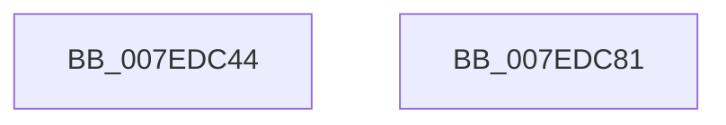

# HvInitializeHashLibrary

- RVA: `0x007EDC44`–`0x007EDC82` (길이 `62` bytes)
- VA: `0x00000001407EDC44`
- 실행 섹션: `PAGE`
- PDB 이름 있음: `예`; PDB Function 태그: `아니요`
- unwind 정보 RVA: `0x0005C788`
- 디코드: `14`개 명령, `62/62` bytes 표시
- 미해석 바이트: `0` (있으면 어셈블리에 `.byte`로 보존)

> 이 문서는 커널 이미지의 기계어와 PDB 기호를 분석해 생성했습니다. 4번과 5번은 함수 원형과 자료형을 바이너리 사용 방식에서 추정한 C 해석이며 원본 소스 복구 결과는 아닙니다.

## 1. Dependencies

- 직접 호출 지점: **2**; 고유 호출 대상: **2**
- 직접 호출자로 확인된 함수: **1**
- RIP 상대 이미지 참조: **1**

### Outgoing calls
- `0x007EDC48` → [SymCryptInit](../../text/5B/SymCryptInit_function_005B24F8.md) (function, `0x005B24F8`)
- `0x007EDC6E` → [SymCryptMarvin32ExpandSeed](../../text/51/SymCryptMarvin32ExpandSeed_function_0051F638.md) (function, `0x0051F638`)

### Direct callers
- [CmInitSystem1](../../init/C5/CmInitSystem1_function_00C559CC.md) at `0x00C55C59`

### Static image references
- `0x007EDC67` → RVA `0x00E2CB20` (`.data`; read)

## 2. Other-region calls and transfers

- 다른 실행 섹션으로 향하는 call: **2**
  - `0x007EDC48` → [SymCryptInit](../../text/5B/SymCryptInit_function_005B24F8.md) (`PAGE` → `.text`)
  - `0x007EDC6E` → [SymCryptMarvin32ExpandSeed](../../text/51/SymCryptMarvin32ExpandSeed_function_0051F638.md) (`PAGE` → `.text`)
- 별도 외부 분기/꼬리 이동을 확인하지 못했습니다.

## 3. Assembly (complete function range)

```asm
007EDC44  48 83 EC 28                     sub rsp, 0x28
007EDC48  E8 AB 48 DC FF                  call 0x1405b24f8
007EDC4D  48 B8 C5 55 4E 7A 88 4D EF 82   movabs rax, 0x82ef4d887a4e55c5
007EDC57  48 8D 54 24 30                  lea rdx, [rsp + 0x30]
007EDC5C  41 B8 08 00 00 00               mov r8d, 8
007EDC62  48 89 44 24 30                  mov qword ptr [rsp + 0x30], rax
007EDC67  48 8D 0D B2 EE 63 00            lea rcx, [rip + 0x63eeb2]
007EDC6E  E8 C5 19 D3 FF                  call 0x14051f638
007EDC73  F7 D8                           neg eax
007EDC75  1B C0                           sbb eax, eax
007EDC77  25 01 00 00 C0                  and eax, 0xc0000001
007EDC7C  48 83 C4 28                     add rsp, 0x28
007EDC80  C3                              ret
007EDC81  CC                              int3
```

## 4. C-style interpretation (structured pseudocode)

```c
__int64 __fastcall HvInitializeHashLibrary(void)
{
    __int64 result;
    __int64 v_rsp;
    unsigned __int64 v_stack_p8;

    v_rsp = (v_rsp) - (40);
    result = SymCryptInit(a1, a2, a3, a4);
    v_stack_p8 = result;
    result = SymCryptMarvin32ExpandSeed(v_rip + 6549170, v_stack_p8, 8, a4);
    result = (unsigned int)(-(result));
    result = (unsigned int)((result) & (0xC0000001ULL));
    v_rsp = (v_rsp) + (40);
    return result;
}
```

## 5. (Beta) C Style

```c
void HvInitializeHashLibrary(void)
{
    int64_t result;
    int64_t local_rsp;
    uint64_t v_stack_p8;

    local_rsp = (local_rsp) - (40);
    result = SymCryptInit(a1, a2, a3, a4);
    v_stack_p8 = result;
    result = SymCryptMarvin32ExpandSeed(v_rip + 6549170, v_stack_p8, 8, a4);
    result = (uint32_t)(-(result));
    result = (uint32_t)((result) & (0xC0000001ULL));
    local_rsp = (local_rsp) + (40);
    return result;
}
```

## 6. Execution-region graph

[열기: 2D/3D 그래프와 함수 탐색 컨트롤 패널](../../../control-panel.html?section=page&rva=0x007EDC44&view=graph)

- 2D 그래프는 위에서 아래로 흐르고, 3D 그래프는 빈 공간을 드래그해 회전합니다. Shift+드래그는 이동, 휠은 확대·축소, 함수 노드 선택은 대상 보고서 이동입니다.

### Static fallback


